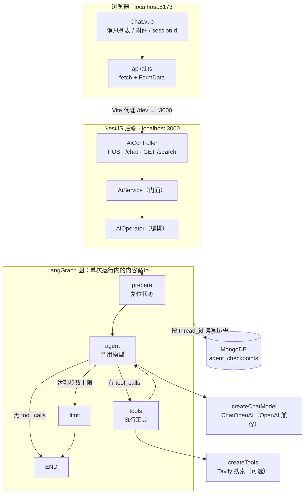
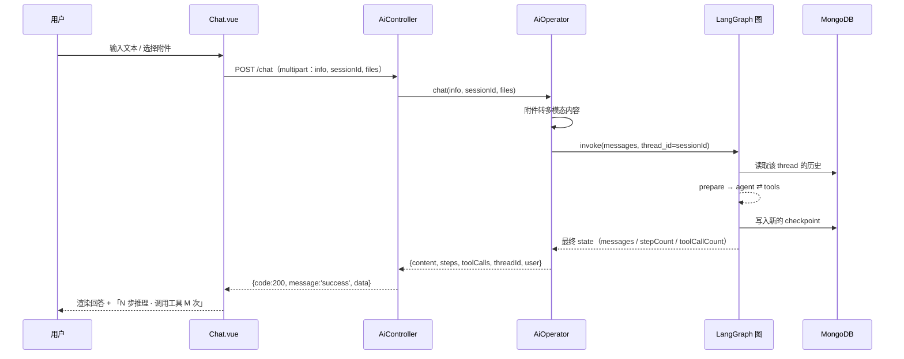
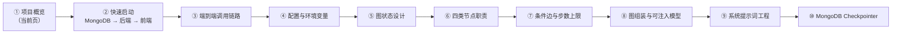

本页是整个文档体系的地图页。它只回答三个问题：**这个项目是什么**、**它由哪些部分组成**、**你应该按什么顺序读下去**。具体的图状态设计、节点实现、checkpoint 细节、前端上传策略等内容都各自有独立页面，这里只给出全局坐标与跳转入口。

Sources: [README.MD](README.MD#L1-L6)

## 一句话定位：没有账号系统的 agent 聊天机器人

这个项目是一个**单用户** AI 聊天机器人：没有登录、注册、邀请码、JWT，打开页面就能对话，系统内置唯一用户 `admin`，而模型 API Key 只存在于后端 `.env` 中。这个定位不是功能裁剪的副产物，而是整个架构的前提——它让「会话归属」这个通常由账号系统解决的复杂问题，退化成图状态里的一个常量。

Sources: [README.MD](README.MD#L1-L5), [state.ts](be/src/ai/graph/state.ts#L4-L12), [model.ts](be/src/ai/model.ts#L11-L29)

正因为身份是常量，后端几乎所有层都不需要处理鉴权上下文：`AiController` 的注释直接写明「单用户模式，没有登录/鉴权，所有请求默认以 admin 身份进入 LangGraph」；`GET /` 这个服务信息接口也把 `mode: 'single-user'` 和内置 admin 作为可被外部探测的返回值暴露出来。

Sources: [ai.controller.ts](be/src/ai/ai.controller.ts#L19-L25), [app.service.ts](be/src/app.service.ts#L6-L18)

## 三个决定架构走向的技术选择

理解这个仓库，最省力的方式是先记住三处「边界」：它们解释了为什么代码被切分成现在这个样子，也解释了为什么有些看起来该由 LangChain 做的事，被交给了 LangGraph。

| 选择 | 具体做法 | 代码位置 |
|---|---|---|
| **agent 循环交给 LangGraph** | 用 `StateGraph` + 条件边表达「模型 ⇄ 工具」循环，而不是手写 while 循环 | [graph.ts](be/src/ai/graph/graph.ts#L41-L59) |
| **LangChain 只保留模型层** | `model.ts` 只负责构造 `ChatOpenAI`，明确注释「只负责模型这一层」 | [model.ts](be/src/ai/model.ts#L31-L49) |
| **依赖注入取代手动 new** | `AiModule` 里把 `AiService`、`AiOperator` 都注册为 provider | [ai.module.ts](be/src/ai/ai.module.ts#L6-L12) |

第一处的关键证据在图的组装函数里：节点用工厂函数创建（`createPrepareNode` / `createAgentNode` / `createToolsNode` / `createLimitNode`），条件边用 `routeAfterAgent` 声明三种去向，`tools → agent` 这条回边正是循环的物理体现。换句话说，**「agent 是个循环」这件事在图结构里是显式的、可读的**，而不是藏在某个函数体内部。

Sources: [graph.ts](be/src/ai/graph/graph.ts#L24-L59), [edges.ts](be/src/ai/graph/edges.ts#L16-L33)

第二处体现在模型构造的可注入性上：节点只依赖一个最小接口 `ChatModelLike`（只要能 `invoke` 消息并返回 `AIMessage`），因此测试里可以塞假模型而不必真的请求外部 API。这个设计决策的直接收益是「图的循环、记忆、上限」都可以被脚本化验证。

Sources: [nodes.ts](be/src/ai/graph/nodes.ts#L6-L12), [AiOperator.ts](be/src/ai/operator/AiOperator.ts#L29-L52)

## 系统全景：三层进程与图的内部循环

下图把仓库里的主要模块一次性铺开。注意左侧「浏览器 → Vite 代理 → NestJS」是一条 HTTP 链路，而右侧「AiOperator → 图 → 模型/工具/MongoDB」是同一次请求内部发生的三次外呼，两者不在同一个抽象层级上。



后端启动时会统一挂载三样全局设施：CORS、`ResponseInterceptor`（响应包装）、`HttpExceptionFilter`（异常包装），以及 Swagger 文档（挂在 `/api`）。这意味着你看到的每个接口返回都已经是统一结构，而不是各个 controller 自己拼的格式。

Sources: [main.ts](be/src/main.ts#L9-L40), [response.interceptor.ts](be/src/common/filters/response.interceptor.ts#L16-L30)

前端只做两件事：把用户输入和附件打包成 `multipart/form-data` 发给 `/chat`，再把统一响应里的 `data.content` 渲染到气泡里。路由层面只有一条真实路由 `/chat`，其余路径全部重定向回聊天页——这是「没有登录页」在路由表上的直接投影。

Sources: [ai.ts](fe/src/api/ai.ts#L45-L73), [router/index.ts](fe/src/router/index.ts#L1-L27), [App.vue](fe/src/App.vue#L1-L6)

## 一次对话经过哪些手

把请求路径按顺序串起来，只需要记住五个交接点：`sessionId` 决定读写哪条历史 → `AiOperator` 把输入（含附件）变成图的状态 → 图在内部循环若干步 → `runGraph` 从最终 state 里抽出可展示字段 → 全局拦截器套上 `{code, message, data}`。



这条链路里的每个环节都有专页：`thread_id` 与「清空对话」的语义在 [thread_id 生命周期：sessionId 与「清空对话」的语义](11-thread_id-sheng-ming-zhou-qi-sessionid-yu-qing-kong-dui-hua-de-yu-yi)，附件转换在 [附件多模态转换：图片 Data URI、文本内联与长度治理](15-fu-jian-duo-mo-tai-zhuan-huan-tu-pian-data-uri-wen-ben-nei-lian-yu-chang-du-zhi-li)，统一响应契约在 [全局响应包装与异常过滤器：统一 {code, message, data} 契约](18-quan-ju-xiang-ying-bao-zhuang-yu-yi-chang-guo-lu-qi-tong-code-message-data-qi-yue)。本页只需确认一点：**前端的 `sessionId` 就是后端的 LangGraph `thread_id`**，这是短期记忆能跨请求延续的全部原因。

Sources: [AiOperator.ts](be/src/ai/operator/AiOperator.ts#L77-L140), [ai.controller.ts](be/src/ai/ai.controller.ts#L34-L47)

`AiOperator` 的定位值得单独强调：它的注释写明「只负责把输入变成图的状态、调用图、把结果整理成 HTTP 友好的结构」，真正的 agent 循环「全部由 LangGraph 图完成」。这条边界让「换模型」和「改循环」互不影响——前者只改 `model.ts`，后者只改 `graph/` 目录。

Sources: [AiOperator.ts](be/src/ai/operator/AiOperator.ts#L20-L28)

## 项目结构地图

```
chat_Robot/
├── be/                                  # 后端：NestJS 11 + LangGraph + MongoDB
│   ├── .env.example                     # 环境变量样板（唯一凭证是 MODEL_API_KEY）
│   └── src/
│       ├── main.ts                      # 启动：CORS / 拦截器 / 异常过滤器 / Swagger
│       ├── app.module.ts                # ConfigModule + MongooseModule + AiModule
│       ├── app.controller.ts            # GET /（服务信息）
│       ├── common/filters/              # 全局响应包装 + 异常过滤器
│       └── ai/
│           ├── ai.controller.ts         # POST /chat、GET /search
│           ├── ai.service.ts            # 门面层
│           ├── ai.module.ts             # DI 注册
│           ├── model.ts                 # ChatOpenAI 构造（唯一入口）
│           ├── operator/
│           │   ├── AiOperator.ts        # 编排：建图缓存 + 调用 + 结果整形
│           │   └── attachments.ts       # 附件 → 文本 / image_url
│           ├── graph/
│           │   ├── state.ts             # Annotation 定义 + ADMIN_USER
│           │   ├── nodes.ts             # prepare / agent / tools / limit
│           │   ├── edges.ts             # routeAfterAgent 条件边
│           │   ├── checkpointer.ts      # MongoDBSaver（连接复用）
│           │   ├── prompts.ts           # 系统提示词
│           │   └── graph.ts             # 图组装（可注入模型）
│           └── tools/index.ts           # 工具注册表（Tavily 可选）
├── fe/                                  # 前端：Vue 3 + Element Plus + Vite
│   └── src/
│       ├── api/ai.ts                    # fetch + FormData 调 /chat
│       ├── components/Chat.vue          # 唯一页面：消息 / 附件 / 输入
│       ├── router/index.ts              # 只有 /chat
│       └── App.vue                      # 只渲染 router-view
└── docs/agent-roadmap.md                # M0 → M7 能力升级路线图
```

把这张树压成一张「看什么」的表，会更容易上手：

| 你想搞清楚的事 | 直接打开 |
|---|---|
| 请求怎么进来、怎么包装 | [main.ts](be/src/main.ts#L9-L33)、[ai.controller.ts](be/src/ai/ai.controller.ts#L23-L47) |
| 编排层做了什么 | [AiOperator.ts](be/src/ai/operator/AiOperator.ts#L20-L140) |
| 图长什么样 | [graph.ts](be/src/ai/graph/graph.ts#L24-L59) |
| 状态里有什么字段 | [state.ts](be/src/ai/graph/state.ts#L23-L55) |
| 历史存在哪 | [checkpointer.ts](be/src/ai/graph/checkpointer.ts#L11-L63) |
| 模型和工具怎么配 | [model.ts](be/src/ai/model.ts#L15-L49)、[tools/index.ts](be/src/ai/tools/index.ts#L6-L27) |

Sources: [README.MD](README.MD#L7-L27)

## 技术栈与「谁负责什么」

依赖清单本身就是架构说明：`@langchain/langgraph` 负责编排，`@langchain/openai` 只提供模型客户端，`@langchain/langgraph-checkpoint-mongodb` 负责持久化，`@langchain/tavily` 是可选的工具能力，而 NestJS 全家桶负责 HTTP 层与 DI。

| 层 | 技术 | 职责边界 |
|---|---|---|
| 前端 | Vue 3、TypeScript、Element Plus、Vite | 渲染消息、管理附件与 `sessionId`、上传 |
| 后端 | NestJS 11、TypeScript | HTTP 接口、参数校验、统一响应 |
| Agent 编排 | **LangGraph** | 状态、节点、条件边、checkpoint |
| 模型层 | `@langchain/openai` | OpenAI 兼容协议，可指向 DeepSeek / Kimi / Qwen |
| 工具 | `@langchain/tavily` | 可选，未配置 Key 则不注册 |
| 存储 | MongoDB | 仅用于 LangGraph 的消息 checkpoint，不是业务库 |

Sources: [README.MD](README.MD#L29-L38), [be/package.json](be/package.json#L22-L41), [fe/package.json](fe/package.json#L11-L16)

有一个容易误解的点：**MongoDB 在这个项目里不是「聊天记录数据库」**，而是 LangGraph 的 checkpointer 后端。所以它存的是图的状态快照（collection 名为 `agent_checkpoints` / `agent_checkpoints_writes`），而不是你自定义的 `messages` 业务表。

Sources: [checkpointer.ts](be/src/ai/graph/checkpointer.ts#L44-L49), [README.MD](README.MD#L125-L130)

## 四个节点和一份状态：图的骨架

图只有四个节点，每个节点的职责可以用一句话说清；状态只有五个字段，其中只有 `messages` 是「累积」的，其余都是「覆盖」的。这个对比是理解整套记忆机制的关键。

| 节点 | 一句话职责 | 返回的 state 更新 |
|---|---|---|
| `prepare` | 每次运行开始复位运行时状态（单用户下 checkpointer 会让 state 跨请求保留，所以计数器必须显式清零） | `user` / `stepCount:0` / `toolCallCount:0` / `maxSteps` |
| `agent` | 拼 system prompt 后调用模型，步数 +1 | `messages: [response]` / `stepCount+1` |
| `tools` | 执行上一条 AIMessage 里的 tool_calls，把 ToolMessage 回灌 | `messages: toolMessages` / `toolCallCount+n` |
| `limit` | 达到步数上限时的兜底出口，直接给用户一条说明 | 一条提示性 `AIMessage` |

Sources: [nodes.ts](be/src/ai/graph/nodes.ts#L14-L78)

| 状态字段 | 归约方式 | 为什么这样设计 |
|---|---|---|
| `messages` | `messagesStateReducer`（累积） | 对话历史需要追加，且由 checkpoint 持久化 |
| `user` | 覆盖 | 单用户固定 `admin`，无需合并 |
| `stepCount` | 覆盖 | 本次运行的推理步数，由 `prepare` 清零 |
| `toolCallCount` | 覆盖 | 本次运行的工具调用次数，用于观测 |
| `maxSteps` | 覆盖 | 由 `prepare` 按环境变量每次重写 |

Sources: [state.ts](be/src/ai/graph/state.ts#L23-L55)

`agent` 节点里还有一个容易被忽略的工程细节：system prompt **不写入消息历史**，而是每次调用时临时拼在最前面（并先把历史里的 system 消息过滤掉）。原因写在注释里——避免 checkpointer 里堆积重复的 system message。这类「状态污染」问题在带持久化记忆的图里非常典型。

Sources: [nodes.ts](be/src/ai/graph/nodes.ts#L27-L44)

## 单用户模式省掉了什么，又留下了什么

| 维度 | 有账号系统的常见做法 | 本项目的做法 | 影响 |
|---|---|---|---|
| 身份来源 | 从 JWT / Session 解析 | 图状态里的常量 `ADMIN_USER` | 所有请求天然同一身份 |
| 会话归属 | 校验「这条会话是不是你的」 | 直接用前端传来的 `sessionId` 当 `thread_id` | 无越权概念，也无需会话表 |
| 凭证管理 | 用户各自配置模型 Key | 只读后端 `.env` | 用户唯一需要的凭证是「部署者配好的服务」 |
| 清空对话 | 服务端删除记录 | 前端换一个 `sessionId` | 旧 thread 留在库里，只是不再被访问 |
| 路由 | 登录页 + 守卫 | 只有 `/chat`，其余重定向 | 打开即用 |

Sources: [state.ts](be/src/ai/graph/state.ts#L4-L18), [ai.ts](fe/src/api/ai.ts#L29-L33), [Chat.vue](fe/src/components/Chat.vue#L112-L128)

表格最后两行是理解「清空对话」语义的入口：`Chat.vue` 的清空函数在重置消息列表的同时执行了 `sessionId.value = crypto.randomUUID()`，也就是说**清空动作发生在前端，服务端并不知道**。这个设计的完整推演在 [thread_id 生命周期：sessionId 与「清空对话」的语义](11-thread_id-sheng-ming-zhou-qi-sessionid-yu-qing-kong-dui-hua-de-yu-yi)。

Sources: [Chat.vue](fe/src/components/Chat.vue#L241-L252)

## API 一览

三个接口构成最小可用面：一个带记忆的多轮对话、一个不带记忆的单轮问答、一个服务信息探测。

| 接口 | 方法 | 是否写记忆 | 关键参数 | 返回要点 |
|---|---|---|---|---|
| `/chat` | POST（multipart） | 是（`thread_id = sessionId`） | `info`、`sessionId`、`files[]` | `content` / `steps` / `toolCalls` / `threadId` / `user` / `tokenUsage` |
| `/search` | GET | 否（随机 `search-${uuid}` 一次性 thread） | `info` | `content` / `steps` / `toolCalls` / `tokenUsage` |
| `/` | GET | — | — | `mode: 'single-user'`、内置 admin、图节点列表、checkpointer 类型 |

Sources: [ai.controller.ts](be/src/ai/ai.controller.ts#L27-L47), [AiOperator.ts](be/src/ai/operator/AiOperator.ts#L54-L113), [app.service.ts](be/src/app.service.ts#L6-L18)

所有响应都会被 `ResponseInterceptor` 统一包成 `{ code: 200, message: 'success', data }`，所以前端判断成功与否时看的是 `payload.code`，而不是 HTTP 状态码（前端代码里 `!response.ok || payload.code !== 200` 两条件并存，正是这个约定的体现）。

Sources: [response.interceptor.ts](be/src/common/filters/response.interceptor.ts#L16-L30), [ai.ts](fe/src/api/ai.ts#L56-L72), [README.MD](README.MD#L82-L97)

## 怎么验证它真的在跑

这个仓库的测试策略很清晰：**把不确定性最高的部分（图的循环、记忆、上限）交给假模型验证，把 IO 部分（附件解析）交给纯函数验证，把真实链路留给 e2e**。

| 入口 | 命令 | 验证的内容 | 前置条件 |
|---|---|---|---|
| 图单元测试 | `cd be && pnpm test` | agent→tools→agent 循环、同 `thread_id` 的记忆、达到上限走 `limit`、`routeAfterAgent` 三种分支 | 无 |
| 附件单元测试 | 同上 | 文本内联、图片转 data URI、超长截断、非法类型抛错 | 无 |
| e2e | `pnpm test:e2e` | 真实 HTTP + 真实 checkpoint | 需要可用的 MongoDB |
| 前端构建 | `cd fe && npm run build` | `vue-tsc` 类型检查 + 打包 | 无 |

Sources: [graph.spec.ts](be/src/ai/graph/graph.spec.ts#L48-L156), [attachments.spec.ts](be/src/ai/operator/attachments.spec.ts#L19-L112), [README.MD](README.MD#L147-L154)

这些测试的存在也解释了 `buildChatGraph` 为什么把 `model` 和 `checkpointer` 都做成参数：测试可以只在需要记忆的用例里传 `MemorySaver` 类的 checkpointer，其余用例走无 checkpoint 的纯图。想追溯这个设计动机，读 [脚本化假模型驱动图测试：循环、记忆与上限断言](23-jiao-ben-hua-jia-mo-xing-qu-dong-tu-ce-shi-xun-huan-ji-yi-yu-shang-xian-duan-yan) 与 [图组装与可注入模型接口：让编排可测试](8-tu-zu-zhuang-yu-ke-zhu-ru-mo-xing-jie-kou-rang-bian-pai-ke-ce-shi)。

Sources: [graph.ts](be/src/ai/graph/graph.ts#L13-L59)

## 建议的阅读路线

下面这条路线遵循「先跑起来，再理解链路，最后钻进图里」的顺序。前三页属于 Get Started，读完你就拥有了可运行的系统和一张调用链路图；从第四页起进入 Deep Dive，按「状态 → 节点 → 路由 → 组装 → 提示词 → 持久化」的顺序推进，正好对应图的五个组成部分。



| 阶段 | 页面 | 读完后的产出 |
|---|---|---|
| 起步 | [快速启动：MongoDB、后端与前端三步跑通](2-kuai-su-qi-dong-mongodb-hou-duan-yu-qian-duan-san-bu-pao-tong) | 本地跑通并发出第一条消息 |
| 起步 | [端到端调用链路：从输入框到图执行再到统一响应](3-duan-dao-duan-diao-yong-lian-lu-cong-shu-ru-kuang-dao-tu-zhi-xing-zai-dao-tong-xiang-ying) | 能在脑中复述一次请求的完整路径 |
| 起步 | [配置与环境变量：唯一的凭证是模型 API Key](4-pei-zhi-yu-huan-jing-bian-liang-wei-de-ping-zheng-shi-mo-xing-api-key) | 知道哪些变量必填、哪些可省 |
| 深入 | [图状态设计：Annotation 与单用户 admin 身份](5-tu-zhuang-tai-she-ji-annotation-yu-dan-yong-hu-admin-shen-fen) | 理解 `Annotation.Root` 与 reducer 语义 |
| 深入 | [四类节点的职责：prepare / agent / tools / limit](6-si-lei-jie-dian-de-zhi-ze-prepare-agent-tools-limit) | 说得清每个节点为什么存在 |
| 深入 | [条件边路由与步数上限：防止工具调用死循环](7-tiao-jian-bian-lu-you-yu-bu-shu-shang-xian-fang-zhi-gong-ju-diao-yong-si-xun-huan) | 理解 `routeAfterAgent` 的三分支 |
| 深入 | [MongoDB Checkpointer：短期记忆的落库与读取](10-mongodb-checkpointer-duan-qi-ji-yi-de-luo-ku-yu-du-qu) | 知道历史到底存在哪两张 collection |

若你的目标是**改造它**而不是读懂它，可以先跳到 [里程碑路线图与自检机制：M0 → M7 的推进方法](26-li-cheng-bei-lu-xian-tu-yu-zi-jian-ji-zhi-m0-m7-de-tui-jin-fang-fa)，那里给出了从当前状态到 RAG、SSE、记忆分层的增量推进方式，以及每一步的自检标准。