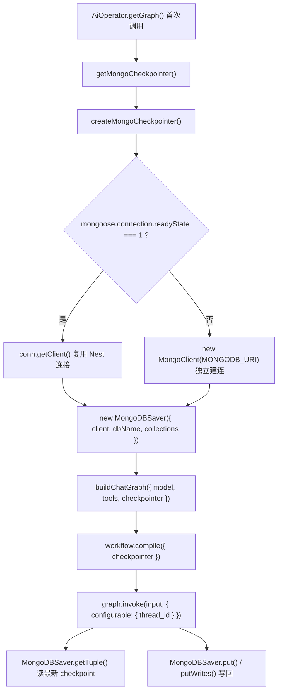
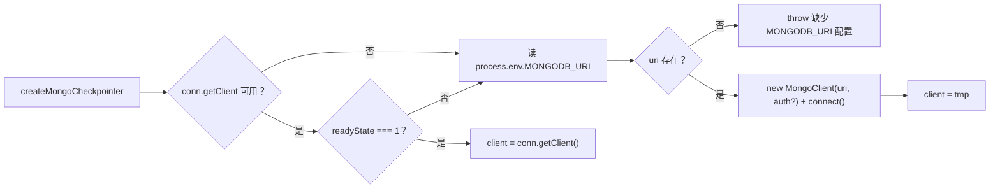
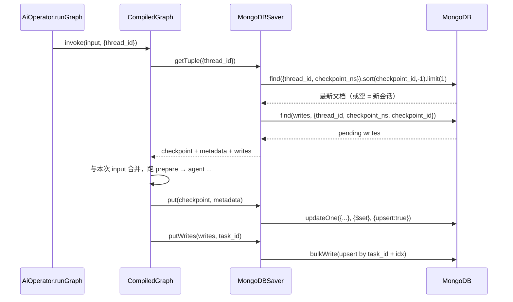

LangGraph 的 `StateGraph` 本身是无状态的：一次 `invoke` 结束后，state 里的消息就消失了。让「第二轮对话记得第一轮」这件事成立的全部机制，都集中在 `MongoDBSaver` 这一个对象上。本页只讨论这个 checkpointer 的构造方式、落库文档形态、读取路径，以及它存在之后对节点实现造成的两个反向约束（计数器清零、system prompt 不入库）。`thread_id` 的生成与「清空对话」的语义属于另一个独立话题，见 [thread_id 生命周期：sessionId 与「清空对话」的语义](11-thread_id-sheng-ming-zhou-qi-sessionid-yu-qing-kong-dui-hua-de-yu-yi)。

Sources: [checkpointer.ts](be/src/ai/graph/checkpointer.ts#L1-L64)

## 边界先划清：checkpointer 存的是「整个 state」，不是「聊天记录」

一个常见的误解是把 checkpointer 理解为「把消息数组 append 到数据库」。实际上 LangGraph 的 checkpoint 保存的是**该 thread 上所有 channel 的当前值与写入链**，`messages` 只是其中一个 channel。在本项目里这意味着一件容易被忽略的事：`stepCount`、`toolCallCount`、`maxSteps` 这些纯运行时字段同样会被持久化并在下一轮被恢复。

正是这个事实解释了 `prepare` 节点为何存在——它不是初始化，而是**复位**。节点注释写得很直接：「有 checkpointer 时 state 会跨请求保留，因此计数器必须显式清零」。如果没有 checkpointer（比如单元测试里不传），这段复位是冗余的；一旦接上 Mongo，它就是防止第二轮刚开口就触发步数上限的必要条件。

Sources: [state.ts](be/src/ai/graph/state.ts#L23-L52), [nodes.ts](be/src/ai/graph/nodes.ts#L14-L25)

从记忆分层的角度，这个对象只承担「短期记忆」：绑定单个会话、生命期与 `thread_id` 绑定。跨会话的用户偏好这类长期记忆需要 `store`，本项目并未使用，取舍分析见 [中间件层与记忆分层：成本控制、上下文治理与 store](27-zhong-jian-jian-ceng-yu-ji-yi-fen-ceng-cheng-ben-kong-zhi-shang-xia-wen-zhi-li-yu-store)。

Sources: [agent-roadmap.md](docs/agent-roadmap.md#L161-L177)

## 装配链路：三个对象决定一次记忆读写

记忆能力不是某个开关，而是三处装配的合成结果：`getMongoCheckpointer()` 产出 saver 实例，`buildChatGraph({ checkpointer })` 把它编进图，`graph.invoke(..., { configurable: { thread_id } })` 在调用时决定读哪个 thread。



`compile` 处的三元表达式是唯一的分叉点：传了 checkpointer 就是有记忆的图，没传就是无状态图。这让同一份图定义既能跑生产（Mongo），也能跑单测（`MemorySaver` 或不传）。

Sources: [graph.ts](be/src/ai/graph/graph.ts#L13-L22), [graph.ts](be/src/ai/graph/graph.ts#L41-L59), [AiOperator.ts](be/src/ai/operator/AiOperator.ts#L29-L52)

下表把链路里每个对象的职责与源码位置固定下来，便于对照排查：

| 环节 | 代码位置 | 职责 | 失败/缺省行为 |
|---|---|---|---|
| saver 构造 | `createMongoCheckpointer` | 拿 `MongoClient`、定 `dbName`、定集合名 | 无 `MONGODB_URI` 且非复用路径 → 抛错 |
| saver 缓存 | `getMongoCheckpointer` | 进程内单例 | 失败时清空 promise，下次请求重试 |
| 图装配 | `buildChatGraph` | 决定 `compile` 是否带 checkpointer | 未传则不持久化 |
| 图缓存 | `AiOperator.getGraph` | 进程内单例 graph | 初始化失败清空缓存 |
| 调用 | `runGraph` | 从入参拼 `configurable.thread_id` | `thread_id` 缺失时 Mongo 层直接抛错 |

Sources: [checkpointer.ts](be/src/ai/graph/checkpointer.ts#L11-L63), [AiOperator.ts](be/src/ai/operator/AiOperator.ts#L29-L52), [AiOperator.ts](be/src/ai/operator/AiOperator.ts#L115-L127)

## 从哪拿连接：优先复用 mongoose，否则独立建连

`createMongoCheckpointer` 的第一件事不是建连，而是**判断要不要建连**。判定条件是两个同时成立：`mongoose.connection` 上存在 `getClient` 函数，且 `readyState === 1`（已连接）。满足就取 mongoose 底层的原生 client 交给 `MongoDBSaver`，不新建连接池。



Sources: [checkpointer.ts](be/src/ai/graph/checkpointer.ts#L12-L37)

两条路径的差异值得用一张表固定，因为它们在「凭证从哪来」这点上并不对称：

| 维度 | 复用路径（`readyState === 1`） | 独立建连路径 |
|---|---|---|
| 触发条件 | mongoose 已连接 | mongoose 未就绪或 API 不可用 |
| 连接串来源 | mongoose 内部已持有的 client | `process.env.MONGODB_URI` |
| 认证信息 | 由 mongoose 配置决定 | 代码显式读 `user` / `pass` / `authSource`（默认 `admin`），两者都非空才启用 `auth` |
| 缺失配置时 | 不适用 | 抛 `缺少 MONGODB_URI 配置：LangGraph 的 checkpoint 需要 MongoDB` |
| 连接归属 | Nest 生命周期管理 | 由本模块创建，代码中无 `close()` 调用 |

Sources: [checkpointer.ts](be/src/ai/graph/checkpointer.ts#L15-L37), [app.module.ts](be/src/app.module.ts#L17-L31)

这里的 `readyState === 1` 判断本身就是对启动时序的防御：Nest 的 `MongooseModule.forRootAsync` 是异步的，若 `AiOperator` 在 mongoose 连上之前就被触发，走复用路径会拿到不可用的连接。本项目选择「探测失败就自己连」，代价是可能短暂出现两个连接池。这条时序链路的完整分析在 [Mongoose 连接复用与启动时序陷阱](12-mongoose-lian-jie-fu-yong-yu-qi-dong-shi-xu-xian-jing)，此处只需记住判定点在哪。

Sources: [checkpointer.ts](be/src/ai/graph/checkpointer.ts#L8-L16), [app.module.ts](be/src/app.module.ts#L14-L31)

## 库名与集合：三级回退与两个集合的分工

`dbName` 的取值是一条显式优先级链：`process.env.DB_NAME` → `mongoose.connection.db.databaseName` → 硬编码 `'chat_robot'`。这条链的意义在于「不配置也能跑」——URI 里已经带了库名（如 `mongodb://127.0.0.1:27017/chat_robot`）时，第三级与第二级会给出同一结果。反过来说，它也是一类隐蔽 bug 的来源：URI 指向 A 库、`DB_NAME` 却指向 B 库时，写入与后续读取会落在不同库，表现为「第二轮失忆」。

Sources: [checkpointer.ts](be/src/ai/graph/checkpointer.ts#L39-L42), [.env.example](be/.env.example#L17-L24)

集合名是硬编码的两个：`agent_checkpoints` 与 `agent_checkpoints_writes`。前者存每个 checkpoint 的完整快照（含序列化后的 state 与 metadata），后者存 checkpoint 之间的中间写入（pending writes）。查询最新状态只需读前者，但一次完整的状态重建两者都要读。

| 集合 | 写入时机 | 文档主键语义 | 用途 |
|---|---|---|---|
| `agent_checkpoints` | 每产生一个 checkpoint | `{thread_id, checkpoint_ns, checkpoint_id}` | 最新 state 快照 + `parent_checkpoint_id` 形成链 |
| `agent_checkpoints_writes` | 节点产生中间写入时 | `{thread_id, checkpoint_ns, checkpoint_id, task_id, idx}` | 该 checkpoint 下各 channel 的增量写入 |

Sources: [checkpointer.ts](be/src/ai/graph/checkpointer.ts#L44-L49), [index.js](be/node_modules/@langchain/langgraph-checkpoint-mongodb/dist/index.js#L112-L171)

`MongoDBSaverParams` 还支持 `enableTimestamps`——置真时每次 upsert 附加 `upserted_at` BSON 日期，便于做 TTL 索引或审计。本项目的构造调用只传了 `client` / `dbName` / 两个集合名，没有启用它，这也意味着集合目前没有任何自动过期能力。

Sources: [index.d.ts](be/node_modules/@langchain/langgraph-checkpoint-mongodb/dist/index.d.ts#L6-L16), [checkpointer.ts](be/src/ai/graph/checkpointer.ts#L44-L49)

## 落库与读取的文档形态：一次 invoke 的读写时序

调用链上的读写是「先读最新，再逐节点写」。`getTuple` 在 config 里没有 `checkpoint_id` 时构造的查询是 `{thread_id, checkpoint_ns}`，按 `checkpoint_id` 降序取 1 条——即该 thread 的最后一帧。拿到文档后，它用 serde 反序列化 `checkpoint` 与 `metadata` 两个 BSON 字段，并按 `{thread_id, checkpoint_ns, checkpoint_id}` 去 writes 集合捞出 pending writes 一并返回。

Sources: [index.js](be/node_modules/@langchain/langgraph-checkpoint-mongodb/dist/index.js#L31-L71)

写入侧是 `updateOne` + `upsert: true`，也就是说同一个 `{thread_id, checkpoint_ns, checkpoint_id}` 重复写是幂等的，同时把 `config.configurable.checkpoint_id` 记进新文档的 `parent_checkpoint_id`，从而让同一 thread 的多个 checkpoint 串成一条可回溯的链。



Sources: [index.js](be/node_modules/@langchain/langgraph-checkpoint-mongodb/dist/index.js#L31-L71), [index.js](be/node_modules/@langchain/langgraph-checkpoint-mongodb/dist/index.js#L112-L171)

`put` 里有一处硬校验：`thread_id === undefined` 直接抛 `The provided config must contain a configurable field with a "thread_id" field`。本项目在 `runGraph` 里用 `sessionId || 'default'` 兜底，因此正常路径不会触发；但这也意味着所有未传 `sessionId` 的请求会**共用同一个 `'default'` thread**，彼此串上下文。

Sources: [index.js](be/node_modules/@langchain/langgraph-checkpoint-mongodb/dist/index.js#L112-L117), [AiOperator.ts](be/src/ai/operator/AiOperator.ts#L101-L103)

## 进程内单例：为什么 saver 与 graph 都必须只造一次

`getMongoCheckpointer` 用一个模块级 `checkpointerPromise` 做缓存，而不是缓存已 resolve 的实例。这个细节是为了处理并发：两个请求同时首次到达时，拿到的是同一个 promise，`createMongoCheckpointer` 只会执行一次。失败时在 `catch` 里把 promise 置回 `null` 再抛出，下一次请求得以重试——不需要重启进程。

Sources: [checkpointer.ts](be/src/ai/graph/checkpointer.ts#L52-L63)

`AiOperator.getGraph` 复刻了同一套模式，且多包了一层：`tools`、`model`、`checkpointer` 的构造全部塞进那个 async IIFE，`buildChatGraph` 只执行一次。失败同样清空缓存，注释给出的理由很实用：「初始化失败（比如没配 API Key）时清空缓存，修好配置后无需重启即可重试」。

| 缓存 | 位置 | 复用对象 | 失败策略 |
|---|---|---|---|
| `checkpointerPromise` | `checkpointer.ts` | `MongoDBSaver` + 其下的 client | 置 `null`，下次重试 |
| `graphPromise` | `AiOperator.ts` | 编译后的 `ChatGraph` | 置 `null`，下次重试 |

Sources: [AiOperator.ts](be/src/ai/operator/AiOperator.ts#L27-L52), [checkpointer.ts](be/src/ai/graph/checkpointer.ts#L52-L63)

## 反作用力：checkpoint 存在之后，节点必须做两件事

记忆一旦开启，节点实现就不能再假设「state 是空的」。第一件事是计数器清零，前面已述。第二件事是 **system prompt 不能进 state**。`agent` 节点在调用模型前先把历史里的 system 消息过滤掉，再把 `SYSTEM_PROMPT` 临时拼到最前面：

```ts
const history = state.messages.filter((message) => message.getType() !== 'system');
const response = await model.invoke([new SystemMessage(SYSTEM_PROMPT), ...history]);
```

Sources: [nodes.ts](be/src/ai/graph/nodes.ts#L27-L44)

这样做的收益只在与 checkpointer 组合时才成立：消息历史会被无限追加，若每轮都把 system prompt 写进 `messages`，checkpoint 里会堆积 N 份内容相同的 system message，既浪费上下文窗口也浪费 token。反过来看，`messages` 的 reducer 是 `messagesStateReducer`（追加语义），这也正是「历史会增长」的机制来源。

Sources: [nodes.ts](be/src/ai/graph/nodes.ts#L30-L38), [state.ts](be/src/ai/graph/state.ts#L31-L35)

## 验收证据：如何证明「真的记住了」

单元测试没有连 Mongo，而是换成 `MemorySaver`——同一个 `BaseCheckpointSaver` 接口的内存实现。这样验证的是**图的记忆语义**，而不是 MongoDB 的连通性。核心断言是第二次 `invoke` 时模型收到的消息条数为 6：system + 上一轮 4 条（人类消息、带 tool_calls 的 AIMessage、ToolMessage、最终 AIMessage）+ 本轮新的人类消息。

Sources: [graph.spec.ts](be/src/ai/graph/graph.spec.ts#L79-L113)

| 断言 | 证明的结论 |
|---|---|
| `model.calls[2]` 长度为 6 | 同 `thread_id` 的下一轮读到了上一轮完整历史 |
| 换 `thread_id` 后 `model.calls[3]` 长度为 2 | 上下文按 thread 隔离，不共享 |
| 不传 `checkpointer` 的用例仍能跑 | checkpointer 是可选的，未注入即无状态 |
| `afterEach(close)` 前 seed 一次数据清理 | 测试隔离依赖内存 saver，不污染真实库 |

Sources: [graph.spec.ts](be/src/ai/graph/graph.spec.ts#L85-L113), [graph.ts](be/src/ai/graph/graph.ts#L56-L58)

e2e 则是另一回事：`AppModule` 会真正构建 mongoose 连接，因此没有 MongoDB 时 e2e 会失败，文档里明确写了「没有数据库时只跑单元测试」。

Sources: [app.e2e-spec.ts](be/test/app.e2e-spec.ts#L7-L10), [README.md](be/README.md#L150-L154)

## 两个入口的记忆语义：`/chat` 复用，`/search` 只增不删

`chat` 把 `sessionId` 直接当 `thread_id`（缺省 `'default'`），并把最终 `threadId` 回传给前端，形成可追踪的会话标识。`searchInfo` 走的是 `search-${randomUUID()}`——每次都是全新的 thread。

```ts
// searchInfo：一次性 thread，不复用任何历史
const result = await this.runGraph(graph, askResult, `search-${randomUUID()}`);
```

Sources: [AiOperator.ts](be/src/ai/operator/AiOperator.ts#L54-L71), [AiOperator.ts](be/src/ai/operator/AiOperator.ts#L115-L122)

这在语义上确实是「单轮问答、不读旧记忆」，但在存储层面需要清楚它的后果：图是带 checkpointer 编译的，因此每次 `/search` 都会在 `agent_checkpoints` 里为那个随机 thread 至少写入一帧，且代码中没有任何清理调用——`deleteThread` 只在依赖库内部定义，`src` 里没有出现。也就是说这些文档会一直留存。

Sources: [AiOperator.ts](be/src/ai/operator/AiOperator.ts#L29-L43), [index.js](be/node_modules/@langchain/langgraph-checkpoint-mongodb/dist/index.js#L172-L175)

如果要做治理，库里已经提供两个抓手：`deleteThread(threadId)` 可精确清除单个会话的两个集合文档；`enableTimestamps: true` 会附加 `upserted_at`，可配合 TTL 索引做时间维度过期。当前代码对两者都未启用，属于明确的扩展空间而非已实现能力。

Sources: [index.d.ts](be/node_modules/@langchain/langgraph-checkpoint-mongodb/dist/index.d.ts#L11-L16), [index.js](be/node_modules/@langchain/langgraph-checkpoint-mongodb/dist/index.js#L172-L175)

## 故障排查对照表

| 现象 | 最可能根因 | 定位点 |
|---|---|---|
| 首聊即报「缺少 MONGODB_URI 配置」 | 环境变量未加载到 `process.env`，且 mongoose 未就绪 | [checkpointer.ts](be/src/ai/graph/checkpointer.ts#L18-L21) |
| 进程启动正常但对话报连接错误 | 独立建连路径的 `MONGODB_URI` 不可达 | [checkpointer.ts](be/src/ai/graph/checkpointer.ts#L26-L36) |
| 第二轮完全失忆 | 每轮 `sessionId` 不同；或 `DB_NAME` 与 URI 库名不一致导致读写落到不同库 | [AiOperator.ts](be/src/ai/operator/AiOperator.ts#L102-L103)、[checkpointer.ts](be/src/ai/graph/checkpointer.ts#L39-L42) |
| 不传 `sessionId` 的请求互相串上下文 | 兜底值 `'default'` 让它们共享同一 thread | [AiOperator.ts](be/src/ai/operator/AiOperator.ts#L102) |
| 第二轮立刻触发步数上限 | 计数器未复位（有人改了 `prepare` 返回值） | [nodes.ts](be/src/ai/graph/nodes.ts#L18-L25) |
| 集合里 system 消息越积越多 | `agent` 节点未过滤 system 类型 | [nodes.ts](be/src/ai/graph/nodes.ts#L35-L38) |
| `pnpm test:e2e` 失败但单元测试通过 | 缺少可用 MongoDB | [app.e2e-spec.ts](be/test/app.e2e-spec.ts#L7-L10) |

Sources: [checkpointer.ts](be/src/ai/graph/checkpointer.ts#L11-L50), [AiOperator.ts](be/src/ai/operator/AiOperator.ts#L96-L103), [nodes.ts](be/src/ai/graph/nodes.ts#L14-L44)

## 自检与下一步

如果你想确认自己真正理解了这一层，可以尝试回答三个问题：为什么 `getMongoCheckpointer` 缓存的是 promise 而不是实例？如果把 `SYSTEM_PROMPT` 改成写进 `messages`，checkpoint 里第一个变大的字段是什么？`/search` 调用 100 次后，`agent_checkpoints` 里新增了多少个不同 `thread_id`？

继续深入建议按以下顺序：先看 [thread_id 生命周期：sessionId 与「清空对话」的语义](11-thread_id-sheng-ming-zhou-qi-sessionid-yu-qing-kong-dui-hua-de-yu-yi) 了解 `thread_id` 如何从请求流到 saver 以及「清空对话」如何实现；再看 [Mongoose 连接复用与启动时序陷阱](12-mongoose-lian-jie-fu-yong-yu-qi-dong-shi-xu-xian-jing) 补齐连接层的时序细节；若关心记忆的产品化演进，读 [中间件层与记忆分层：成本控制、上下文治理与 store](27-zhong-jian-jian-ceng-yu-ji-yi-fen-ceng-cheng-ben-kong-zhi-shang-xia-wen-zhi-li-yu-store)。