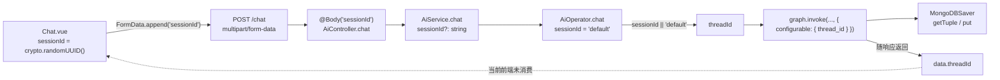
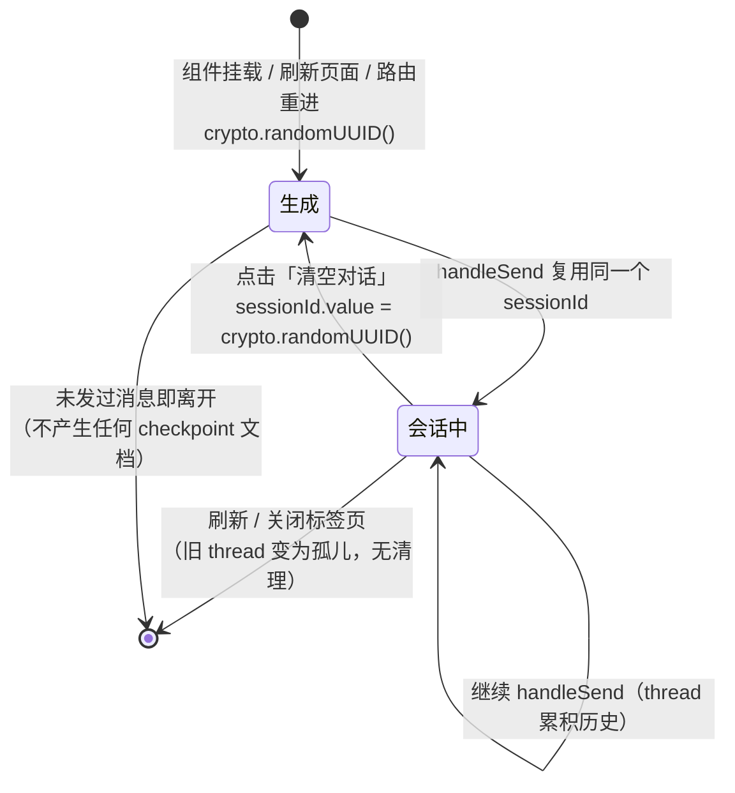
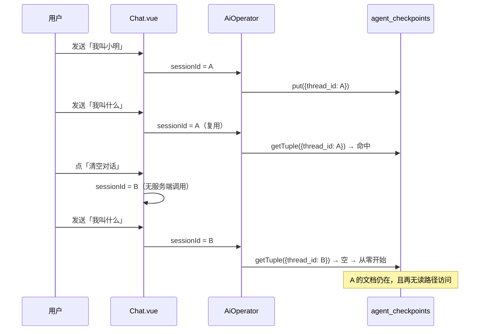

本页只讨论一件事：那个在 MongoDB 里决定「这次对话记得住什么」的字符串，**从哪来、用多久、什么时候被换掉**。前置的存储机制（`MongoDBSaver` 如何读写两个集合）已在 [MongoDB Checkpointer：短期记忆的落库与读取](10-mongodb-checkpointer-duan-qi-ji-yi-de-luo-ku-yu-du-qu) 中拆解，这里不再重复；本页聚焦前端那一个 `crypto.randomUUID()` 与后端 `thread_id` 之间的映射关系，以及点击「清空对话」时到底发生了什么——结论会有些反直觉：**它清空的是指针，不是数据**。

Sources: [AiOperator.ts](be/src/ai/operator/AiOperator.ts#L73-L113), [Chat.vue](fe/src/components/Chat.vue#L245-L254)

## 一个字符串决定全部记忆：thread_id 是地址，不是记录 id

理解本页所有细节的前提，是把 `thread_id` 定位成**寻址键**而非数据主键。`runGraph` 只做一件事：把外部传入的 `threadId` 塞进 `configurable.thread_id`，然后 `graph.invoke`。图内部没有任何逻辑去校验这个值是否是「当前用户」或「当前会话」，它只是被原样往下传。

Sources: [AiOperator.ts](be/src/ai/operator/AiOperator.ts#L115-L127)

到了 saver 层，这个字符串变成查询条件的主体。`getTuple` 在没有 `checkpoint_id` 时构造的查询是 `{ thread_id, checkpoint_ns }`，按 `checkpoint_id` 降序取一条——即该 thread 的最后一帧；`put` 则用 `{ thread_id, checkpoint_ns, checkpoint_id }` 做 upsert。换言之：**同一个值 = 续写上一段记忆；不同的值 = 从空白开始**，中间没有别的开关。

Sources: [index.js](be/node_modules/@langchain/langgraph-checkpoint-mongodb/dist/index.js#L31-L49), [index.js](be/node_modules/@langchain/langgraph-checkpoint-mongodb/dist/index.js#L112-L140)

这也解释了 `state.ts` 里那句注释为什么把两件事写在一起——「`messages`：对话消息历史，由 checkpointer 按 `thread_id` 持久化」。消息本身不带会话归属字段，它的归属完全由这次 `invoke` 的 `config` 决定。

Sources: [state.ts](be/src/ai/graph/state.ts#L23-L35)

## 命名流转：同一个值穿过五层，改四次名字

这个值在前端被称作 `session`，在后端被称作 `thread`，在 HTTP 层又被写成驼峰。下表把它途经的每一站与变换动作固定下来，便于在一处断链时快速定位：

| 层 | 载体 / 名称 | 变换动作 | 源码 |
|---|---|---|---|
| 浏览器 | `sessionId`（Vue `ref`） | `crypto.randomUUID()` 生成 | [Chat.vue](fe/src/components/Chat.vue#L120) |
| 请求体 | `formData` 字段 `sessionId` | `?? ''` 空值兜底为空串 | [ai.ts](fe/src/api/ai.ts#L48-L50) |
| Controller | `@Body('sessionId') sessionId` | 从 multipart 表单取字段 | [ai.controller.ts](be/src/ai/ai.controller.ts#L41-L47) |
| Service | `chat(info, sessionId?, files?)` | 纯转发，类型上可缺省 | [ai.service.ts](be/src/ai/ai.service.ts#L16-L18) |
| Operator | 形参默认值 `'default'` → 局部变量 `threadId` | `sessionId \|\| 'default'` 二次兜底 | [AiOperator.ts](be/src/ai/operator/AiOperator.ts#L77-L103) |
| 图调用 | `configurable.thread_id` | 下划线风格，LangGraph 契约名 | [AiOperator.ts](be/src/ai/operator/AiOperator.ts#L119-L122) |

Sources: [ai.ts](fe/src/api/ai.ts#L45-L56), [AiOperator.ts](be/src/ai/operator/AiOperator.ts#L101-L103)

图中最后那条虚线是这个设计里最值得注意的缺口：`threadId` 已经随响应回传，但前端从未读取它。

Sources: [AiOperator.ts](be/src/ai/operator/AiOperator.ts#L105-L112), [ai.ts](fe/src/api/ai.ts#L8-L19)

## 生命周期三态：生成、复用、换新（以及一个隐式死亡）

`sessionId` 不是 `localStorage` 里的持久标识，而是组件 `setup` 作用域内的一个 `ref`。这意味着它的生命周期严格绑定在「`Chat.vue` 组件实例」上，而组件的创建与销毁由路由与刷新决定。

Sources: [Chat.vue](fe/src/components/Chat.vue#L117-L125), [index.ts](fe/src/router/index.ts#L1-L23)

三个转移点对应三行代码，它们在源码里的位置非常集中，值得直接记住：

| 事件 | 代码 | 语义后果 |
|---|---|---|
| 生成 | `const sessionId = ref(crypto.randomUUID())` | 每次挂载一条全新 thread，首轮即「失忆」 |
| 复用 | `chatKimi({ info: text, sessionId: sessionId.value, files })` | 同值 → 命中上一帧 checkpoint → 模型看到完整历史 |
| 换新 | `sessionId.value = crypto.randomUUID()` | 值变了 → 查不到旧帧 → 图从空 state 起跑 |

Sources: [Chat.vue](fe/src/components/Chat.vue#L120), [Chat.vue](fe/src/components/Chat.vue#L228-L229), [Chat.vue](fe/src/components/Chat.vue#L245-L254)

回到上一节那张图里 `configurable.thread_id` 的分支：值是否相同，就是「第二轮记得住第一轮」与「第二轮完全失忆」的唯一分水岭。这一点有单元测试的硬证据——同一 `thread_id` 的第二次 `invoke` 里，模型收到的消息条数从 2 涨到 6；换成 `thread-other` 后又回到 2。测试用的是 `MemorySaver`，所以它验证的是**图的寻址语义**，与 MongoDB 是否可用无关。

Sources: [graph.spec.ts](be/src/ai/graph/graph.spec.ts#L79-L113)

## 「清空对话」清空的是什么：一次纯客户端的三项复位

`clearMessages` 的实现只有四行有效语句，构成的是一次**前端状态复位**。把它和「删除服务端历史」区分开，是本页的核心认知：

| 对象 | 清空前 | 清空后 | 服务端是否受影响 |
|---|---|---|---|
| `messages`（Vue 数组） | 当前全部气泡 | 重置为一条问候语 | 否 |
| `sessionId` | 旧 UUID | 新 UUID | 否（只是之后不再使用旧值） |
| `attachedFiles` | 已选附件 | `[]` | 否（尚未发送的文件本就不在服务端） |
| `agent_checkpoints` 中旧 thread 的文档 | 存在 | **仍然存在** | 是（但代码未触碰） |

Sources: [Chat.vue](fe/src/components/Chat.vue#L245-L254)

关键在于最后一行：整个代码库里没有任何一处调用 `deleteThread`。saver 确实提供了这个方法（它对两个集合各执行一次 `deleteMany({ thread_id })`），但 `AiOperator` 只用到 `getTuple` / `put` / `putWrites` 这条隐式路径。因此「清空对话」在产品语义上应被读作**「开启新会话」**，而不是「销毁旧会话」——UI 文案与数据行为之间存在一层不对等。

Sources: [index.js](be/node_modules/@langchain/langgraph-checkpoint-mongodb/dist/index.js#L172-L175), [AiOperator.ts](be/src/ai/operator/AiOperator.ts#L29-L52)

这个方法里还有一处容易被忽略的防御：第一行的 `if (sending.value) return`。它的作用是避免「请求在途时清空」导致的竞态——否则 `handleSend` 里那个按下标取出的 `assistantMessage`（数组响应式代理）会在 `messages.value` 被整体替换后指向一个已脱离渲染树的旧对象，回复内容写进去也无人可见。代价是同一个保护的副作用：**正在等待回复时用户无法中止请求**，只能等它返回。带中断能力的版本（`AbortController` 接到「清空对话」）属于路线图中尚未落地的部分。

Sources: [Chat.vue](fe/src/components/Chat.vue#L222-L243), [Chat.vue](fe/src/components/Chat.vue#L245-L248), [agent-roadmap.md](docs/agent-roadmap.md#L195-L201)

## 存储后果：换值不换库，thread 只增不减

把「清空」识别为「换指针」之后，其存储代价就顺理成章：每点一次清空、每刷新一次页面，都会产生一个新的 `thread_id`，而旧 thread 的全部 checkpoint 文档留在库里，并且不再有任何读路径会访问它们。写入侧是 `updateOne(..., { upsert: true })`，同一 `{thread_id, checkpoint_ns, checkpoint_id}` 重复写是幂等的，但**不同 thread_id 之间没有任何合并或淘汰机制**。

Sources: [index.js](be/node_modules/@langchain/langgraph-checkpoint-mongodb/dist/index.js#L112-L140), [checkpointer.ts](be/src/ai/graph/checkpointer.ts#L44-L49)

`createMongoCheckpointer` 构造 `MongoDBSaver` 时只传了 `client` / `dbName` / 两个集合名，没有开启 `enableTimestamps`。这个参数正是做时间维度过期（TTL 索引）的前置条件：不开它，文档上就没有可索引的时间字段，集合也就没有任何自动清理能力。因此当前状态下，「孤儿 thread」是一个**只增不减的累积项**，属于明确的扩展空间而非既有缺陷。

Sources: [checkpointer.ts](be/src/ai/graph/checkpointer.ts#L39-L49), [index.d.ts](be/node_modules/@langchain/langgraph-checkpoint-mongodb/dist/index.d.ts#L6-L16)

## 刷新页面：一次静默的会话切换

由于 `sessionId` 是 `ref` 而不是持久化存储，刷新页面等价于重跑一次 `setup`。`App.vue` 只提供 `<router-view />`、没有 `keep-alive`，路由里 `Chat.vue` 也是动态导入的独立组件，所以「刷新」与「离开再回来」都会得到全新的 UUID。

Sources: [App.vue](fe/src/App.vue#L1-L7), [index.ts](fe/src/router/index.ts#L1-L23), [Chat.vue](fe/src/components/Chat.vue#L120)

用户体感是「页面一刷新就失忆」，而服务端数据其实完好无损——这是一个典型的**读路径缺失**问题：数据在库里，只是地址丢了。有意思的是，后端已经把答案递了回来：响应体里包含 `threadId`（`runGraph` 返回值里带上、`chat` 再透传到 `data` 中），前端类型声明 `ChatResponseData.threadId` 也保留了注释「会话 id（后端 LangGraph checkpoint 的 thread_id）」。

Sources: [AiOperator.ts](be/src/ai/operator/AiOperator.ts#L105-L112), [ai.ts](fe/src/api/ai.ts#L8-L19)

但 `Chat.vue` 只消费了 `content` 与 `steps` / `toolCalls`，`threadId` 在全前端仅出现于类型声明一处。这条现成的通道意味着「刷新后恢复会话」的改造只需两步：把 `threadId` 写进 `localStorage`，挂载时优先读它而不是 `randomUUID()`。当前未做这一层，是设计取舍（单用户、无历史列表）而非阻塞。

Sources: [Chat.vue](fe/src/components/Chat.vue#L228-L235), [ai.ts](fe/src/api/ai.ts#L15-L16)

## 两条非预期共享路径：多标签页与缺省值 `default`

`sessionId` 作用域在组件内这一事实，同时带来了一个正面效果与一个潜在后门。正面效果是**多标签页天然隔离**：每个标签页独立挂载组件、独立生成 UUID，因此两个页面各自演进两条 thread，互不串上下文（这与 `/search` 每次 `search-${randomUUID()}` 的一次性 thread 在「不复用」上相似，但 `/search` 连写入的历史都不会被再次读取）。

Sources: [Chat.vue](fe/src/components/Chat.vue#L120), [AiOperator.ts](be/src/ai/operator/AiOperator.ts#L54-L63)

后门在兜底值上。前端 `formData.append('sessionId', params.sessionId ?? '')` 允许写入空串，Controller 原样取到 `''`，`AiOperator.chat` 的形参默认值不会生效（因为实参是 `''` 而非 `undefined`），最后由 `sessionId || 'default'` 把它折成 `'default'`。于是所有「没带 sessionId」的请求共享同一条 thread：它们会看到彼此的历史，模型上下文互相污染。

Sources: [ai.ts](fe/src/api/ai.ts#L48-L50), [AiOperator.ts](be/src/ai/operator/AiOperator.ts#L77-L103)

以只读探索为目的直接 `curl` 打 `/chat`、或用 Swagger 页面手工试调（`@Body('sessionId')` 在表单里留空）都会落进这条路径。这条兜底同时还有一层保险作用：`put` 里对 `thread_id === void 0` 有硬校验并会抛错，`|| 'default'` 保证正常路径永不触发它。

Sources: [ai.controller.ts](be/src/ai/ai.controller.ts#L34-L47), [index.js](be/node_modules/@langchain/langgraph-checkpoint-mongodb/dist/index.js#L112-L117)

## 六种入口的语义对照矩阵

把前面所有分支压缩成一张表，可以直接当作排障索引使用——「第二轮为什么失忆」「为什么两个客户端串话」，答案基本都落在某一行：

| 入口 | thread_id 来源 | 是否新 thread | 读旧历史 | 写库 | 旧数据残留 |
|---|---|---|---|---|---|
| 首次打开页面并连聊多轮 | `randomUUID()` 生成一次、反复复用 | 首个请求是 | 首轮否，之后是 | 是 | — |
| 点「清空对话」后再聊 | 新 `randomUUID()` | 是 | 否 | 是（写入新 thread） | 旧 thread 全量残留 |
| 刷新页面后再聊 | 重挂载时新 `randomUUID()` | 是 | 否 | 是 | 旧 thread 全量残留 |
| 新开标签页 | 各标签页独立 UUID | 是 | 否 | 是 | 上一个标签页的 thread 残留 |
| `GET /search` | `search-${randomUUID()}` | 恒为是 | 否 | 是（一帧起步） | 每次调用一条新 thread |
| `POST /chat` 不带 sessionId | 兜底 `'default'` | 恒为否 | 是（跨客户端共享） | 是 | 持续堆积在同一条 thread |

Sources: [Chat.vue](fe/src/components/Chat.vue#L120), [Chat.vue](fe/src/components/Chat.vue#L245-L254), [AiOperator.ts](be/src/ai/operator/AiOperator.ts#L54-L63), [AiOperator.ts](be/src/ai/operator/AiOperator.ts#L101-L103)

## 验证方式与测试覆盖的盲区

现有的自动化证据止于「图的 thread 隔离语义」：`graph.spec.ts` 用 `MemorySaver` 断言同 thread 累积、异 thread 不共享，并以 `model.calls[2]` 长度 6 / `model.calls[3]` 长度 2 作为可直接阅读的证据。但它绕过了 `AiOperator`，因此**「sessionId → threadId → configurable.thread_id」这段映射没有单测覆盖**——`AiOperator` 目录下只有 `attachments.spec.ts`。

Sources: [graph.spec.ts](be/src/ai/graph/graph.spec.ts#L79-L113), [attachments.spec.ts](be/src/ai/operator/attachments.spec.ts#L1-L20)

手工验证不需要写代码，只需一次只读查询：正常连聊两轮、点一次清空、再聊一轮，然后观察 `agent_checkpoints` 里 `thread_id` 的取值分布即可。按本文的结论，你应该看到 2 个不同的 `thread_id`、第一个下挂着前两轮的若干帧、第二个只有第三轮的一帧。

Sources: [Chat.vue](fe/src/components/Chat.vue#L204-L254), [AiOperator.ts](be/src/ai/operator/AiOperator.ts#L115-L140)

## 若要让它名副其实：三个可落地的方向

把「清空」做成真正的删除，最直接的一步是暴露 saver 的 `deleteThread(threadId)`——它已存在于依赖中，只需在 `chat` 之外新增一个接口并在 `clearMessages` 中调用。第二种是治理而非删除：开启 `enableTimestamps` 后为 `agent_checkpoints` 建 TTL 索引，让孤儿 thread 按时间自然过期，代价是无法再回溯历史。第三种不改数据面，只补读路径：用 `localStorage` 保存 `threadId` 并在挂载时回填，把「刷新失忆」变成「刷新续聊」。

Sources: [index.js](be/node_modules/@langchain/langgraph-checkpoint-mongodb/dist/index.js#L172-L175), [index.d.ts](be/node_modules/@langchain/langgraph-checkpoint-mongodb/dist/index.d.ts#L6-L16), [ai.ts](fe/src/api/ai.ts#L15-L19)

自检建议：能回答「为什么前端传空串 `sessionId` 会落到共享 thread 而不是各自默认」「点清空之后旧会话的数据还在不在」「刷新和清空在数据层面有什么区别」这三个问题，说明这一层的语义已经打通。若关注存储侧的连接建立时序（`readyState` 判断为何存在），继续读 [Mongoose 连接复用与启动时序陷阱](12-mongoose-lian-jie-fu-yong-yu-qi-dong-shi-xu-xian-jing)；若关注记忆分层与成本治理，读 [中间件层与记忆分层：成本控制、上下文治理与 store](27-zhong-jian-jian-ceng-yu-ji-yi-fen-ceng-cheng-ben-kong-zhi-shang-xia-wen-zhi-li-yu-store)；若关注「清空对话」未来如何与流式中断配合，读 [SSE 流式输出与工具调用可视化设计](28-sse-liu-shi-shu-chu-yu-gong-ju-diao-yong-ke-shi-hua-she-ji)。