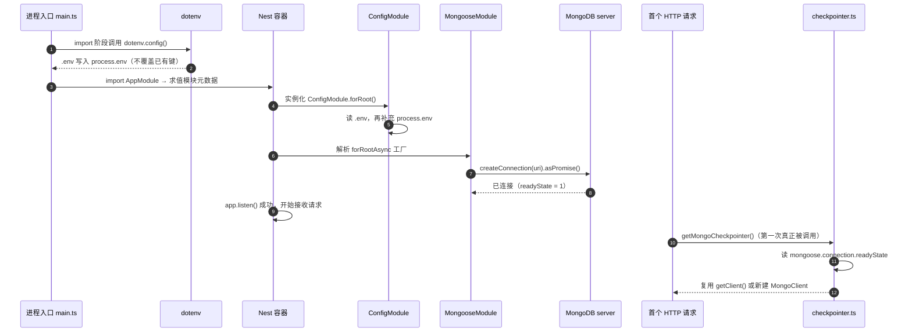

一个 LangGraph checkpointer 需要的只是一个可用的 `MongoClient`。但在这个项目里，这个 client 不是由 Nest 注入的依赖，而是从 `mongoose` 的全局单例上「借」来的；借不到时才自己建。**「借还是建」这个判断发生在第一个 HTTP 请求里，而不是进程启动时**，于是数据库连接的建立时刻被劈成了两段：Nest 容器启动期（阻塞、必须成功）与首个业务请求期（懒执行、可失败可重试）。本页只讨论这个连接对象的来源判定、生命周期，以及两段时间轴错位带来的具体故障模式。checkpointer 保存的文档结构与读取路径见 [MongoDB Checkpointer：短期记忆的落库与读取](10-mongodb-checkpointer-duan-qi-ji-yi-de-luo-ku-yu-du-qu)，模块依赖注入的整体协作见 [模块划分与依赖注入：ConfigModule 与 AiModule 的协作](16-mo-kuai-hua-fen-yu-yi-lai-zhu-ru-configmodule-yu-aimodule-de-xie-zuo)。

Sources: [checkpointer.ts](be/src/ai/graph/checkpointer.ts#L11-L50), [AiOperator.ts](be/src/ai/operator/AiOperator.ts#L29-L52)

## 三段时间轴：进程求值 → 容器装配 → 首个请求

理解本页所有陷阱的前提，是把「环境变量可读」「数据库已连上」「checkpointer 已创建」这三件事在时间轴上分开——它们分别属于三个完全不同的阶段，且每一步的先后顺序都是**隐式约定**而非显式编排。

两个关键事实由此显现：其一，**`MongooseModule.forRootAsync` 的 provider 工厂是 `await` 到底的**——`createMongooseConnection` 内部返回 `connection.asPromise()`，因此 `app.listen()` 之前 mongoose 连接必然已经处于 `connected`；其二，**checkpointer 的创建时机被刻意推迟到首个请求**，它的失败不会阻止进程启动。

Sources: [main.ts](be/src/main.ts#L1-L10), [app.module.ts](be/src/app.module.ts#L10-L31), [AiOperator.ts](be/src/ai/operator/AiOperator.ts#L29-L52), [mongoose-core.module.js](be/node_modules/@nestjs/mongoose/dist/mongoose-core.module.js#L113-L119)

## 复用判定：`readyState === 1` 与 `getClient` 的双重类型守卫

`createMongoCheckpointer` 开头不建连，先做一次三合一的守卫判断：`conn` 存在、`typeof conn.getClient === 'function'`、且 `conn.readyState === 1`。三个条件全部为真才走复用分支。这个写法看起来可以简化成 `if (conn.db)`，但两个额外条件各自挡掉了一类真实故障。

`readyState` 在 mongoose 中是 `ConnectionStates` 数值，取值语义决定了这个守卫的严格程度：

| `readyState` | 语义 | 守卫结果 | 走上哪条分支 | 后果 |
|---|---|---|---|---|
| `0` | `disconnected` | 假 | 回退建连 | 新建独立 client，与原连接互不共享 |
| `1` | `connected` | **真** | **复用 `getClient()`** | 与 mongoose 共用同一连接池 |
| `2` | `connecting` | 假 | 回退建连 | 两条连接同时指向同一库 |
| `3` | `disconnecting` | 假 | 回退建连 | 原连接即将关闭，复用反而危险 |
| `99` | `uninitialized` | 假 | 回退建连 | 尚未 `openUri` |

只接受 `1`（严格等于 connected）而不是 `>= 1` 或「非 0」，是因为 `2` 和 `3` 都是**过渡态**：在此刻取到的 client 虽然非空，但其底层拓扑尚未就绪或正在拆除，交给 `MongoDBSaver` 后会在首次 `getTuple()` 时以驱动层超时的形式失败，且错误信息完全指不到 checkpointer。`typeof getClient === 'function'` 这一支则是对测试替身与老版本兼容的防御——单测里注入的 `Connection` mock 往往只有 `db` 没有 `getClient`。

Sources: [checkpointer.ts](be/src/ai/graph/checkpointer.ts#L12-L17), [connectionState.js](be/node_modules/mongoose/lib/connectionState.js#L10-L20)

## 为什么复用是硬要求：构造期的 `appendMetadata` 与连接池

复用不是为了省几行代码。`MongoDBSaver` 的构造函数里做了两件与 client 强耦合的事：调用 `client.appendMetadata({ name: 'langgraphjs_checkpoint_saver' })`，以及 `this.db = client.db(dbName)`。前者把 LangGraph 的标识写进驱动的握手元数据，意味着**每新建一个 client 就多一份驱动元数据与一个独立连接池**；后者是同步调用，不做任何连接校验，因此 `dbName` 一旦传错，构造阶段毫无征兆，错误被推迟到第一次读写。

在这个项目的调用频次下（`AiOperator` 是单例，`graphPromise` 只构建一次），连接池翻倍本身并不致命；真正的问题在于**状态分裂**：如果一部分 checkpoint 走 mongoose 的 client、另一部分走回退 client，两个 client 的写关注、拓扑发现、重连节奏彼此独立，同一个 `thread_id` 的历史可能出现「刚写完就读不到」的窗口。这也是复用分支被放在函数最前面、优先级最高的原因。

Sources: [checkpointer.ts](be/src/ai/graph/checkpointer.ts#L44-L49), [index.js](be/node_modules/@langchain/langgraph-checkpoint-mongodb/dist/index.js#L16-L24)

## 缓存的是 Promise，不是实例

`getMongoCheckpointer` 只用了六行，但它的缓存对象是 **Promise 本身**（`checkpointerPromise`），而不是 `MongoDBSaver` 实例。这个区别在并发场景下是决定性的。

如果缓存的是实例，代码会写成 `if (!saver) saver = await create(...)`，那么两个同时到达的首批请求会**各自进入 `await` 之前的判断**，都看到 `saver` 为 `null`，从而各建一个 client——正是要避免的连接风暴。缓存 Promise 则把赋值动作提前到 `await` 之前（`checkpointerPromise = createMongoCheckpointer().catch(...)`），使第二次调用读到的是同一个进行中的 Promise，天然具备了「单飞（single-flight）」语义。

失败回滚同样是这段代码的核心语义：`.catch` 里把 `checkpointerPromise = null` 再重新抛出。这意味着配置修好后无需重启进程即可重试——但也意味着**一次失败会连带作废整张图**，因为 `AiOperator.getGraph` 的 `graphPromise` 有自己的同构 catch，两层缓存在失败时被一起清空，模型与工具也要重建。

Sources: [checkpointer.ts](be/src/ai/graph/checkpointer.ts#L52-L63), [AiOperator.ts](be/src/ai/operator/AiOperator.ts#L30-L48)

下表把两层缓存的职责与失败语义并列，二者不能互相替代：

| 缓存 | 变量 | 归属 | 缓存内容 | 清空条件 | 清空的连锁影响 |
|---|---|---|---|---|---|
| checkpointer | `checkpointerPromise` | 模块级（跨实例共享） | `Promise<MongoDBSaver>` | 自身创建失败 | 下一次调用重新建连 |
| graph | `graphPromise` | `AiOperator` 实例 | `Promise<ChatGraph>` | 图构建任一步失败 | 模型、工具、checkpointer 全部重取 |

Sources: [checkpointer.ts](be/src/ai/graph/checkpointer.ts#L52-L63), [AiOperator.ts](be/src/ai/operator/AiOperator.ts#L27-L52)

## 陷阱一：`dotenv.config()` 必须先于 `AppModule` 求值

`main.ts` 的前四行是一个刻意为之的顺序安排：`dotenv.config()` 夹在两批 import 之间。这在 ESM 语义下是无效的（所有 import 都会被提升到模块求值之前），但本项目 `tsconfig.json` 的 `module` 是 `nodenext` 且 `package.json` 无 `"type": "module"`，编译产物是 CommonJS，`require` 保持源码顺序——`dist/main.js` 里可以看到 `require("dotenv")` → `dotenv.config()` → `require("./app.module")` 的原始次序。

这个顺序之所以重要，是因为 `checkpointer.ts` 在**回退分支里直接读 `process.env.MONGODB_URI`**，不经过 `ConfigService`。任何「在模块顶层读环境变量」的代码都依赖这条隐式约定：只要入口是 `main.ts`，`.env` 已就绪；一旦换入口（比如直接 `node -e "require('./dist/app.module')"`，或编译目标切到 ESM），`AppModule` 会先于 dotenv 求值，`.env` 里的值全部读不到。

Sources: [main.ts](be/src/main.ts#L1-L4), [main.js](be/dist/main.js#L36-L39), [tsconfig.json](be/tsconfig.json#L3-L4), [checkpointer.ts](be/src/ai/graph/checkpointer.ts#L17-L22)

## 陷阱二：`forRootAsync` + `ConfigService`，而不是 `forRoot(process.env.MONGODB_URI)`

`app.module.ts` 在 `MongooseModule.forRootAsync` 上方留了注释，说明其动机是「避免模块文件在 dotenv 加载之前就读取 `process.env`」。这条注释透露了项目曾踩过的坑：`MongooseModule.forRoot(process.env.MONGODB_URI)` 是在**模块元数据求值阶段**（也就是 `import AppModule` 的那一刻）读取的，而 `ConfigModule.forRoot` 加载 `.env` 发生在**容器实例化阶段**——晚于前者。于是 `.env` 里的 `MONGODB_URI` 必然错过，只能靠 shell 导出的环境变量兜底。

改成 `forRootAsync({ inject: [ConfigService], useFactory })` 之后，URI 的读取被推迟到 provider 工厂执行期，此时 `ConfigModule` 必定已经实例化完毕（依赖注入顺序保证）。附带的好处是 `authSource` / `user` / `pass` 可以用条件展开——值为空字符串时不传，避免把空认证信息交给驱动。

Sources: [app.module.ts](be/src/app.module.ts#L10-L31), [config.module.js](be/node_modules/@nestjs/config/dist/config.module.js#L73-L102)

另一条必须知道的细节：`ConfigModule` 把 `.env` 写回 `process.env` 时会**跳过已存在的键**（`filter(key => !(key in process.env))`）。所以 `checkpointer.ts` 里那些直读 `process.env` 的语句，实际读到的是「shell 环境变量优先、`.env` 只做补齐」的结果。如果 shell 里存在一个空的 `MONGODB_URI=`，`.env` 里的值不会覆盖它，回退分支会拿到空串并按「未配置」抛出。

Sources: [config.module.js](be/node_modules/@nestjs/config/dist/config.module.js#L198-L212), [checkpointer.ts](be/src/ai/graph/checkpointer.ts#L17-L21)

## 陷阱三：两条读取路径，两套认证参数名

同一个 MongoDB 连接在两个地方被配置，且两边用的是**不同的参数词汇**：

| 配置项 | `app.module.ts`（mongoose 侧） | `checkpointer.ts`（driver 侧） | 差异风险 |
|---|---|---|---|
| URI | `config.get<string>('MONGODB_URI')` | `process.env.MONGODB_URI` | 只经过 `ConfigService` 注入的 URI（如自定义 config factory）回退路径看不到 |
| 用户名 | `user`（mongoose 兼容选项） | `auth: { username }`（driver 选项） | 语义相同，写法不同，改一处易漏另一处 |
| 密码 | `pass` | `auth: { password }` | 同上 |
| 认证库 | `authSource`（有值才传） | `authSource \|\| 'admin'`（**默认 admin**） | 未设时两边行为可能不一致 |
| 缺省校验 | 无（`uri` 为 `undefined` 也照样传给驱动） | 显式 `throw new Error('缺少 MONGODB_URI 配置…')` | 报错质量不对称 |

最值得留意的是 `authSource` 的默认值分歧：driver 侧在未配置时硬编码回落到 `'admin'`，而 mongoose 侧留空交给驱动按 URI 中的默认库推断。在需要认证的部署里，如果用户只在 URI 里写了库名、没有显式设 `authSource`，**复用分支与回退分支可能连到不同的认证库**，表现为「有时能写 checkpoint、重启后不能」。

Sources: [app.module.ts](be/src/app.module.ts#L17-L31), [checkpointer.ts](be/src/ai/graph/checkpointer.ts#L23-L37)

## 陷阱四：`dbName` 的解析与连接状态藕断丝连

`dbName` 的取值是一条三级链条：`process.env.DB_NAME` → `mongoose.connection.db?.databaseName` → 字面量 `'chat_robot'`。问题出在第二级：`mongoose.connection.db` **只在已连接时才有值**。

这意味着同一个函数在两条分支下的解析能力不同：复用分支里 mongoose 必然已连接，第二级有效，`dbName` 能正确继承 URI 中的库名；回退分支恰恰是「mongoose 没连上或没连」的情形，第二级必然 `undefined`，于是直接落到 `'chat_robot'`。如果 URI 指向的是 `mongodb://host:27017/prod_chat`，回退路径会把 checkpoint 写进 `prod_chat` 之外的 `chat_robot` 库——数据没丢，只是**在另一个库里，且没有任何日志提示**。

Sources: [checkpointer.ts](be/src/ai/graph/checkpointer.ts#L39-L42), [.env.example](be/.env.example#L16-L19)

## 陷阱五：启动期硬失败 vs 运行期软失败

`@nestjs/mongoose` 的 provider 工厂被 `handleRetry(retryAttempts = 9, retryDelay = 3000)` 包裹：数据库不可达时，进程会在启动阶段重试 9 次、每次间隔 3 秒，约 30 秒后才抛错退出。项目没有覆盖这两个默认值，因此**MongoDB 不可用时现象是「启动卡住约半分钟然后崩溃」**，而不是快速失败。

与之对照，checkpointer 侧的失败是运行期的软失败：`createMongoCheckpointer` 抛出的错误会穿过 `getGraph` → `runGraph`，最终被包装成 `BadGatewayException('AI 服务调用失败：…')`，进程继续存活，下一次请求会重试。两种失败的观感完全不同，排障时容易误判——「服务起来了但一调就 502」指向 checkpointer，「服务根本没起来」指向 mongoose。

Sources: [mongoose.utils.js](be/node_modules/@nestjs/mongoose/dist/common/mongoose.utils.js#L20-L30), [checkpointer.ts](be/src/ai/graph/checkpointer.ts#L18-L21), [AiOperator.ts](be/src/ai/operator/AiOperator.ts#L115-L127)

还有一个与入口相关的时序问题：`ConfigModule.forRoot({ envFilePath: '.env' })` 与 `dotenv.config()` 读的都是**相对当前工作目录**的 `.env`。`start:prod` 脚本是 `node dist/main`（隐含在 `be/` 下执行），若改为从仓库根目录执行 `node be/dist/main`，两个加载器都找不到 `.env`，mongoose 拿到 `undefined` 的 URI 进入重试循环，最终以驱动层的连接串解析错误收场——错误信息完全不会提到「`.env` 没找到」。e2e 测试同样依赖这条路径约定：`app.e2e-spec.ts` 直接 `import { AppModule }`，没有 `dotenv.config()`，`.env` 完全靠 `ConfigModule` 补齐，而 checkpointer 的 `process.env` 直读恰好发生在那之后（首个请求期），才没有暴露问题。

Sources: [app.module.ts](be/src/app.module.ts#L10-L13), [package.json](be/package.json#L14), [app.e2e-spec.ts](be/test/app.e2e-spec.ts#L5-L20)

## 陷阱六：回退 client 没有关闭路径

复用分支借来的 client 归 mongoose 所有，`MongooseCoreModule.onApplicationShutdown` 会关掉那条连接。但回退分支里 `new MongoClient(...)` 创建的 `tmp` 只是被 `MongoDBSaver` 持有的一个局部引用——`checkpointer.ts` 里没有任何 `close()`，也没有实现 `OnModuleDestroy`。更根本的是，`main.ts` 没有调用 `app.enableShutdownHooks()`，因此即使 `MongooseCoreModule` 定义了 `onApplicationShutdown`，进程收到 `SIGTERM` 时也不会走到那段清理逻辑。

结果是：走回退路径的部署在热重载（`start:dev`）与频繁重启下会持续泄漏连接池，直到 MongoDB 侧达到连接上限。这条问题与「复用」直接相关——**复用的价值不仅是省资源，还是让连接生命周期回到 mongoose 的统一管理下**。

Sources: [checkpointer.ts](be/src/ai/graph/checkpointer.ts#L26-L37), [mongoose-core.module.js](be/node_modules/@nestjs/mongoose/dist/mongoose-core.module.js#L121-L124), [main.ts](be/src/main.ts#L9-L33)

## 排错对照表

把上述机制压缩成一张「症状 → 机制 → 处置」的对照表，用于定位连接与时序类故障：

| 现象 | 对应机制 | 定位点 | 处置 |
|---|---|---|---|
| 启动卡住约 30 秒后崩溃 | `handleRetry` 默认 9×3000ms | 启动日志里的 `Unable to connect to the database` | 先确认 MongoDB 可达，再看 URI |
| 启动成功，首次 `/chat` 返回 502「AI 服务调用失败」 | checkpointer 懒创建失败，被 `BadGatewayException` 包装 | `checkpointerPromise` 是否被清空 | 修 `.env` 后直接重试，无需重启 |
| checkpoint 写进了非预期库 | `dbName` 回退到 `'chat_robot'` | 是否显式配置 `DB_NAME` | 显式设置 `DB_NAME`，不依赖连接态推断 |
| 认证失败但 URI 看起来正确 | driver 侧 `authSource` 默认 `'admin'` | 是否命中回退分支 | 显式设置 `authSource`，让两侧一致 |
| 重启后连接数持续上涨 | 回退 client 无关闭路径 + 未开 shutdown hooks | 是否命中 `else` 分支 | 修复 mongoose 连接使其命中复用分支 |
| 改了 `MONGODB_URI` 但行为不变 | shell 环境变量优先于 `.env` | `process.env` 是否已被外部导出 | 清理 shell 变量，或改用 `ConfigService` 单一路径 |
| `GET /` 显示 `checkpointer: 'mongodb'` 但实际不可用 | 该字段是静态字面量，不探测连接 | `AppService.getInfo` | 不要把 `/` 当健康检查，改用真实读写 |

Sources: [app.service.ts](be/src/app.service.ts#L6-L18), [checkpointer.ts](be/src/ai/graph/checkpointer.ts#L52-L63), [AiOperator.ts](be/src/ai/operator/AiOperator.ts#L115-L127)

## 延伸阅读

连接判定与图装配的交汇点（`compile({ checkpointer })` 那个三元表达式、以及 `AiOperator` 如何把图缓存成单例）属于编排层的可测试性设计，见 [图组装与可注入模型接口：让编排可测试](8-tu-zu-zhuang-yu-ke-zhu-ru-mo-xing-jie-kou-rang-bian-pai-ke-ce-shi)；`sessionId` 到 `thread_id` 的映射与「清空对话」的语义见 [thread_id 生命周期：sessionId 与「清空对话」的语义](11-thread_id-sheng-ming-zhou-qi-sessionid-yu-qing-kong-dui-hua-de-yu-yi)；环境变量的完整清单与优先级规则见 [配置与环境变量：唯一的凭证是模型 API Key](4-pei-zhi-yu-huan-jing-bian-liang-wei-de-ping-zheng-shi-mo-xing-api-key)。