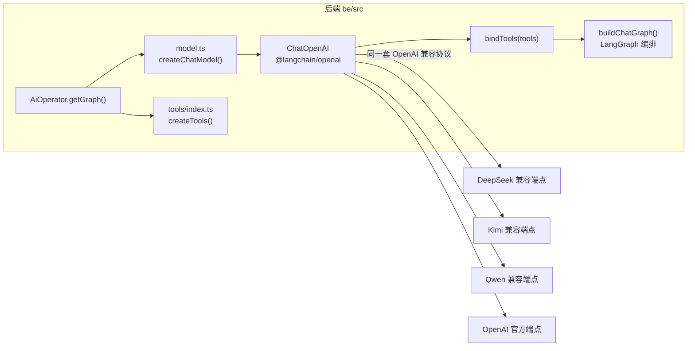
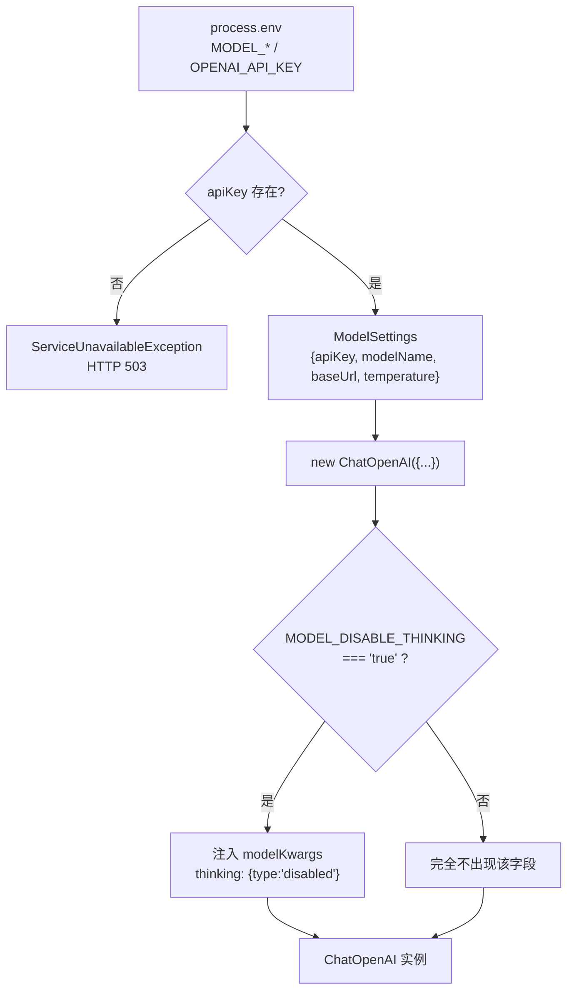
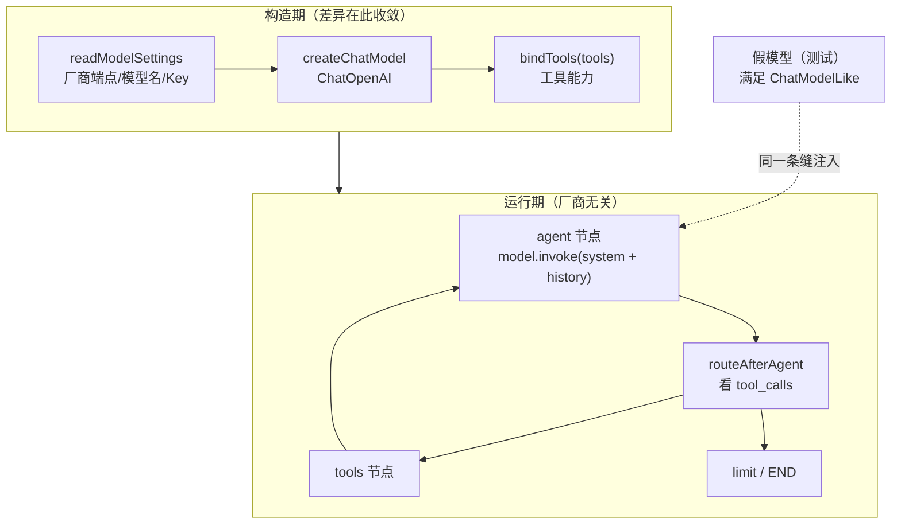
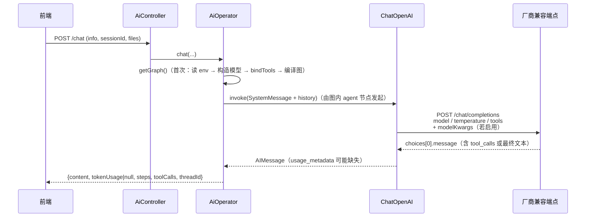

本页只回答一个问题：**后端如何用一份代码同时对接 DeepSeek、Kimi、Qwen、OpenAI 等多家模型服务**。答案集中在一个不到 50 行的文件里——`be/src/ai/model.ts`。它不负责 agent 循环（那是 LangGraph 的事），也不负责工具定义（那是工具注册表的事），它只做两件事：把环境变量收敛成 `ModelSettings`，再把 `ModelSettings` 映射成一个 `ChatOpenAI` 实例。

理解这一层的关键前提是：**这里的"统一"不是抽象出多个 Provider 再分发，而是直接选择了"OpenAI 兼容协议"作为事实标准**。协议本身就是抽象层，所以不需要写 if/else 判断厂商。

Sources: [model.ts](be/src/ai/model.ts#L1-L50), [package.json](be/package.json#L23-L26)

## 一、抽象策略：用协议替代 Provider 分支

代码对模型服务的全部依赖只有 `@langchain/openai` 一个包，没有任何厂商专属 SDK。`ChatOpenAI` 本质上是一个 OpenAI HTTP 客户端，而绝大多数国内厂商（DeepSeek、Kimi、Qwen 等）都对外暴露 `/chat/completions` 形态的兼容端点，因此"换厂商"退化成"改端点 + 改模型名"。

Sources: [package.json](be/package.json#L23-L26), [model.ts](be/src/ai/model.ts#L31-L37)

三种常见做法在该项目语境下的取舍：

| 方案 | 换厂商成本 | 类型安全/可控性 | 厂商私有能力 | 本项目选择 |
|---|---|---|---|---|
| 每家一套厂商 SDK | 高：需新增代码分支与依赖 | 强（各家类型） | 完整 | 未采用 |
| 手写 HTTP 客户端打 `/chat/completions` | 低 | 弱：消息、工具调用、usage 都要自己解析 | 自行拼接 | 未采用 |
| `ChatOpenAI` + 可配置 `baseURL` | 低：只改两个环境变量 | 中：消息/工具调用/usage 由 `@langchain/*` 统一 | 通过 `modelKwargs` 原样透传 | **已采用** |

代价也很明确：**只有遵守 OpenAI 协议形态的能力才能被使用**。厂商的私有特性要么不存在，要么必须借 `modelKwargs` 这条"后门"手工塞进请求体（见第四节）。

Sources: [model.ts](be/src/ai/model.ts#L31-L49)

图中可见一个刻意的边界：**「模型」只被构造一次，且构造点唯一**。`ChatOpenAI` 在整个仓库里只出现在 `model.ts`，`AiOperator` 通过 `createChatModel()` 获取它，而不是自己 `new`。

Sources: [AiOperator.ts](be/src/ai/operator/AiOperator.ts#L29-L43), [model.ts](be/src/ai/model.ts#L35-L49)

## 二、ModelSettings：客户端的输入契约

`ModelSettings` 是一个四字段的纯数据结构，它把"外界能影响模型客户端的一切"压缩到最小集合——这也意味着，凡是没出现在这四字段里的东西，都无法通过配置改变模型行为。

| 字段 | 类型 | 来源环境变量 | 缺省行为 |
|---|---|---|---|
| `apiKey` | `string` | `MODEL_API_KEY`，回退 `OPENAI_API_KEY` | **缺失即抛 503**，无默认值 |
| `modelName` | `string` | `MODEL_NAME` | `gpt-4o-mini` |
| `baseUrl` | `string?` | `MODEL_BASE_URL` | `undefined`（交给 SDK 默认） |
| `temperature` | `number` | `MODEL_TEMPERATURE` | `0.6` |

Sources: [model.ts](be/src/ai/model.ts#L4-L29)

`readModelSettings()` 的失败路径值得单独注意：当两个 Key 变量都为空时，它抛出的是 `ServiceUnavailableException`（HTTP 503），而不是笼统的 500。这是一个语义判断——**"凭证没配"是部署状态问题，不是服务器内部错误**，因此错误文案直接给出修复指引（去 `be/.env` 设置 `MODEL_API_KEY`），并一路透传到浏览器。

Sources: [model.ts](be/src/ai/model.ts#L15-L21)

还有一个容易踩的细节：**模板默认值 ≠ 代码默认值**。`.env.example` 里把 `MODEL_BASE_URL` 预填为 DeepSeek 端点、`MODEL_NAME` 预填为 `deepseek-chat`，但代码里的兜底是 `undefined` 与 `gpt-4o-mini`。也就是说，如果你**删掉**这两行而不是修改它们，客户端会悄悄回到 OpenAI 官方语义。厂商端点与模型名必须成对出现，这是本节最重要的一条经验法则。

Sources: [.env.example](be/.env.example#L1-L8), [model.ts](be/src/ai/model.ts#L23-L28)

## 三、createChatModel：字段映射与构造时序

从 `ModelSettings` 到 `ChatOpenAI` 构造参数是一一对应的直译，唯一的"变形"发生在 `baseUrl` 上：它不直接作为顶层参数，而是嵌进 `configuration.baseURL`。原因是 `configuration` 承载的是底层 OpenAI SDK 的 `ClientOptions`（客户端级配置），而 `model`/`temperature`/`modelKwargs` 属于请求级参数，两者层级不同。

| `ModelSettings` 字段 | `ChatOpenAI` 参数 | 层级 | 说明 |
|---|---|---|---|
| `settings.apiKey` | `apiKey` | 客户端（鉴权） | 唯一凭证，缺失在读取阶段就被拦截 |
| `settings.modelName` | `model` | 请求 | 送给厂商的模型标识 |
| `settings.temperature` | `temperature` | 请求 | 采样温度 |
| `settings.baseUrl` | `configuration.baseURL` | 客户端（路由） | 为空则整段 `configuration` 传 `undefined` |
| `MODEL_DISABLE_THINKING` | `modelKwargs.thinking` | 请求（透传） | 条件性注入，默认不存在 |

Sources: [model.ts](be/src/ai/model.ts#L35-L49)

注意 `baseUrl` 的三元表达式写法：**只有当它非空时才创建 `configuration` 对象**。这不是风格问题，而是为了避免向 SDK 传一个 `{ baseURL: undefined }` 的无效配置——保持"未配置 = 完全交给 SDK 默认"的干净语义。

Sources: [model.ts](be/src/ai/model.ts#L38-L42)

## 四、厂商差异适配：三类差异与三个适配点

同一个兼容协议并不等于厂商行为完全一致。代码里能验证的差异只有三类，每一类都有明确的对策位置。

| 差异类型 | 具体表现 | 代码中的适配点 | 出错时的信号 |
|---|---|---|---|
| **端点差异** | 各家域名不同，路径前缀不同 | `baseUrl` → `configuration.baseURL` | 404 / 找不到模型 |
| **模型命名差异** | 同名端点下的模型标识各不相同 | `modelName` → `model` | 400 模型不存在 |
| **私有请求参数** | Kimi/Qwen 的 `thinking` 等 OpenAI 没有的字段，部分服务不识别未知字段 | `modelKwargs` 条件注入，默认不发送 | 400 unknown parameter |
| **usage 统计缺失** | 部分兼容服务不返回 token 用量 | 结果整理时 `?? null` 兜底 | 用量字段为 `null` 而非报错 |
| **多模态形态** | vision 能力非所有兼容服务具备 | 内容数组用 `image_url` 形态（见第七节） | 图片被忽略或 400 |

Sources: [model.ts](be/src/ai/model.ts#L23-L28), [model.ts](be/src/ai/model.ts#L43-L48), [AiOperator.ts](be/src/ai/operator/AiOperator.ts#L129-L140)

### 4.1 私有参数：默认不发送才是兼容性最优解

`thinking` 是 Kimi、Qwen 等厂商的私有参数，OpenAI 与 DeepSeek 不认。代码采取的策略是**默认不发送**：只有当 `MODEL_DISABLE_THINKING` 严格等于字符串 `'true'` 时，才通过对象展开把 `modelKwargs` 合入构造参数。这个"严格等于"很重要——`'TRUE'`、`'1'`、`'true '` 都不会触发，避免了误判导致某个厂商收到不认识的字段而整条请求 400。

Sources: [model.ts](be/src/ai/model.ts#L43-L48)

`modelKwargs` 之所以能承担这个角色，是因为它在 `@langchain/openai` 内部的语义是"原样并入请求体"：`modelKwargs` 的类型是 `Record<string, any>`，在组装 `chat.completions.create` 的 `params` 时被展开到最外层。换言之，**写进 `modelKwargs` 的东西不会被 SDK 校验或改写，会直接出现在 HTTP body 里**——这既是能力，也是风险。

Sources: [types.d.ts](node_modules/@langchain/openai/dist/types.d.ts#L56-L60), [completions.js](node_modules/@langchain/openai/dist/chat_models/completions.js#L40-L50)

### 4.2 usage 统计：可缺失数据的容错

结果整理阶段，token 用量取自最后一条消息的 `usage_metadata`，并用 `?? null` 兜底。这行代码的隐含假设是：**兼容服务可能不返回用量，但这不应让对话失败**。对上层而言，`tokenUsage` 只是可观测性字段，不是业务必需字段，因此缺失时降级为 `null` 而不是抛错。

Sources: [AiOperator.ts](be/src/ai/operator/AiOperator.ts#L129-L140)

### 4.3 工具调用：协议形态是硬约束

模型客户端与图之间有一个必须成立的协议约定：模型返回的 `AIMessage.tool_calls` 必须是 OpenAI 的标准形状（`name` / `args` / `id`）。条件边直接依据这个字段做路由——有 `tool_calls` 就去 `tools` 节点，没有就结束。**如果某家厂商的工具调用格式不标准，图的循环会静默地走不到 `tools` 节点**，表现为"模型说它要查天气，但什么也没查"。

Sources: [edges.ts](be/src/ai/graph/edges.ts#L16-L26)

## 五、边界划分：模型能力在构造期，循环在图里

工具的绑定不在 `model.ts` 里，而在 `AiOperator.getGraph()` 初始化时完成，注释把理由写得很直白：「工具绑定属于『模型能力』，循环与分支交给图」。`bindTools(tools)` 返回的是一个被绑定过的 Runnable，它仍然满足图节点需要的最小接口。

Sources: [AiOperator.ts](be/src/ai/operator/AiOperator.ts#L32-L35)

图节点这一侧只声明了极小接口 `ChatModelLike`——一个 `invoke(messages) → AIMessage` 的方法签名。它不要求 `bindTools`、不要求 `stream`、不要求任何厂商字段，于是真实客户端与测试里的脚本化假模型可以互换。这正是"厂商差异适配"范围可控的根本原因：**差异全部收敛在构造期，图只认消息进出**。

Sources: [nodes.ts](be/src/ai/graph/nodes.ts#L6-L12), [nodes.ts](be/src/ai/graph/nodes.ts#L28-L44)

假模型的具体实现就是按脚本返回 `AIMessage` 的 `invoke`，并被记录每次收到的消息以便断言。延伸阅读见 [图组装与可注入模型接口：让编排可测试](8-tu-zu-zhuang-yu-ke-zhu-ru-mo-xing-jie-kou-rang-bian-pai-ke-ce-shi) 与 [脚本化假模型驱动图测试：循环、记忆与上限断言](23-jiao-ben-hua-jia-mo-xing-qu-dong-tu-ce-shi-xun-huan-ji-yi-yu-shang-xian-duan-yan)。

Sources: [graph.spec.ts](be/src/ai/graph/graph.spec.ts#L19-L33)

## 六、错误语义分层与"修好即生效"的自愈设计

模型客户端相关的错误被分成两层，各自有不同的归属与处置方式。

**第一层：构造期错误。** 缺 Key 时 `createChatModel()` 抛出的 503 会沿 `getGraph()` 的 Promise 链向上冒泡。关键在于 `catch` 分支把 `this.graphPromise` 重置为 `null`——**初始化失败不会污染缓存**，因此你补上 API Key 后，下一个请求就会重新尝试构造，无需重启进程。

Sources: [AiOperator.ts](be/src/ai/operator/AiOperator.ts#L29-L52)

**第二层：调用期错误。** 图执行阶段的异常在 `runGraph` 里分类：如果它本身是 `HttpException`（例如上面那个 503），保持原语义直接抛；其他一切（网络失败、厂商返回 4xx/5xx、解析失败）统一包装成 `BadGatewayException`（502），文案为「AI 服务调用失败：<原始消息>」。这样前端能区分"自己没配好"（503）与"上游模型服务出问题"（502）。

Sources: [AiOperator.ts](be/src/ai/operator/AiOperator.ts#L115-L127)

但这套自愈机制有一个反向代价：**构造成功之后，缓存不会再失效**。`graphPromise` 一旦缓存了编译结果，此时修改 `.env` 里的 `MODEL_NAME` 或 `MODEL_BASE_URL`（即更换厂商）不会生效，必须重启后端。这也解释了为什么"换厂商"在操作上总是一组"改两个变量 + 重启"的动作。

Sources: [AiOperator.ts](be/src/ai/operator/AiOperator.ts#L27-L52)

| 现象 | 归属层 | 根因 | 处置 |
|---|---|---|---|
| 503「未配置模型 API Key」 | 构造期 | `MODEL_API_KEY` 与 `OPENAI_API_KEY` 皆空 | 填 Key，**无需重启**即可重试 |
| 404 / 模型不存在 | 调用期（502） | `MODEL_BASE_URL` 与 `MODEL_NAME` 不配对 | 成对修改后**重启** |
| 400 unknown parameter `thinking` | 调用期（502） | 该厂商不认思考参数却收到该字段 | 保持默认不发送；确需关闭时才设 `MODEL_DISABLE_THINKING=true` |
| 改了 `.env` 但模型没变 | 缓存 | `graphPromise` 已缓存编译结果 | 重启后端 |
| 模型口头说要查却不查 | 协议形态 | 厂商 `tool_calls` 非标准形状 | 换支持标准 tool calling 的模型 |

Sources: [model.ts](be/src/ai/model.ts#L15-L21), [model.ts](be/src/ai/model.ts#L43-L48), [AiOperator.ts](be/src/ai/operator/AiOperator.ts#L44-L52), [edges.ts](be/src/ai/graph/edges.ts#L16-L26)

## 七、多模态内容同样走这条协议

图片不是通过单独的上传接口送给模型，而是在进入图之前被就地转换成 OpenAI 协议的 `image_url` 内容段，其 `url` 是 base64 编码的 data URI。这意味着**多模态能力也完全依赖厂商对 OpenAI 内容数组格式的兼容度**：支持 vision 的兼容服务可直接消费，不支持的服务可能忽略图片部分或直接报错。

Sources: [attachments.ts](be/src/ai/operator/attachments.ts#L82-L89), [AiOperator.ts](be/src/ai/operator/AiOperator.ts#L88-L99)

一个自然的推论是：内容形态的选择（字符串 vs 内容数组）取决于是否带图。纯文本时 `content` 直接是一个字符串，带图时才升级为 `[{type:'text'}, ...imageParts]` 数组形态——后者正是 OpenAI 兼容协议的写法。长度治理与格式边界的细节见 [附件多模态转换：图片 Data URI、文本内联与长度治理](15-fu-jian-duo-mo-tai-zhuan-huan-tu-pian-data-uri-wen-ben-nei-lian-yu-chang-du-zhi-li)。

Sources: [AiOperator.ts](be/src/ai/operator/AiOperator.ts#L93-L99)

## 八、换厂商操作清单

按上面的分析，"适配新厂商"在工程上被压缩为三个变量的组合调整。模板中已给出 DeepSeek 的可用组合，其余厂商请以其官方文档中的 OpenAI 兼容端点为准。

| 目标 | `MODEL_BASE_URL` | `MODEL_NAME` | `MODEL_DISABLE_THINKING` | 备注 |
|---|---|---|---|---|
| DeepSeek（模板默认） | `https://api.deepseek.com` | `deepseek-chat` | 保持 `false` | 模板已预填，只需填 Key |
| Kimi / Qwen 等带思考开关的厂商 | 按其兼容端点填写 | 按模型标识填写 | 视需要设为 `true` | 仅在此才注入 `thinking: disabled` |
| OpenAI 官方 | 留空（或删掉该行） | 如 `gpt-4o-mini` | 保持 `false` | 留空时 `configuration` 整体不传，走 SDK 默认 |

Sources: [.env.example](be/.env.example#L1-L8), [model.ts](be/src/ai/model.ts#L23-L28), [model.ts](be/src/ai/model.ts#L38-L42)

一次完整的模型调用，在模型客户端视角下可以概括为下面的时序；注意"厂商"只在最后一跳出现，且在代码中不表现为任何分支。

Sources: [AiOperator.ts](be/src/ai/operator/AiOperator.ts#L29-L52), [AiOperator.ts](be/src/ai/operator/AiOperator.ts#L115-L140), [ai.controller.ts](be/src/ai/ai.controller.ts#L36-L50)

## 小结与下一步

模型客户端的全部设计可以说只有三句话：**用 OpenAI 兼容协议代替厂商分支**（`configuration.baseURL` + `model`）、**用"默认不发送"代替参数兼容层**（`modelKwargs` 条件注入）、**用最小接口 `ChatModelLike` 把模型差异挡在图的边界之外**。理解了这三点，跨厂商问题基本都能被定位到"端点/模型名/私有参数/协议形态"四者之一。

接下来可以顺着调用链继续阅读：模型的输出如何被图消费 → [图状态设计：Annotation 与单用户 admin 身份](5-tu-zhuang-tai-she-ji-annotation-yu-dan-yong-hu-admin-shen-fen)；工具如何成为模型能力的一部分 → [工具注册表：工具描述即 Prompt，可选工具的条件启用](14-gong-ju-zhu-ce-biao-gong-ju-miao-shu-ji-prompt-ke-xuan-gong-ju-de-tiao-jian-qi-yong)；配置项全貌与启动时序 → [配置与环境变量：唯一的凭证是模型 API Key](4-pei-zhi-yu-huan-jing-bian-liang-wei-de-ping-zheng-shi-mo-xing-api-key)、[模块划分与依赖注入：ConfigModule 与 AiModule 的协作](16-mo-kuai-hua-fen-yu-yi-lai-zhu-ru-configmodule-yu-aimodule-de-xie-zuo)。