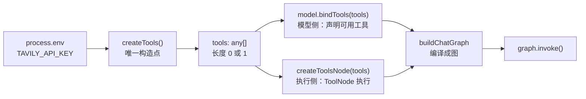
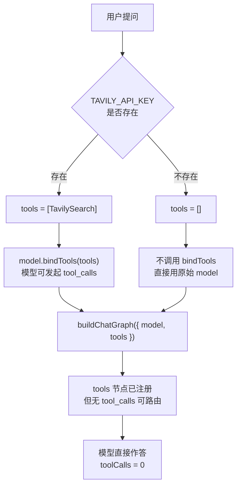

这个页面只讲一件事：**后端怎么决定「模型能看见哪些工具、能调用哪些工具」**。整个决策被压缩在一个 28 行的文件里——`be/src/ai/tools/index.ts`。它看起来只是一个把 `TavilySearch` 塞进数组的小函数，实际上同时承担了三个职责：定义工具清单（唯一构造点）、把工具描述当作 prompt 的一部分喂给模型、以及根据环境变量决定是否启用某项能力。读完这一页，你应该能做到三件事：看懂「描述为什么不是注释」、看懂「没有 API Key 时图为什么还能跑」、以及自己新增一个工具。

Sources: [index.ts](be/src/ai/tools/index.ts#L1-L27)

## 全景：一个数组，两个消费者

先建立最小的结构直觉。注册表不产生「能力」，它只产生一个 `any[]` 数组；这个数组随后被**两处代码**分别消费：模型侧用 `bindTools` 告诉模型「你有这些工具」，执行侧用 `ToolNode` 负责在模型发出 `tool_calls` 后真正执行。理解这「一份数据两个消费者」的关系，是本页后面所有细节的基础。

`AiOperator` 的懒加载初始化把这条链串起来：先 `createTools()` 拿数组，再 `createChatModel()`，然后**只有在数组非空时**才 `bindTools`，最后把同一个 `tools` 数组连同模型一起交给 `buildChatGraph`。注意最后一步是把 `tools` 复制了一份引用传给建图函数——所以「模型知道的工具」和「节点能执行的工具」永远来自同一份数据，不会出现模型调用了一个没人能执行的工具这种错位。

Sources: [AiOperator.ts](be/src/ai/operator/AiOperator.ts#L29-L43)

## 注册表本身的三个设计决策

`createTools` 是一个**无参数的工厂函数**，不注入 ConfigService，也不依赖 Nest 容器。它内部只做一件判定：`process.env.TAVILY_API_KEY` 存在就 `push` 一个 `TavilySearch` 实例，否则什么都不做，返回空数组。这种「返回新数组而非模块级常量」的写法是有意的——模块级常量会在 import 时就固化工具实例，而工厂函数让调用时机变得可控（`AiOperator` 就是延迟到首次请求才调用）。

Sources: [index.ts](be/src/ai/tools/index.ts#L14-L27)

第二个决策是**返回类型故意写成 `any[]`**。`TavilySearch` 是 `StructuredTool` 的子类，将来用 `tool()` 造出来的本地工具也各有自己的类型；如果标注成 `StructuredTool[]`，在传给 `ToolNode` 和 `bindTools` 时会遇到泛型不变性的麻烦。项目选择了「放弃类型精度、换取注册表可以自由混合不同来源的工具」，代价是编译器不会帮你检查数组元素是否真的是工具。

Sources: [index.ts](be/src/ai/tools/index.ts#L14-L15), [nodes.ts](be/src/ai/graph/nodes.ts#L50-L51)

第三个决策是文件头部的 `dotenv.config()`。项目在 `main.ts` 和 `AppModule` 里已经有 `ConfigModule.forRoot`，这里再调一次是为了让这个模块**脱离 Nest 启动流程也能自洽**（单元测试直接 import 时，`process.env` 里也该有 `.env` 的值）。重复调用 `dotenv.config()` 不会覆盖已有变量，所以它是安全的幂等操作。

Sources: [index.ts](be/src/ai/tools/index.ts#L1-L4), [main.ts](be/src/main.ts#L1-L2), [app.module.ts](be/src/app.module.ts#L10-L13)

## 工具描述即 Prompt：description 为什么不是注释

这是整页最需要转变观念的一点。代码注释只给人看，而工具的 `name`、`description` 和**每个参数的 `describe()`** 会被序列化成一段结构化文本，随每次模型调用一起进入上下文。也就是说，工具定义的写法和 system prompt 的写法具有同等效力——写得含糊，模型就不知道该在什么时候调用它；参数描述写得含糊，模型就会传错参。

从已安装依赖的源码可以看到，`TavilySearch` 自带的默认定义就是一段面向模型的说明：名称是 `tavily_search`，描述是「A search engine optimized for comprehensive, accurate, and trusted results. Useful for when you need to answer questions about current events」。这句话里的 `current events` 正是模型判断「要不要搜索」的依据——它不是给开发者看的文档，而是给模型的指令。

Sources: [tavily-search.js](be/node_modules/@langchain/tavily/dist/tavily-search.js#L104-L105)

注册表里对 `TavilySearch` 的两个构造参数也在影响这段 prompt 的实际效果：`maxResults: 3` 控制回灌到上下文的结果条数（每个结果都会占用 token），`searchDepth: 'basic'` 则决定搜索的深度与耗时。项目选的是「少量、快速」的组合，与后面要讲的「工具定义和工具结果都是上下文成本」这一约束保持一致。

Sources: [index.ts](be/src/ai/tools/index.ts#L17-L24)

理解了三件套的分工，就能读懂测试里那个假工具为什么长成那样：

| 组成 | 作用对象 | 作用 | 写坏的后果 |
|---|---|---|---|
| `name` | 模型 | 模型在 `tool_calls` 里回传的标识符，必须与执行侧注册名一致 | 调用落到不存在的工具，执行失败 |
| `description` | 模型 | 决定「什么时候该用它」，等价于一段 prompt | 该查不查 / 滥调，工具形同虚设 |
| `schema` + `describe()` | 模型 | 参数名、类型与语义，决定模型传什么值 | 参数缺失或类型错误，返回错误后重试 |

Sources: [graph.spec.ts](be/src/ai/graph/graph.spec.ts#L10-L17)

## 条件启用：没有 Key 时图为什么还能跑

`createTools` 的第二段逻辑是一句 `if`。这段 `if` 的语义是：**搜索是可选能力，不是系统前提**。没有 `TAVILY_API_KEY` 时数组为空，而空数组会沿着调用链一路「无害地流过」每一个环节——这正是设计的关键。`.env.example` 里那句注释是这条契约的原文说明：「搜索工具（可选；留空则不注册搜索工具，图仍然可用）」。

Sources: [index.ts](be/src/ai/tools/index.ts#L17-L24), [.env.example](be/.env.example#L13-L14)

空数组流过三个环节时各自的行为如下：

第一条路径在 `AiOperator` 里是显式分支：`tools.length > 0 ? model.bindTools(tools) : model`。没有工具可绑定时它**不调用** `bindTools`，模型实例保持原样——这样既避免了给模型发送空工具列表，也避免了某些兼容服务对空数组的异常处理。

Sources: [AiOperator.ts](be/src/ai/operator/AiOperator.ts#L32-L35)

第二条路径在建图函数里：`buildChatGraph` 的 `tools` 参数默认值就是 `[]`，而 `createToolsNode(tools)` 是**无条件注册**的节点。空数组不会让建图失败，只是这个节点永远不可能被走到——因为条件边 `routeAfterAgent` 只在最后一条 AIMessage 含有 `tool_calls` 时才返回 `tools` 节点名，没有绑定工具的模型不会产生 `tool_calls`，于是直接走 `END`。

Sources: [graph.ts](be/src/ai/graph/graph.ts#L41-L59), [edges.ts](be/src/ai/graph/edges.ts#L16-L26)

这里有一个容易被忽略的呼应：system prompt 的行为准则第 1 条写的是「当问题需要实时信息时，先调用**可用的**搜索工具」。措辞里的「可用的」不是客套——正是因为工具是条件注册的，prompt 不能承诺「一定会有搜索工具」，只能声明「如果有就优先用」。这条 prompt 与注册表的耦合关系，在系统提示词那一页有更完整的分析。

Sources: [prompts.ts](be/src/ai/graph/prompts.ts#L13-L17)

## 两条注册信息的落点：缺一不可

初学者最容易混的地方是「绑定了工具」和「注册了工具节点」这两件事的关系。它们消费同一份数组，但作用在不同的层：

| 阶段 | 代码位置 | 解决的问题 | 缺了它会怎样 |
|---|---|---|---|
| `model.bindTools(tools)` | `AiOperator` L35 | 让模型**知道**有这些工具、什么参数 | 模型永远不会发出 `tool_calls`，工具形同不存在 |
| `createToolsNode(tools)` → `new ToolNode(tools)` | `nodes.ts` L50-L51 | 让运行时**真的执行** `tool_calls` | 模型发起了调用，但没有节点能执行，循环断在半路 |

Sources: [AiOperator.ts](be/src/ai/operator/AiOperator.ts#L34-L35), [nodes.ts](be/src/ai/graph/nodes.ts#L50-L62)

`ToolNode` 还承担了一个对初学者很重要的语义：**工具执行失败不会中断图**。错误会作为 `ToolMessage` 回灌给模型，让模型自己判断是参数问题还是工具不可用，从而修正后重试。这正是「工具描述写错」的两级容错设计——第一级靠 `description` 尽量让模型一次调对，第二级靠错误回灌让模型二次修正。执行细节本身属于节点职责那一页，这里只需要记住它由注册表传入的数组驱动。

Sources: [nodes.ts](be/src/ai/graph/nodes.ts#L46-L62)

## 可观测性：怎么确认工具到底启用了没

工具是否注册成功，最直接的外部信号是响应里的 `toolCalls` 字段。它来自 state 的 `toolCallCount`，由 tools 节点按回灌的 `ToolMessage` 条数累加——没有工具时它恒为 `0`。`AiOperator` 把 `toolCalls` 和 `steps` 一起放进 `/chat`、`/search` 的返回体，前端 `Chat.vue` 则把它渲染成「N 步推理 · 调用工具 M 次」这行元信息。所以「想联网却一直搜不到」的第一诊断动作就是看 `toolCalls` 是否为 0。

Sources: [AiOperator.ts](be/src/ai/operator/AiOperator.ts#L105-L112), [state.ts](be/src/ai/graph/state.ts#L44-L47), [Chat.vue](fe/src/components/Chat.vue#L151-L157)

第二个需要注意的点是**缓存导致的「改了配置没生效」**。图是进程内单例，缓存在 `graphPromise` 里，`createTools()` 只在首次构建时执行一次。因此新增或删除 `TAVILY_API_KEY` 后必须重启进程，图才会重建——唯一的例外是初始化阶段就抛错（比如模型 Key 没配），此时 `graphPromise` 会被清空以便修复配置后直接重试。

Sources: [AiOperator.ts](be/src/ai/operator/AiOperator.ts#L29-L52)

| 现象 | 最可能的原因 | 排查位置 |
|---|---|---|
| 提问实时信息，`toolCalls` 一直是 0 | `TAVILY_API_KEY` 未配置，搜索工具未注册 | `.env` 与 `createTools` 的 `if` |
| 配了 Key 但行为没变 | 图已被缓存，改动未生效 | 重启后端进程 |
| `toolCalls` > 0 但答案没用到搜索结果 | 工具返回内容未被模型采纳（prompt 或结果质量） | system prompt 与 `maxResults` |
| 模型反复调用搜索、答案迟迟不出 | 步数上限兜底触发 | `AGENT_MAX_STEPS` 与 `routeAfterAgent` |

Sources: [index.ts](be/src/ai/tools/index.ts#L17-L24), [AiOperator.ts](be/src/ai/operator/AiOperator.ts#L42-L48), [edges.ts](be/src/ai/graph/edges.ts#L23-L25)

## 新增一个工具：从三行到三步

新增工具不需要动 Nest 模块，也不需要改图——注册表的全部改动都集中在同一个 `if` 后面追加元素。用 `tool()` + `zod`（项目已有 zod 依赖）定义，`name` / `description` / `schema` 三件套照填即可。测试里的 `createWeatherTool` 就是一个可直接照抄的最小范例：一个异步函数返回字符串结果，`schema` 用 `z.object` 描述参数并给每个字段 `describe`。

Sources: [graph.spec.ts](be/src/ai/graph/graph.spec.ts#L10-L17)

具体改动的前后对比：

| 环节 | 改动前（只有搜索） | 改动后（加一个本地工具） |
|---|---|---|
| 工具实现 | 无 | 新增 `tool(async ({city}) => ..., {name, description, schema})` |
| `createTools` | 只 `push(TavilySearch)` | `tools.push(createWeatherTool())`，无条件或按自己的环境变量判定 |
| `AiOperator` | `tools.length > 0 ? bindTools : model` | 不变 |
| `buildChatGraph` | `tools` 透传 | 不变 |
| system prompt | 只说「可用的搜索工具」 | 需要补充该工具的使用时机，否则模型不知道何时用 |

Sources: [index.ts](be/src/ai/tools/index.ts#L14-L27), [AiOperator.ts](be/src/ai/operator/AiOperator.ts#L34-L38)

最后一行是初学者最容易漏的：**注册表只负责「让工具存在」，prompt 才负责「让工具被使用」**。新增工具后如果 `toolCalls` 始终为 0，先检查 system prompt 里有没有说明它的使用时机，而不是怀疑注册表。工具定义的路线图里还有更进一步的方向——当工具数量增长到十几个时，工具定义本身就会成为显著的上下文成本，那时才需要引入「用小模型动态挑选本次暴露哪些工具」的中间件，而这属于后续演进范畴。

Sources: [prompts.ts](be/src/ai/graph/prompts.ts#L7-L18), [agent-roadmap.md](docs/agent-roadmap.md#L92-L96)

## 小结与下一步

把这一页压缩成一句话：**注册表用一个工厂函数产出一份 `any[]`，这份数组既定义模型看到的 prompt 片段，也定义运行时能执行的工具；环境变量决定数组是否为空，而数组为空不会破坏图的任何一环。** 三个可验证的锚点分别是 `createTools` 的条件 `if`、`AiOperator` 的 `bindTools` 分支、以及 `routeAfterAgent` 对 `tool_calls` 的判定。

Sources: [index.ts](be/src/ai/tools/index.ts#L14-L27), [AiOperator.ts](be/src/ai/operator/AiOperator.ts#L32-L35), [edges.ts](be/src/ai/graph/edges.ts#L16-L26)

沿着这条链路继续阅读，建议按以下顺序推进：先看 [系统提示词工程：把身份与工具使用规则写进 Prompt](9-xi-tong-ti-shi-ci-gong-cheng-ba-shen-fen-yu-gong-ju-shi-yong-gui-ze-xie-jin-prompt) 理解「让工具被使用」的另一半，再看 [四类节点的职责：prepare / agent / tools / limit](6-si-lei-jie-dian-de-zhi-ze-prepare-agent-tools-limit) 看 `ToolNode` 如何执行工具并把结果写回 state，接着看 [图组装与可注入模型接口：让编排可测试](8-tu-zu-zhuang-yu-ke-zhu-ru-mo-xing-jie-kou-rang-bian-pai-ke-ce-shi) 理解建图时的参数注入，最后看 [脚本化假模型驱动图测试：循环、记忆与上限断言](23-jiao-ben-hua-jia-mo-xing-qu-dong-tu-ce-shi-xun-huan-ji-yi-yu-shang-xian-duan-yan) 学怎么用假工具在无网络环境下验证工具链路。若你关心 `TAVILY_API_KEY` 之外的环境变量语义，[配置与环境变量：唯一的凭证是模型 API Key](4-pei-zhi-yu-huan-jing-bian-liang-wei-de-ping-zheng-shi-mo-xing-api-key) 是配套读物。