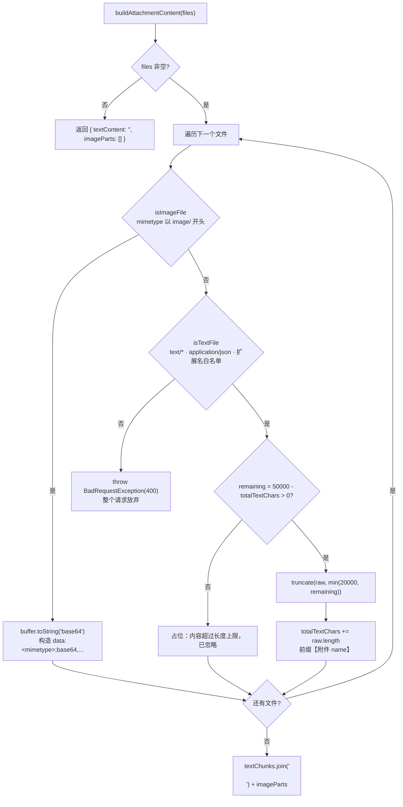
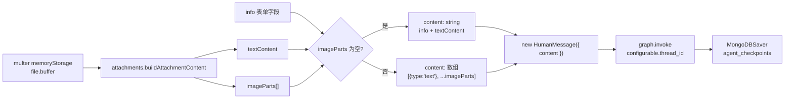

这一页只讨论一个组件：`be/src/ai/operator/attachments.ts`——它把 multer 收进内存的 `Buffer` 编排成「模型能消费的内容」，并顺手完成长度治理。它处在**图执行之前**，属于纯粹的输入整形层：不依赖 Nest 的 DI 容器、不依赖 HTTP、不依赖 LangGraph，唯一的外部依赖是 `BadRequestException`。页面聚焦四个问题：**如何判定文件类型、图片如何变成 `image_url`、文本如何在不撑爆上下文的前提下内联、以及这些内容如何落到多模态消息体里并被 checkpoint 持久化**。

Sources: [attachments.ts](be/src/ai/operator/attachments.ts#L1-L22)

## 为什么这一层必须是纯函数

`buildAttachmentContent` 的入参类型不是 `Express.Multer.File`，而是一个只含三个字段的本地接口 `UploadedFileLike { originalname, mimetype, buffer }`。这个刻意收窄的契约带来两个工程收益：单测可以在**不启动 HTTP 服务、不引入 multer**的情况下构造附件（测试里正是用一个 `createFile` 工厂直接造对象）；同时它把「文件从哪来」与「文件怎么被消费」解耦——未来换用对象存储直传、或从消息队列消费附件，只要拼得出这三个字段，转换逻辑无需改动。

Sources: [attachments.ts](be/src/ai/operator/attachments.ts#L3-L10), [attachments.spec.ts](be/src/ai/operator/attachments.spec.ts#L9-L17)

返回值同样是显式契约：`AttachmentContent` 把结果拆成 `textContent`（已拼接的文本）与 `imageParts`（OpenAI 兼容的 `{ type: 'image_url', image_url: { url } }` 数组）。注意注释里那句「图片附件不包含在内」——这不是随手写的注释，而是后续消息组装分支的依据：`textContent` 永远只承载文本类附件的载荷，图片的信息完全走 `imageParts` 这条独立通道。

Sources: [attachments.ts](be/src/ai/operator/attachments.ts#L12-L22)

## 三路分派：图片、文本、拒绝

遍历逻辑是一个「先判图片、再判文本、否则拒绝」的三路分派，两个判定函数的证据来源并不相同，这是理解整个模块行为的关键：**图片只看 MIME 前缀**（`image/`），**文本是 MIME 与扩展名的并集**（`text/*`、`application/json`，或扩展名落在 `TEXT_EXTENSIONS` 白名单内）。扩展名通过 `getExtension` 取最后一个 `.` 之后的部分并统一小写，因此 `.MD`、`.JSON` 这类大写后缀同样命中。

Sources: [attachments.ts](be/src/ai/operator/attachments.ts#L29-L63)

分支顺序本身携带语义：图片判定在最前，意味着**一个 `image/*` 的文件绝不会因为扩展名不认识而被拒**；反过来，一张图片如果 MIME 被识别成 `application/octet-stream`，就会掉进 `isTextFile` 的扩展名分支——而 `.ts` 里的 `IMAGE_EXTENSIONS` 常量声明之后从未被引用，后端实际不做图片的扩展名兜底（对比前端 `Chat.vue` 用的是自己的 `IMAGE_EXTENSIONS` 做扩展名筛选）。这就是前后端判据不一致的具体位置：前端按扩展名放行，后端按 MIME 分类。

Sources: [attachments.ts](be/src/ai/operator/attachments.ts#L29-L63), [Chat.vue](fe/src/components/Chat.vue#L111-L115), [Chat.vue](fe/src/components/Chat.vue#L158-L162)

第三路是**硬失败**。遇到既非图片也非文本的二进制（pdf/docx/xlsx/pptx 等），直接抛出 `BadRequestException`，错误消息里带上原始文件名和一个尽力而为的类型标识（扩展名优先，退化为 mimetype，再退化为「未知类型」）。这个设计决定了两点行为：其一，拒绝发生在**进入图之前**，不会带着无意义的二进制去消耗模型 token；其二，抛异常中止整个循环，因此处理是「全有或全无」——即使前几个文本附件已经解析成功，也不会以部分成功的形态返回。

Sources: [attachments.ts](be/src/ai/operator/attachments.ts#L92-L98), [AiOperator.ts](be/src/ai/operator/AiOperator.ts#L88-L90)

## 图片分支：Data URI 的构造与代价

图片处理只有三行，但每一行都有后果。`file.buffer.toString('base64')` 把内存缓冲编码，再拼成 `data:${file.mimetype};base64,${base64}` 的 Data URI 塞进 `image_url.url`。之所以不会出现 `data:undefined`，恰恰依赖前面的 MIME 判定：能走到这里就说明 `mimetype` 非空且以 `image/` 开头，分支自带前置不变量。

Sources: [attachments.ts](be/src/ai/operator/attachments.ts#L83-L90)

代价来自两处可量化的放大。第一处是 **base64 的 4/3 膨胀**：multer 的 `MAX_FILE_SIZE` 是 10MB，编码后字符串约 13.3MB。第二处更隐蔽——这条 `HumanMessage` 的 `content` 是数组，会被 `messagesStateReducer` 收进 messages，再由 `MongoDBSaver` 按 `thread_id` 落进 `agent_checkpoints` 集合。也就是说**图片的 base64 会成为对话历史的一部分被持久化**，并且在该 thread 的后续每一轮中，都会随历史一起再次进入模型上下文。图片不是「一次性输入」，而是「长期资产 + 长期成本」。

Sources: [ai.controller.ts](be/src/ai/ai.controller.ts#L14-L17), [attachments.ts](be/src/ai/operator/attachments.ts#L84-L88), [state.ts](be/src/ai/graph/state.ts#L31-L35), [checkpointer.ts](be/src/ai/graph/checkpointer.ts#L44-L49)

这解释了一个容易被误判为 bug 的现象：同一 thread 里第二轮不带图片提问，token 用量仍显著偏高。根因不在本轮请求，而在上一轮图片的 Data URI 仍然躺在 checkpoint 恢复出来的历史里，被 `createAgentNode` 连同 system prompt 一起重新送给模型——节点只过滤了 `system` 类型消息，没有任何针对多模态历史的裁剪。

Sources: [nodes.ts](be/src/ai/graph/nodes.ts#L32-L44)

## 文本分支：两级字符预算

文本侧的治理用两个导出常量表达：单文件 `MAX_TEXT_CHARS_PER_FILE = 20000`，单请求合计 `MAX_TOTAL_TEXT_CHARS = 50000`。它们以 `export const` 形式暴露，动机是让测试能直接引用常量构造边界数据，而不是在断言里硬编码魔数。

Sources: [attachments.ts](be/src/ai/operator/attachments.ts#L24-L27), [attachments.spec.ts](be/src/ai/operator/attachments.spec.ts#L63-L84)

预算的消耗过程有一个值得注意的实现细节：`remaining = MAX_TOTAL_TEXT_CHARS - totalTextChars` 在每个文件前重算，然后实际截断长度取 `Math.min(MAX_TEXT_CHARS_PER_FILE, remaining)`，最后 `totalTextChars += raw.length`（加的是**截断后**的长度）。这构成一个单调不可逆的账本：预算只会被一张文件吃光或吃半，并且 `remaining <= 0` 之后的所有后续文本附件都不再读取内容，只留一行占位说明。

Sources: [attachments.ts](be/src/ai/operator/attachments.ts#L100-L114)

| 场景 | 实际行为 | 写进 prompt 的文本 |
| --- | --- | --- |
| 文件 ≤ 20000 字符，预算充足 | 全文内联 | `【附件 name】\n` + 原文 |
| 文件 > 20000 字符，预算充足 | 截到 20000 | `【附件 name】\n` + 前 20000 字 + `\n...(内容过长已截断)` |
| 文件较大且剩余预算 < 20000 | 截到 `remaining` | 同上，但后缀文案仍是「内容过长已截断」 |
| 剩余预算已耗尽 | 不读内容 | `【附件 name】内容超过长度上限，已忽略` |
| 无附件 | 空数组直接返回 | `''` |

表格第三行暴露了文案与因果的错位：`truncate` 的限额参数可能是「剩余总额」而非「单文件上限」，但后缀统一为「内容过长已截断」。排查「为什么这个不大的文件被截了」时，正确线索是**前面文件的累计消耗**，而不是这个文件自身的大小。另外，截断后缀本身也计入 `raw.length`，即预算里包含标记文本的开销（这也是测试用 `MAX_TOTAL_TEXT_CHARS + 1000` 这类宽松上界断言的原因）。

Sources: [attachments.ts](be/src/ai/operator/attachments.ts#L65-L66), [attachments.ts](be/src/ai/operator/attachments.ts#L100-L114), [attachments.spec.ts](be/src/ai/operator/attachments.spec.ts#L73-L84)

解码一律用 `buffer.toString('utf8')`，没有 BOM 剥离、没有编码探测。这既是「当前阶段只支持纯文本」的诚实边界，也意味着一个被 MIME/扩展名伪装成文本的二进制会变成一串替换字符进入 prompt——不会报错，只会让模型看到乱码。文件之间的分隔是双换行 `join('\n\n')`，与每个块自带的 `【附件 文件名】` 前缀一起，构成了模型区分「多个附件」的全部结构信号。

Sources: [attachments.ts](be/src/ai/operator/attachments.ts#L108-L116)

## 消息组装：从两个字段到一条 content

转换结果在 `AiOperator.chat` 里被压成一条 `HumanMessage` 的 `content`，这里有一个二态分支：**没有图片时 content 是纯字符串**（问题与文本附件用 `\n\n` 连接，空串被 `filter(Boolean)` 剔除）；**有图片时 content 是数组**，第一个元素是 `{ type: 'text', text }`，随后展开 `imageParts`。文本永远排在图片之前，这个顺序让模型先读指令与文本资料，再看图。

Sources: [AiOperator.ts](be/src/ai/operator/AiOperator.ts#L90-L99)

数组分支里那个 `|| '请描述这些图片的内容'` 兜底值得单独说明：它是「只传图片、不写任何文字」这一合法输入的唯一出口。而在纯字符串分支，同样的「只有附件没有提问」会得到 `textContent` 本身——没有兜底提示，也不报错，因为 `question` 为空但有 `files` 时前置校验已放行。这两种输入形态在同一入口下走了不同语义，是阅读调用链时最容易看出差别的一处。

Sources: [AiOperator.ts](be/src/ai/operator/AiOperator.ts#L77-L99)

## 反向：extractTextContent 的归一化

同一模块还负责反方向的形状归一化。`extractTextContent` 处理四种形态：字符串原样返回；数组逐项取 `text`（同时兼容数组里混着裸字符串）；对象上若有 `text` 字段则取之；`null`/`undefined` 返回空串；其余情况 `String()` 兜底。注释点明了动因——「某些 OpenAI 兼容实现会把 content 返回成数组（多模态格式）」，因此这是对厂商差异的防御，而不是对自家数据的假设。

Sources: [attachments.ts](be/src/ai/operator/attachments.ts#L119-L137)

它被 `runGraph` 用于把最后一条 `AIMessage.content` 变成给前端的纯文本，同一处还顺手抽出 `usage_metadata`、`stepCount`、`toolCallCount`。前端 `Chat.vue` 里的 `formatContent` 是一份**独立实现的镜像逻辑**（同样处理字符串与数组），两条实现各自演化，这是观察接口契约漂移的合适切入点。

Sources: [AiOperator.ts](be/src/ai/operator/AiOperator.ts#L129-L139), [Chat.vue](fe/src/components/Chat.vue#L135-L145)

## 四道闸门与失败语义

长度与数量治理不是一处限制，而是四层依次收紧的闸门，每层的失败表现不同：

| 层 | 限制 | 载体 | 越界后果 |
| --- | --- | --- | --- |
| 前端选择 | 扩展名白名单、10MB、50 个、同名同尺寸去重 | `Chat.vue` 的 `handleFileChange` | `ElMessage.warning` 提示并跳过该文件，其余照常提交 |
| multer | `fileSize: 10MB`、`files: 50` | `FilesInterceptor` 的 `limits` | 非 `HttpException`，被全局过滤器归入 500「服务器内部错误」 |
| 类型闸门 | 仅图片与纯文本 | `attachments.ts` | `BadRequestException` → `{ code: 400, message: 含文件名 }` |
| 长度闸门 | 20000 / 50000 字符 | `attachments.ts` | 截断或占位说明，不报错 |

Sources: [Chat.vue](fe/src/components/Chat.vue#L172-L201), [ai.controller.ts](be/src/ai/ai.controller.ts#L35-L47), [http-exception.filter.ts](be/src/common/filters/http-exception.filter.ts#L21-L43)

表格第二行是这套分层里唯一的「语义裂缝」：`HttpExceptionFilter` 对 `HttpException` 逐字段提取 `message` 并令 `code = status`，否则一律落到 500 与「服务器内部错误」。multer 抛出的 `MulterError`（例如超限）不属于 `HttpException`，于是它的具体原因不会透出，前端只能拿到泛化文案。相对地，`BadRequestException` 路径是完整闭环的：message 原样带出，`code = 400`，前端 `chatKimi` 读到 `payload.code !== 200` 后抛出，由 `handleSend` 把 message 写进助手气泡。

Sources: [http-exception.filter.ts](be/src/common/filters/http-exception.filter.ts#L37-L63), [ai.ts](fe/src/api/ai.ts#L61-L73), [Chat.vue](fe/src/components/Chat.vue#L236-L242)

## 测试锚点

`attachments.spec.ts` 把上述每一条行为都钉成了断言，可以作为本页内容的可执行摘要：文本内联保留文件名前缀、MIME 缺失时靠扩展名识别、图片产出精确的 Data URI 字符串、不支持类型抛 `BadRequestException`、单文件截断、合计截断、以及无附件时的空结果；`extractTextContent` 则覆盖字符串、多模态数组与空值三种输入。

Sources: [attachments.spec.ts](be/src/ai/operator/attachments.spec.ts#L19-L112)

这些用例的边界取舍、错误语义的完整讨论与运行方式属于另一页的范畴，见 [附件解析的边界条件与错误语义测试](24-fu-jian-jie-xi-de-bian-jie-tiao-jian-yu-cuo-wu-yu-yi-ce-shi)；本页所依赖的上传通道细节（为何用原生 `fetch` 而非 axios）见 [fetch + FormData 上传：绕开 axios 的 boundary 陷阱](21-fetch-formdata-shang-chuan-rao-kai-axios-de-boundary-xian-jing)。

## 当前边界与可演进点

模块注释已经声明了阶段边界：pdf/docx/xlsx/pptx「当前阶段无法解析，明确返回 400」。这个决定的代价是显式拒绝而非静默丢弃，好处是用户立刻知道失败原因。要让 pdf 进门，改动点高度收敛——在 `isTextFile` 之外的判定链上插入一条「文档抽取分支」，把抽取结果作为 `textChunks` 的一员走同一套字符预算即可，`AttachmentContent` 契约与 `AiOperator` 的组装逻辑都无需变动。

Sources: [attachments.ts](be/src/ai/operator/attachments.ts#L68-L98)

另一处值得留意的冗余是前文提到的 `IMAGE_EXTENSIONS` 未使用常量。它不影响行为，但会让阅读者误以为后端也做图片扩展名兜底；若要消除前后端判据的不一致，最小改动是在 `isImageFile` 中并入扩展名判断，使「MIME 为 `application/octet-stream` 的 `.png`」不再被当作不支持类型拒绝。

Sources: [attachments.ts](be/src/ai/operator/attachments.ts#L29-L36), [attachments.ts](be/src/ai/operator/attachments.ts#L54-L55)

转换层与其上下游的关系可回到职责分层的全景中重看：[Controller / Service / Operator 三层职责边界](17-controller-service-operator-san-ceng-zhi-ze-bian-jie)；而图片 Data URI 进入 `agent_checkpoints` 后的存储与读取机制，见 [MongoDB Checkpointer：短期记忆的落库与读取](10-mongodb-checkpointer-duan-qi-ji-yi-de-luo-ku-yu-du-qu)。