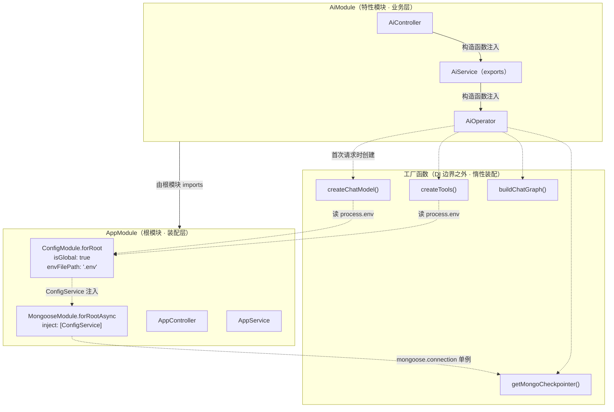
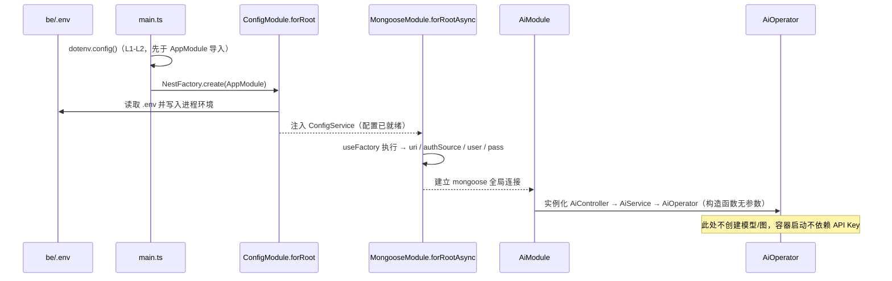
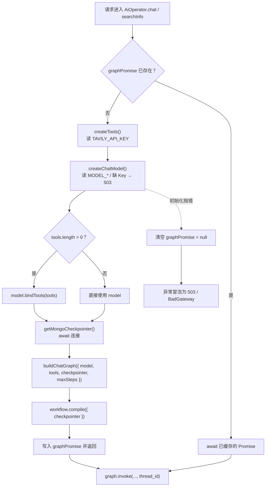

本页剖析后端 NestJS 容器内部的**装配契约**：根模块如何把「基础设施」（配置、MongoDB 连接）与「业务能力」（AI 聊天）分成两个模块，两者在 `imports` 与依赖注入（DI）层面如何协作，以及一个关键的设计取舍——**为什么配置同时存在两条读取通道（`ConfigService` 与 `process.env`），它们又为何不会互相污染**。阅读本页后，你应当能回答三个问题：新增一个需要配置的模块应该 inject `ConfigService` 还是直接读 `process.env`；为什么 `MongooseModule` 必须写成 `forRootAsync`；以及为什么 `AiOperator` 的构造函数是空的却仍能拿到模型、工具与 checkpointer。

Sources: [app.module.ts](be/src/app.module.ts#L1-L37), [ai.module.ts](be/src/ai/ai.module.ts#L1-L12)

## 根模块的职责切分：四行 imports 的分层语义

`AppModule` 只做四件事，且顺序本身就承载语义：先建立**配置上下文**（`ConfigModule.forRoot`），再建立**数据库连接**（`MongooseModule.forRootAsync`），最后挂载**业务模块**（`AiModule`），控制器与服务则留在根模块内提供无状态的元信息接口。

| 位置 | 声明 | 层级 | 作用域 |
|---|---|---|---|
| L10-L13 | `ConfigModule.forRoot({ isGlobal: true, envFilePath: '.env' })` | 基础设施 | 全局可见，加载 `.env` 到进程环境 |
| L17-L31 | `MongooseModule.forRootAsync({ inject: [ConfigService], ... })` | 基础设施 | 全局 MongoDB 连接（隐式全局） |
| L32 | `AiModule` | 业务能力 | 独立特性模块，`imports: []` |
| L34-L35 | `AppController` / `AppService` | 展示层 | 根模块内，仅返回静态服务信息 |

`isGlobal: true` 是一个容易被忽略但决定性的参数：它让 `ConfigModule` 导出的 `ConfigService` 无需在每个特性模块里重复 `imports` 即可被注入。这正是 `AiModule` 敢写下 `imports: []` 的前提——如果 `isGlobal` 为 false，任何想拿配置的模块都必须显式引入，模块边界会立刻变得啰嗦。

Sources: [app.module.ts](be/src/app.module.ts#L8-L36), [ai.module.ts](be/src/ai/ai.module.ts#L6-L12)

图中实线是 Nest 的 DI 装配，虚线是运行时的**工厂调用**：所有 LangGraph 相关对象都诞生在虚线上，从未进入容器。

Sources: [ai.service.ts](be/src/ai/ai.service.ts#L8-L19), [AiOperator.ts](be/src/ai/operator/AiOperator.ts#L25-L52)

## 两条配置通道：一处 `ConfigService`，全局 `process.env`

这是本系统最值得记录的架构不对称。全仓库只有 `MongooseModule` 的工厂函数通过 `ConfigService` 取配置，**其余所有配置读取都是直接 `process.env`**。

| 配置项 | 读取方式 | 读取时机 | 证据位置 |
|---|---|---|---|
| `MONGODB_URI` / `authSource` / `user` / `pass` | `config.get<string>()` | 容器启动、provider 实例化 | [app.module.ts](be/src/app.module.ts#L19-L30) |
| `MODEL_API_KEY` / `OPENAI_API_KEY` | `process.env` | 每次 `createChatModel()` 调用 | [model.ts](be/src/ai/model.ts#L16-L21) |
| `MODEL_NAME` / `MODEL_BASE_URL` / `MODEL_TEMPERATURE` | `process.env` | 每次构造模型时 | [model.ts](be/src/ai/model.ts#L23-L28) |
| `MODEL_DISABLE_THINKING` | `process.env` | 每次构造模型时 | [model.ts](be/src/ai/model.ts#L44-L48) |
| `AGENT_MAX_STEPS` | `process.env` | 模块文件求值期（state.ts）+ 图构建期 | [state.ts](be/src/ai/graph/state.ts#L20-L21), [AiOperator.ts](be/src/ai/operator/AiOperator.ts#L42) |
| `TAVILY_API_KEY` | `process.env` | 每次 `createTools()` 调用 | [tools/index.ts](be/src/ai/tools/index.ts#L14-L24) |
| `DB_NAME` / `MONGODB_URI` / `user` / `pass` / `authSource` | `process.env` | checkpointer 创建时（懒加载） | [checkpointer.ts](be/src/ai/graph/checkpointer.ts#L18-L42) |
| `PORT` | `process.env` | `app.listen()` 调用时 | [main.ts](be/src/main.ts#L33)

两条通道不会打架，原因在于它们最终指向**同一处存储**：`@nestjs/config` 的加载结果会写入进程环境，而 `process.env` 读取的正是同一份数据。`MONGODB_URI` 因此在两个通道里被读到两次——一次由 `MongooseModule` 建立连接，一次由 checkpointer 作为兜底自建连——但取到的值必然一致。

Sources: [app.module.ts](be/src/app.module.ts#L10-L31), [checkpointer.ts](be/src/ai/graph/checkpointer.ts#L11-L42)

这种不对称并非疏漏，而是与「DI 边界画在哪里」强相关：`process.env` 的读取者全是**纯函数工厂**（`createChatModel`、`createTools`、`createMongoCheckpointer`），它们位于容器之外、可被单元测试直接调用。一旦把它们改成 `@Injectable` + `ConfigService`，这些工厂就必须依赖容器才能运行，`graph.spec.ts` 里那种「传入假模型即可测图」的轻量性会随之消失。取舍可总结为：

| 维度 | 注入 `ConfigService` | 直读 `process.env` |
|---|---|---|
| 可测试性 | 需要构造 TestingModule 或 mock 服务 | 纯函数，直接调用/改环境变量即可 |
| 类型安全 | `config.get<T>()` 可加泛型 | 需手动 `Number()` / `\|\|` 兜底 |
| 校验/转换能力 | 支持 `validationSchema`、命名空间配置 | 无 |
| 适合对象 | 需要在**启动期**完成一次性装配的 provider | 运行期按需创建、易被独立调用的工厂 |

Sources: [model.ts](be/src/ai/model.ts#L11-L29), [tools/index.ts](be/src/ai/tools/index.ts#L14-L27), [graph.spec.ts](be/src/ai/graph/graph.spec.ts#L1-L33)

## 为什么 `MongooseModule` 必须写成 `forRootAsync`

源代码里有一段罕见的「自带解释」的注释，直指 Nest 模块求值顺序的陷阱：如果用 `MongooseModule.forRoot({ uri: process.env.MONGODB_URI })`，`uri` 表达式的求值发生在**模块文件被 import 的那一刻**，而那一刻 `dotenv` 尚未把 `.env` 写进 `process.env`，于是只能拿到命令行环境变量，`.env` 里的 `MONGODB_URI` 会被静默吞掉。

Sources: [app.module.ts](be/src/app.module.ts#L14-L18)

`forRootAsync` + `inject: [ConfigService]` 把求值推迟到**工厂函数执行的那一刻**——此时 `ConfigModule` 已完成加载，`ConfigService` 拿到的是完整配置。用一张表对比两种写法的时序差异：

| 写法 | 求值时机 | 能否读到 `.env` | 失败表现 |
|---|---|---|---|
| `forRoot({ uri: process.env.X })` | 模块文件求值期（import 时） | 不能（除非另有 `dotenv.config()` 先行） | `uri: undefined`，连接报错或无认证信息 |
| `forRootAsync({ inject: [ConfigService], useFactory })` | provider 实例化期（容器启动中） | 能 | 配置缺失时在启动阶段显式暴露 |

注意 `useFactory` 中那三处展开语法（`...(config.get('authSource') ? {...} : {})`）：它们让**空值不产生空字符串字段**。`.env.example` 中 `authSource=`、`user=`、`pass=` 默认留空，若直接把空字符串传给 mongoose，会被当成真实用户名/认证源而触发认证失败，条件展开避免了这个问题。

Sources: [app.module.ts](be/src/app.module.ts#L19-L31), [.env.example](be/.env.example#L22-L26)

## `dotenv` 的三个加载入口与入口差异

配置能生效，靠的是三个互补的 `dotenv` 调用点，它们服务于不同的启动路径：

| 加载点 | 位置 | 服务的启动方式 |
|---|---|---|
| `main.ts` 顶部 `dotenv.config()` | [main.ts](be/src/main.ts#L1-L2) | `pnpm start:dev` / `node dist/main`，且早于 `AppModule` 导入 |
| `ConfigModule.forRoot({ envFilePath: '.env' })` | [app.module.ts](be/src/app.module.ts#L10-L13) | 所有通过容器启动的路径，由 `ConfigService` 消费 |
| 工具注册表内 `dotenv.config()` | [tools/index.ts](be/src/ai/tools/index.ts#L1-L4) | 直接 import `createTools` 的场景（单测、脚本） |

第三处看似冗余，实则是防御性设计：`state.ts` 在**模块文件求值期**就把 `AGENT_MAX_STEPS` 固化为 `DEFAULT_MAX_STEPS` 常量，`tools/index.ts` 同样在求值期调用 `dotenv.config()`。当入口不是 `main.ts` 时（例如 e2e 测试直接 `imports: [AppModule]`），这些顶层表达式必须自己保证环境已经加载，否则会静默退化为默认值（8 步、无搜索工具）。

Sources: [state.ts](be/src/ai/graph/state.ts#L20-L21), [tools/index.ts](be/src/ai/tools/index.ts#L1-L27), [app.e2e-spec.ts](be/test/app.e2e-spec.ts#L1-L21)

另外注意 `envFilePath: '.env'` 是**相对进程工作目录**的路径，因此后端必须在 `be/` 目录下启动——README 的启动步骤正是先 `cd be` 再 `pnpm start:dev`。从仓库根目录启动会读不到 `.env`，表现出的症状是「明明配了 Key 却报未配置」。

Sources: [app.module.ts](be/src/app.module.ts#L10-L13), [README.MD](README.MD#L50-L60)

## `AiModule` 的边界：空 `imports` 与三段式依赖链

`AiModule` 的元数据只有四行有效声明，但每一行都定义了明确的契约：

| 字段 | 值 | 契约含义 |
|---|---|---|
| `imports: []` | 无 | 不依赖任何其它模块；配置通过全局 `ConfigModule` 与 `process.env` 两条路径获得，无需显式引入 |
| `controllers` | `[AiController]` | HTTP 入口唯一，`@Controller()` 不带前缀 |
| `providers` | `[AiService, AiOperator]` | 两个可注入对象，形成 `Controller → Service → Operator` 的单向链 |
| `exports` | `[AiService]` | 对外只暴露门面，`AiOperator` 保持模块私有 |

Sources: [ai.module.ts](be/src/ai/ai.module.ts#L6-L12)

依赖注入链是严格的单向三段：`AiController` 构造函数注入 `AiService`，`AiService` 构造函数注入 `AiOperator`，`AiOperator` 的构造函数**为空**。前两跳是典型的 Nest 服务装配，第三跳的断点正是本页的核心：**容器只负责到 `AiOperator` 这一层，图对象的一切装配交由运行期的工厂函数完成**。当前仓库内除 `AiController` 外没有其它消费者，`exports: [AiService]` 是一份已声明但尚未被使用的对外契约。

Sources: [ai.controller.ts](be/src/ai/ai.controller.ts#L23-L47), [ai.service.ts](be/src/ai/ai.service.ts#L8-L19), [AiOperator.ts](be/src/ai/operator/AiOperator.ts#L25-L27)

`AiService` 在链中几乎没有逻辑——两个方法都是对 `AiOperator` 的原样转发。它的价值不在代码量，而在于**隔离了图编排的复杂度**：控制器只看到一个两方法的门面（`searchInfo` / `chat`），完全不知道 LangGraph、checkpointer、`bindTools` 的存在。若将来要在 `AiModule` 内重构编排细节，控制器无需改动。

Sources: [ai.service.ts](be/src/ai/ai.service.ts#L4-L19)

## 惰性图装配：`graphPromise` 的三重契约

`AiOperator` 用一个私有方法与一个可空字段完成了延迟初始化：`getGraph()` 首次调用时创建工具、模型、checkpointer，构建并编译图；结果存入 `graphPromise`，后续请求直接复用同一个 Promise。

这个缓存机制承载了三条契约：

1. **启动与凭证解耦**——缺 `MODEL_API_KEY` 时容器照常启动（构造函数无副作用），只在首个请求时由 `readModelSettings()` 抛出 `ServiceUnavailableException`，信息里直接给出「请在 be/.env 中设置 MODEL_API_KEY」的修复指引。
2. **失败可恢复**——`.catch()` 分支把 `graphPromise` 重置为 `null`，所以修好配置后无需重启进程，下一次请求会重新尝试装配。
3. **装配开销仅付一次**——`compile()`、`bindTools()`、`MongoDBSaver` 构造都只发生一次，与请求量无关。

Sources: [AiOperator.ts](be/src/ai/operator/AiOperator.ts#L29-L52), [model.ts](be/src/ai/model.ts#L15-L21)

同样的模式在 checkpointer 层重复出现：模块级 `checkpointerPromise` 保证「进程内复用同一个 checkpointer 实例」，失败时同样把变量置回 `null`。两层缓存叠加的效果是——**整个进程只有一份图、一份 checkpointer**，与其单用户、单会话的定位一致。需要留意的是，这两处缓存都不受 Nest 容器生命周期管理：它们在 `app.close()` 时不会被清理，测试中反复创建应用会共享同一份实例。

Sources: [checkpointer.ts](be/src/ai/graph/checkpointer.ts#L52-L63)

## 隐式耦合点：`AiModule` 如何「借用」mongoose 连接

`AiModule` 的 `imports: []` 意味着它**没有引入 `MongooseModule`**，也就无法通过 DI 注入 mongoose 连接。它走的是另一条路：直接访问 `mongoose` 包的全局单例，并在 `readyState === 1` 时复用已建立的连接，否则用同一份 `MONGODB_URI` 自建 `MongoClient`。

| 分支条件 | 行为 | 依赖的模块协作 |
|---|---|---|
| `readyState === 1`（连接就绪） | `conn.getClient()` 复用 Nest 已建连接 | 依赖 `AppModule` 中 `MongooseModule.forRootAsync` 先完成连接 |
| 否则（未就绪/未初始化） | 用 `process.env.MONGODB_URI` 等自建连接 | 不依赖容器，可脱离 Nest 单独使用 |

这正是两个模块之间唯一实质性的运行时耦合：`AiModule` 不声明对 `MongooseModule` 的依赖，却依赖它「先连上」这个事实。兜底分支的存在让耦合变成软依赖——连接时序不理想时不会直接崩，而是多建一条连接。连接复用与启动时序的完整分析见 [Mongoose 连接复用与启动时序陷阱](12-mongoose-lian-jie-fu-yong-yu-qi-dong-shi-xu-xian-jing)。

Sources: [checkpointer.ts](be/src/ai/graph/checkpointer.ts#L5-L50), [app.module.ts](be/src/app.module.ts#L17-L31)

值得注意的是 `dbName` 的三级回退：`process.env.DB_NAME` → `mongoose.connection.db.databaseName` → 常量 `'chat_robot'`。中间一级直接读取了 mongoose 连接的库名，是复用连接的另一处体现；若 `AiModule` 当初注入的是 `@InjectConnection()`，这行本可以写得更直白。

Sources: [checkpointer.ts](be/src/ai/graph/checkpointer.ts#L39-L42)

## 装配层与全局中间件的分工

还有一处「没走 DI」的地方与模块划分直接相关：全局响应拦截器与异常过滤器是在 `main.ts` 里用 `new` 手工注册的，而非通过 `APP_INTERCEPTOR` / `APP_FILTER` provider 注入。这带来一个可观测后果——**e2e 测试直接编译 `AppModule`，因此拿不到统一包装**，测试断言的是控制器原始返回值。

| 注册方式 | 生效范围 | 在 `Test.createTestingModule({ imports: [AppModule] })` 下 |
|---|---|---|
| `app.useGlobalInterceptors(new ResponseInterceptor())` | 该 `INestApplication` 实例 | 不生效 |
| `useGlobalFilters(new HttpExceptionFilter())` | 该 `INestApplication` 实例 | 不生效 |
| `providers: [{ provide: APP_INTERCEPTOR, useClass: ... }]` | 容器级，随 `AppModule` 一起加载 | 生效 |

`AiController` 的 `FilesInterceptor` 也是同理——它以装饰器参数的形式内联构造（`MAX_FILES = 50`、`MAX_FILE_SIZE = 10MB` 为文件常量），不参与容器装配，而是每个路由声明周期内由 Nest 实例化。

Sources: [main.ts](be/src/main.ts#L9-L30), [app.e2e-spec.ts](be/test/app.e2e-spec.ts#L14-L38), [ai.controller.ts](be/src/ai/ai.controller.ts#L14-L47)

## 新增模块时的决策清单

把本页的结论收敛成一组可直接套用的判断规则：

| 你要做的事 | 应当选择 | 理由 |
|---|---|---|
| 新增一个需要数据库 collection 的特性模块 | `imports: [MongooseModule.forFeature([...])]` | 与 `AiModule` 不同，这类模块需要**模型注入**，必须显式引入 |
| 新增一个纯业务模块（无 DB 模型） | `imports: []` + 依赖全局 `ConfigModule` | 与 `AiModule` 同构，避免冗余 import |
| 在**启动期**需要一次性完成的装配（连接、SDK 客户端） | `forRootAsync` + `inject: [ConfigService]` | 避开模块文件求值期读不到 `.env` 的陷阱 |
| 在**请求期**按需创建、需可被独立测试的对象 | 纯工厂函数 + `process.env` | 保留脱离容器测试的能力 |
| 对外暴露能力给其它模块 | 在 `exports` 中导出**服务级门面**，不导出内部实现 | `AiModule` 只导出 `AiService`，`AiOperator` 保持私有 |

Sources: [app.module.ts](be/src/app.module.ts#L8-L36), [ai.module.ts](be/src/ai/ai.module.ts#L6-L12), [model.ts](be/src/ai/model.ts#L11-L29)

## 延伸阅读

本页聚焦「模块与配置如何装配」，两条相邻主线的细节在专门页面展开：DI 之下的三层职责切分见 [Controller / Service / Operator 三层职责边界](17-controller-service-operator-san-ceng-zhi-ze-bian-jie)；`buildChatGraph` 的可注入模型接口与图组装细节见 [图组装与可注入模型接口：让编排可测试](8-tu-zu-zhuang-yu-ke-zhu-ru-mo-xing-jie-kou-rang-bian-pai-ke-ce-shi)；配置项的完整含义与 `.env` 面板见 [配置与环境变量：唯一的凭证是模型 API Key](4-pei-zhi-yu-huan-jing-bian-liang-wei-de-ping-zheng-shi-mo-xing-api-key)；全局包装契约见 [全局响应包装与异常过滤器：统一 {code, message, data} 契约](18-quan-ju-xiang-ying-bao-zhuang-yu-yi-chang-guo-lu-qi-tong-code-message-data-qi-yue)。