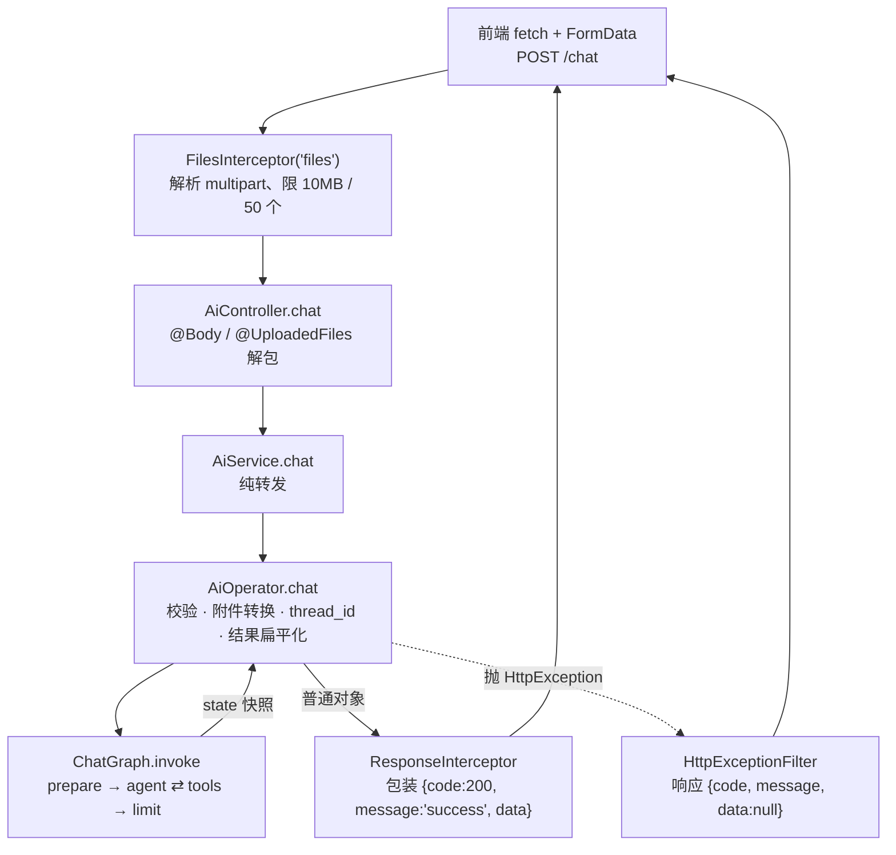
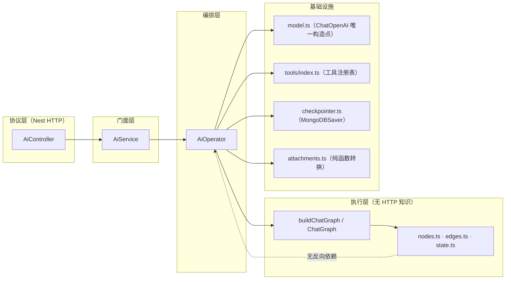

本页聚焦后端 AI 模块的三层分工：**`AiController` 只做 HTTP 协议适配，`AiService` 只做门面转发，`AiOperator` 承担全部编排职责**。理解这条边界的价值在于：它是"改动应该落在哪一层"的唯一判据。凡是与 HTTP 报文结构（multipart、query、状态码）相关的改动落到 Controller；凡是"把用户输入变成图能消费的形态、把图输出变回 HTTP 友好结构"的改动落到 Operator；`AiService` 则应长期保持零逻辑。图本身的循环、路由、状态语义则属于第四层（`graph/`），不在本页主线内，参见 [四类节点的职责：prepare / agent / tools / limit](6-si-lei-jie-dian-de-zhi-ze-prepare-agent-tools-limit) 与 [条件边路由与步数上限：防止工具调用死循环](7-tiao-jian-bian-lu-you-yu-bu-shu-shang-xian-fang-zhi-gong-ju-diao-yong-si-xun-huan)。

Sources: [ai.controller.ts](be/src/ai/ai.controller.ts#L19-L48), [ai.service.ts](be/src/ai/ai.service.ts#L1-L19), [AiOperator.ts](be/src/ai/operator/AiOperator.ts#L20-L27)

## 三层全景与请求流

一次 `POST /chat` 的完整穿越路径如下。注意两个"外层"参与者：`FilesInterceptor`（框架中间件，在 Controller 方法执行**之前**完成 multipart 解析）与全局 `ResponseInterceptor` / `HttpExceptionFilter`（在 Controller 返回**之后**统一改写成 `{code, message, data}`）。这意味着 Controller 自己既不需要解析文件，也不需要包装返回体。

Sources: [ai.controller.ts](be/src/ai/ai.controller.ts#L35-L47), [ai.service.ts](be/src/ai/ai.service.ts#L16-L18), [AiOperator.ts](be/src/ai/operator/AiOperator.ts#L77-L122), [response.interceptor.ts](be/src/common/filters/response.interceptor.ts#L16-L30), [http-exception.filter.ts](be/src/common/filters/http-exception.filter.ts#L59-L63)

三层的输入输出契约可以压成一张对照表。核心不对称在于：**Controller 的输出是"裸数据"，Operator 的输出是"已定型的业务对象"，而两者之间没有任何字段裁剪**。

| 维度 | `AiController` | `AiService` | `AiOperator` |
|---|---|---|---|
| 文件位置 | `ai/ai.controller.ts` | `ai/ai.service.ts` | `ai/operator/AiOperator.ts` |
| 输入 | `@Query` / `@Body` / `@UploadedFiles` 原始报文 | 已解包的普通参数 | 字符串 + `sessionId` + `Express.Multer.File[]` |
| 输出 | 直接 `return` Operator 结果，不加工 | 直接 `return` Operator 的 Promise | `{content, tokenUsage, steps, toolCalls, threadId, user}` |
| 依赖 | 只依赖 `AiService` | 只依赖 `AiOperator` | 依赖 `createTools` / `createChatModel` / `getMongoCheckpointer` / `buildChatGraph` / `buildAttachmentContent` |
| 是否抛业务异常 | 否（仅框架层 400：文件超限） | 否 | 是（400 / 502，透传 503） |
| 职责关键词 | 路由、装饰器、参数解包 | 门面 | 校验、转换、编排、错误语义映射 |

Sources: [ai.controller.ts](be/src/ai/ai.controller.ts#L23-L47), [ai.service.ts](be/src/ai/ai.service.ts#L8-L18), [AiOperator.ts](be/src/ai/operator/AiOperator.ts#L26-L140)

## Controller：只做协议适配，不做业务判断

`AiController` 的代码量极小，且每个元素都是"协议层词汇"：`@Controller()` 空前缀让路由成为根级的 `GET /search` 与 `POST /chat`；`@UseInterceptors(FilesInterceptor(...))` 把 multipart 解析、单文件 10MB、单次 50 个的上限声明交给框架；方法体只有 `@Body('info')`、`@Body('sessionId')`、`@UploadedFiles()` 三处解包，然后一行 `return`。这里**没有任何 if、try/catch、字段校验或响应包装**。

Sources: [ai.controller.ts](be/src/ai/ai.controller.ts#L14-L47)

`MAX_FILE_SIZE` 与 `MAX_FILES` 两个常量是该层唯一的"策略"痕迹，但它们仍然是传输层策略——超限时由 `multer` 直接返回框架级 400，不进入业务代码。真正的**内容合法性**（内容为空？文件类型支持吗？）全部下沉到 Operator，这说明"体积上限"和"语义上限"被有意分置在不同层。

Sources: [ai.controller.ts](be/src/ai/ai.controller.ts#L14-L17), [ai.controller.ts](be/src/ai/ai.controller.ts#L35-L40), [AiOperator.ts](be/src/ai/operator/AiOperator.ts#L82-L90)

Controller 顶部的注释明确了单用户模式的边界：没有登录与鉴权，所有请求默认以 admin 身份进入 LangGraph，`admin` 身份本身也不由 Controller 注入，而是由图状态中的 `ADMIN_USER` 默认值给出。因此 Controller 既不含身份解析，也不传递任何用户上下文——它连"谁是调用者"都不关心。

Sources: [ai.controller.ts](be/src/ai/ai.controller.ts#L19-L25), [state.ts](be/src/ai/graph/state.ts#L4-L18), [nodes.ts](be/src/ai/graph/nodes.ts#L14-L25)

## Service：刻意保持"空"的门面

`AiService` 的两个方法都是一行透传，并且**不 `await`**——直接把 Operator 的 Promise 原样返回。这一细节让异常与异步时序保持单点：异常在 Operator 内部生成、沿同一 Promise 链向上冒泡到 Nest 的异常过滤层，Service 不做任何拦截或重写。文件头注释已经把这层定位写死："AI 能力门面：控制器只依赖这一层，具体的 LangGraph 图编排由 `AiOperator` 负责"。

Sources: [ai.service.ts](be/src/ai/ai.service.ts#L4-L18)

门面的实际价值体现在模块契约上：`AiModule` 的 `providers` 注册了 `AiService` 与 `AiOperator`，但 `exports` 只导出 `AiService`。也就是说 `AiOperator` 是模块**内部实现**，其他模块即使拿到 `AiModule` 也无法注入它，编译期就阻断了跨模块直接调编排层的可能。

Sources: [ai.module.ts](be/src/ai/ai.module.ts#L6-L12)

这层门面是一次结构债的偿还结果。仓库路线图记录的历史问题是：`AiModule` 只 provide `AiService`，而 `AiService` 内部用 `new AiOperator()` 手动实例化，导致类型退化成 `any`。当前实现改为构造器注入并声明 `private readonly aiOperator: AiOperator`，依赖关系因此可被 Nest 解析、可被类型系统检查。

Sources: [agent-roadmap.md](docs/agent-roadmap.md#L15), [ai.service.ts](be/src/ai/ai.service.ts#L9-L10), [ai.module.ts](be/src/ai/ai.module.ts#L9)

`AppService` 提供了同构的对照样本：根路由 `GET /` 的信息接口同样是"Controller 一行转发 + Service 返回普通对象"，业务对象（模式、内置用户、图节点清单）由 Service 组装，Controller 全程无逻辑。这套模式在小模块里是一致的。

Sources: [app.controller.ts](be/src/app.controller.ts#L4-L13), [app.service.ts](be/src/app.service.ts#L4-L19)

## Operator：编排层承担的五件事

`AiOperator` 的类注释给出了它唯一的自我约束："只负责把输入变成图的状态、调用图、把结果整理成 HTTP 友好的结构。真正的 agent 循环（模型 → 工具 → 模型）全部由 LangGraph 图完成"。这可以拆成五个可独立审阅的职责簇。

Sources: [AiOperator.ts](be/src/ai/operator/AiOperator.ts#L20-L27)

**职责一：依赖图的惰性单例装配。** `getGraph()` 用 `graphPromise` 字段做单次初始化缓存：首次调用时并行完成"取工具 → 建模型 → `bindTools` → 取 checkpointer → 组装图"，其中 `maxSteps` 从 `AGENT_MAX_STEPS` 读取并做 `|| 8` 兜底。注释特别指出工具绑定属于"模型能力"，循环与分支交给图——这是 Operator 不做路由的明文依据。

Sources: [AiOperator.ts](be/src/ai/operator/AiOperator.ts#L27-L43), [graph.ts](be/src/ai/graph/graph.ts#L13-L22)

初始化失败时（例如未配 API Key），`catch` 段把 `graphPromise` 置回 `null` 再抛出，使得修好配置后无需重启进程即可重试。缓存的是 Promise 而不是已完成实例，避免了并发首请求重复建连的竞态。

Sources: [AiOperator.ts](be/src/ai/operator/AiOperator.ts#L44-L52), [checkpointer.ts](be/src/ai/graph/checkpointer.ts#L52-L63)

**职责二：入参语义校验。** `/search` 检查空字符串后抛 `BadRequestException('请输入您的问题内容')`；`/chat` 先 `trim()`，再判断"问题为空且无附件"才拒绝，错误文案合并为"请输入您的问题内容或上传文件"。校验放在 Operator 而非 Controller 的原因是可测试性与复用：校验规则与"图能否被调用"的先决条件绑定在一起。

Sources: [AiOperator.ts](be/src/ai/operator/AiOperator.ts#L57-L60), [AiOperator.ts](be/src/ai/operator/AiOperator.ts#L82-L86)

**职责三：附件 → 模型内容的多模态转换。** 这是 Operator 中唯一"有分支逻辑"的部分：调用 `buildAttachmentContent` 得到文本内联与图片 `data:` URI 两部分，再把主问题、附件文本、图片分片组装成 `string` 或 OpenAI 兼容的 `content` 数组；若无文本但只有图片，则注入兜底提示"请描述这些图片的内容"。转换函数本身被抽到同目录的 `attachments.ts` 并保持纯函数形态（只依赖 `UploadedFileLike` 最小接口），细节参见 [附件多模态转换：图片 Data URI、文本内联与长度治理](15-fu-jian-duo-mo-tai-zhuan-huan-tu-pian-data-uri-wen-ben-nei-lian-yu-chang-du-zhi-li)。

Sources: [AiOperator.ts](be/src/ai/operator/AiOperator.ts#L88-L99), [attachments.ts](be/src/ai/operator/attachments.ts#L3-L22), [attachments.ts](be/src/ai/operator/attachments.ts#L75-L117)

**职责四：会话身份（`thread_id`）的决策。** 两个入口用两套策略：`/search` 生成 `search-${randomUUID()}` 的一次性 `thread_id`，以"每次新线程"实现"不进会话记忆"的语义；`/chat` 使用 `sessionId || 'default'` 复用线程，历史由 Mongo checkpointer 承载。关键点在于 Operator 只把 `thread_id` 通过 `configurable` 传入，而**不把任何会话状态写进图状态**——图的 `messages` 由 checkpointer 按线程持久化，图本身对"这是第几轮"无感知。语义细节参见 [thread_id 生命周期：sessionId 与「清空对话」的语义](11-thread_id-sheng-ming-zhou-qi-sessionid-yu-qing-kong-dui-hua-de-yu-yi)。

Sources: [AiOperator.ts](be/src/ai/operator/AiOperator.ts#L54-L63), [AiOperator.ts](be/src/ai/operator/AiOperator.ts#L101-L103), [AiOperator.ts](be/src/ai/operator/AiOperator.ts#L119-L122)

**职责五：错误语义映射与结果扁平化。** `runGraph()` 把图的失败分两类处理：已是 `HttpException` 的原样透传（注释举例"没配 Key"），其余一律包装成 `BadGatewayException('AI 服务调用失败：…')`。成功路径则把 `result.messages` 的最后一条取出来，用 `extractTextContent` 抹平"字符串 / 数组 / 带 text 的对象"三种厂商差异，并把 `stepCount`、`toolCallCount`、`user` 投影成扁平字段——`/chat` 额外回填 `threadId`。

Sources: [AiOperator.ts](be/src/ai/operator/AiOperator.ts#L115-L140), [AiOperator.ts](be/src/ai/operator/AiOperator.ts#L129-L139), [attachments.ts](be/src/ai/operator/attachments.ts#L119-L137)

需要精确区分的是：模型与 checkpointer 的创建发生在 `getGraph()`（在 `runGraph` 之外），所以"未配 API Key"的 `ServiceUnavailableException` 是从 `getGraph()` 直接抛出的；`runGraph` 内的 `HttpException` 透传分支属于防御性设计，用于兜住图执行过程中可能出现的同类异常。

Sources: [model.ts](be/src/ai/model.ts#L15-L29), [AiOperator.ts](be/src/ai/operator/AiOperator.ts#L44-L48), [AiOperator.ts](be/src/ai/operator/AiOperator.ts#L123-L127)

## 依赖方向：单向、可闭合、无回指

依赖始终单向：`Controller → Service → Operator → (graph / model / tools / checkpointer)`。反向依赖为零——图、模型、工具都不 import Controller 或 Service；不仅如此，图对 Operator 也一无所知，`buildChatGraph` 只接收 `{model, tools, checkpointer, maxSteps}` 四个依赖注入项。

Sources: [ai.controller.ts](be/src/ai/ai.controller.ts#L1-L12), [ai.service.ts](be/src/ai/ai.service.ts#L1-L10), [AiOperator.ts](be/src/ai/operator/AiOperator.ts#L1-L13), [graph.ts](be/src/ai/graph/graph.ts#L1-L11), [tools/index.ts](be/src/ai/tools/index.ts#L14-L27)

这种闭合性让"换引擎不换壳"成为可能：`buildChatGraph` 的入参刻意用 `ChatModelLike`（仅要求 `invoke`）而不是具体模型类型，Operator 传入的 `boundModel` 即使被 `as any` 断言也不影响图层类型；换模型只改 `model.ts` 一处，如图说明所述它是 `ChatOpenAI` 的唯一构造点。

Sources: [nodes.ts](be/src/ai/graph/nodes.ts#L6-L12), [AiOperator.ts](be/src/ai/operator/AiOperator.ts#L32-L35), [model.ts](be/src/ai/model.ts#L31-L49)

## 错误语义归属表

错误在哪个层产生，就决定了最终 HTTP 状态码与前端可见文案。由于全局过滤器对 `HttpException` 保留 `status`、对未知异常统一降级为 500 并 `console.error`，Operator 的"包装未知异常为 502"这一动作实际上承担了**防止内部细节以 500 形式静默泄漏**的职责。

| 触发条件 | 产生位置 | 异常类型 | HTTP | 前端表现 |
|---|---|---|---|---|
| 单个文件 > 10MB 或数量 > 50 | Controller 的 `FilesInterceptor` | 框架级 `PayloadTooLarge`/`BadRequest` | 400 | `message` 来自框架 |
| `/search` 的 `info` 为空 | `AiOperator.searchInfo` | `BadRequestException` | 400 | "请输入您的问题内容" |
| `/chat` 问题与附件同时为空 | `AiOperator.chat` | `BadRequestException` | 400 | "请输入您的问题内容或上传文件" |
| 附件为 pdf/docx 等不可解析类型 | `attachments.buildAttachmentContent` | `BadRequestException` | 400 | 明确列出支持类型 |
| 未配置 `MODEL_API_KEY` | `model.readModelSettings`（经 `getGraph`） | `ServiceUnavailableException` | 503 | 提示在 `be/.env` 设置 |
| 图执行中的任意其他失败 | `AiOperator.runGraph` | `BadGatewayException` | 502 | "AI 服务调用失败：…" |
| 未被上述任何层包装的异常 | 全局过滤器兜底 | — | 500 | "服务器内部错误" + 控制台堆栈 |

Sources: [ai.controller.ts](be/src/ai/ai.controller.ts#L35-L40), [AiOperator.ts](be/src/ai/operator/AiOperator.ts#L57-L60), [AiOperator.ts](be/src/ai/operator/AiOperator.ts#L82-L86), [attachments.ts](be/src/ai/operator/attachments.ts#L92-L98), [model.ts](be/src/ai/model.ts#L16-L21), [AiOperator.ts](be/src/ai/operator/AiOperator.ts#L123-L127), [http-exception.filter.ts](be/src/common/filters/http-exception.filter.ts#L21-L43)

前端的消费方式正好对应这条契约：`ChatResponseData` 的字段与 Operator 的返回对象逐项对齐（`content` / `tokenUsage` / `steps` / `toolCalls` / `threadId` / `user`），且 `chatKimi` 以 `payload.code !== 200` 判定失败、直接透出 `payload.message`。换言之，**Operator 的返回对象就是前后端契约的实体**，任何新增字段都应在此处落地，而不是在 Controller 里二次拼装。统一包装与过滤器的机制细节参见 [全局响应包装与异常过滤器：统一 {code, message, data} 契约](18-quan-ju-xiang-ying-bao-zhuang-yu-yi-chang-guo-lu-qi-tong-code-message-data-qi-yue)。

Sources: [ai.ts](fe/src/api/ai.ts#L8-L26), [ai.ts](fe/src/api/ai.ts#L68-L72), [AiOperator.ts](be/src/ai/operator/AiOperator.ts#L105-L113)

## 可测试性：边界决定测试粒度

三层切分直接映射为三级测试策略，每级都绕开了上一级，因此单测不需要启动 HTTP 服务。**纯函数级**：`attachments.spec.ts` 用最小 `UploadedFileLike` 假对象直接验证 `buildAttachmentContent` / `extractTextContent`，不涉及 Controller、也不涉及图。**图层级**：`graph.spec.ts` 用脚本化假模型（按调用次序返回预设 `AIMessage`）注入 `buildChatGraph`，配合 `MemorySaver` 与假 weather 工具断言"循环 / 记忆 / 上限 / 路由"，完全跳过 Operator 与真实 API。

Sources: [attachments.spec.ts](be/src/ai/operator/attachments.spec.ts#L1-L14), [graph.spec.ts](be/src/ai/graph/graph.spec.ts#L1-L60)

代价是**编排层本身缺少单测**：`AiOperator` 的校验分支、`thread_id` 生成、异常包装目前没有对应 spec，若要覆盖就需要 mock `getMongoCheckpointer` 与 `createChatModel`（两者都是模块级函数而非可注入依赖）。这正是该设计的取舍点：把可测性下压给纯函数与图层，换取 Operator 内部无需依赖注入容器即可直接 `new` 出依赖。测试全景见 [脚本化假模型驱动图测试：循环、记忆与上限断言](23-jiao-ben-hua-jia-mo-xing-qu-dong-tu-ce-shi-xun-huan-ji-yi-yu-shang-xian-duan-yan)。

Sources: [AiOperator.ts](be/src/ai/operator/AiOperator.ts#L29-L36), [checkpointer.ts](be/src/ai/graph/checkpointer.ts#L55-L63), [model.ts](be/src/ai/model.ts#L35-L49)

## 常见越界改动与正确落点

| 需求 | ❌ 越界做法 | ✅ 正确落点 |
|---|---|---|
| 新增字段返回给前端 | 在 Controller 里 `return {...res, extra}` | 在 `runGraph`/`chat` 的返回对象中投影 |
| 新增参数校验 | 在 Controller 写 `if (!info) throw` | `AiOperator.chat` / `searchInfo` 现有校验处 |
| 支持新的附件格式 | 在 Controller 的 `@UploadedFiles` 后解析 | `attachments.ts` 的 `isTextFile` / `isImageFile` |
| 调整步数上限 | 在 Controller 读 `process.env` | `getGraph()` 传入 `maxSteps`（源头在 `state.ts` 的默认值） |
| 修改"清空对话"语义 | 在 Controller 生成 `sessionId` | `chat` 中 `sessionId || 'default'` 的 `thread_id` 策略 |
| 新增路由 | 在 `AiService` 里加分支 | `AiController` 加装饰器 + `AiService` 加一行转发 + Operator 加编排 |

Sources: [AiOperator.ts](be/src/ai/operator/AiOperator.ts#L101-L113), [AiOperator.ts](be/src/ai/operator/AiOperator.ts#L82-L99), [attachments.ts](be/src/ai/operator/attachments.ts#L49-L63), [AiOperator.ts](be/src/ai/operator/AiOperator.ts#L38-L43), [state.ts](be/src/ai/graph/state.ts#L20-L21)

一处可核验的细节不对称值得在改动前留意：`searchInfo(askResult = '')` 只判 `!askResult`（未 `trim`），而 `chat` 先 `trim()` 再判空，因此对 `/search` 传入仅含空白的 `info` 会通过校验并原样送进图。若要统一行为，改动应落在 Operator 层，而不是在 Controller 补 `trim`。

Sources: [AiOperator.ts](be/src/ai/operator/AiOperator.ts#L57-L60), [AiOperator.ts](be/src/ai/operator/AiOperator.ts#L82-L86)

## 小结与阅读延伸

三层边界的判定口令是：**"这句话里有没有 HTTP 名词？"** 有（multipart、query、状态码）→ Controller；有"会话/线程/附件/步数"这类业务名词 → Operator；两者都没有、只是转发 → Service。图的一切（节点、边、循环、状态 reducer）都留在 `graph/`，Operator 只负责给它"喂状态、读快照"。

Sources: [ai.controller.ts](be/src/ai/ai.controller.ts#L27-L47), [ai.service.ts](be/src/ai/ai.service.ts#L12-L18), [AiOperator.ts](be/src/ai/operator/AiOperator.ts#L115-L140), [graph.ts](be/src/ai/graph/graph.ts#L24-L59)

若要继续向下钻，图状态与单用户身份见 [图状态设计：Annotation 与单用户 admin 身份](5-tu-zhuang-tai-she-ji-annotation-yu-dan-yong-hu-admin-shen-fen)；组装与可注入模型接口见 [图组装与可注入模型接口：让编排可测试](8-tu-zu-zhuang-yu-ke-zhu-ru-mo-xing-jie-kou-rang-bian-pai-ke-ce-shi)；模块与 DI 装配细节见 [模块划分与依赖注入：ConfigModule 与 AiModule 的协作](16-mo-kuai-hua-fen-yu-yi-lai-zhu-ru-configmodule-yu-aimodule-de-xie-zuo)；对外 API 契约（`/chat`、`/search`、`GET /` 与 Swagger）见 [Swagger 文档与 API 契约：/chat、/search 与 GET /](19-swagger-wen-dang-yu-api-qi-yue-chat-search-yu-get)。