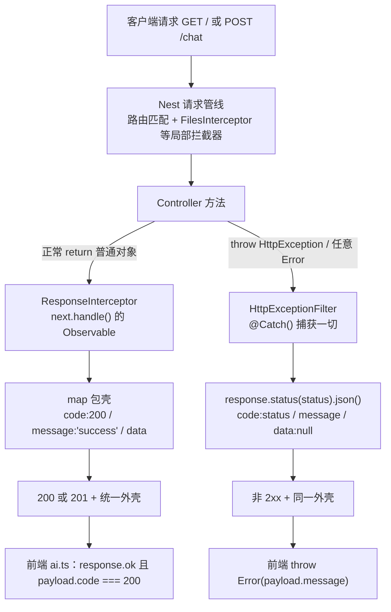
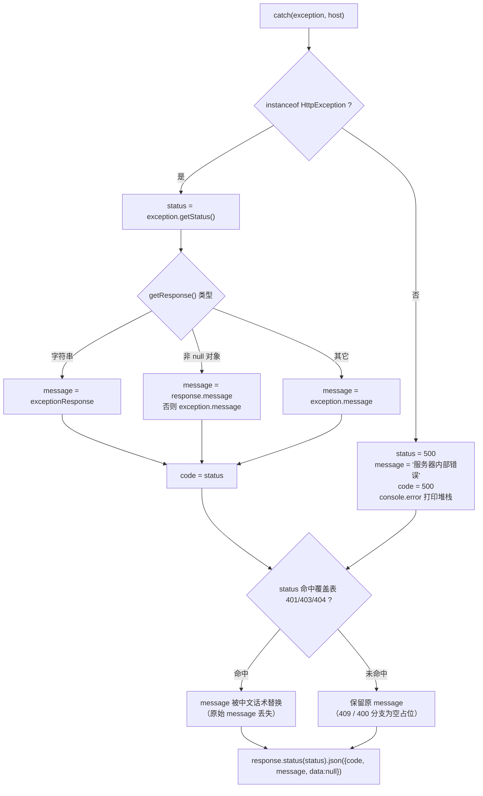

本页聚焦后端仅有的两个「全局改写层」：`ResponseInterceptor` 把任何成功返回值包成 `{code, message, data}`，`HttpExceptionFilter` 把任何失败改写为同一外壳。看完本页你应该能回答三个问题：这两个类各自被装在请求管线的哪个位置、它们逐行做了什么判断、以及为什么前端只需读一个 `code` 字段就能区分成功与失败。

Sources: [main.ts](be/src/main.ts#L9-L19), [response.interceptor.ts](be/src/common/filters/response.interceptor.ts#L16-L30), [http-exception.filter.ts](be/src/common/filters/http-exception.filter.ts#L10-L64)

## 为什么需要这一层：控制器输出的是「裸数据」

先看被包装的原始对象长什么样。`AppController.getInfo()` 直接返回一个普通对象（`name` / `mode` / `user` / `graph`），`AiController.searchInfo()` 与 `chat()` 则把 `AiService` 的 Promise 原样返回，一路透传到 `AiOperator` 组装出的业务对象（`content` / `tokenUsage` / `steps` / `toolCalls` / `threadId` / `user`）。**整条链路里没有任何一处写 `code` 或 `message`**，Controller、Service、Operator 三层都不知道「统一响应格式」这件事的存在。

Sources: [app.controller.ts](be/src/app.controller.ts#L9-L13), [app.service.ts](be/src/app.service.ts#L6-L18), [ai.controller.ts](be/src/ai/ai.controller.ts#L27-L47), [AiOperator.ts](be/src/ai/operator/AiOperator.ts#L57-L113)

这正是这层设计的价值：**业务代码只关心「返回什么数据」，不关心「怎么交付」**。业务对象被集中到两个地方改写——成功走拦截器，失败走过滤器。由于改写点唯一，前端拿到的响应体外层形状在成功与失败两条路径上完全一致，也就不用为每种接口单独写解析逻辑。

Sources: [response.interceptor.ts](be/src/common/filters/response.interceptor.ts#L22-L28), [http-exception.filter.ts](be/src/common/filters/http-exception.filter.ts#L58-L63), [ai.ts](fe/src/api/ai.ts#L21-L26)

| 角色 | 文件位置 | 触发时机 | 输入 → 输出 |
|---|---|---|---|
| `ResponseInterceptor` | `be/src/common/filters/response.interceptor.ts` | Controller 方法**正常返回之后** | 裸业务对象 → `{code:200, message:'success', data}` |
| `HttpExceptionFilter` | `be/src/common/filters/http-exception.filter.ts` | 管线中**任意位置抛异常之后** | 异常对象 → `{code: status, message, data:null}` |
| 注册点 | `be/src/main.ts` | 应用启动时 | 两个 `new` 出来的实例挂到 `INestApplication` 上 |

Sources: [response.interceptor.ts](be/src/common/filters/response.interceptor.ts#L10-L30), [http-exception.filter.ts](be/src/common/filters/http-exception.filter.ts#L10-L14), [main.ts](be/src/main.ts#L15-L19)

## 装配位置与执行顺序

两个类都在 `bootstrap()` 里注册，顺序是「先拦截器、后过滤器」。但这个顺序并不决定执行先后——它们从来不会对同一个请求同时生效：**请求走到了 `next.handle()` 并正常完成，就只经过拦截器；中途抛出异常，就只有过滤器接手**。

Sources: [main.ts](be/src/main.ts#L9-L19), [response.interceptor.ts](be/src/common/filters/response.interceptor.ts#L18-L22)

Sources: [main.ts](be/src/main.ts#L15-L19), [ai.controller.ts](be/src/ai/ai.controller.ts#L35-L47), [response.interceptor.ts](be/src/common/filters/response.interceptor.ts#L18-L28), [http-exception.filter.ts](be/src/common/filters/http-exception.filter.ts#L21-L63)

需要提前说明一个装配上的事实：这两个实例是用 `new` 手工构造后挂上去的，而不是以 `APP_INTERCEPTOR` / `APP_FILTER` provider 的形式注册进容器。后果是它们**不参与依赖注入**（构造器里无法再注入任何服务），并且**只在真正启动的应用实例上生效**，`Test.createTestingModule({imports:[AppModule]})` 拿不到它们。完整的注册方式对照表与测试影响见 [模块划分与依赖注入：ConfigModule 与 AiModule 的协作](16-mo-kuai-hua-fen-yu-yi-lai-zhu-ru-configmodule-yu-aimodule-de-xie-zuo)，本页只保留一个可验证的现象作为佐证：e2e 测试断言的是 `res.body.mode` 这种**未包装的原始字段**，并且测试文件里专门写了注释说明这一点。

Sources: [main.ts](be/src/main.ts#L15-L19), [app.e2e-spec.ts](be/test/app.e2e-spec.ts#L27-L38)

## ResponseInterceptor：一个 `map` 就够了

拦截器的全部逻辑只有七行。它声明实现 `NestInterceptor<T, Response<T>>`，泛型参数 `T` 表示「控制器原始返回类型」，`Response<T>` 表示「包装后的类型」；方法体只有 `next.handle().pipe(map(...))`，即把下游返回值流中的每一个值替换成一个固定结构。`code` 与 `message` 是**硬编码常量**（`200` 与 `'success'`），唯一从下游透传的是 `data`。

Sources: [response.interceptor.ts](be/src/common/filters/response.interceptor.ts#L10-L30)

这里有三处对初学者很重要的细节。第一，`Response<T>` 是一个**文件内私有 interface**（没有 `export`），前端在 `fe/src/api/ai.ts` 里另外手写了一份 `ChatApiResponse`——契约是两侧各写一遍的，没有共享类型。第二，`data: T` 声明为非可选，所以类型层面不允许 `data` 缺失，但从实现看它也可能取到 `undefined`（控制器若返回 `void`），而 `JSON.stringify` 会直接丢掉 `undefined` 的键，那时响应体就只剩 `{code, message}`。第三，`map` 作用在**流上**，而不是在单个值上——目前所有接口都是一次性返回，所以表现为「包一层壳」；如果将来改成逐条推送（如 SSE），每个 emission 都会被各自包一次壳，这不是当前设计预期，相关演进方向见 [SSE 流式输出与工具调用可视化设计](28-sse-liu-shi-shu-chu-yu-gong-ju-diao-yong-ke-shi-hua-she-ji)。

Sources: [response.interceptor.ts](be/src/common/filters/response.interceptor.ts#L10-L28), [ai.ts](fe/src/api/ai.ts#L21-L26)

还有一个**用 HTTP 状态码观察不到的错位**值得单独指出：拦截器永远往 body 里写 `code: 200`，但它不修改 HTTP 状态码。Nest 对 `@Post()` 的默认状态是 201，而 `AiController.chat()` 没有加 `@HttpCode(200)`，于是 `POST /chat` 成功时的真实响应是「HTTP 201 + body `code: 200`」。前端用 `response.ok`（2xx 为真）与 `payload.code === 200` 做双重判断，两条判据都通过，所以这个错位不会被表现成 bug；但如果换成只检查 `status === 200` 的客户端，就会误判为失败。

Sources: [response.interceptor.ts](be/src/common/filters/response.interceptor.ts#L22-L28), [ai.controller.ts](be/src/ai/ai.controller.ts#L35-L47), [ai.ts](fe/src/api/ai.ts#L56-L72)

## HttpExceptionFilter：四段式判断

过滤器用 `@Catch()` 的空参数装饰器声明「捕获一切」，方法签名收 `exception: any` 与 `host: ArgumentsHost`。开头的三行是标准样板：`host.switchToHttp()` 拿到 HTTP 上下文，再分别取出 Express 的 `Response` 与 `Request`（其中 `request` 取出后并未使用，是纯预留）。随后声明 `status` / `message` / `code` 三个变量，进入真正有判断的四段式逻辑。

Sources: [http-exception.filter.ts](be/src/common/filters/http-exception.filter.ts#L10-L19)

Sources: [http-exception.filter.ts](be/src/common/filters/http-exception.filter.ts#L12-L64)

**第一段（`instanceof HttpException`）** 决定「框架已给出语义」还是「完全未知」。前者的 `status` 取自 `exception.getStatus()`，`code` 直接等于 `status`，也就是**body 里的 `code` 与 HTTP 状态码始终一致**，这让 `code` 在语义上是冗余的，但换来前端只需比较一个数字。后者的处理是兜底：500 + 中文「服务器内部错误」+ `console.error('未捕获的异常:', exception)`——注意这句日志**只在非 HttpException 时打印**，预期内的业务异常不会污染日志。

Sources: [http-exception.filter.ts](be/src/common/filters/http-exception.filter.ts#L21-L43)

**第二段（`getResponse()` 的三态解包）** 处理的是同一个 `HttpException` 家族里消息形态不一致的问题：`new BadRequestException('文本')` 的 `getResponse()` 返回对象 `{message, error, statusCode}`，而某些场景可能返回纯字符串。过滤器因此按「字符串 / 非 null 对象 / 其它」三分支取值，并统一回退到 `exception.message`。当前项目没有注册 `ValidationPipe`（`main.ts` 中无 `useGlobalPipes`，且 `package.json` 不含 `class-validator`），所以 `message` 实际恒为字符串；一旦将来引入参数校验，校验失败的 `message` 会变成**字符串数组**，此处直接把数组赋给声明为 `string` 的变量，外层契约的 `message: string` 就会被破坏——这是这层最脆弱的一行。

Sources: [http-exception.filter.ts](be/src/common/filters/http-exception.filter.ts#L26-L36), [main.ts](be/src/main.ts#L9-L19), [package.json](be/package.json#L1-L60)

**第三段（状态码话术覆盖）** 用 `if / else if` 链把四个高频状态码的文案「中文化」：401 →「认证失败，请检查您的凭证」、403 →「您没有权限执行此操作」、404 →「请求的资源不存在」；409 与 400 两个分支只写了注释没有赋值，属于显式留白——**保留上游抛出的原始 message**（例如 Operator 抛的「请输入您的问题内容或上传文件」正是通过 400 分支原样透出的）。代价是命中覆盖的三个状态码会**丢掉业务侧写的具体文案**，这也是单用户模式下可以接受的取舍：没有鉴权，401/403 基本不会出现，404 通常是「路由写错了」这种与业务无关的开发者错误。

Sources: [http-exception.filter.ts](be/src/common/filters/http-exception.filter.ts#L45-L56), [AiOperator.ts](be/src/ai/operator/AiOperator.ts#L82-L86)

**第四段（输出）** 只有一行：`response.status(status).json({code, message, data: null})`。它与拦截器严格对称——外层三字段同名、`data` 在失败时固定为 `null` 而不是缺省，因此前端可以无条件读取 `data` 字段。

Sources: [http-exception.filter.ts](be/src/common/filters/http-exception.filter.ts#L58-L63)

## 契约总表：一个真实接口的七种响应

把拦截器与过滤器的分支合起来看，就能得到下表。`data` 的具体字段来自 `AiOperator` 的返回结构，错误文案来自各层抛出的异常；未列入覆盖表的状态码（如 multer 因超出 10MB / 50 个上限抛出的 413）会保留框架原始 message。

| 场景 | 抛出/返回处 | HTTP 状态 | 响应体 |
|---|---|---|---|
| `GET /` 成功 | `AppService.getInfo()` | 200 | `{code:200, message:'success', data:{name,mode,user,graph}}` |
| `POST /chat` 成功 | `AiOperator.chat()` | 201（Nest POST 默认） | `{code:200, message:'success', data:{content,tokenUsage,steps,toolCalls,threadId,user}}` |
| `GET /search` 成功 | `AiOperator.searchInfo()` | 200 | `{code:200, message:'success', data:{content,tokenUsage,steps,toolCalls}}`（无 `threadId`） |
| 问题为空 | `BadRequestException`（400 分支不覆盖文案） | 400 | `{code:400, message:'请输入您的问题内容', data:null}` |
| 模型调用失败 | `BadGatewayException` | 502 | `{code:502, message:'AI 服务调用失败：…', data:null}` |
| 未配置 API Key | `ServiceUnavailableException` | 503 | `{code:503, message:'未配置模型 API Key：请在 be/.env 中设置 MODEL_API_KEY（或 OPENAI_API_KEY）', data:null}` |
| 路由不存在 | Nest 内建 `NotFoundException` | 404 | `{code:404, message:'请求的资源不存在', data:null}` |
| 任何非 HttpException | 过滤器兜底 | 500 | `{code:500, message:'服务器内部错误', data:null}` |

Sources: [app.service.ts](be/src/app.service.ts#L6-L18), [AiOperator.ts](be/src/ai/operator/AiOperator.ts#L57-L113), [AiOperator.ts](be/src/ai/operator/AiOperator.ts#L115-L140), [model.ts](be/src/ai/model.ts#L15-L22), [http-exception.filter.ts](be/src/common/filters/http-exception.filter.ts#L21-L63), [ai.controller.ts](be/src/ai/ai.controller.ts#L35-L47)

注意 502 与 503 的出现方式并不相同：`ServiceUnavailableException` 是图初始化阶段（`createChatModel()` 读不到 Key）直接抛出的，会先被 `runGraph` 的 `error instanceof HttpException` 判据识别并**保持原语义向上抛**；只有真正来自模型/网络的未知错误才被包成 502。这条「HttpException 原样透传、其他一律 502」的规则决定了上表里 503 的文案能为用户提供可操作的指引（去 `.env` 填 Key），而不会被降级成模糊的「AI 服务调用失败」。

Sources: [model.ts](be/src/ai/model.ts#L15-L22), [AiOperator.ts](be/src/ai/operator/AiOperator.ts#L115-L127)

## 前端如何消费这份契约

前端把契约写成两个类型：`ChatApiResponse` 描述外壳，`ChatResponseData` 描述 `data`。请求完成后先尝试 `response.json()`，解析失败置 `null`，然后一次性判断 `!response.ok || !payload || payload.code !== 200`——**三重条件合并在同一行**，任一不满足就 `throw new Error(payload?.message || '请求失败（HTTP …）')`。这意味着过滤器精心构造的中文 `message` 会原封不动地成为前端 Error 的消息。

Sources: [ai.ts](fe/src/api/ai.ts#L8-L26), [ai.ts](fe/src/api/ai.ts#L56-L72)

视图层再分两种展示路径：`try` 里若 `data.code === 200 && data.data` 成立，就把 `data.data.content` 拍平进气泡、把 `steps`/`toolCalls` 拼成元信息；`catch` 则把 `error.message` 写成「抱歉，本次回复失败：…」。`else` 分支（HTTP 2xx 但 `code` 非 200）在当前实现下几乎不可能触发，但它作为契约的兜底仍然保留。**同一条错误最终只有一处用户可见文案**，这是这层统一契约带来的直接收益——不需要在组件里按 HTTP 状态码写 switch。元信息字段的渲染细节属于 [单页聊天界面：Vue 3 + Element Plus 的消息与附件状态](20-dan-ye-liao-tian-jie-mian-vue-3-element-plus-de-xiao-xi-yu-fu-jian-zhuang-tai) 的范围。

Sources: [Chat.vue](fe/src/components/Chat.vue#L228-L242), [Chat.vue](fe/src/components/Chat.vue#L152-L156)

## 边界与陷阱清单

把上述所有可验证的行为收敛成一张排查表，供你在新增接口或写测试时对照：

| 现象 | 成因 | 应对 |
|---|---|---|
| e2e 里拿到的是裸对象 | 过滤器/拦截器在 `main.ts` 用 `new` 注册，测试直接编译 `AppModule` 不执行 `bootstrap()` | 测试断言原始字段，或改用 `APP_INTERCEPTOR` / `APP_FILTER` provider |
| 想在拦截器里注入服务，构造函数参数为 `undefined` | 实例由 `new` 创建，不经过 DI 容器 | 改为容器级注册，或把配置提前放进闭包 |
| `POST /chat` 是 201 但 body 是 `code: 200` | 拦截器硬编码 `200`，不读取也不改写 HTTP 状态 | 客户端用 `response.ok` 判断传输层成败 |
| 看到 `{code, message}` 而缺 `data` | 控制器返回 `void`，`undefined` 被 JSON 序列化丢弃 | 让控制器始终返回对象，失败时由过滤器补 `data: null` |
| 401/403/404 的具体文案消失了 | 覆盖表把 message 替换为固定中文 | 需要精确文案时改用 400/409 等未覆盖状态 |
| `message` 变成数组 | 引入 `ValidationPipe` 后校验错误的 `getResponse().message` 是数组 | 在过滤器里对数组做 `join` 或取首项 |
| 日志里只有「未捕获的异常」 | 该 `console.error` 只在非 `HttpException` 分支执行 | 业务异常想留痕需自行加日志 |
| 流式接口被逐条包壳 | `map` 作用在 Observable 的每个 emission 上 | 流式接口需旁路包装，见 [SSE 流式输出与工具调用可视化设计](28-sse-liu-shi-shu-chu-yu-gong-ju-diao-yong-ke-shi-hua-she-ji) |

Sources: [main.ts](be/src/main.ts#L9-L19), [app.e2e-spec.ts](be/test/app.e2e-spec.ts#L27-L38), [response.interceptor.ts](be/src/common/filters/response.interceptor.ts#L22-L28), [http-exception.filter.ts](be/src/common/filters/http-exception.filter.ts#L26-L56), [package.json](be/package.json#L28-L38)

最后一个与代码整洁度相关的小事实：拦截器的文件名是 `response.interceptor.ts`，却被放在 `common/filters/` 目录下，与 `http-exception.filter.ts` 并列。功能上没有任何影响（Nest 完全不看路径），但它提示这两个文件是作为「一对响应改写器」一起被引入 `main.ts` 的——按同样的相对路径 `./common/filters/...` 相邻导入。若后续要拆分目录，两个文件的引用需同步调整。

Sources: [main.ts](be/src/main.ts#L5-L6), [response.interceptor.ts](be/src/common/filters/response.interceptor.ts#L1-L8), [http-exception.filter.ts](be/src/common/filters/http-exception.filter.ts#L1-L8)

## 下一步阅读

契约的下游文档是接口清单本身。既然所有接口都返回同一外壳，描述各接口「`data` 里到底有什么」的工作就落在 Swagger 上，见 [Swagger 文档与 API 契约：/chat、/search 与 GET /](19-swagger-wen-dang-yu-api-qi-yue-chat-search-yu-get)；如果你更关心「异常是在 Operator 的哪一行抛出来的」，回到 [Controller / Service / Operator 三层职责边界](17-controller-service-operator-san-ceng-zhi-ze-bian-jie)；而「为什么全局注册在测试中失效」的容器视角解释在 [模块划分与依赖注入：ConfigModule 与 AiModule 的协作](16-mo-kuai-hua-fen-yu-yi-lai-zhu-ru-configmodule-yu-aimodule-de-xie-zuo)。