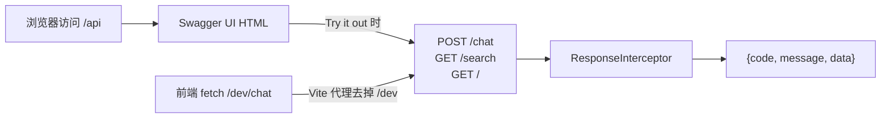
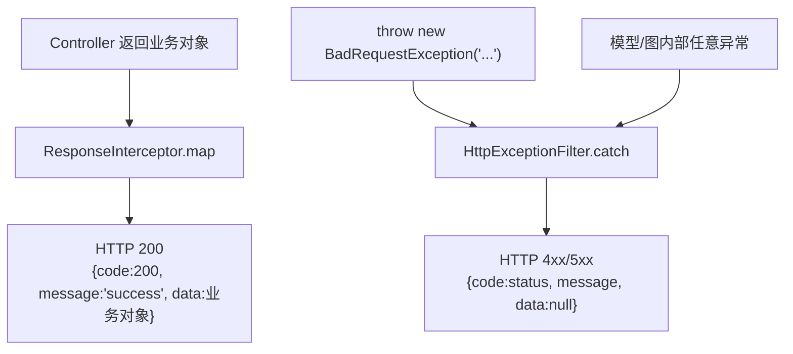
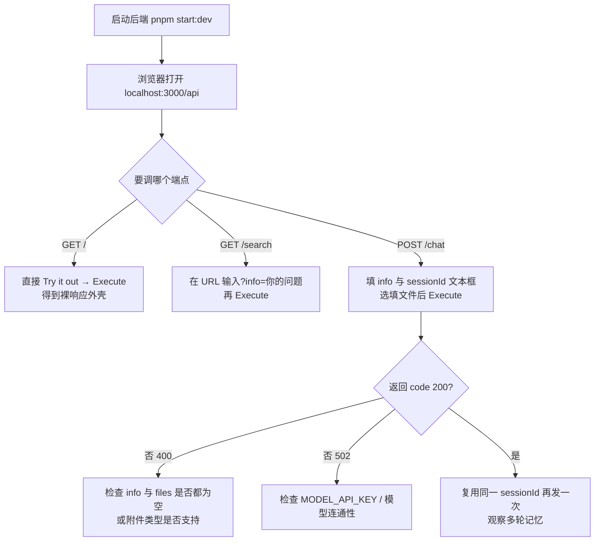

这个后端对外只有三个 HTTP 端点，但它们同时被三种"契约来源"描述：**Swagger 自动生成的 OpenAPI 文档**（描述路由骨架）、**全局拦截器与异常过滤器**（描述统一的外壳 `{code, message, data}`）、以及**Operator 层返回的对象字面量**（描述 `data` 里面的字段）。初学 NestJS 时最容易犯的错误，是以为打开 `/api` 就能看到完整接口说明——本项目恰恰是一个"文档只描述骨架、契约藏在代码里"的典型案例。本页会依次拆解这三层，并给出每个端点的精确入参与返回字段。

Sources: [main.ts](be/src/main.ts#L21-L30), [response.interceptor.ts](be/src/common/filters/response.interceptor.ts#L10-L30), [AiOperator.ts](be/src/ai/operator/AiOperator.ts#L57-L113)

## API 全景：三条路由登记在哪个控制器上

理解端点路径的第一步，是确认**没有全局路由前缀**。`main.ts` 只调用了 `enableCors()`、注册拦截器与过滤器、挂载 Swagger，并未调用 `app.setGlobalPrefix(...)`；同时 `AiController` 的 `@Controller()` 装饰器也不带参数字符串。这两个"空"叠加在一起，意味着装饰器里写的字符串就是最终 URL——`@Get('search')` 对应 `GET /search`，`@Post('chat')` 对应 `POST /chat`，而 `AppController` 的 `@Get()` 对应裸根路径 `GET /`。

Sources: [main.ts](be/src/main.ts#L9-L33), [ai.controller.ts](be/src/ai/ai.controller.ts#L23-L48), [app.controller.ts](be/src/app.controller.ts#L4-L13)

| 方法 | 路径 | 控制器方法 | 入参位置 | 会话记忆 | 主要用途 |
|---|---|---|---|---|---|
| `GET` | `/` | `AppController.getInfo` | 无 | 无关 | 自检：模式、内置用户、图节点清单 |
| `GET` | `/search` | `AiController.searchInfo` | query `info` | 否（一次性随机 `thread_id`） | 单轮问答，不留痕 |
| `POST` | `/chat` | `AiController.chat` | `multipart/form-data` | 是（`sessionId` → `thread_id`） | 多轮对话 + 附件 |

`GET /` 的存在价值常被低估：它返回的是**运行时的自我描述**，包含 `mode: 'single-user'`、`user`（固定 admin）以及 `graph.framework: 'langgraph'` 与节点数组 `['prepare', 'agent', 'tools', 'limit']`。因为它的字段全部来自 `AppService` 的硬编码对象而非数据库，所以可以用它做零依赖的存活探测。

Sources: [app.service.ts](be/src/app.service.ts#L6-L18)

## Swagger 的挂载方式：一个极简 DocumentBuilder

Swagger 的初始化只占 `main.ts` 五行。`DocumentBuilder` 链式调用了三个方法——`setTitle`、`setDescription`、`setVersion`——随后 `SwaggerModule.createDocument(app, config)` 生成文档对象，`SwaggerModule.setup('api', app, document)` 把它挂到 `/api` 路径。这段配置传递的信息量很小，全部"元数据"就是标题「AI 聊天机器人 API」和一句说明：单用户（admin）聊天服务、无登录鉴权、agent 循环由 LangGraph 编排。

Sources: [main.ts](be/src/main.ts#L21-L30), [README.md](be/README.md#L147)

| 配置项 | 代码中的值 | 初学者需要知道的含义 |
|---|---|---|
| `setTitle` | `AI 聊天机器人 API` | Swagger UI 顶部标题 |
| `setDescription` | 单用户、无鉴权、LangGraph 编排 | 说明鉴权模型，避免误找登录接口 |
| `setVersion` | `1.0` | 仅展示，不影响路由 |
| `SwaggerModule.setup('api', ...)` | 路径 `/api` | **文档**路径，与业务路由 `/chat` 平级、不冲突 |
| 未使用 | `addBearerAuth` / `addTag` / `addServer` | 因此 UI 上没有 Authorize 按钮，也没有分组标签 |

`setup('api', ...)` 这一步值得单独强调：`/api` 是文档页地址，而业务接口仍然挂在根路径。所以浏览器里访问 `http://localhost:3000/api` 看到的是 HTML 页面，`http://localhost:3000/api/chat` 并不存在。启动日志里打印的两行地址，正是把这两件事分开提示的。

Sources: [main.ts](be/src/main.ts#L33-L40)

## 文档为何"看着很空"：缺失的 DTO 装饰器

如果你带着"打开 `/api` 就能看到完整字段说明"的预期去访问，会发现表单一栏相当朴素。原因是可验证的：整个 `src` 目录里 `@nestjs/swagger` 只在 `main.ts` 出现一次，没有 `@ApiTags`、`@ApiProperty`、`@ApiQuery`、`@ApiBody`、`@ApiResponse` 任何一个装饰器；`nest-cli.json` 的 `compilerOptions` 里也没有启用 Swagger CLI 插件（插件能靠类型推断自动生成 schema）。换句话说，OpenAPI 文档只能从 `@Get` / `@Post` 装饰器和 TypeScript 的类型元数据里刮出**最少**的信息：有哪些路径、什么方法、返回类型未声明。

Sources: [main.ts](be/src/main.ts#L7), [nest-cli.json](be/nest-cli.json#L1-L8), [ai.controller.ts](be/src/ai/ai.controller.ts#L1-L48)

这一点在 `/search` 上尤其明显：控制器签名是 `searchInfo(@Query() query)`，`query` 参数**没有声明具体的 DTO 类型**，因此 Nest 的 Swagger 探索器拿不到任何属性元数据，无法为它生成 `info` 参数定义。相比之下 `/chat` 至少声明了 `@Body('info') info: string` 与 `@Body('sessionId') sessionId: string`，类型是明确的 `string`，Swagger 能推断出"这里有两个字符串字段"。

Sources: [ai.controller.ts](be/src/ai/ai.controller.ts#L28-L47)

| 契约信息 | 是否出现在 Swagger 文档 | 真正定义它的地方 |
|---|---|---|
| 路径与方法（`POST /chat`） | ✅ 自动 | `@Post('chat')` 装饰器 |
| 请求字段名与类型 | ⚠️ 部分（`info`/`sessionId`） | 控制器参数装饰器 |
| `files` 附件字段 | ⚠️ 仅作为拦截器配置存在 | `FilesInterceptor('files', 50, ...)` |
| 响应外层 `{code, message, data}` | ❌ | `ResponseInterceptor` / `HttpExceptionFilter` |
| `data` 内部字段 | ❌ | `AiOperator.chat` / `searchInfo` 的 `return` 对象 |
| 错误码与中文文案 | ❌ | `HttpExceptionFilter` + 各层 `throw` |

给初学者一个实践建议：把 `/api` 当作**路由清单**来用（确认有哪些端点、拼写是否正确），把本页后面的字段表当作**真正的契约**来用。这也解释了为什么仓库里 `README.MD` 手写了一份 `POST /chat` 的入参表和响应 JSON 示例——那是当前阶段对 Swagger 缺口的补偿。

Sources: [README.MD](README.MD#L70-L105)

## 统一响应外壳：成功与失败的两条出口

所有三个端点返回的外层结构完全一致，因为它不由控制器决定，而由两个全局组件统一接管。成功路径上，`ResponseInterceptor` 用 RxJS 的 `map` 把控制器返回值整体塞进 `data`，并硬编码 `code: 200`、`message: 'success'`；失败路径上，`HttpExceptionFilter` 用 `@Catch()` 兜住一切异常，把 HTTP 状态码同时写进响应状态行和 body 的 `code`，`data` 置为 `null`。

Sources: [response.interceptor.ts](be/src/common/filters/response.interceptor.ts#L16-L30), [http-exception.filter.ts](be/src/common/filters/http-exception.filter.ts#L10-L63), [main.ts](be/src/main.ts#L15-L19)

异常过滤器内部还有一层映射逻辑值得记住：`HttpException` 的 `message` 会被优先取出（字符串直接用，对象取 `.message` 字段）；非 `HttpException` 一律降级为 `500` + 「服务器内部错误」，并把原始异常打到服务端日志。随后对 `401`/`403`/`404` 三个状态**覆盖**成固定的中文文案（如「请求的资源不存在」），而 `400` 与 `409` 保留业务层抛出的原始 message。这就是为什么本项目的 400 报错总是信息量很足的中文句子，而 404 永远是那一句统一话术。

Sources: [http-exception.filter.ts](be/src/common/filters/http-exception.filter.ts#L21-L63)

> **注意一个容易被忽略的事实**：e2e 测试里明确写了「e2e 里没有注册 main.ts 的全局 ResponseInterceptor，所以这里拿到的是控制器原始返回值」。也就是说，如果你用 `Test.createTestingModule` 搭测试，`GET /` 的响应体是**裸的** `{name, mode, user, graph}`，没有 `code`/`message` 外壳。契约只在 `bootstrap()` 走完的完整应用里成立。

Sources: [app.e2e-spec.ts](be/test/app.e2e-spec.ts#L27-L38)

## `POST /chat`：multipart 契约与返回字段

`/chat` 是唯一带文件上传的端点，因此不用 `@Body()` 直接接收整个对象，而是先用 `FilesInterceptor('files', MAX_FILES, { limits: ... })` 拦住请求，再由三个参数装饰器分别取值：`@Body('info')`、`@Body('sessionId')`、`@UploadedFiles()`。上限以常量形式写在控制器顶部——单文件 10MB、单请求最多 50 个文件——并同时出现在装饰器参数与 `limits` 选项里，形成"拦截器配置"与"业务断言"的双保险。

Sources: [ai.controller.ts](be/src/ai/ai.controller.ts#L14-L47)

| 请求字段 | 位置 | 类型 | 必填 | 说明 |
|---|---|---|---|---|
| `info` | form-data | string | 与 `files` 至少有一项 | 用户输入文本 |
| `sessionId` | form-data | string | 否（默认 `'default'`） | 直接作为 LangGraph `thread_id` |
| `files` | form-data 多值 | file[] | 与 `info` 至少有一项 | 图片或纯文本，≤10MB/个，≤50 个 |

返回体是 `{code, message, data}` 中的 `data`，由 `AiOperator.chat` 的对象字面量直接决定：

| `data` 字段 | 类型 | 来源 | 初学者注解 |
|---|---|---|---|
| `content` | string | 最后一条消息的文本（`extractTextContent`） | 模型最终答复 |
| `tokenUsage` | object \| null | 最后一条消息的 `usage_metadata` | 厂商可能不返回，故为 null |
| `steps` | number | 图状态 `stepCount` | 本次推理步数 |
| `toolCalls` | number | 图状态 `toolCallCount` | 本次工具调用次数 |
| `threadId` | string | 入参 `sessionId \|\| 'default'` | 回显给前端确认会话归属 |
| `user` | object \| null | 图状态 `user`（固定 admin） | 单用户模式下恒为 `{id, username, role}` |

Sources: [AiOperator.ts](be/src/ai/operator/AiOperator.ts#L77-L140), [state.ts](be/src/ai/graph/state.ts#L8-L13)

`content` 的组装方式还决定了两个边界行为：`info` 会先 `trim()`，然后与文本附件内容用双换行拼接；若存在图片附件，`content` 从字符串升级为多模态数组（`[{type:'text'},{type:'image_url'}...]`），并在文本为空时兜底成「请描述这些图片的内容」。这些细节属于附件转换的职责，本页只需记住：**HTTP 层看到的契约是 `info` + `files`，模型层看到的可能是完全不同的结构**。

Sources: [AiOperator.ts](be/src/ai/operator/AiOperator.ts#L82-L103)

## `GET /search`：刻意"少两个字段"的单轮问答

`/search` 与 `/chat` 走同一个图、同一个 `runGraph` 私有方法，差别只在两处：入参是 query 里的 `info`，以及 `thread_id` 用 `search-${randomUUID()}` 生成。随机 `thread_id` 意味着每次调用都是全新的会话，checkpoint 不会命中旧历史——这正是"单轮、不留痕"的实现方式。

Sources: [AiOperator.ts](be/src/ai/operator/AiOperator.ts#L54-L71)

**关键差异在于返回字段**：`searchInfo` 的 `return` 只包含 `content`、`tokenUsage`、`steps`、`toolCalls` 四项，**没有 `threadId`、也没有 `user`**。这是有意为之——一个一次性会话没有可供后续复用的 `thread_id`，返回它反而会误导调用方。

Sources: [AiOperator.ts](be/src/ai/operator/AiOperator.ts#L65-L70)

| 字段 | `GET /search` | `POST /chat` |
|---|---|---|
| `content` | ✅ | ✅ |
| `tokenUsage` | ✅ | ✅ |
| `steps` | ✅ | ✅ |
| `toolCalls` | ✅ | ✅ |
| `threadId` | ❌（内部随机，不对外） | ✅ |
| `user` | ❌ | ✅（admin） |

前端只消费了 `/chat`（`fe/src/api/ai.ts` 中只有 `chatKimi` 一处 `fetch`），而它定义的 `ChatResponseData` 把除 `content` 之外的**所有字段都标为可选**，正好兼容了这两个端点的返回差异。这是一个很值得初学者模仿的写法：当同一套类型要覆盖多个返回形态略有不同的端点时，用可选字段表达"可能没有"。

Sources: [ai.ts](fe/src/api/ai.ts#L1-L35)

## `GET /`：把运行时自画像做成接口

`GET /` 是最简单的端点，也是理解"契约来自哪里"的最好样本。控制器只有一行 `return this.appService.getInfo()`，`AppService` 返回一个纯字面量对象，其中 `user` 用 `{ ...ADMIN_USER }` 展开，因此与图状态里的 admin 定义共享同一个信源——改动 `state.ts` 里的 `ADMIN_USER` 会同步反映到 `GET /` 的响应里。

Sources: [app.controller.ts](be/src/app.controller.ts#L4-L13), [app.service.ts](be/src/app.service.ts#L1-L19)

| 字段 | 值 | 校验位置 |
|---|---|---|
| `name` | `'chat_robot'` | — |
| `mode` | `'single-user'` | `app.controller.spec.ts`、`app.e2e-spec.ts` 均断言 |
| `user` | `{ id:'admin', username:'admin', role:'admin' }` | 单元测试断言 `role === 'admin'` |
| `graph.framework` | `'langgraph'` | 单元测试与 e2e 均断言 |
| `graph.nodes` | `['prepare','agent','tools','limit']` | 单元测试用 `arrayContaining` 断言含 `agent`/`tools` |
| `graph.checkpointer` | `'mongodb'` | — |

值得注意的是两套测试对同一契约的断言强度不同：单元测试直接调用 `appController.getInfo()` 检查对象内容，e2e 则通过 HTTP 读取**未经包装**的响应体，用 `expect.arrayContaining` 这种宽松匹配以保证新增节点不会打破测试。对于初学者，这是"测试应断言契约中最稳定的部分"的实用示范。

Sources: [app.controller.spec.ts](be/src/app.controller.spec.ts#L18-L30), [app.e2e-spec.ts](be/test/app.e2e-spec.ts#L27-L38)

## 错误契约：三个端点共享的失败语义表

由于 `HttpExceptionFilter` 是全局的，所有端点共用一个错误外壳。下表把本项目实际会出现的错误来源归拢在一起，方便调试时对照：

| HTTP 状态 | `message` 来源 | 触发场景 | 出处 |
|---|---|---|---|
| `400` | 业务文案「请输入您的问题内容」 | `GET /search` 且 `info` 为空 | `searchInfo` 首行守卫 |
| `400` | 「请输入您的问题内容或上传文件」 | `POST /chat` 且 `info` 与 `files` 同时为空 | `chat` 首行守卫 |
| `400` | 「暂不支持解析文件「X」（.pdf），目前仅支持图片与纯文本文件…」 | 上传了无法解析的二进制类型 | `buildAttachmentContent` |
| `404` | 固定文案「请求的资源不存在」 | 路径拼错（如 `/api/chat`） | 过滤器状态映射 |
| `502` | 「AI 服务调用失败：<原始错误>」 | 图内部非 `HttpException` 异常（如模型鉴权失败） | `runGraph` 的 `catch` |
| `500` | 固定文案「服务器内部错误」 | 任何未被识别的异常 | 过滤器兜底分支 |

其中 502 那条最能体现设计意图：`runGraph` 先判断 `error instanceof HttpException`，是则原样抛出（保留"没配 Key"这类既有语义），否则一律包装成 `BadGatewayException` 并附上原因。这样调用方永远能区分"我传错了参数（400）"和"下游模型出问题了（502）"。

Sources: [AiOperator.ts](be/src/ai/operator/AiOperator.ts#L57-L60), [AiOperator.ts](be/src/ai/operator/AiOperator.ts#L84-L97), [attachments.ts](be/src/ai/operator/attachments.ts#L92-L98), [AiOperator.ts](be/src/ai/operator/AiOperator.ts#L115-L127), [http-exception.filter.ts](be/src/common/filters/http-exception.filter.ts#L37-L56)

## 用 Swagger UI 自助调试 `/chat` 的步骤

由于文档缺少 schema，第一次在 UI 上调试 `/chat` 需要一点手工操作。下面的流程按依赖顺序排列：

有三点实操提醒。第一，**`/chat` 是有副作用的写操作**：同一个 `sessionId` 每发一次，就会在 MongoDB checkpoint 里多一轮历史，所以"反复点 Execute 想试出结果"会让上下文不断膨胀，想重开请在 UI 里换一个 `sessionId`（这比清库简单得多）。第二，附件字段在缺少 `@ApiBody` 的情况下并不总有文件选择器，必要时改用 `curl -F` 或前端页面验证。第三，`/search` 的 `info` 参数没有类型声明，文档里可能不出现输入框，需要自己把 `?info=...` 拼到 URL 上——这属于"Swagger 只描述骨架"的直接后果，而不是接口坏了。

Sources: [ai.controller.ts](be/src/ai/ai.controller.ts#L28-L47), [AiOperator.ts](be/src/ai/operator/AiOperator.ts#L101-L113), [main.ts](be/src/main.ts#L37-L39)

## 契约信源的对照清单

把"某个字段是谁定义的"记成一张表，是排查契约漂移最快的方法：

| 契约元素 | 权威定义点 | 是否被 Swagger 反映 |
|---|---|---|
| 路由路径与方法 | `@Controller()` + `@Get`/`@Post` 参数 | ✅ |
| Swagger 页面地址 `/api` | `SwaggerModule.setup('api', ...)` | — |
| 文档标题/描述/版本 | `DocumentBuilder` 链式调用 | ✅ |
| 请求字段 `info`/`sessionId` | `@Body(...)` 参数装饰器 | ⚠️ 部分 |
| 附件字段名与上限 | `FilesInterceptor('files', 50, limits)` | ❌ |
| 外层 `{code, message, data}` | `ResponseInterceptor` / `HttpExceptionFilter` | ❌ |
| `data` 内部字段 | `AiOperator.chat` / `searchInfo` 的 return | ❌ |
| 前端消费侧类型镜像 | `fe/src/api/ai.ts` 的 interface | ❌ |

这张表也解释了为什么本项目当前阶段选择"手写 README + 代码即契约"：在只有三个端点、无 DTO 校验管道的规模下，补 `@ApiProperty` 的收益小于维护成本。如果后续端点增多，最自然的演进路径是先给 `/chat` 引入一个 DTO 类承载 `info`/`sessionId`，再在上层加工 `@ApiResponse`，一次补齐请求与响应两侧的 schema。

Sources: [response.interceptor.ts](be/src/common/filters/response.interceptor.ts#L10-L27), [ai.ts](fe/src/api/ai.ts#L8-L35), [README.MD](README.MD#L72-L97)

## 相关阅读与下一步

想继续深入这条链路，建议按依赖顺序阅读：

- 先看 [全局响应包装与异常过滤器：统一 {code, message, data} 契约](18-quan-ju-xiang-ying-bao-zhuang-yu-yi-chang-guo-lu-qi-tong-code-message-data-qi-yue)，理解本页反复引用的那层外壳是怎么挂上去的；
- 再看 [Controller / Service / Operator 三层职责边界](17-controller-service-operator-san-ceng-zhi-ze-bian-jie)，看清"路由装饰器 → 门面 → 编排"的分工；
- 想理解 `sessionId` 回显与「清空对话」的语义，读 [thread_id 生命周期：sessionId 与「清空对话」的语义](11-thread_id-sheng-ming-zhou-qi-sessionid-yu-qing-kong-dui-hua-de-yu-yi)；
- 想动手用前端替代 Swagger 调试，读 [fetch + FormData 上传：绕开 axios 的 boundary 陷阱](21-fetch-formdata-shang-chuan-rao-kai-axios-de-boundary-xian-jing) 和 [Vite 代理与 TypeScript 构建：/dev 前缀到后端 3000](22-vite-dai-li-yu-typescript-gou-jian-dev-qian-zhui-dao-hou-duan-3000)；
- 附件相关的 400 语义与类型边界，在 [附件多模态转换：图片 Data URI、文本内联与长度治理](15-fu-jian-duo-mo-tai-zhuan-huan-tu-pian-data-uri-wen-ben-nei-lian-yu-chang-du-zhi-li) 里有完整展开。