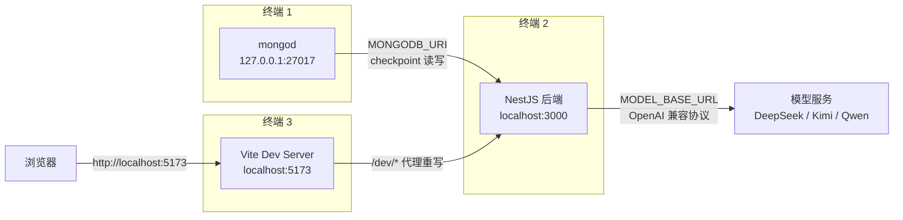
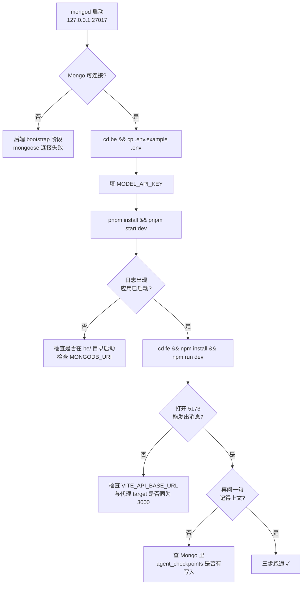

这一页的目标非常具体：**在你自己的机器上把三个进程按正确顺序拉起来，并成功发出第一条消息**。它不解释 LangGraph 图内部如何循环、也不展开每个环境变量的语义——那些内容属于后面的深挖页面。这里只回答三个问题：先启动什么、每条命令在哪执行、每步怎么确认成功了。

整个仓库的启动逻辑遵循一个硬约束：**checkpoint 存储（MongoDB）必须在后端启动之前可达**。这个约束不是约定俗成的习惯，而是由 NestJS 模块初始化时序写死的——`MongooseModule.forRootAsync` 在 `bootstrap()` 期间就建立连接，连接失败则应用起不来。

Sources: [README.MD](README.MD#L40-L68), [app.module.ts](be/src/app.module.ts#L10-L31)

## 启动全景：三个进程、两条连接

下图是一次完整启动后形成的运行拓扑。注意后端是唯一的"中心"：它同时向 MongoDB 取会话历史、向模型服务发请求，而前端从不直连 MongoDB。



三条链路对应三个必须配对的配置项：`MONGODB_URI` 打通 Mongo，`MODEL_API_KEY` 打通模型，`VITE_API_BASE_URL` 打通前后端。少任何一个，链路都会在某处断开。

Sources: [app.module.ts](be/src/app.module.ts#L17-L31), [vite.config.ts](fe/vite.config.ts#L12-L25), [model.ts](be/src/ai/model.ts#L15-L29)

| 进程 | 执行目录 | 启动命令 | 默认地址 | 启动前置条件 |
|---|---|---|---|---|
| MongoDB | 任意 | `mongod --dbpath ...` | `127.0.0.1:27017` | 已有数据目录 |
| 后端 | `be/` | `pnpm start:dev` | `http://localhost:3000` | Mongo 已可达 + `.env` 存在 |
| 前端 | `fe/` | `npm run dev` | `http://localhost:5173` | 后端已启动（否则代理 502） |

Sources: [package.json](be/package.json#L8-L21), [package.json](fe/package.json#L6-L10), [README.MD](README.MD#L60-L68)

## 第 0 步：确认你只需要准备两样东西

这是本项目最容易让人犹豫的地方，所以先明确边界：**没有注册、没有登录、没有邀请码、没有 JWT**。系统内置唯一用户 `admin`，所有请求默认以这个身份进入图。因此你不需要准备数据库用户表、不需要生成密钥对，只需要：

1. 一个**可连接的 MongoDB 实例**（本地或远程均可）；
2. 一个**模型 API Key**（DeepSeek / Kimi / Qwen / OpenAI 等任何 OpenAI 兼容服务）。

这两样东西都以环境变量的形式只存在于后端 `be/.env` 中。前端不需要任何凭证——它的 `.env` 里只有一个 API 前缀。

Sources: [README.MD](README.MD#L1-L6), [model.ts](be/src/ai/model.ts#L11-L21), [.env.example](fe/.env.example#L1)

## 第一步：启动 MongoDB（checkpoint 的落点）

MongoDB 在这个项目里只承担一件事：**按 `thread_id` 保存 LangGraph 的消息历史**，也就是"短期记忆"。它不存用户、不存配置，所以即便你清空整个库，系统照样能启动，只是历史对话会全部丢失。这解释了为什么数据库是必需项却不涉及任何业务表结构。

```bash
mongod --dbpath /your/mongo/data --port 27017
```

`MONGODB_URI` 的默认形态是 `mongodb://127.0.0.1:27017/chat_robot`：前半段定位实例，末尾的 `chat_robot` 是库名。这个库名有双重作用——Mongoose 用它建连，checkpointer 也把它当作 checkpoint 的默认库名。库里最终只会出现两个 collection：`agent_checkpoints` 与 `agent_checkpoints_writes`，它们由 `MongoDBSaver` 自动创建，你不需要手动建表。

Sources: [.env.example](be/.env.example#L16-L24), [checkpointer.ts](be/src/ai/graph/checkpointer.ts#L39-L49)

一个对初学者很实用的事实：**checkpointer 不是在后端启动瞬间就建好的**，而是在第一次真正需要图执行时才延迟创建。它优先复用 Nest 已经建立的 mongoose 连接；如果此时 mongoose 尚未就绪（`readyState !== 1`），才用同一份 `MONGODB_URI` 单独建一个 `MongoClient`。这个兜底设计降低了启动顺序的敏感度，但**并没有取消 Mongo 必须先可达的要求**——因为 Nest 的 mongoose 连接本身就在 bootstrap 阶段进行。

Sources: [checkpointer.ts](be/src/ai/graph/checkpointer.ts#L11-L37), [app.module.ts](be/src/app.module.ts#L17-L31)

验证这一小步是否成功，最省事的方式是看后端启动日志有没有连接错误；如果你想要独立验证，也可以用任意 Mongo 客户端 ping 一次 `127.0.0.1:27017`。

## 第二步：配置并启动后端

后端的配置文件来源只有一个：`be/.env`。仓库里提供了模板，直接复制再填值即可。

```bash
cd be
cp .env.example .env
# 打开 .env，把 MODEL_API_KEY 填成你的真实 Key
pnpm install
pnpm start:dev
```

`cp .env.example .env` 不是可选步骤——`.env` 被 `.gitignore` 明确排除（根目录规则是 `.env` / `.env.*`，仅白名单放行 `.env.example`），所以克隆下来的仓库里**一定没有 `.env`**，缺了它后端会因为拿不到 `MONGODB_URI` 而起不来。

Sources: [README.md](be/README.md#L117-L121), [.gitignore](.gitignore#L1-L4), [.gitignore](be/.gitignore#L4-L5)

模板里变量很多，但**真正阻断启动的只有两个**。下面的对照表列出了"模板原样"与"你必须改成什么"：

| 变量 | 模板值 | 你要做的 | 不填的后果 |
|---|---|---|---|
| `MODEL_API_KEY` | 空 | 填入真实 Key | 首次对话返回 503，提示未配置 Key |
| `MONGODB_URI` | `mongodb://127.0.0.1:27017/chat_robot` | 本地跑就不用改 | checkpointer 抛错，图无法执行 |
| `PORT` | `3000` | 保持 3000 最省事 | 改了要同步改前端代理 target |
| `MODEL_BASE_URL` | `https://api.deepseek.com` | 换厂商时才改 | 默认可直接对接 DeepSeek |
| `MODEL_NAME` | `deepseek-chat` | 换厂商时才改 | 与 `BASE_URL` 不匹配会 404 |
| `TAVILY_API_KEY` | 空 | 留空也能跑 | 不注册搜索工具，图仍可用 |

Sources: [.env.example](be/.env.example#L1-L27), [model.ts](be/src/ai/model.ts#L15-L29), [tools/index.ts](be/src/ai/tools/index.ts#L14-L27)

关于依赖安装，仓库的锁文件情况略有差异，值得提前知道：后端只有 `pnpm-lock.yaml`，所以按 README 用 `pnpm install`；前端同时存在 `package-lock.json` 与 `pnpm-lock.yaml`，README 里给的是 `npm install`。两者都能跑通，但**同一个项目里建议只维持一种包管理器**，避免 node_modules 被两种工具交替改写。

Sources: [README.MD](README.MD#L60-L66), [package.json](be/package.json#L8-L21), [package.json](fe/package.json#L6-L10)

`pnpm start:dev` 对应 `nest start --watch`，即热重载模式。启动成功后控制台会打印两行固定信息，这就是你第二个自检点：

```
应用已启动，访问地址：http://localhost:3000
Swagger文档地址：http://localhost:3000/api
```

端口取值来自 `process.env.PORT ?? 3000`，两个日志行用的是同一个表达式，所以日志里显示的端口永远与实际监听一致。

Sources: [main.ts](be/src/main.ts#L33-L39)

这里有一个容易被忽略、但排障时非常关键的时序细节：`main.ts` 的第 1–2 行是 `import * as dotenv from 'dotenv'; dotenv.config();`，**写在所有其它 import 之前**。TypeScript 编译到 CommonJS 时保留了这个顺序（可在 `dist/main.js` 前 40 行中看到 `dotenv.config()` 排在 `require("./app.module")` 之前），因此 `.env` 会在任何模块被求值之前加载完成。这正是 `app.module.ts` 里那段注释所解释的动机：如果模块文件在 dotenv 之前读取 `process.env`，`.env` 里的 `MONGODB_URI` 就拿不到。

Sources: [main.ts](be/src/main.ts#L1-L7), [app.module.ts](be/src/app.module.ts#L14-L16)

由此推出一个初学者常踩的坑：**必须在 `be/` 目录内启动后端**。`dotenv.config()` 默认读当前工作目录下的 `./.env`，`ConfigModule.forRoot` 的 `envFilePath` 也写的是相对路径 `'.env'`。在仓库根目录执行 `pnpm --prefix be start:dev` 之类的方式很可能读不到配置文件。

Sources: [app.module.ts](be/src/app.module.ts#L10-L13)

后端起来之后，用两个不依赖模型、不依赖前端的端点验证它确实活着：

| 验证项 | 请求 | 期望结果 |
|---|---|---|
| 服务信息 | `GET http://localhost:3000/` | `mode: "single-user"`、`user.role: "admin"`、`graph.framework: "langgraph"` |
| 接口文档 | 浏览器打开 `http://localhost:3000/api` | Swagger UI 列出 `/chat`、`/search`、`/` |

`GET /` 的返回值是纯静态信息，不查库也不调模型，因此它成功只能说明"进程活着"；它能返回正确的 `graph.nodes` 列表说明 AppModule 与 AiModule 都已装配完成。

Sources: [app.controller.ts](be/src/app.controller.ts#L8-L12), [app.service.ts](be/src/app.service.ts#L5-L18), [main.ts](be/src/main.ts#L21-L30)

## 第三步：配置并启动前端

前端只有一项配置：`VITE_API_BASE_URL`。模板与仓库内的 `.env` 都是 `/dev`，这个值本身不是真实 URL，而是一个**约定的前缀**，由 Vite 的代理规则负责翻译。

```bash
cd fe
npm install
npm run dev
```

默认 `.env` 已存在并等于 `/dev`；如果缺了，`.env.example` 里也只有这一行，直接复制即可。

Sources: [.env.example](fe/.env.example#L1), [README.md](fe/README.md#L23-L31)

`/dev` 到后端的映射由 `vite.config.ts` 的 `server.proxy` 完成，规则包含三个要素：`target` 指向 `http://localhost:3000`、`changeOrigin: true` 改写 Host 头、`rewrite` 把路径开头的 `/dev` 剥掉。所以前端请求的 `/dev/chat` 到达后端时是 `/chat`——和 `@Post('chat')` 完全对齐。

| 前端代码里写的 | 浏览器实际发出 | 后端收到的 |
|---|---|---|
| `${VITE_API_BASE_URL}/chat` | `/dev/chat` | `POST /chat` |
| 组合结果 | `http://localhost:5173/dev/chat` | `http://localhost:3000/chat` |

Sources: [vite.config.ts](fe/vite.config.ts#L12-L25), [ai.ts](fe/src/api/ai.ts#L35-L35), [ai.controller.ts](be/src/ai/ai.controller.ts#L34-L47)

一条排障要点：`import.meta.env` 是**构建期注入**的，修改 `fe/.env` 之后必须重启 `vite` 才会生效，热更新对它无效。同理，修改后端 `.env` 后也需要重启（`start:dev` 的 watch 通常会自动触发一次重启）。

Sources: [ai.ts](fe/src/api/ai.ts#L35-L35), [main.ts](be/src/main.ts#L1-L2)

打开 `http://localhost:5173` 后，你不需要记路由：`/` 会重定向到 `/chat`，任何未知路径也会回到 `/chat`，全站只有这一个页面。

Sources: [index.ts](fe/src/router/index.ts#L4-L19)

## 端到端自检：从输入框到 MongoDB

三步都起来之后，按下面的顺序做四项检查，可以精确定位问题发生在哪一段：

| 检查项 | 操作 | 期望现象 | 失败说明什么 |
|---|---|---|---|
| 页面可达 | 打开 `:5173` | 自动跳到 `/chat`，看到欢迎语 | 前端未起或端口占用 |
| 代理连通 | 页面发一条"你好" | 出现回复气泡，不是"抱歉，本次回复失败" | 后端未起或代理前缀不对 |
| 模型连通 | 同上 | 回复有实质内容 | `MODEL_API_KEY` / `BASE_URL` / `NAME` 不匹配 |
| 记忆落库 | 同一页面再问一句依赖上文的话 | 模型记得上一轮 | Mongo 未连上或 `thread_id` 变了 |

Sources: [Chat.vue](fe/src/components/Chat.vue#L215-L243), [ai.ts](fe/src/api/ai.ts#L56-L71)

关于最后一项"记忆"，有一个必读的语义：`sessionId` 就是 LangGraph 的 `thread_id`，它在组件初始化时用 `crypto.randomUUID()` 生成一次，**刷新页面就会换新的**；而点击"清空对话"按钮也会主动换一个新的 `sessionId`，代表开启全新会话。所以"刷新后模型忘了刚才聊的"不是 bug，而是设计——历史留在 Mongo 里，但新页面拿的是新 `thread_id`，自然不会去读旧记录。

Sources: [Chat.vue](fe/src/components/Chat.vue#L120-L120), [Chat.vue](fe/src/components/Chat.vue#L246-L253)

响应里还带了两个诊断字段，是这条链路上最有价值的观测点：`steps` 表示本轮图里执行了几次模型推理，`toolCalls` 表示调了几次工具。**无工具调用时 `toolCalls` 为 0、`steps` 通常为 1**；如果 `steps` 反复撞到 `AGENT_MAX_STEPS`（默认 8），说明模型在工具循环里打转，属于需要排查的异常而不是正常态。

Sources: [README.MD](README.MD#L84-L95), [.env.example](be/.env.example#L10-L11)

## 故障对照表：五类高频启动失败

下面每一条都能在代码里找到确定的触发点，按"报错文本 → 根因 → 处理"的顺序排列。

| 现象 / 报错文本 | 触发位置 | 根因 | 处理方式 |
|---|---|---|---|
| `未配置模型 API Key：请在 be/.env 中设置 MODEL_API_KEY` | `readModelSettings` | `.env` 为空或未填 `MODEL_API_KEY` | 填写 Key 后重启后端 |
| `缺少 MONGODB_URI 配置：LangGraph 的 checkpoint 需要 MongoDB` | `createMongoCheckpointer` | `.env` 缺 `MONGODB_URI`，且 mongoose 未就绪 | 补上连接串并确认 Mongo 已启动 |
| 后端启动即失败 / 一直重试连接 | `MongooseModule.forRootAsync` | Mongo 未启动或 URI 不可达 | 先起 mongod，再起后端（顺序不可颠倒） |
| 前端提示 `请求失败（HTTP 404）` | `chatKimi` | 代理前缀与 `VITE_API_BASE_URL` 不一致 | 确认 `.env` 为 `/dev` 且已重启 vite |
| 前端提示 `Failed to fetch` / 500 | 代理层 | 后端未起，或 `PORT` 被改而代理 target 仍是 3000 | 两端端口保持一致 |

Sources: [model.ts](be/src/ai/model.ts#L15-L21), [checkpointer.ts](be/src/ai/graph/checkpointer.ts#L18-L21), [app.module.ts](be/src/app.module.ts#L17-L31), [ai.ts](fe/src/api/ai.ts#L62-L71), [vite.config.ts](fe/vite.config.ts#L19-L23)

上表中"模型 Key 未配置"这一条有个值得记住的行为特征：它**不会在启动时报错**，而是在第一次对话时才抛出 503。因为图是延迟构建的（`getGraph` 内部缓存了一个 `graphPromise`），而构建过程里才调用 `createChatModel()`。更贴心的是，初始化失败时缓存会被清空，所以配置修好后无需担心被一个坏掉的 Promise 永久卡住。

Sources: [AiOperator.ts](be/src/ai/operator/AiOperator.ts#L27-L52), [model.ts](be/src/ai/model.ts#L15-L21)

如果要把启动拆成一张带判定门的分步流程图，它的形状是这样的：



Sources: [app.module.ts](be/src/app.module.ts#L17-L31), [main.ts](be/src/main.ts#L9-L40), [vite.config.ts](fe/vite.config.ts#L12-L25)

## 跑通之后：可选开关与测试入口

启动路径上有两个可选开关，值得在第一次跑通后立刻知道，因为它们不影响启动成功与否：

**搜索工具**是条件注册的——只有存在 `TAVILY_API_KEY` 时才把 `TavilySearch` 塞进工具列表。不配它，图依然完整可运行，只是模型只能凭自身知识回答，`toolCalls` 会一直是 0。

Sources: [tools/index.ts](be/src/ai/tools/index.ts#L6-L27)

**测试的分层依赖**同样值得注意：`pnpm test` 跑的是单元测试（图循环、记忆、步数上限、附件解析），用的是脚本化假模型，**不需要 Mongo 也不需要网络**；而 `pnpm test:e2e` 会真正导入 `AppModule`，因此**必须有可用的 MongoDB**。换机器或刚配好环境时，先跑 `pnpm test` 能快速确认代码本身没坏。

Sources: [README.md](be/README.md#L137-L145), [app.e2e-spec.ts](be/test/app.e2e-spec.ts#L7-L10)

另外，如果你是从旧版本升级过来，会发现本地 `be/.env` 里可能残留 `JWT_SECRET`、`JWT_EXPIRES_IN` 这类历史变量——认证层已被整体移除，这些值不再被任何代码读取，留着无害，删掉也无害。

Sources: [main.ts](be/src/main.ts#L1-L40), [model.ts](be/src/ai/model.ts#L15-L29)

## 建议的阅读顺序

三步跑通意味着你已经拥有了一个可观测的系统，接下来按"先看数据怎么流、再看每一层怎么实现"的顺序推进最省力：

1. **[端到端调用链路：从输入框到图执行再到统一响应](3-duan-dao-duan-diao-yong-lian-lu-cong-shu-ru-kuang-dao-tu-zhi-xing-zai-dao-tong-xiang-ying)** —— 把刚才那条链路完整走一遍，知道每个函数位置；
2. **[配置与环境变量：唯一的凭证是模型 API Key](4-pei-zhi-yu-huan-jing-bian-liang-wei-de-ping-zheng-shi-mo-xing-api-key)** —— 本页只讲了必需的两个变量，那里讲全部；
3. **[Mongoose 连接复用与启动时序陷阱](12-mongoose-lian-jie-fu-yong-yu-qi-dong-shi-xu-xian-jing)** —— 深入本页"为什么 Mongo 必须先起"的底层原因；
4. **[MongoDB Checkpointer：短期记忆的落库与读取](10-mongodb-checkpointer-duan-qi-ji-yi-de-luo-ku-yu-du-qu)** —— 解释 `agent_checkpoints` 里到底存了什么；
5. **[Vite 代理与 TypeScript 构建：/dev 前缀到后端 3000](22-vite-dai-li-yu-typescript-gou-jian-dev-qian-zhui-dao-hou-duan-3000)** —— 把 `/dev` 这条前缀规则彻底搞清楚。