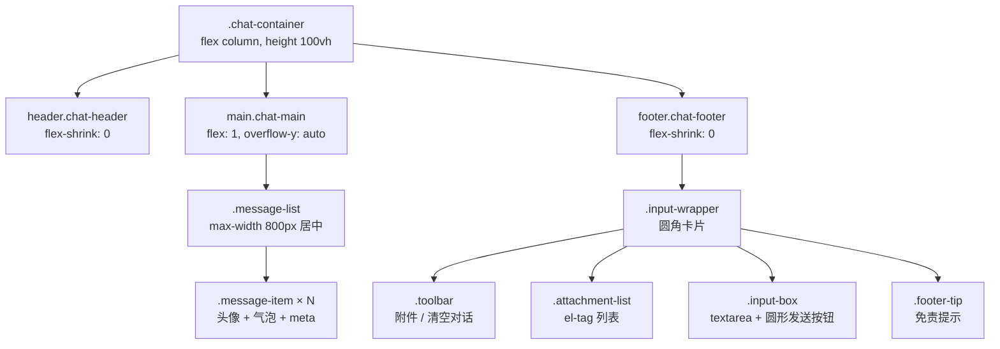
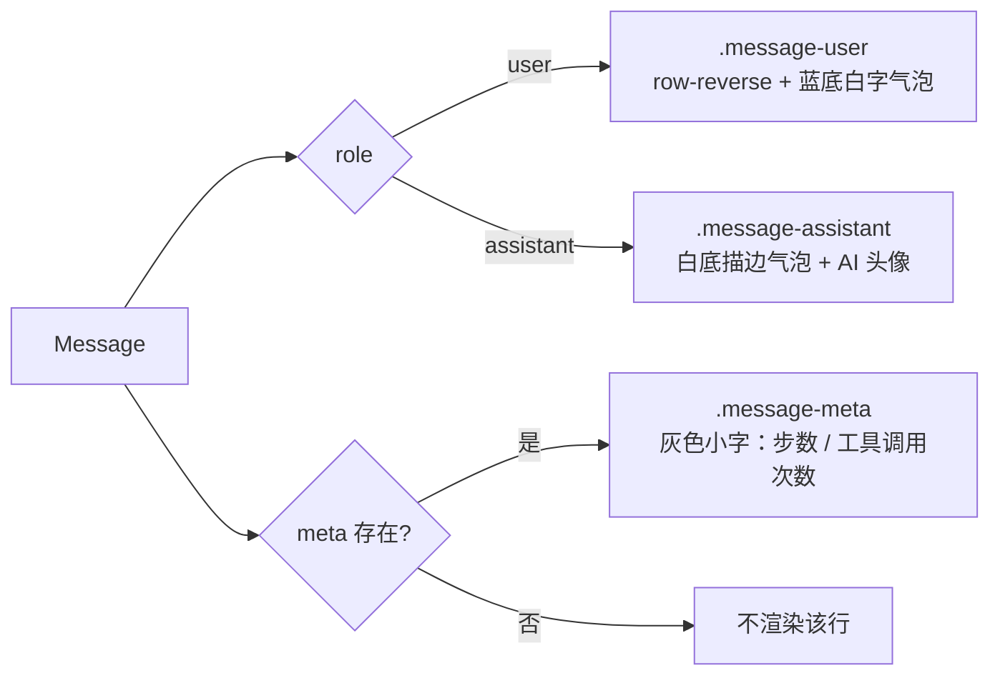
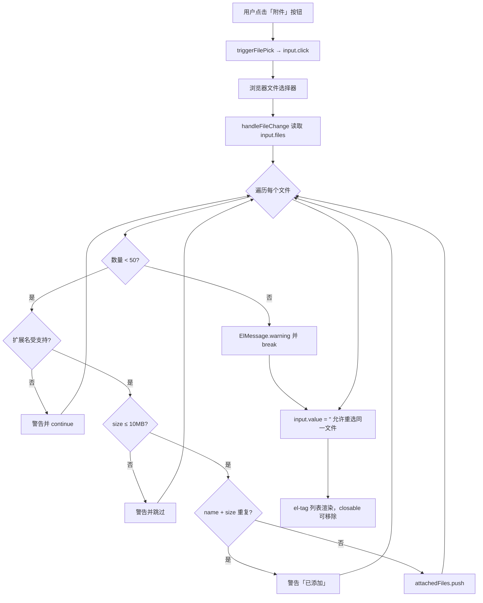
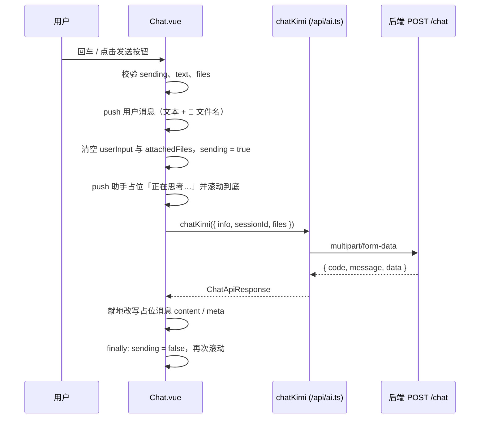
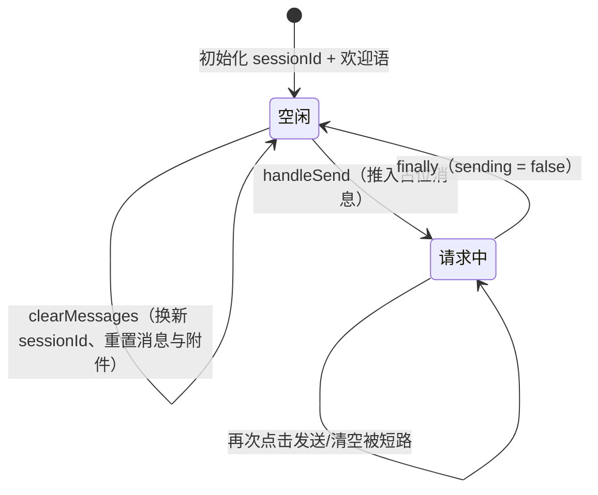

本页专注前端**单页聊天界面**本身：它由哪些组件骨架构成、用哪些响应式状态描述「消息」与「附件」、以及在用户点击发送后视图如何在本地即时更新。整个前端没有登录页、没有多路由导航，只有一个页面组件 `Chat.vue` 承载全部交互。上传的具体网络细节、Vite 代理与后端会话记忆语义分别属于其它页面，这里只在必要处点到为止。

Sources: [Chat.vue](fe/src/components/Chat.vue#L1-L95)

## 页面在应用中的位置：一个路由、一个组件

前端的启动链路极其扁平：`main.ts` 创建应用、注册 Element Plus 与 vue-router，然后挂载到 `#app`。Element Plus 的样式与组件在此**全局注册**，因此 `Chat.vue` 里可以直接使用 `el-avatar`、`el-button`、`el-tag`、`el-input` 而不必逐个 import 组件本体（只 import 图标与 `ElMessage`）。

Sources: [main.ts](fe/src/main.ts#L1-L11), [Chat.vue](fe/src/components/Chat.vue#L97-L102)

路由表同样只有一条真实路由：`/` 重定向到 `/chat`，`/chat` 懒加载 `Chat.vue`，其余任意路径也回落重定向到 `/chat`。这意味着**不存在「404 页面」与「登录页」**，任何 URL 最终都会落到聊天界面。

| 路径 | 行为 | 目的 |
|---|---|---|
| `/` | `redirect: '/chat'` | 打开根域名直接进入聊天 |
| `/chat` | 动态 `import('../components/Chat.vue')` | 唯一的真实页面（按需加载） |
| `/:pathMatch(.*)*` | `redirect: '/chat'` | 未知路径兜底，避免空白页 |

Sources: [index.ts](fe/src/router/index.ts#L1-L24), [App.vue](fe/src/App.vue#L1-L6)

`App.vue` 只做一件事：渲染 `<router-view />`，并用全局样式重置 `margin/padding/box-sizing`、把 `body` 设为 `overflow: hidden`、`#app` 设为满屏。`overflow: hidden` 很关键——滚动被**限定在消息列表容器内部**，而不是整页滚动，这样头部与输入区才能固定在上下两端。

Sources: [App.vue](fe/src/App.vue#L8-L26), [style.css](fe/src/style.css#L22-L32)

## 三段式组件骨架

`Chat.vue` 是典型的「上中下」三段布局：固定的头部、可滚动的消息区、固定的输入区。三个区域都用 `flex-shrink: 0` / `flex: 1` 明确分配空间，容器高度取 `100vh`，因此界面在桌面端不会出现整页滚动条。



| 区域 | 关键样式 | 作用 |
|---|---|---|
| `.chat-container` | `display:flex; flex-direction:column; height:100vh` | 撑满视口，纵向排列三段 |
| `.chat-main` | `flex:1; overflow-y:auto; scroll-behavior:smooth` | 唯一可滚动区，平滑滚动到最新消息 |
| `.message-list` | `max-width:800px; margin:0 auto` | 与输入框同宽对齐，阅读区不过度拉伸 |
| `.chat-footer` | `flex-shrink:0` + 渐隐背景 | 固定在底部，配合上方内容渐隐过渡 |
| `.input-wrapper` | `border-radius:16px` + `:focus-within` 高亮 | 聚焦时边框变为主色 `#165dff` |

Sources: [Chat.vue](fe/src/components/Chat.vue#L257-L311), [Chat.vue](fe/src/components/Chat.vue#L362-L381), [Chat.vue](fe/src/components/Chat.vue#L451-L457)

头部还给出一个身份提示：右上角徽标固定显示「单用户模式 · admin」，与后端没有鉴权、所有请求按 admin 身份进入图的设计相呼应。这类「无登录」的全局语义由 [图状态设计：Annotation 与单用户 admin 身份](5-tu-zhuang-tai-she-ji-annotation-yu-dan-yong-hu-admin-shen-fen) 负责解释，本页只承担界面表达。

Sources: [Chat.vue](fe/src/components/Chat.vue#L3-L7)

## 响应式状态清单：六个 ref 描述整个界面

这个组件的全部可变状态只有六个 `ref`，没有任何 store 或 composable。理解它们之间的职责划分，就理解了整个界面的行为边界。

| 状态 | 类型 | 初始值 | 职责 |
|---|---|---|---|
| `messages` | `ref<Message[]>` | 一条 assistant 欢迎语 | 完整消息历史（用户 + 助手） |
| `userInput` | `ref<string>` | `''` | 输入框内容（`v-model` 双向绑定） |
| `attachedFiles` | `ref<File[]>` | `[]` | 待发送的原生 `File` 对象列表 |
| `sending` | `ref<boolean>` | `false` | 请求进行中，用于禁用/loading 与并发保护 |
| `sessionId` | `ref<string>` | `crypto.randomUUID()` | 会话标识，随每次发送一起提交 |
| `chatMainRef` / `fileInputRef` | `ref<HTMLElement \\| HTMLInputElement \\| null>` | `null` | 用于滚动定位与触发原生文件选择 |

Sources: [Chat.vue](fe/src/components/Chat.vue#L117-L125)

`sessionId` 直接用浏览器内置的 `crypto.randomUUID()` 生成，无需后端先「创建会话」再返回 id。这与「清空对话即换新 id」的语义配套使用，具体生命周期含义见 [thread_id 生命周期：sessionId 与「清空对话」的语义](11-thread_id-sheng-ming-zhou-qi-sessionid-yu-qing-kong-dui-hua-de-yu-yi)。

Sources: [Chat.vue](fe/src/components/Chat.vue#L120), [Chat.vue](fe/src/components/Chat.vue#L246-L254)

## 消息模型：一个 interface 覆盖三种渲染差异

`Message` 接口刻意做得很小——只有 `role`、`content` 和一个可选的 `meta`（图执行信息）。三种视觉差异全部由 `role` 与 `meta` 的存在与否驱动，而不是定义多个组件：



- 用户消息行使用 `flex-direction: row-reverse`，头像自动被推到右侧，气泡通过 `border-bottom-right-radius: 4px` 形成「小尾巴」。
- 助手消息使用默认行方向，气泡左下角收窄，头像来自 `el-avatar` 的远程 logo。
- 气泡统一 `white-space: pre-wrap` 与 `word-break: break-word`，这是展示附件文件名换行与长链接不断图的关键。

Sources: [Chat.vue](fe/src/components/Chat.vue#L12-L28), [Chat.vue](fe/src/components/Chat.vue#L104-L109), [Chat.vue](fe/src/components/Chat.vue#L313-L360)

`meta` 由后端返回的两个计数字段拼接而成：`steps` 表示本次图运行的推理步数，`toolCalls` 表示工具被调用的次数。当两者都为假值时函数返回空串，转为 `undefined` 后 `v-if="msg.meta"` 就不会渲染这一行——所以普通寒暄消息下面不会出现多余留白。

Sources: [Chat.vue](fe/src/components/Chat.vue#L151-L157), [Chat.vue](fe/src/components/Chat.vue#L26)

## 视图更新的关键技巧：占位消息 + 响应式代理就地赋值

这是初学者最容易忽略、但最能体现 Vue 响应式原理的一段代码。发送时组件不是「等结果再 push」，而是先立即 push 一条内容为 `正在思考…` 的助手消息，取得它的**数组下标**，再通过下标从 `messages.value` 里取出元素——拿到的是 Vue 包装后的响应式代理对象，因此后续直接改 `assistantMessage.content` 就能触发视图更新，无需替换数组元素。

```ts
const assistantIndex = messages.value.push({ role: 'assistant', content: '正在思考…' }) - 1
// 通过数组下标取到的是响应式代理，直接改它的 content 就能触发视图更新
const assistantMessage = messages.value[assistantIndex]!
```

Sources: [Chat.vue](fe/src/components/Chat.vue#L222-L226)

三个分支都只修改同一个占位对象，保证界面上**永远只有一条**助手气泡在变化，不会出现「失败的空白气泡 + 提示气泡」两条残影：

| 分支 | 触发条件 | 对占位气泡的写入 |
|---|---|---|
| 成功 | `data.code === 200 && data.data` | `content = formatContent(...)`（空则 `（空回复）`），`meta = buildGraphMeta(...)` |
| 业务失败 | `code !== 200` 或 `data` 缺失 | `抱歉，本次回复失败：${data.message}` |
| 网络/异常 | 请求抛出（`catch`） | `抱歉，本次回复失败：${error.message}` |

`finally` 块无论成败都会复位 `sending = false` 并再滚动一次，保证按钮解除禁用、最新气泡可见。

Sources: [Chat.vue](fe/src/components/Chat.vue#L228-L243)

`formatContent` 则解决「后端 `content` 形状不定」的问题：它可能是字符串、可能是多模态数组（元素为字符串或带 `text` 字段的对象），也可能是 `null`。函数把数组各部分的文本抽出来拼接，其它情况转成字符串，从而让模板里的 `{{ msg.content }}` 永远安全。多模态数组为何会出现，属于 [附件多模态转换：图片 Data URI、文本内联与长度治理](15-fu-jian-duo-mo-tai-zhuan-huan-tu-pian-data-uri-wen-ben-nei-lian-yu-chang-du-zhi-li) 的内容。

Sources: [Chat.vue](fe/src/components/Chat.vue#L135-L144), [AiOperator.ts](be/src/ai/operator/AiOperator.ts#L88-L99)

## 附件状态流水线：从文件选择到标签列表

附件不是简单地把 `File` 塞进数组，而是一条带四道校验的流水线。界面上的「附件」按钮只是一个伪装成按钮的触发器：真正的 `<input type="file" multiple>` 被 CSS 隐藏（`.file-input { display: none }`），按钮点击时代为调用 `fileInputRef.value?.click()`。



Sources: [Chat.vue](fe/src/components/Chat.vue#L36-L68), [Chat.vue](fe/src/components/Chat.vue#L159-L201), [Chat.vue](fe/src/components/Chat.vue#L404-L413)

四道校验的判定依据与前端常量的对应关系如下。注意**前端与后端使用了同一组阈值**（50 个文件、10MB），前端是为了即时反馈，后端是真正的安全边界：

| 校验项 | 判定实现 | 前端常量 |
|---|---|---|
| 数量上限 | `attachedFiles.value.length >= MAX_FILES` | `MAX_FILES = 50` |
| 类型白名单 | 取小写扩展名后查两个数组 | `IMAGE_EXTENSIONS` / `TEXT_EXTENSIONS` |
| 单文件大小 | `file.size > MAX_FILE_SIZE` | `MAX_FILE_SIZE = 10 * 1024 * 1024` |
| 重复添加 | `name === item.name && size === item.size` | —（同名同尺寸视为同一文件） |

`ACCEPT` 常量把两个扩展名数组拼成逗号串绑定到 `input` 的 `accept` 属性，并配合 `multiple` 允许一次多选；工具栏的 `el-tooltip` 则把同样的规则用自然语言告知用户，形成「限制 + 解释」的成对设计。

Sources: [Chat.vue](fe/src/components/Chat.vue#L111-L115), [Chat.vue](fe/src/components/Chat.vue#L37-L52), [ai.controller.ts](be/src/ai/ai.controller.ts#L14-L17)

最后一个细节常被忽略：循环结束后执行 `input.value = ''`。如果不重置原生 input 的值，用户删除某个标签后**再次选择同一个文件不会触发 `change` 事件**，表现为「点了没反应」。这行代码是清空原生控件状态以恢复可重复选择能力的最小修复。

Sources: [Chat.vue](fe/src/components/Chat.vue#L199-L201)

## 发送流程：本地消息先落屏，再等待后端

`handleSend` 被两个入口共享：发送按钮的 `@click` 与文本域的 `@keydown.enter.prevent`（回车直接发送，`prevent` 阻止 textarea 换行）。函数开头有两道短路：`sending` 为真时直接返回（防止重复提交），文本与附件同时为空时也返回。



Sources: [Chat.vue](fe/src/components/Chat.vue#L203-L243), [Chat.vue](fe/src/components/Chat.vue#L71-L90)

用户消息的文案是**本地拼装**的：有文本就放文本，有附件就把每个文件名前缀 `📎` 后换行拼接。这样用户能立刻看到自己发了什么，而不必等后端返回；气泡的 `white-space: pre-wrap` 正好让文件名逐个换行显示。注意此时提交给后端的是 `text` 与原始 `files`，附件名只是本地展示用的副产物。

Sources: [Chat.vue](fe/src/components/Chat.vue#L210-L215)

发送按钮的可用性由一条复合条件控制，这是表单交互的中心约束：

| 条件 | 表达式片段 | 含义 |
|---|---|---|
| 请求进行中 | `sending` | 禁用，同时 `:loading="sending"` 显示转圈 |
| 内容为空 | `!userInput.trim() && attachedFiles.length === 0` | 只有附件也可以发，只有空白字符不可发 |

即 `:disabled="sending || (!userInput.trim() && attachedFiles.length === 0)"`——空白字符被 `trim()` 过滤掉，但「只发附件不发文字」是允许的，这与后端「问题与附件不能同时为空」的校验保持一致。

Sources: [Chat.vue](fe/src/components/Chat.vue#L81-L89), [AiOperator.ts](be/src/ai/operator/AiOperator.ts#L82-L86)

滚动行为统一收敛到 `scrollToBottom`：`await nextTick()` 等待 DOM 因状态变更而更新完成，再把 `scrollTop` 设为 `scrollHeight`。三处调用点分别是用户消息落屏后、助手占位落屏后、以及 `finally` 结束请求后，保证任何时刻最新内容都在可视区内。

Sources: [Chat.vue](fe/src/components/Chat.vue#L127-L133)

## 清空对话：重置视图，而不是调用后端

「清空对话」是一个纯前端操作：把 `messages` 替换为只剩欢迎语、清掉 `attachedFiles`、并重新生成 `crypto.randomUUID()` 作为新的 `sessionId`。它不会请求后端清理 checkpoint——语义上是通过**换 thread_id 让旧历史自然失效**。函数入口同样用 `sending` 做保护，避免请求进行中清空导致占位消息被孤立。

Sources: [Chat.vue](fe/src/components/Chat.vue#L245-L254)



Sources: [Chat.vue](fe/src/components/Chat.vue#L204-L205), [Chat.vue](fe/src/components/Chat.vue#L246-L247)

## 数据契约：页面依赖的响应结构

前端在 `api/ai.ts` 中用 TypeScript 接口固定了后端的「三明治」响应：外层 `code / message / data`，内层 `content` 加若干可选元数据。`Chat.vue` 只消费其中三项——`content`、`steps`、`toolCalls`；`tokenUsage`、`threadId`、`user` 虽在类型中声明，当前界面并未展示。

| 字段 | 类型 | 页面用途 |
|---|---|---|
| `content` | `string`（后端已抽取文本） | 经 `formatContent` 归一化后写入气泡 |
| `steps` | `number?` | 拼入 meta：「N 步推理」 |
| `toolCalls` | `number?` | 拼入 meta：「调用工具 N 次」 |
| `tokenUsage` / `threadId` / `user` | 可选 | 类型中保留，界面暂未渲染 |

Sources: [ai.ts](fe/src/api/ai.ts#L1-L33), [Chat.vue](fe/src/components/Chat.vue#L228-L235)

这些字段由后端 `AiOperator.chat` 返回，经全局响应拦截器包上 `code: 200 / message: 'success'` 后到达前端；因此前端判断成功的口径是 `data.code === 200`（同时也是 HTTP 200）。统一响应契约的完整说明见 [全局响应包装与异常过滤器：统一 {code, message, data} 契约](18-quan-ju-xiang-ying-bao-zhuang-yu-yi-chang-guo-lu-qi-tong-code-message-data-qi-yue)。

Sources: [AiOperator.ts](be/src/ai/operator/AiOperator.ts#L105-L112), [response.interceptor.ts](be/src/common/filters/response.interceptor.ts#L17-L29)

## 两个容易误读的模板细节

第一，模板中存在 `role="contentList"` 与 `role="userInput"` 这样的自定义属性——`role` 本身是合法的 HTML 属性，但这两个取值并非标准 ARIA role，实际用途是给消息列表与输入框提供**稳定的选择器锚点**（便于自动化测试或调试定位），不承担无障碍语义。

Sources: [Chat.vue](fe/src/components/Chat.vue#L11), [Chat.vue](fe/src/components/Chat.vue#L75)

第二，工具栏的 `<div class="toolbar" row-flex>` 使用了一个自定义属性 `row-flex`，其效果来自全局样式中 `*[row-flex] { display:flex; flex-direction:row }` 这条属性选择器规则。也就是说布局能力不是由 class 提供的，而是由这个属性选择器统一注入，属于该项目的惯例写法。

Sources: [Chat.vue](fe/src/components/Chat.vue#L36), [style.css](fe/src/style.css#L34-L42)

## 当前实现的边界

界面采用**一次性整体响应**：请求期间只有一条静态的「正在思考…」占位，返回后一次性替换文案与 meta。它没有逐字流式输出，也没有把工具调用过程可视化——这些属于后续演进方向，设计思路见 [SSE 流式输出与工具调用可视化设计](28-sse-liu-shi-shu-chu-yu-gong-ju-diao-yong-ke-shi-hua-she-ji)。若要继续深入本页顺延的下一个实现细节——表单如何真正被发出去、`Content-Type` 与 boundary 的坑——请阅读 [fetch + FormData 上传：绕开 axios 的 boundary 陷阱](21-fetch-formdata-shang-chuan-rao-kai-axios-de-boundary-xian-jing)；若关心 `/dev` 前缀如何被代理到后端 3000 端口，请阅读 [Vite 代理与 TypeScript 构建：/dev 前缀到后端 3000](22-vite-dai-li-yu-typescript-gou-jian-dev-qian-zhui-dao-hou-duan-3000)。