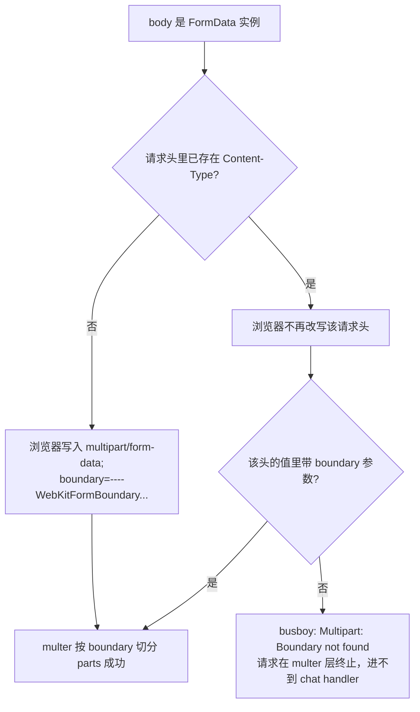
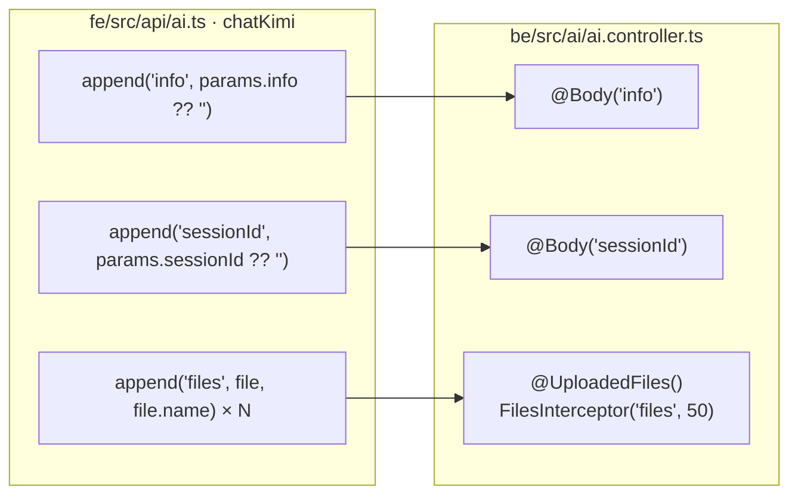
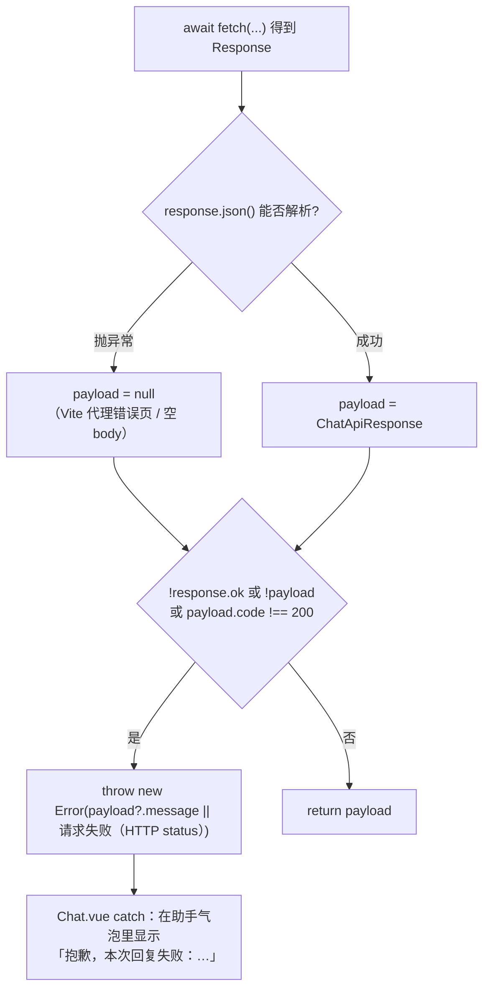

本页只讲**传输层**：一次带附件的对话请求，如何从浏览器发出、如何被后端 multer 解析、以及为什么这里刻意不用 axios。它上接单页聊天界面的附件状态管理（[单页聊天界面：Vue 3 + Element Plus 的消息与附件状态](20-dan-ye-liao-tian-jie-mian-vue-3-element-plus-de-xiao-xi-yu-fu-jian-zhuang-tai)），下接后端把附件转成多模态内容的解析逻辑（[附件多模态转换：图片 Data URI、文本内联与长度治理](15-fu-jian-duo-mo-tai-zhuan-huan-tu-pian-data-uri-wen-nei-lian-yu-chang-du-zhi-li)）。整个前端与后端之间的附件通道，收敛在一个 74 行的文件里。

Sources: [ai.ts](fe/src/api/ai.ts#L1-L74)

## 问题的本质：boundary 是「谁」写的

`multipart/form-data` 不是一种自带分界符的格式——它必须靠 `Content-Type` 头里的 `boundary=...` 参数告诉解析器「用哪串字符切分字段」。浏览器把这条规则实现得很聪明也很有脾气：**只有当开发者没有手动设置 `Content-Type` 时，它才会替你写入完整的 `multipart/form-data; boundary=----WebKitFormBoundaryXXXX`**。一旦请求头里已经存在这个键（哪怕是实例级默认值），浏览器就不再改写，boundary 参数随之缺席，后端 busboy/multer 便在解析第一步失败。

Sources: [ai.ts](fe/src/api/ai.ts#L37-L44)

这就是本项目 `chatKimi` 注释里记录的那条真实故障：axios 1.x 会给 POST 请求补上 `Content-Type: application/x-www-form-urlencoded`，FormData 上传时浏览器不再自动补 boundary，后端 multer 直接报 `Multipart: Boundary not found`。更早的版本里，前端的 axios 实例还显式写过实例级默认头 `'Content-Type': 'application/json'`，属于同一类问题的同一根因（该实例封装已在提交 `d528969` 之后的「移除登录/注册/JWT」重构中被删除）。

Sources: [ai.ts](fe/src/api/ai.ts#L40-L44)

图示的核心结论只有一句：**boundary 是「不干预」的产物**，任何一层（axios 实例默认、拦截器、手写 headers）对 `Content-Type` 的善意补充都会破坏它。

## 为什么这个项目最终不引入 axios

前端 `package.json` 的 dependencies 只有 `@element-plus/icons-vue`、`element-plus`、`vue`、`vue-router`——HTTP 客户端一个都没有。这不是遗漏，而是一次明确的功能裁剪：单用户模式下没有 token 需要注入，没有 401 需要跳登录页，仓库里也不再存在那个「带拦截器 + 请求取消 + 统一错误提示」的 `request.ts` 封装。

Sources: [package.json](fe/package.json#L1-L30)

当拦截器带来的能力（鉴权头、统一业务码校验、重复请求取消）全部不再需要时，axios 剩下的价值只有「省几行语法」，而代价是多一层对 `Content-Type` 的隐式干预。原生 `fetch` 的语义恰好相反：它对请求头不做任何假设，你不写，它就不加；body 是 FormData，浏览器就负责生成 boundary。

Sources: [ai.ts](fe/src/api/ai.ts#L56-L59)

## FormData 构造：字段名是与后端的硬契约

构造函数部分是整条链路上唯一「写了就不能改」的字符串。后端用 `FilesInterceptor('files', MAX_FILES, { limits })` 声明文件字段名，用 `@Body('info')`、`@Body('sessionId')` 声明文本字段名——multipart 是按字段名逐 part 索引的，字段名对不上时不会报错，只会静默变成空的 `undefined` / 空数组。

Sources: [ai.controller.ts](be/src/ai/ai.controller.ts#L34-L47)

| 前端字段 | 构造方式 | 后端消费点 | 关键约束 |
|---|---|---|---|
| `info` | `append('info', params.info ?? '')` | `@Body('info')` → `aiService.chat` | 空串兜底，保证字段一定存在 |
| `sessionId` | `append('sessionId', params.sessionId ?? '')` | `@Body('sessionId')` → `threadId` | 空值在后端回退为 `'default'` |
| `files`（同名多次） | `append('files', file, file.name)` | `FilesInterceptor('files', 50, …)` | 字段名 `files` + 保留文件名 |

Sources: [ai.ts](fe/src/api/ai.ts#L48-L54), [ai.controller.ts](be/src/ai/ai.controller.ts#L14-L17), [AiOperator.ts](be/src/ai/operator/AiOperator.ts#L77-L103)

文件名那一项值得单独强调：`append` 的第三个参数决定 `Content-Disposition` 里的 `filename`，而 multer 正是把它读成 `file.originalname`。后端判断「是不是文本附件」时，`mimetype` 之外还会回退到 `originalname` 的扩展名，图片则直接用 `mimetype` 拼 `data:` URI。文件名丢失会连带让后端把 `.md`、`.csv` 这类 `mimetype` 不可靠的文件判成「不支持的类型」。

Sources: [attachments.ts](be/src/ai/operator/attachments.ts#L57-L66)

## fetch 调用：三处「不做」才是正确做法

真正的 `fetch` 调用只有四行，且刻意省略了所有可选配置——没有 `headers`、没有 `mode`、没有 `credentials`。省略 `headers` 不是偷懒，而是这条链路上唯一不可妥协的设计决定：只要这一项存在，浏览器就不再补 boundary。

Sources: [ai.ts](fe/src/api/ai.ts#L56-L59)

`getBaseUrl()` 的取值顺序是 `import.meta.env.VITE_API_BASE_URL || '/dev'`，本地 `.env` 里写的就是 `/dev`，所以浏览器实际请求 `POST /dev/chat`，再由 Vite 代理把 `/dev` 前缀重写为空并转发到 `localhost:3000`（详见 [Vite 代理与 TypeScript 构建：/dev 前缀到后端 3000](22-vite-dai-li-yu-typescript-gou-jian-dev-qian-zhui-dao-hou-duan-3000)）。代理层转发的是原始字节流，不会也不能重写 multipart 头，因此 boundary 在整个链路上保持原样。

Sources: [ai.ts](fe/src/api/ai.ts#L35-L35), [.env](fe/.env#L1-L1)

下表把这些「不做」翻译成反例，便于排错时快速对号入座：

| 错误写法 | 破坏点 | 观察到的现象 |
|---|---|---|
| `headers: { 'Content-Type': 'multipart/form-data' }` | 手写头缺少 boundary，浏览器不再补 | multer 报 `Multipart: Boundary not found` |
| 沿用实例级默认头 `application/json` | 同上，请求头已存在 | 同上；附件字节被当成 JSON 解析失败 |
| 全局请求拦截器统一注入 `Content-Type` | 同上，且隐蔽（业务代码看不出来） | 同上，排查成本最高 |
| `body: JSON.stringify(formData)` | FormData 变字符串，二进制全丢 | 后端收到空文件或字段为 `undefined` |
| `append('file', f)` 复数写成单数 | 后端 `FilesInterceptor('files')` 匹配不到 | `files` 为空数组，附件被静默忽略 |

最后一行的行为可以从后端代码确认：`buildAttachmentContent(files = [])` 的默认参数与 `chat(..., files = [])` 的默认值都允许空数组直接通过，只有「既无文本又无文件」才会抛 `BadRequestException`。也就是说，字段名写错不会报错，只会得到一个「好像没带附件」的正常回复。

Sources: [AiOperator.ts](be/src/ai/operator/AiOperator.ts#L82-L91), [attachments.ts](be/src/ai/operator/attachments.ts#L75-L76)

## 响应处理：把 axios 拦截器原本做的三件事补回来

放弃 axios 意味着放弃响应拦截器，`chatKimi` 必须自己完成拦截器原本承担的判定：非 2xx 抛错、业务码校验、以及「响应体不是 JSON」这种代理层错误页的兜底。实现顺序经过刻意安排——先尝试解析，再判定状态，最后判定业务码。

Sources: [ai.ts](fe/src/api/ai.ts#L61-L72)

`try/catch` 在这里是必需的而非防御性冗余：当后端进程没起来或代理目标拒连时，Vite 返回的是 HTML 错误页，`response.json()` 会直接抛 `SyntaxError`，若不捕获就会把「HTTP 500」误包装成「JSON 解析失败」，用户看到的信息与真实原因完全脱节。

Sources: [ai.ts](fe/src/api/ai.ts#L61-L70)

抛错的优先级同样有讲究：`payload?.message || \`请求失败（HTTP ${response.status}）\`` 意味着**只要后端返回了统一契约，就用后端的中文提示**。后端 `HttpExceptionFilter` 对 `BadRequestException`（例如附件类型不支持）会原样透出 message，所以「暂不支持解析文件「x.pdf」」这类具体文案能一路传到用户的气泡里。而 multer 抛出的非 `HttpException` 错误会走到过滤器的兜底分支，前端只会看到「服务器内部错误」——这正是需要靠第 6 节的排查表反推根因的场景。

Sources: [ai.ts](fe/src/api/ai.ts#L68-L72), [http-exception.filter.ts](be/src/common/filters/http-exception.filter.ts#L31-L62), [attachments.ts](be/src/ai/operator/attachments.ts#L92-L97)

调用侧还有一个细节：`Chat.vue` 里仍然写了 `if (data.code === 200 && data.data)` 的分支，而 `chatKimi` 已经保证 `code === 200` 才会返回，因此那个 `else` 实际不可达。这属于双保险写法，不影响行为，但阅读时要知道错误提示真正的出口是 `catch`。

Sources: [Chat.vue](fe/src/components/Chat.vue#L228-L242)

## 双侧约束对齐：10MB / 50 个 / 类型白名单

前端在 `Chat.vue` 顶部把限制写成三个常量，后端在 `ai.controller.ts` 里写了一份等价声明。两份数字完全相同不是为了冗余，而是为了「体验」与「安全」分工：前端拦截是为了让用户即时得到 warning 提示而不是等一次完整的失败往返；后端拦截是因为任何前端校验都可被绕过。

| 约束 | 前端位置 | 后端位置 | 表现差异 |
|---|---|---|---|
| 单文件 ≤ 10MB | `MAX_FILE_SIZE = 10 * 1024 * 1024`，超限跳过并 warn | `limits: { fileSize: MAX_FILE_SIZE }` | 前端静默跳过单个文件；后端整请求被拒 |
| 数量 ≤ 50 | `MAX_FILES = 50`，达上限即 break | `FilesInterceptor('files', MAX_FILES)` | 同上 |
| 仅图片 + 纯文本 | `IMAGE_EXTENSIONS` / `TEXT_EXTENSIONS` + `isSupportedFile` | `isImageFile`（mimetype）+ `isTextFile`（mimetype 或扩展名） | 前端 warning 跳过；后端 400 明确报错 |

Sources: [Chat.vue](fe/src/components/Chat.vue#L111-L115), [Chat.vue](fe/src/components/Chat.vue#L159-L201), [ai.controller.ts](be/src/ai/ai.controller.ts#L14-L17), [attachments.ts](be/src/ai/operator/attachments.ts#L30-L66)

两套白名单的实现口径并不完全一致，这值得中级开发者留意：前端按扩展名判断（`getExtension` + 两个数组），后端对图片以 `mimetype.startsWith('image/')` 为准、对文本则接受 `text/*`、`application/json` 或扩展名兜底。因此存在「前端放过、后端拒绝」的窄缝——例如扩展名合法但 mimetype 异常的构造文件；反向的「前端拒、后端本可接受」也被扩展名白名单收紧了。当前实现选择让前端更严格，把后端错误当作最后一道闸。

Sources: [Chat.vue](fe/src/components/Chat.vue#L146-L162), [attachments.ts](be/src/ai/operator/attachments.ts#L45-L66)

## 故障排查表

| 症状（用户视角） | 后端日志 / 返回 | 根因 | 修复 |
|---|---|---|---|
| 回复「服务器内部错误」，附件与文本都没进去 | `Multipart: Boundary not found` | 某处设置了 `Content-Type` | 删掉 `headers` / 拦截器里的 Content-Type 注入 |
| 正常回复，但附件像没带 | `files` 为空数组，无报错 | FormData 字段名不是 `files` | 对齐 `FilesInterceptor('files', …)` |
| 回复「请输入您的问题内容或上传文件」 | `BadRequestException` | `info` 为空且 `files` 为空 | 检查 `info` 字段名与空串兜底 |
| 上传大文件后整体失败 | 500「服务器内部错误」 | 超过 `limits.fileSize` | 前端 10MB 预校验被绕过，检查 `MAX_FILE_SIZE` 两侧一致性 |
| 回复「暂不支持解析文件「x」」 | 400 + 具体文件名 | 后端白名单拒绝该类型 | 收敛前端 `ACCEPT` 到同一份扩展名清单 |
| 回复「请求失败（HTTP 502）」 | 代理层 HTML 错误页 | 后端未启动 / 端口不符 | 检查 Vite 代理 target 与 `PORT` |
| 多轮历史丢失 | `threadId` 变成 `default` | `sessionId` 字段缺失或为空 | 检查 FormData 的 `sessionId` append |

Sources: [ai.ts](fe/src/api/ai.ts#L48-L72), [ai.controller.ts](be/src/ai/ai.controller.ts#L34-L47), [AiOperator.ts](be/src/ai/operator/AiOperator.ts#L82-L103), [http-exception.filter.ts](be/src/common/filters/http-exception.filter.ts#L36-L62)

## 迁移对照：从 axios 调用到 fetch + FormData

如果用惯用的 axios 写法描述同一件事，差异集中体现在「谁决定 Content-Type」与「谁决定抛出错误」两点上：

| 关注点 | axios 写法（本项目已弃用） | 当前 fetch 写法 |
|---|---|---|
| 请求头 | 实例默认 / 拦截器注入，需显式 `delete` 才能让浏览器补 boundary | 完全不写，交给浏览器 |
| 请求体 | `data: formData`，且必须确认没有序列化转换 | `body: formData` 原样传递 |
| 非 2xx | 自动 reject，进入 `catch` | 只有网络层失败才 reject，需自己判 `response.ok` |
| 业务码 | 响应拦截器统一判 `data.code !== 200` | `chatKimi` 内联判断并 `throw` |
| 响应体非 JSON | 拦截器里容易漏掉 | `try { response.json() } catch { null }` 显式兜底 |
| 超时 | 可配置 `timeout` | 无内置超时（当前实现未设置） |
| 上传进度 | 支持 `onUploadProgress` | 不支持，仅有 `sending` 布尔态 |

Sources: [ai.ts](fe/src/api/ai.ts#L45-L72), [Chat.vue](fe/src/components/Chat.vue#L204-L243)

表格最后两行是本实现主动接受的取舍：模型推理耗时较长，请求本身没有超时保护（一旦挂起只能靠用户刷新）；附件上传过程没有进度反馈，仅靠发送按钮的 `:loading="sending"` 表达「正在进行」。这两点都在单用户、本地开发的定位下被判定为可接受，若后续演进为多用户或大文件场景，才需要重新引入带超时与进度的封装。

Sources: [Chat.vue](fe/src/components/Chat.vue#L81-L90), [Chat.vue](fe/src/components/Chat.vue#L219-L241)

## 下一步

传输层之后的阅读路径有两条：想看 `POST /dev/chat` 如何被代理到 `localhost:3000` 并顺带了解 `vue-tsc` 构建约束，读 [Vite 代理与 TypeScript 构建：/dev 前缀到后端 3000](22-vite-dai-li-yu-typescript-gou-jian-dev-qian-zhui-dao-hou-duan-3000)；想看这些字节在后端如何变成 `image_url` 与内联文本、以及长度截断策略，读 [附件多模态转换：图片 Data URI、文本内联与长度治理](15-fu-jian-duo-mo-tai-zhuan-huan-tu-pian-data-uri-wen-nei-lian-yu-chang-du-zhi-li)。至于 `sessionId` 如何决定 `thread_id` 与「清空对话」的语义，见 [thread_id 生命周期：sessionId 与「清空对话」的语义](11-thread-id-sheng-ming-zhou-qi-sessionid-yu-qing-kong-dui-hua-de-yu-yi)。