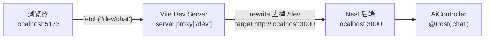
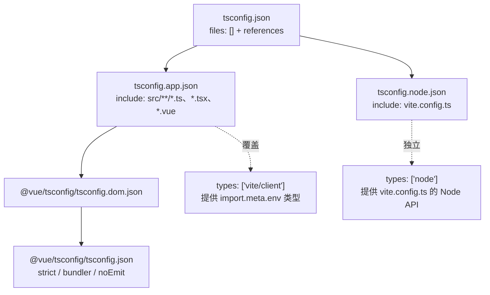

这个页面只回答两个前端工程化问题：**开发时前端怎么把请求送到 3000 端口的后端**（Vite `server.proxy` + `/dev` 前缀 + `VITE_API_BASE_URL`），以及**`npm run build` 到底做了什么**（`vue-tsc -b` 的类型检查链 + `vite build` 的产物组织）。读完后你应该能自己修改代理目标、切换部署地址，并且在 `vue-tsc` 报错时知道是哪个配置文件在起作用。

## 为什么需要代理：5173 与 3000 是两个源

前端由 Vite 开发服务器提供，默认地址是 `http://localhost:5173`；后端 Nest 默认监听 `3000`。两者端口不同，对浏览器而言就是**两个不同的源**，直接请求会落入跨域场景。项目的处理方式是让前端只请求自己的源、把特定前缀的路径交给 Vite 转发给后端——即"开发期同源"。

Sources: [README.MD](README.MD#L58-L68), [main.ts](be/src/main.ts#L32-L39)

下图是这条链路的静态结构，注意 `/dev` 只存在于浏览器到 Vite 的那一段，转发出去时就已经被抹掉了：

Sources: [vite.config.ts](fe/vite.config.ts#L12-L25), [ai.controller.ts](be/src/ai/ai.controller.ts#L23-L35)

## vite.config.ts 全貌：插件、别名、代理

配置文件本身非常短，只有三块内容：Vue 插件、`@` 路径别名、`server.proxy`。理解它不需要任何构建原理，只需要知道 Vite 把这份对象当作开发服务器与打包器的统一配置。

Sources: [vite.config.ts](fe/vite.config.ts#L1-L27)

| 配置块 | 代码位置 | 作用 | 新手最容易误解的点 |
|---|---|---|---|
| `plugins: [vue()]` | L6 | 让 Vite 能编译 `.vue` 单文件组件 | 它**不**做类型检查，类型检查在 `vue-tsc` 里 |
| `resolve.alias['@'] = '/src'` | L7-L11 | 用 `@/xxx` 代替相对路径 | 目前项目源码 **0 处**使用它，见后文"已知缝隙" |
| `server.proxy['/dev']` | L19-L23 | 开发期转发规则 | 只在 `npm run dev` 生效，**打包后不存在** |
| 注释掉的 `/api` 块 | L14-L18 | 早期写法，说明前缀是可替换的 | 换前缀 = 改这里 + 改 `.env`，两处必须同步 |

Sources: [vite.config.ts](fe/vite.config.ts#L4-L25)

代理条目四个字段可以逐条对照：

| 字段 | 本项目取值 | 语义 |
|---|---|---|
| key `'/dev'` | 路径前缀匹配 | 只看请求路径是否以此开头，不看域名 |
| `target` | `http://localhost:3000` | 命中后转发到的后端地址，端口必须与后端实际监听一致 |
| `changeOrigin` | `true` | 转发时把 `Host` 头改为 target 的主机名，避免后端按 Host 做校验时拒绝 |
| `rewrite` | `path.replace(/^\/dev/, '')` | 转发前重写路径，把前缀剥掉 |

Sources: [vite.config.ts](fe/vite.config.ts#L19-L23)

## 前后对照：一次 `/dev/chat` 请求的路径变换

`rewrite` 是这条链路上唯一会"改地址"的环节，因为后端根本没有 `/dev` 这一层。证据在控制器：`@Controller()` 没有传参（即无路由前缀），方法装饰器直接写 `@Post('chat')` 与 `@Get('search')`；`main.ts` 也只做了 CORS、拦截器、过滤器与 Swagger 挂载，没有 `setGlobalPrefix`。所以后端的真实路径就是 `/chat`、`/search`、`/`。

Sources: [ai.controller.ts](be/src/ai/ai.controller.ts#L23-L35), [app.controller.ts](be/src/app.controller.ts#L1-L9), [main.ts](be/src/main.ts#L9-L30)

| 前端发起 | Vite 匹配 | 转发给后端 | 后端命中 |
|---|---|---|---|
| `/dev/chat` | ✅ | `http://localhost:3000/chat` | `@Post('chat')` |
| `/dev/search` | ✅ | `http://localhost:3000/search` | `@Get('search')` |
| `/dev/api` | ✅ | `http://localhost:3000/api` | Swagger UI（`SwaggerModule.setup('api', ...)`） |
| `/chat`（漏写前缀） | ❌ | 不转发，Vite 返回 index.html 或 404 | 永远到不了后端 |

Sources: [vite.config.ts](fe/vite.config.ts#L19-L23), [main.ts](be/src/main.ts#L29-L30), [ai.controller.ts](be/src/ai/ai.controller.ts#L28-L35)

第三行值得留意：Swagger 文档挂在 `/api`，因此走代理访问 `http://localhost:5173/dev/api` 也能打开接口文档——这说明代理是**通用前缀转发**，并非只对 `/chat` 特判。

Sources: [main.ts](be/src/main.ts#L21-L30), [vite.config.ts](fe/vite.config.ts#L22)

## 请求地址的唯一来源：VITE_API_BASE_URL

前端所有请求的基址只由一个函数决定：`import.meta.env.VITE_API_BASE_URL || '/dev'`。这是一个"两层兜底"设计——`.env` 里配置了 `VITE_API_BASE_URL=/dev`；即使 `.env` 缺失，`||` 后面的 `'/dev'` 仍会兜住，保证开发环境默认可用。

Sources: [ai.ts](fe/src/api/ai.ts#L35), [.env](fe/.env#L1)

调用点把基址与路径简单拼接：`fetch(\`${getBaseUrl()}/chat\`, ...)`。所以"改后端地址"这件事在整个前端只有两处需要动的地方——`.env` 与 `vite.config.ts` 的 `target`——不需要碰任何组件代码。

Sources: [ai.ts](fe/src/api/ai.ts#L56-L59), [Chat.vue](fe/src/components/Chat.vue#L98-L101)

| 场景 | `VITE_API_BASE_URL` | `vite.config.ts` target | 结果 |
|---|---|---|---|
| 本地开发（当前状态） | `/dev` | `http://localhost:3000` | 同源请求，走代理转发 |
| 后端换端口 3001 | `/dev` | 改为 `http://localhost:3001` | 代理目标变了，前端代码不动 |
| 部署，后端同域反代 | `/dev` 或 `/api` | 打包后代理失效，由网关/反代处理 | 需在部署侧配置等价规则 |
| 部署，前端直连后端域名 | `https://api.example.com` | 无需修改 | 变成跨域请求，依赖后端 CORS |

Sources: [vite.config.ts](fe/vite.config.ts#L19-L23), [ai.ts](fe/src/api/ai.ts#L35), [main.ts](be/src/main.ts#L12-L13)

第四行之所以可行，是因为后端显式开启了 CORS：`app.enableCors()`。这也解释了为什么"生产环境必须改 `.env`"——代理只存在于 Vite 开发服务器中，`dist` 产物里没有任何转发逻辑，基址仍是相对路径时前端会请求到自己的静态服务器上。

Sources: [main.ts](be/src/main.ts#L12-L13), [fe/README.md](fe/README.md#L31)

两个运维细节需要提前知道：`.env` 被写进 `fe/.gitignore`（所以新人必须 `cp .env.example .env`，好在代码里还有 `|| '/dev'` 兜底）；只有 `VITE_` 开头的变量才会被注入到浏览器端代码，非 `VITE_` 前缀的变量在 `import.meta.env` 上取不到。

Sources: [.gitignore](fe/.gitignore#L10-L11), [.env.example](fe/.env.example#L1), [.env](fe/.env#L1)

## TypeScript 构建：三份 tsconfig 的引用关系

前端没有一份"大一统"的 tsconfig，而是标准的 **project references** 结构：根 `tsconfig.json` 里 `files: []`、只有 `references`，本身不参与编译，只负责把两个子项目串起来。这与 `build` 脚本里的 `vue-tsc -b`（build 模式）严格对应——`-b` 就是"按引用关系构建"。

Sources: [tsconfig.json](fe/tsconfig.json#L1-L7), [package.json](fe/package.json#L6-L10)

Sources: [tsconfig.json](fe/tsconfig.json#L3-L6), [tsconfig.app.json](fe/tsconfig.app.json#L1-L16), [tsconfig.node.json](fe/tsconfig.node.json#L2-L26)

拆成两个子项目的动机很直接：`src/` 跑在浏览器里，`vite.config.ts` 跑在 Node 里，两者的全局类型集合互相污染。所以 `tsconfig.app.json` 声明 `types: ["vite/client"]`（提供 `import.meta.env`、`*.vue` 等类型），`tsconfig.node.json` 声明 `types: ["node"]` 并设置 `module: ESNext`、`moduleResolution: bundler`、`target: ES2023`，且 `noEmit: true`——它只做检查，不产出 JS。

Sources: [tsconfig.app.json](fe/tsconfig.app.json#L2-L5), [tsconfig.node.json](fe/tsconfig.node.json#L4-L15)

| 维度 | `tsconfig.app.json` | `tsconfig.node.json` |
|---|---|---|
| 覆盖文件 | `src/**/*.ts`、`*.tsx`、`*.vue` | 仅 `vite.config.ts` |
| 继承来源 | `@vue/tsconfig/tsconfig.dom.json`（含 DOM lib） | 无 `extends`，全量自写 |
| 类型环境 | `types: ["vite/client"]` | `types: ["node"]` |
| target / lib | 继承 Vite 对齐的 ES2020 + DOM | `ES2023` + `["ES2023"]` |
| 增量缓存文件 | `node_modules/.tmp/tsconfig.app.tsbuildinfo` | `node_modules/.tmp/tsconfig.node.tsbuildinfo` |
| 适用场景 | 浏览器端业务代码 | 构建配置文件本身 |

Sources: [tsconfig.app.json](fe/tsconfig.app.json#L1-L16), [tsconfig.node.json](fe/tsconfig.node.json#L1-L26)

`.vue` 文件被列在 `include` 里是这里最关键的细节：`tsc` 不认识单文件组件，所以必须用 `vue-tsc` 而不是 `tsc` 来执行 build 模式检查。这就是 `build` 脚本写成 `vue-tsc -b && vite build` 的原因——**先类型检查，通过了才打包**；任一类型错误都会让整个 `npm run build` 失败。

Sources: [tsconfig.app.json](fe/tsconfig.app.json#L15), [package.json](fe/package.json#L8)

## 严格度从哪里来：继承的选项 vs 项目自己加的

`tsconfig.app.json` 只写了一小段 `compilerOptions`，其余全部来自 `@vue/tsconfig`。这意味着阅读配置时要把"项目显式声明的"和"继承来的"分开看，否则会找不到某些报错的原因（例如索引访问返回 `T | undefined`、`import type` 报错）。

Sources: [tsconfig.app.json](fe/tsconfig.app.json#L2-L14)

| 选项 | 来源 | 新手会遇到的症状 |
|---|---|---|
| `strict` | 两处都写（app 显式 L8，基座亦有） | 未标注类型的参数/`null` 检查报错 |
| `noUncheckedIndexedAccess` | 基座（`@vue/tsconfig`） | `arr[0]` 的类型变成 `T \| undefined` |
| `verbatimModuleSyntax` | 基座 | 导入纯类型必须写 `import type` |
| `moduleDetection: force` | 基座 | 无 import/export 的文件也被当作模块 |
| `noUnusedLocals` / `noUnusedParameters` | app 显式 L9-L10 | 定义了没用的变量/参数会直接构建失败 |
| `erasableSyntaxOnly` | app 显式 L11 | 禁止 `enum`、参数属性等"需要生成代码"的语法 |
| `noFallthroughCasesInSwitch` | app 显式 L12 | `switch` 漏写 `break` 报错 |
| `noUncheckedSideEffectImports` | app 显式 L13 | 副作用导入（如纯样式导入）也要能解析到 |

Sources: [tsconfig.app.json](fe/tsconfig.app.json#L3-L14), [tsconfig.node.json](fe/tsconfig.node.json#L17-L23)

`noUnusedLocals` / `noUnusedParameters` 特别值得强调：它们在 `vite dev` 下**完全不报**（开发服务器不做类型检查），只在 `vue-tsc -b` 时爆发。所以"本地跑得好好的、一构建就红"的最常见原因就是这个组合——例如调试时留下的 `const tmp = ...`、未使用的导入图标。

Sources: [tsconfig.app.json](fe/tsconfig.app.json#L9-L10), [package.json](fe/package.json#L7-L8)

## 构建产物：dist 里到底生成了什么

Vite 以 `index.html` 为入口，沿 `<script type="module" src="/src/main.ts">` 抓取依赖图并打包。仓库里已有的 `dist/` 展示了产物形态：`index.html` 被改写成引用带哈希的 JS/CSS，`assets/` 下是 `index-*.js`、`index-*.css` 以及单独分出的 `Chat-*.js`、`Chat-*.css`。

Sources: [index.html](fe/index.html#L10-L11), [index.html](fe/dist/index.html#L8-L9), [assets](fe/dist/assets)

`Chat-*.js` 是一个独立 chunk，来源是路由里的**动态导入**：`component: () => import('../components/Chat.vue')`。这是 Vite/Rollup 的自动代码分割，不需要任何额外配置——写成 `() => import(...)` 就分到一个 chunk 里。

Sources: [router/index.ts](fe/src/router/index.ts#L9-L13)

| 产物文件 | 大小（本地 dist 实测） | 来源 |
|---|---|---|
| `assets/index-*.js` | ~1.0 MB | Element Plus + Vue 等入口依赖 |
| `assets/index-*.css` | ~350 KB | `element-plus/dist/index.css` 等全局样式 |
| `assets/Chat-*.js` | ~5.4 KB | `Chat.vue` 动态导入分包 |
| `assets/Chat-*.css` | ~3.4 KB | `Chat.vue` 的 `<style lang="scss" scoped>` 编译结果 |
| `vite.svg` | 1.5 KB | `public/` 目录原样拷贝 |

Sources: [assets](fe/dist/assets), [main.ts](fe/src/main.ts#L1-L9), [Chat.vue](fe/src/components/Chat.vue#L257)

`Chat-*.css` 的存在顺手解释了 `sass` 为什么在 `devDependencies` 里：`Chat.vue` 的样式块声明了 `lang="scss"`，Vite 需要 sass 编译器把它转成 CSS；缺了 `sass` 依赖时构建会直接报"预处理器找不到"。同时注意 `scoped` 属性，它让样式只作用于该组件。

Sources: [Chat.vue](fe/src/components/Chat.vue#L257), [package.json](fe/package.json#L17-L25)

还有一个部署层面的坑：配置里没有设置 `base`，因此 `dist/index.html` 里的资源路径是根绝对路径 `/assets/...`。把 `dist` 部署到子路径（例如 `https://host/app/`）时必须显式配置 `base`，否则白屏。

Sources: [index.html](fe/dist/index.html#L5-L9), [vite.config.ts](fe/vite.config.ts#L5-L11)

## 已知缝隙与工程约定

**`@` 别名只在打包器一侧声明。** `vite.config.ts` 里配置了 `resolve.alias['@'] = '/src'`，但 TypeScript 侧（`tsconfig.app.json` 及其继承链）没有任何 `paths` 映射。当前源码中 `from '@/...'` 的使用数为 0，所以构建不会失败；一旦开始使用，`vue-tsc` 会报模块找不到，届时需要补一条 `paths: { "@/*": ["./src/*"] }`。

Sources: [vite.config.ts](fe/vite.config.ts#L7-L11), [tsconfig.app.json](fe/tsconfig.app.json#L1-L16)

**`shims` 与 `assets` 目录是空的。** 因为 `types: ["vite/client"]` 已经提供了 `*.vue` 等模块声明，传统项目必需的 `shims-vue.d.ts` 在这里被省略了；两个空目录更像是脚手架预留位。

Sources: [tsconfig.app.json](fe/tsconfig.app.json#L5)

**包管理器约定。** 根 README 明确写了前端用 `npm install && npm run dev`、后端用 `pnpm`。`fe/` 下同时存在 `package-lock.json` 与 `pnpm-lock.yaml`，还有一份 `pnpm-workspace.yaml` 把 `esbuild` 等依赖的构建脚本设为 `false`（`allowBuilds`）；按 README 走 npm 路线最稳妥，改用 pnpm 时要留意这层脚本禁用设置。

Sources: [README.MD](README.MD#L60-L66), [pnpm-workspace.yaml](fe/pnpm-workspace.yaml#L1-L4)

## 故障排查速查表

| 现象 | 最可能原因 | 检查点 |
|---|---|---|
| 前端拿到 `index.html` 或 404（JSON 解析失败） | 请求没带 `/dev` 前缀，未被代理匹配 | `ai.ts` 的 `getBaseUrl()` 返回值、`.env` 是否被 gitignore 掉 |
| `ECONNREFUSED` / 代理 500 | 后端没起或端口不是 3000 | `be` 是否 `pnpm start:dev`；`be/.env` 的 `PORT` 与代理 `target` 是否一致 |
| 后端收到 404，路径变成 `/dev/chat` | `rewrite` 被删除或写错 | `path.replace(/^\/dev/, '')` 是否存在 |
| 后端报 multipart / boundary 相关错误 | 请求体非 FormData 导致 | 属于上传实现细节，见 [fetch + FormData 上传：绕开 axios 的 boundary 陷阱](21-fetch-formdata-shang-chuan-rao-kai-axios-de-boundary-xian-jing) |
| `npm run build` 因 TS 报错中断 | `vue-tsc -b` 类型检查失败（dev 时不报） | 未使用变量/参数、缺 `import type`、索引访问可能为 `undefined` |
| 部署后白屏、控制台 404 `/assets/...` | 未设置 `base` 且部署在子路径 | `dist/index.html` 里资源是否以 `/` 开头 |
| 部署后接口打到前端自己的静态服务器 | `VITE_API_BASE_URL` 仍是 `/dev` | 打包前改为后端绝对地址，或由网关做等价转发 |

Sources: [vite.config.ts](fe/vite.config.ts#L13-L24), [ai.ts](fe/src/api/ai.ts#L35), [ai.ts](fe/src/api/ai.ts#L68-L70), [main.ts](be/src/main.ts#L32-L39), [package.json](fe/package.json#L8), [index.html](fe/dist/index.html#L8-L9)

## 命令速查

| 命令 | 实际执行 | 用途 |
|---|---|---|
| `npm run dev` | `vite` | 启动 5173，代理生效，**不做类型检查** |
| `npm run build` | `vue-tsc -b && vite build` | 类型检查（app + node 两个子项目）→ 产出 `dist/` |
| `npm run preview` | `vite preview` | 本地预览 `dist/` 产物，**代理不生效**，接口需按生产方式配置 |

Sources: [package.json](fe/package.json#L6-L10)

`preview` 这一行是新手最常踩的坑：它是静态服务器，不是开发服务器，`server.proxy` 在这条命令下没有任何效果。想验证"部署后能不能跑"，必须先把 `VITE_API_BASE_URL` 改成后端可达地址再重新 `build`。

Sources: [package.json](fe/package.json#L9), [fe/README.md](fe/README.md#L33-L40)

## 继续阅读

这条链路的上下游分别在别的页面：请求体为什么要用原生 `fetch` 而不是 axios，见 [fetch + FormData 上传：绕开 axios 的 boundary 陷阱](21-fetch-formdata-shang-chuan-rao-kai-axios-de-boundary-xian-jing)；后端如何把响应统一包成 `{code, message, data}`（本页的 `payload.code !== 200` 判断依赖的契约），见 [全局响应包装与异常过滤器：统一 {code, message, data} 契约](18-quan-ju-xiang-ying-bao-zhuang-yu-yi-chang-guo-lu-qi-tong-code-message-data-qi-yue)；环境变量的完整清单（后端部分）见 [配置与环境变量：唯一的凭证是模型 API Key](4-pei-zhi-yu-huan-jing-bian-liang-wei-de-ping-zheng-shi-mo-xing-api-key)；整体构建、Lint 与测试流程见 [构建、Lint 与 e2e 测试流程](25-gou-jian-lint-yu-e2e-ce-shi-liu-cheng)。