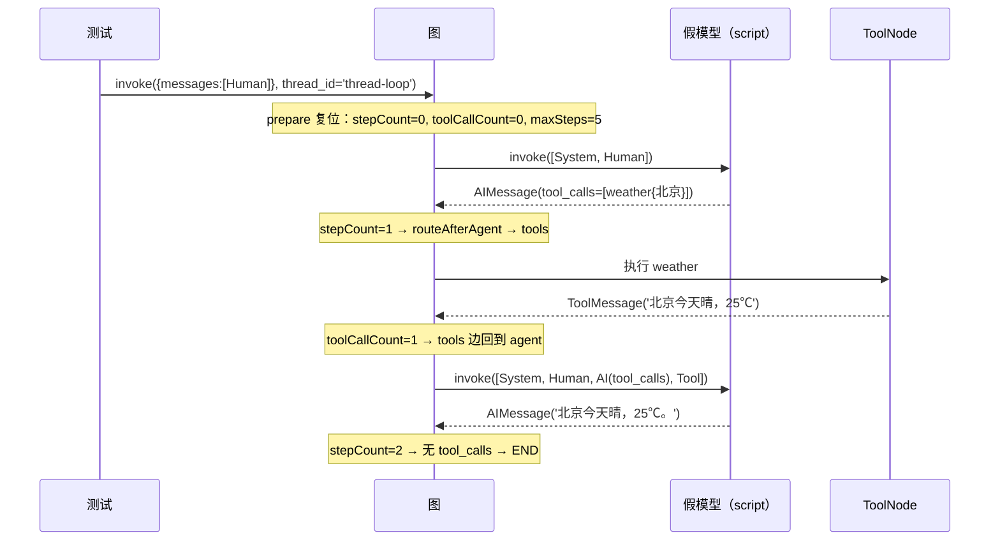
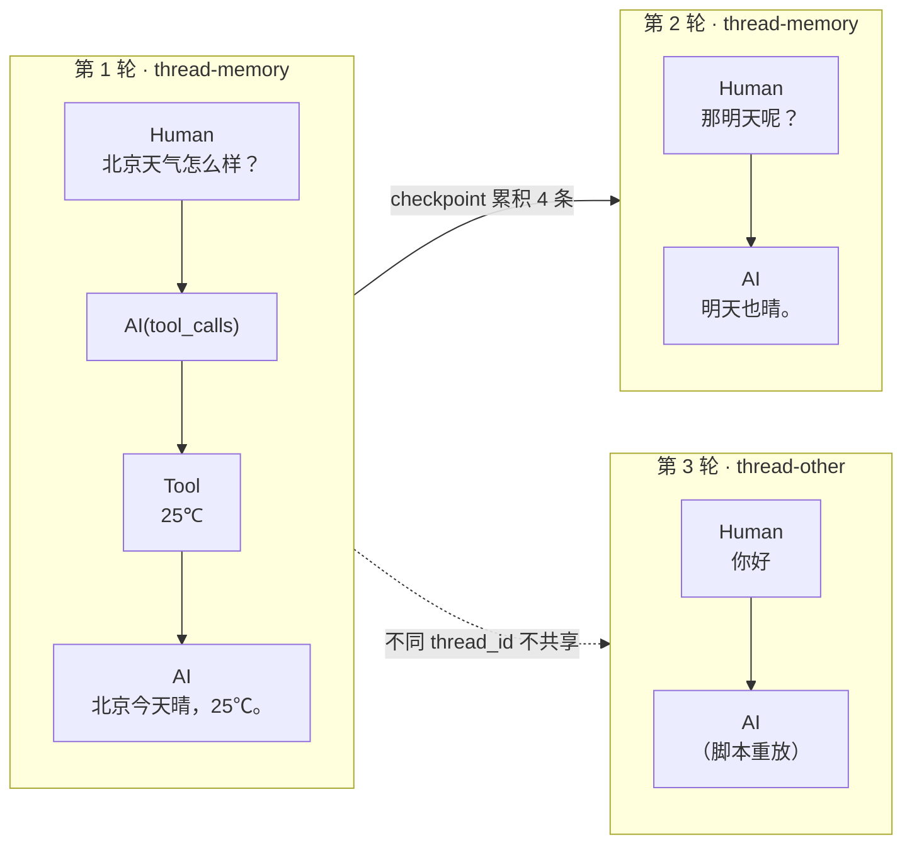

`be/src/ai/graph/graph.spec.ts` 是整个后端里唯一一个**真正编译并执行 LangGraph 图**的测试文件：它不走 Nest 的 DI 容器、不发 HTTP 请求、不连 MongoDB、不请求任何模型 API，却完整跑通了 `prepare → agent → tools → agent` 的多轮循环、跨请求的 checkpoint 记忆、以及 `maxSteps` 触顶后的 `limit` 兜底。实现这一点的关键不是 mock 框架，而是 `graph.ts` 早已把模型、工具、持久化三项依赖提到参数表里——测试只需要按同样的签名传进去四个「廉价替身」。本页拆解这四个替身如何构造、脚本引擎如何记账、以及每一条 `expect` 究竟在守护哪一条图不变量。

Sources: [graph.spec.ts](be/src/ai/graph/graph.spec.ts#L1-L7), [graph.ts](be/src/ai/graph/graph.ts#L41-L59)

## 隔离边界：一次 import 决定测试不联网、不落库

判断一个测试的隔离程度，最可靠的证据是它的 import 闭包。测试文件只 import 了 `@langchain/core/messages`、`@langchain/core/tools`、`@langchain/langgraph`（`END`、`MemorySaver`）、`zod`，以及本地的 `./graph`、`./state`、`./edges`。顺着这条链展开，`graph.ts` 只 import `./state` / `./nodes` / `./edges`，`nodes.ts` 只多 import 了 `./prompts` 里的一个字符串常量。**`model.ts`（会读 `process.env.MODEL_API_KEY`）、`tools/index.ts`（会 `dotenv.config()` 并可能 new `TavilySearch`）、`graph/checkpointer.ts`（会 import `mongoose`）全部不在依赖树里。**

Sources: [graph.spec.ts](be/src/ai/graph/graph.spec.ts#L1-L7), [graph.ts](be/src/ai/graph/graph.ts#L1-L4), [nodes.ts](be/src/ai/graph/nodes.ts#L1-L4), [checkpointer.ts](be/src/ai/graph/checkpointer.ts#L1-L21), [index.ts](be/src/ai/tools/index.ts#L14-L27)

生产装配与测试装配是同一组参数的两种填法，差异可以逐项对齐：

| 参数 | 生产填法（`AiOperator.getGraph`） | 测试填法（`graph.spec.ts`） | 隔离了什么 |
| --- | --- | --- | --- |
| `model` | `createChatModel()` 后 `model.bindTools(tools)` | `createScriptedModel(script)`，只有 `invoke` | API Key、网络、token 计费、模型不确定性 |
| `tools` | `createTools()`，依赖 `TAVILY_API_KEY` 才注册 | `createWeatherTool()`，纯本地字符串返回 | 外部搜索服务、配额 |
| `checkpointer` | `await getMongoCheckpointer()`（`MongoDBSaver`） | `new MemorySaver()` | MongoDB 连接、集合、进程外状态 |
| `maxSteps` | `Number(process.env.AGENT_MAX_STEPS ?? 8) \|\| 8` | 字面量 `3` / `5` | 环境变量漂移 |
| `thread_id` | `sessionId`（`/search` 用随机 UUID） | 手写 `'thread-loop'` / `'thread-memory'` / `'thread-other'` | 会话语义可复述、可断言 |

Sources: [AiOperator.ts](be/src/ai/operator/AiOperator.ts#L29-L52), [graph.spec.ts](be/src/ai/graph/graph.spec.ts#L48-L136), [state.ts](be/src/ai/graph/state.ts#L21)

值得注意的是第三个用例**完全不传 `checkpointer`**。这不是遗漏，而是对 `graph.ts` 末尾那个三元的显式验证——`checkpointer ? workflow.compile({ checkpointer }) : workflow.compile()`——同时也证明无持久化模式下 `graph.invoke(...)` 不需要 `configurable.thread_id`；该用例的调用参数里确实只有 `{ messages: [...] }`。

Sources: [graph.ts](be/src/ai/graph/graph.ts#L58), [graph.spec.ts](be/src/ai/graph/graph.spec.ts#L115-L127)

## ChatModelLike：把「模型」压扁成一个 invoke

节点层没有依赖 `ChatOpenAI`，而是声明了一个只有一个方法的最小接口：`invoke(messages, options?) => Promise<AIMessage>`。测试里的假模型连 `implements ChatModelLike` 都不写——`createScriptedModel` 没有返回类型标注，靠 TypeScript 的结构化类型自动匹配即可赋值给 `model`。这正是接口宽度的验证：**一个三行对象字面量就足以顶替真实模型**。

Sources: [nodes.ts](be/src/ai/graph/nodes.ts#L6-L12), [graph.spec.ts](be/src/ai/graph/graph.spec.ts#L19-L33)

```ts
type ScriptedStep = (messages: any[], callIndex: number) => AIMessage;

const createScriptedModel = (script: ScriptedStep[]) => {
  const calls: any[][] = [];
  return {
    calls,
    invoke: async (messages: any[]) => {
      calls.push(messages);
      const callIndex = calls.length - 1;
      const step = script[Math.min(callIndex, script.length - 1)];
      return step(messages, callIndex);
    },
  };
};
```

这里有三个刻意的设计：`ScriptedStep` 返回同步 `AIMessage`，但外层 `invoke` 是 `async`——假模型可以完全同步思考，异步性由 `async` 关键字补齐；`calls.push(messages)` 保存的是**每次调用实际收到的完整数组**，这才是断言「模型看到了什么」的唯一入口，而不是事后去读 state；`calls` 被挂在返回对象上，使测试可以从外部读取「调用次数」这一事实（`expect(model.calls).toHaveLength(2)`），无需额外计数器。

Sources: [graph.spec.ts](be/src/ai/graph/graph.spec.ts#L19-L33)

## 越界夹取：脚本长度不足时不报错，而是重放最后一步

`script[Math.min(callIndex, script.length - 1)]` 是本文件最容易被忽略、又最影响断言正确性的一行。语义是：**脚本用完后无限重放最后一个 `ScriptedStep`**，绝不抛错。这带来两个后果——第一个是正面的：用例三只需要一条「永远返回 tool_calls」的步骤就能模拟死循环倾向；第二个是陷阱：用例二只有 3 个步骤，却发生了 4 次模型调用，第 4 次（`callIndex === 3`）拿到的是 `script[2]`，即 `finalStep('明天也晴。')`，而不是某个「空响应」。因此该用例对新线程的结果只断言 `toBeDefined()`，没有断言文本内容。

Sources: [graph.spec.ts](be/src/ai/graph/graph.spec.ts#L29), [graph.spec.ts](be/src/ai/graph/graph.spec.ts#L79-L113)

| 调用序 | `callIndex` | 命中脚本项 | 该次调用看到的上下文长度 |
| --- | --- | --- | --- |
| 第 1 次 | 0 | `script[0]` = tool_calls | 2（system + human） |
| 第 2 次 | 1 | `script[1]` = final | 4（system + human + AI(tool_calls) + Tool） |
| 第 3 次 | 2 | `script[2]` = final | 6（system + 上一轮 4 条 + 新 human） |
| 第 4 次（换线程） | 3 | `Math.min(3, 2)` → `script[2]`，重放 | 2（system + human） |

Sources: [graph.spec.ts](be/src/ai/graph/graph.spec.ts#L92-L113)

## 假工具：一个 ToolNode 真能执行的 Runnable

`createWeatherTool()` 用的是 LangChain 官方的 `tool()` 工厂，带 `name`、`description` 和 `zod` schema，返回值是一个真正的 `RunnableToolLike`。这意味着它会被 `new ToolNode(tools)` 正常识别、按 `tool_calls` 里的 `args` 调用、并把字符串结果包成 `ToolMessage` 写回 state——**工具节点这条路径没有被短路**，只是工具的副作用被换成了纯字符串 `` `${city}今天晴，25℃` ``。用例一里 `expect(model.calls[1][3].content).toContain('25℃')` 能成立，恰恰证明 ToolNode 真的执行了工具并把结果回灌给模型，因为那个 `25℃` 只可能来自工具函数体。

Sources: [graph.spec.ts](be/src/ai/graph/graph.spec.ts#L9-L17), [nodes.ts](be/src/ai/graph/nodes.ts#L50-L62)

与之配合的两个消息构造器构成脚本的「词汇表」：`toolCallStep(id)` 产出 `content: ''` 但带 `tool_calls` 的 `AIMessage`（模拟模型想调工具），`finalStep(text)` 产出只有文本的 `AIMessage`（模拟模型给答案）。`lastMessage(result)` 则是读取终态的通用取巧：结果 state 里 `messages` 的最后一条永远是「这一轮的定论」。

Sources: [graph.spec.ts](be/src/ai/graph/graph.spec.ts#L35-L46)

## 用例一：agent → tools → agent 循环的消息账本

第一个用例把「一次带工具调用的完整问答」压缩成两条脚本，然后同时断言三样东西：调用次数、计数器的终值、以及每次调用看到的上下文形状。

Sources: [graph.spec.ts](be/src/ai/graph/graph.spec.ts#L49-L77)



计数器终值 `stepCount === 2` / `toolCallCount === 1` 直接对应 `agent` 节点（`stepCount + 1`）与 `tools` 节点（`toolCallCount + toolMessages.length`）的写回逻辑；`toolCallCount` 之所以按「消息条数」而不是「调用批次数」累加，是为了让「一次 tool_call 里并行请求三个工具」也被如实计入。

Sources: [nodes.ts](be/src/ai/graph/nodes.ts#L32-L44), [nodes.ts](be/src/ai/graph/nodes.ts#L50-L62), [graph.spec.ts](be/src/ai/graph/graph.spec.ts#L63-L66)

更精巧的是对消息长度的断言：第一次调用 `toHaveLength(2)`、第二次 `toHaveLength(4)`。这两个数字锁死了一条容易被写坏的不变量——**system prompt 每次调用时临时拼在最前面，但从不写回消息历史**。如果 `agent` 节点把 system message 也塞进返回的 `messages`，那么第二次调用会是 5 条，并且每轮都会在 checkpoint 里堆积一份重复的 system message。测试用 `model.calls[0][1].content` 与 `model.calls[1][3].getType() === 'tool'` 同时固定了「索引 0 是 system、索引 1 是用户输入、末尾是工具结果」这个顺序契约。

Sources: [nodes.ts](be/src/ai/graph/nodes.ts#L27-L44), [graph.spec.ts](be/src/ai/graph/graph.spec.ts#L69-L76)

## 用例二：checkpoint 记忆与 prepare 的计数器复位

第二个用例在同一个 `graph` 实例、同一个 `MemorySaver` 上连续 `invoke` 两次，用 `thread_id: 'thread-memory'` 复用同一份历史；第三次换 `thread-other` 做对照。断言点只有一个数字却信息量很大：`model.calls[2]` 的长度是 **6**——system + 上一轮留下的 4 条（Human、AI(tool_calls)、ToolMessage、AI 终答）+ 本轮新 Human。

Sources: [graph.spec.ts](be/src/ai/graph/graph.spec.ts#L79-L113)



这个用例还隐含地验证了 `prepare` 节点存在的必要性：`stepCount` 是跨请求保留在 state 里的字段，若第二轮不清零，第二轮会以 `stepCount=2` 起步、在第 3 次工具调用时就撞上 `maxSteps: 5` 的假上限。测试没有直接断言 `stepCount` 复位，却通过「第二轮仍能正常结束并给出终答」间接覆盖了它——这正是 `nodes.ts` 里「有 checkpointer 时 state 会跨请求保留，因此计数器必须显式清零」这条注释的回归防线。

Sources: [nodes.ts](be/src/ai/graph/nodes.ts#L14-L25), [state.ts](be/src/ai/graph/state.ts#L40-L51), [graph.spec.ts](be/src/ai/graph/graph.spec.ts#L97-L104)

## 用例三：maxSteps 触顶与 limit 兜底

第三个用例把脚本压到最短——一条「永远返回 `tool_calls`」的步骤，且 `id` 用 `call_${callIndex}` 生成以免多次调用共用同一 id——并把 `maxSteps` 压到 `3`、不传 `checkpointer`。跑完后的三条断言构成一条完整的时间线证据：`stepCount === 3`（`agent` 执行了三次）、`getType() === 'tool'` 的消息恰好 **2** 条（第三次的 tool_calls 没有再进入 `tools` 节点）、`model.calls` 长度 **3**（模型没有被第 4 次调用）。

Sources: [graph.spec.ts](be/src/ai/graph/graph.spec.ts#L115-L136)

驱动这一结果的判定顺序在 `routeAfterAgent` 里是硬编码的：先看有没有 `tool_calls`，没有就直接 `END`；有则比较 `state.stepCount >= state.maxSteps` 决定去 `limit` 还是 `tools`。测试之所以要断言「tool 消息只有 2 条」而不是笼统地断言「循环停止了」，是因为这里有两条不同的停止路径（正常收敛 vs 上限截断），只有 `tool` 消息条数能区分它们：如果是模型自己不再调工具，`stepCount` 不会等于 `maxSteps`；如果是上限截断，工具执行次数必然比 agent 执行次数少 1。

Sources: [edges.ts](be/src/ai/graph/edges.ts#L16-L26), [graph.spec.ts](be/src/ai/graph/graph.spec.ts#L129-L135)

最后一条断言检查终态文本包含「最大推理步数」，这是 `limit` 节点唯一可观察的产物；它同时说明「截断」不是抛异常，而是**以一条 AI 消息的形式告知用户**——这使得 `AiOperator.runGraph` 无需为上限场景写任何特殊分支，直接走 `extractTextContent(lastMessage.content)` 就能得到一个可读回复。

Sources: [nodes.ts](be/src/ai/graph/nodes.ts#L64-L78), [AiOperator.ts](be/src/ai/operator/AiOperator.ts#L115-L139)

## 用例四：把路由判定降为纯函数断言

图之外另有一个 `describe('routeAfterAgent')`，它不编译图、不造模型，只用一个三行 helper 伪造 state：`stateOf(messages, stepCount = 1, maxSteps = 8)` 做类型断言交给 `AgentState`。三个用例分别对应三条分支——无 `tool_calls` → `END`、有且未触顶 → `NODE_TOOLS`、有且 `stepCount === maxSteps` → `NODE_LIMIT`。

Sources: [graph.spec.ts](be/src/ai/graph/graph.spec.ts#L139-L156)

这组断言的价值在于**失败定位的粒度**：一旦上限逻辑被改坏，集成用例只会告诉你「消息条数不对」，而这一组会直接指出「`8 >= 8` 被判成了去 tools」。它同时也是 `routeAfterAgent` 保持纯函数（只读 `state.messages` 与 `state.stepCount`、不读环境变量、不读时间）的护栏——一旦有人往里面塞 `process.env` 或 I/O，这个 helper 就构造不出合法 state 了。

Sources: [edges.ts](be/src/ai/graph/edges.ts#L16-L26)

## 断言清单：每条 expect 守护哪条不变量

| 断言 | 守护的不变量 | 相关实现 |
| --- | --- | --- |
| `model.calls` 长度 2 / 3 | 模型调用次数与 `stepCount` 同步，上限后不再调用 | `agent` 节点、`routeAfterAgent` |
| `result.stepCount` = 2 / 3 | `agent` 节点自增、`prepare` 每轮清零 | `createAgentNode` / `createPrepareNode` |
| `result.toolCallCount` = 1 | `tools` 节点按 ToolMessage 条数累加 | `createToolsNode` |
| `calls[0]` 长度 2、`calls[1]` 长度 4 | system prompt 临时拼接、不入 checkpoint | `createAgentNode` 的 `filter` |
| `calls[1][3].getType() === 'tool'` | 工具结果被回灌为 ToolMessage | `ToolNode` 集成 |
| `calls[2]` 长度 6 | 同 `thread_id` 复用历史 | `MemorySaver` + `messagesStateReducer` |
| `calls[3]` 长度 2 | 不同 `thread_id` 上下文隔离 | 同上 |
| tool 消息恰 2 条（`maxSteps=3`） | 触顶后 tool_calls 不再执行 | `routeAfterAgent` 判定顺序 |
| 终答含「最大推理步数」 | `limit` 以消息而非异常收尾 | `createLimitNode` |

Sources: [graph.spec.ts](be/src/ai/graph/graph.spec.ts#L63-L135), [nodes.ts](be/src/ai/graph/nodes.ts#L18-L78), [edges.ts](be/src/ai/graph/edges.ts#L16-L26)

## 这套测试的覆盖边界

作为「脚本驱动的图测试」，它刻意不覆盖三类东西，理解边界比记住用例更重要。第一是**工具失败的路径**：`tools` 节点声明「工具执行失败不中断图，错误作为 ToolMessage 回灌」，但假工具永远成功，这条注释目前无测试守护。第二是**真实持久化的语义**：`MemorySaver` 在进程内保存，无法验证 `MongoDBSaver` 的集合命名、跨进程读取与 `thread_id` 命名空间的真实行为。第三是**模型真实行为**：脚本模型天然不会「自己决定不调用工具」或「同一轮并发多个 tool_calls」，因此 `routeAfterAgent` 里「无 tool_calls → END」这条分支在集成用例中是由脚本显式喂出来的，而非模型自然收敛的结果。

Sources: [nodes.ts](be/src/ai/graph/nodes.ts#L46-L62), [checkpointer.ts](be/src/ai/graph/checkpointer.ts#L44-L49), [edges.ts](be/src/ai/graph/edges.ts#L23)

运行方式上，这些用例无需任何环境变量：`package.json` 的 jest 配置把 `rootDir` 设为 `src`、`testRegex` 设为 `.*\.spec\.ts$`，因此 `pnpm test` 会同时收集 `graph.spec.ts`、`attachments.spec.ts` 与 `app.controller.spec.ts`；`test:e2e` 用的是另一份 `test/jest-e2e.json`，与本文件无关。

Sources: [package.json](be/package.json#L15-L20), [package.json](be/package.json#L68-L84)

要接着往下读，建议先回到装配的来源 [图组装与可注入模型接口：让编排可测试](8-tu-zu-zhuang-yu-ke-zhu-ru-mo-xing-jie-kou-rang-bian-pai-ke-ce-shi) 复核四个参数的含义，再对比同一目录下另一组边界测试 [附件解析的边界条件与错误语义测试](24-fu-jian-jie-xi-de-bian-jie-tiao-jian-yu-cuo-wu-yu-yi-ce-shi)——那一页处理的是「失败输入」，与本页「成功路径的计数与记忆」正好互补；最后用 [构建、Lint 与 e2e 测试流程](25-gou-jian-lint-yu-e2e-ce-shi-liu-cheng) 把 `pnpm test` 放回完整流水线中理解。