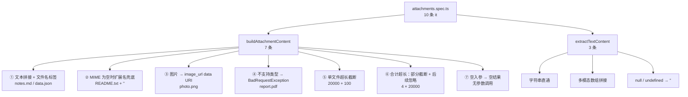
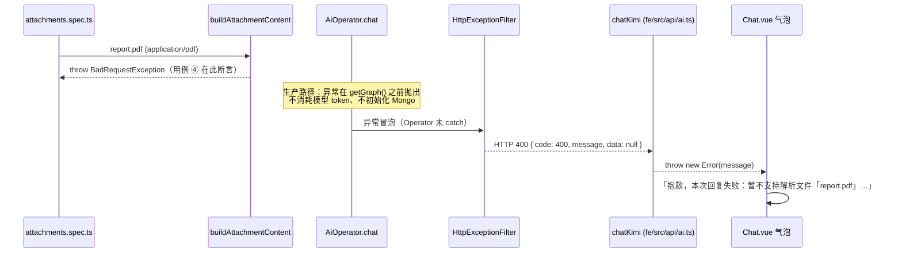

这一页只讨论一个文件：`be/src/ai/operator/attachments.spec.ts`。它守护的是**输入整形层**的行为合同——文件类型如何被判定、字符预算在何处截断、以及不支持的类型为什么必须以 `BadRequestException` 而不是任意 `Error` 或静默忽略的方式失败。与实现页（[附件多模态转换：图片 Data URI、文本内联与长度治理](15-fu-jian-duo-mo-tai-zhuan-huan-tu-pian-data-uri-wen-ben-nei-lian-yu-chang-du-zhi-li)）关注「怎么实现」不同，本页关注「哪些行为被 10 条 `it` 钉死、哪条边界其实没人守、以及错误语义如何一路走到前端气泡」。

Sources: [attachments.spec.ts](be/src/ai/operator/attachments.spec.ts#L1-L19)

## 隔离边界：一个不需要服务器、数据库和 API Key 的测试

判断一个测试有多"轻"，最可靠的证据是它的 import 闭包。这个文件只 import 了三样东西：`BadRequestException`（来自 `@nestjs/common`）、被测函数与常量（来自 `./attachments`），以及 Jest 全局。它不 import `@nestjs/testing`、不 `compile()` 任何 module、不碰 `mongoose`、不读 `process.env`。这之所以可行，完全依赖 `attachments.ts` 刻意收窄的入参类型 `UploadedFileLike`——它声明的是 `{ originalname, mimetype, buffer }`，而不是 `Express.Multer.File`。

Sources: [attachments.spec.ts](be/src/ai/operator/attachments.spec.ts#L1-L7), [attachments.ts](be/src/ai/operator/attachments.ts#L3-L10)

Jest 配置把 `rootDir` 设为 `src`、`testRegex` 设为 `.*\.spec\.ts$`，因此这个与被测文件**同目录共置**的 spec 会被 `pnpm test` 自动发现，不需要任何注册或清单文件。这也意味着整条附件解析链路可以在毫秒级被验证：没有 HTTP 服务器启动开销，没有 MongoDB 连接时序（对比 [Mongoose 连接复用与启动时序陷阱](12-mongoose-lian-jie-fu-yong-yu-qi-dong-shi-xu-xian-jing)），没有模型网络往返。

Sources: [package.json](be/package.json#L78-L92), [attachments.spec.ts](be/src/ai/operator/attachments.spec.ts#L1-L2)

值得注意的是 `be/test/` 下的 e2e 测试**完全没有覆盖 `/chat` 的上传路径**：唯一的用例是 `GET /` 的冒烟断言。因此本页讨论的单元测试是目前附件解析行为唯一的自动化防线；而 multer 层面的 10MB/50 个文件限制、以及 HTTP 状态码映射，都处于测试真空区。

Sources: [app.e2e-spec.ts](be/test/app.e2e-spec.ts#L1-L40), [ai.controller.ts](be/src/ai/ai.controller.ts#L14-L40)

## 测试夹具：为什么是 `createFile` 而不是 `new File` 或 multer

文件顶部定义了一个三参数的本地工厂 `createFile(originalname, mimetype, content)`。它的核心价值在于第三个参数的双通道能力：`Buffer.isBuffer(content) ? content : Buffer.from(content, 'utf8')`。这让测试既能用**字符串**表达人类可读的文本附件（`'# 标题\n正文内容'`），也能用**原始字节数组**表达二进制图片（`Buffer.from([0x89, 0x50, 0x4e, 0x47])`），而两种形态在测试正文里都是字面量，无外部 fixture 文件、无磁盘 I/O。

Sources: [attachments.spec.ts](be/src/ai/operator/attachments.spec.ts#L9-L17)

这个工厂还有一层语义作用：它显式地把 `mimetype` 设为可传空字符串。用例 2 正是传 `''`，用来验证「MIME 缺失时仍能按扩展名识别文本」。也就是说，这个工厂不是为了少打字，而是为了让**每一个判据字段都能被独立置空**——这是测试类型判定逻辑的必要条件。

Sources: [attachments.spec.ts](be/src/ai/operator/attachments.spec.ts#L33-L39)

## 十条用例的覆盖矩阵

整个文件分成两个 `describe`：`buildAttachmentContent`（7 条）与 `extractTextContent`（3 条）。前者是主要的边界战场，后者是对模型返回值形态的容错。

Sources: [attachments.spec.ts](be/src/ai/operator/attachments.spec.ts#L19-L94)

| # | 用例 | 构造的边界 | 守护的契约 | 断言强度 |
| --- | --- | --- | --- | --- |
| ① | 文本拼接 | 两个不同类型文本 | `【附件 name】` 标签 + 原文均出现在 `textContent` | 弱（`toContain`） |
| ② | 扩展名兜底 | `mimetype = ''` | MIME 缺失不影响文本识别 | 弱 |
| ③ | 图片通道 | PNG 原始字节 | `textContent === ''` 且 `imageParts[0].type === 'image_url'` | 强（`toBe` 精确） |
| ④ | 不支持类型 | `application/pdf` | 抛出 `BadRequestException` | 中（只看异常类） |
| ⑤ | 单文件上限 | 20000 + 100 字符 | 出现截断标记，总长受控 | 弱（宽松上界） |
| ⑥ | 合计上限 | 4 × 20000 字符 | 总长受控 + 出现忽略占位句 | 弱（宽松上界） |
| ⑦ | 空入参 | 不传参数 | `{ textContent: '', imageParts: [] }` | 强（`toEqual`） |
| ⑧⑨⑩ | `extractTextContent` | 字符串 / 数组 / 空值 | 三种形态归一为字符串 | 中（`toBe` 精确但分支少） |

Sources: [attachments.spec.ts](be/src/ai/operator/attachments.spec.ts#L19-L112)

## 边界一：类型判定的三条判据

用例 ②③④ 构成一组完整的类型判定三路验证：**MIME 缺失（②）→ MIME 命图片（③）→ 两者都不命中（④）**。这三条正好对应实现里两个判定函数的不同证据来源——`isImageFile` 只看 `mimetype.startsWith('image/')`，`isTextFile` 是 `text/*`、`application/json` 与扩展名白名单的并集。

Sources: [attachments.spec.ts](be/src/ai/operator/attachments.spec.ts#L33-L61), [attachments.ts](be/src/ai/operator/attachments.ts#L54-L63)

用例 ③ 的断言里藏着一个容易被忽略的"镜像"特性：期望值是用与生产代码**完全相同的表达式**算出来的——`data:image/png;base64,${png.toString('base64')}`。这意味着这条断言真正校验的是 `data:` 前缀格式、MIME 被原样嵌入、以及 buffer 被逐字节编码这三件事，而不是 base64 编码结果本身是否正确（那由 Node 保证）。理解这一点，才能判断它在什么时候会失效：如果实现改成 `data:image/png;charset=utf-8;base64,`，测试确实会红——因为期望值仍拼旧格式；但如果只是把编码换成 `base64url`，两边的 `toString('base64')` 若同步改动则不会报错。**镜像断言的保护范围是"两处实现的一致性"，不是"正确性"。**

Sources: [attachments.spec.ts](be/src/ai/operator/attachments.spec.ts#L41-L53), [attachments.ts](be/src/ai/operator/attachments.ts#L83-L90)

用例 ③ 还额外断言了 `result.textContent` 严格等于 `''`。这条比它看起来重要：它把「图片附件不进入文本通道」这一注释级约定（`AttachmentContent` 里那句"图片附件不包含在内"）变成了可执行不变量。下游 `AiOperator` 正是靠 `imageParts.length === 0` 来决定 `content` 是字符串还是多模态数组，因此这个空字符串断言间接保护了消息体形状的选择逻辑。

Sources: [attachments.spec.ts](be/src/ai/operator/attachments.spec.ts#L46-L47), [attachments.ts](be/src/ai/operator/attachments.ts#L17-L22), [AiOperator.ts](be/src/ai/operator/AiOperator.ts#L90-L99)

用例 ④ 只写了 `toThrow(BadRequestException)`。这是**类级断言**：它禁止的是"换成 `Error`"、"改成 `UnprocessableEntityException`"、"改成静默 `continue`"这三类回退，但完全不约束错误消息的文案、也不约束消息里是否包含文件名。这正是错误语义测试的典型取舍——见后文"错误语义"一节。

Sources: [attachments.spec.ts](be/src/ai/operator/attachments.spec.ts#L55-L61)

## 边界二：两级字符预算的算术验证

用例 ⑤⑥ 是文件里唯一涉及数量级计算的测试，且都**引用了导出常量**而非硬编码魔数。这个选择有明确后果：把 `MAX_TEXT_CHARS_PER_FILE` 从 20000 调成 8000，用例 ⑤ 依然会绿（它构造的超长数据随之变短），因为测试钉的是**相对行为**（"超过上限就截断"），不是"上限就是 20000"这个绝对值。

Sources: [attachments.spec.ts](be/src/ai/operator/attachments.spec.ts#L63-L84), [attachments.ts](be/src/ai/operator/attachments.ts#L24-L27)

用例 ⑤ 的实际数值可以精确推算：输入 `'a'.repeat(20000 + 100)`，`truncate` 保留前 20000 字符后追加 13 个字符的后缀（`'\n'` + `'...(内容过长已截断)'`），得到 20013 字符的 `raw`；再加上 13 字符的 `【附件 big.txt】\n` 前缀，`textContent` 总长恰为 **20026**。断言上界是 `MAX_TEXT_CHARS_PER_FILE + 200 = 20200`，余量 174——这就是为什么这条断言"看起来宽松"却仍能抓住预算失效：任何让长度翻倍或完全不做截断的改动都会立刻越界。

Sources: [attachments.spec.ts](be/src/ai/operator/attachments.spec.ts#L63-L71), [attachments.ts](be/src/ai/operator/attachments.ts#L65-L66), [attachments.ts](be/src/ai/operator/attachments.ts#L108-L113)

用例 ⑥ 的"为什么是 4 个文件"值得单独讲，这是本文件里最讲究的一处构造。每个 chunk 恰好等于单文件上限 20000：文件 1、2 各消耗 20000（账本 40000）；文件 3 时 `remaining = 10000`，于是渲染 `Math.min(20000, 10000)` 即截到 10000 再加 13 字符后缀，账本变成 50013，**已超出 50000**；文件 4 时 `remaining = -13 <= 0`，走"忽略"分支只写一行占位句。若只用 3 个文件，文件 3 会被部分截断，永远不会命中 `remaining <= 0` 那条 `continue` 分支——**第 4 个文件的存在，就是为了把"预算耗尽后不再读取内容"这条语义单独打出来。**

Sources: [attachments.spec.ts](be/src/ai/operator/attachments.spec.ts#L73-L84), [attachments.ts](be/src/ai/operator/attachments.ts#L100-L114)

| 量 | 值 | 说明 |
| --- | --- | --- |
| `totalTextChars` 账本终值 | 50013 | 按截断后长度累加，可超出常量 13 |
| 实际写入的 `textContent` 长度 | 约 50074 | 额外含 4 段文件名前缀 + 3 个 `\n\n` 分隔符 |
| 断言上界 | `MAX_TOTAL_TEXT_CHARS + 1000 = 51000` | 余量约 926 |
| 单文件正文上限 | 20000 | 文件 1、2 未截断（严格 `>` 才截断） |
| 文件 3 正文 | 10000（+13 后缀） | 由 `remaining` 而非单文件上限决定 |

Sources: [attachments.spec.ts](be/src/ai/operator/attachments.spec.ts#L73-L84), [attachments.ts](be/src/ai/operator/attachments.ts#L100-L116)

这套断言风格的本质是**包络断言**：它验证"总长被某个宽松上界封住"，而不验证"总长恰好等于多少"。代价是文案变更（比如把后缀改短）永远不会让测试报警；收益是测试不会因为多一个换行而假红。对于治理型逻辑（长尾输入不可穷举），这个取舍通常是正确的。

## 错误语义：从异常类到前端气泡的完整链路

用例 ④ 是唯一涉及错误的测试，但错误语义的真实含义要跨越四层才能看清。第一层是**抛出点**：`buildAttachmentContent` 在遇到既非图片也非文本的文件时构造 `BadRequestException`，消息里拼上原始文件名与尽力而为的类型标识（扩展名优先，退化为 mimetype，再退化为「未知类型」）。

Sources: [attachments.ts](be/src/ai/operator/attachments.ts#L92-L98)

第二层是**时机**：`AiOperator.chat` 在 `getGraph()` 之前调用 `buildAttachmentContent`，因此不支持的文件不会触发模型客户端与 checkpointer 的初始化——错误在"进图之前"就发生了。这也解释了为什么用例 ④ 能在没有 API Key 的环境里稳定通过：整条路径压根没走到 `createChatModel()`。

Sources: [AiOperator.ts](be/src/ai/operator/AiOperator.ts#L88-L101), [AiOperator.ts](be/src/ai/operator/AiOperator.ts#L29-L52)

第三层是**HTTP 映射**：`AiOperator.chat` 里没有 `try/catch` 包裹 `buildAttachmentContent`，异常直接冒泡到全局 `HttpExceptionFilter`。过滤器识别 `HttpException` 后取 `status`（`BadRequestException` 自带 400）与 `getResponse().message`，最终输出 `{ code: 400, message, data: null }`。由于 `BadRequestException` 用字符串构造时响应体是 `{ message: <字符串>, error, statusCode }`，`message` 字段就是那句中文原文，未被改写。

Sources: [AiOperator.ts](be/src/ai/operator/AiOperator.ts#L115-L127), [http-exception.filter.ts](be/src/common/filters/http-exception.filter.ts#L21-L36), [http-exception.filter.ts](be/src/common/filters/http-exception.filter.ts#L54-L63)

第四层是**前端呈现**：`chatKimi` 在 `!response.ok || payload.code !== 200` 时抛出携带 `payload.message` 的 `Error`；`Chat.vue` 捕获后把消息写进助手气泡，而不是只弹一个 toast 留下空白回复。因此**后端错误消息的文案直接是用户可见文案**，这也让"只断言异常类、不断言消息"这个缺口有了实际风险等级。

Sources: [ai.ts](fe/src/api/ai.ts#L61-L70), [Chat.vue](fe/src/components/Chat.vue#L228-L239)

| 失败场景 | 抛出位置 | HTTP 结果 | 前端表现 | 是否有测试 |
| --- | --- | --- | --- | --- |
| 不支持的文件类型（pdf 等） | `buildAttachmentContent` | 400 + 中文文案 | 气泡显示"本次回复失败：…" | ✅ 用例 ④（仅类） |
| 既无文本又无附件 | `AiOperator.chat` 入口 | 400「请输入您的问题内容或上传文件」 | 同上 | ❌ |
| 单文件 > 10MB / > 50 个 | multer 拦截器 | 413 / 400 | 同上 | ❌（无 e2e） |
| 模型调用失败 | 图执行内部 | 502「AI 服务调用失败」 | 同上 | ❌（单元层） |

Sources: [attachments.spec.ts](be/src/ai/operator/attachments.spec.ts#L55-L61), [AiOperator.ts](be/src/ai/operator/AiOperator.ts#L82-L86), [ai.controller.ts](be/src/ai/ai.controller.ts#L35-L47)

## `extractTextContent`：三个用例覆盖四种返回形态

第二个 `describe` 只有 3 条用例，而函数有 4 个分支。已覆盖的是**字符串直通**、**多模态数组拼接**（两段 `{ type: 'text', text }` 拼成 `'你好'`）、以及 **`null` / `undefined` 归一为空串**。这三条覆盖了真实世界里最常见的返回形态——尤其是数组形态，它是多模态模型与部分 OpenAI 兼容实现的差异点（对比 [统一模型客户端：OpenAI 兼容协议与厂商差异适配](13-tong-mo-xing-ke-hu-duan-openai-jian-rong-xie-yi-yu-han-shang-chai-yi-gua-pei)）。

Sources: [attachments.spec.ts](be/src/ai/operator/attachments.spec.ts#L94-L112), [attachments.ts](be/src/ai/operator/attachments.ts#L123-L137)

未被覆盖的分支有两个：一是 `{ text: '...' }` 这种**单对象**形态（`'text' in content` 那条判断），二是 `String(content)` 的**原始值强转**分支（例如模型意外返回数字）。同时，数组分支内部的两个兜底也没有单独用例：数组元素本身是字符串（`typeof part === 'string'`）、以及元素缺少 `text` 时退化为空串。这些分支一旦被误改，测试不会报警——它们属于"容错代码的容错无人守"这一类典型盲区。

Sources: [attachments.ts](be/src/ai/operator/attachments.ts#L123-L137), [attachments.spec.ts](be/src/ai/operator/attachments.spec.ts#L94-L112)

## 覆盖盲区清单

把十条用例与实现逐分支对照，可以列出一份明确的补测清单。它们的共同特征是：**分支存在、语义重要、但没有断言**。

| 盲区 | 实现位置 | 为什么值得补测 |
| --- | --- | --- |
| 错误消息内容（文件名 / 类型标识 / 中文文案） | `throw new BadRequestException(...)` | 文案直接进前端气泡，是唯一用户可见的错误信息 |
| "全有或全无"语义 | 循环中途 `throw` | 前几个文本附件已解析成功，异常仍会丢弃全部结果 |
| 图片 + 文本混合 | 三路分派 | 两条通道同时非空是生产最常见的真实场景 |
| 大写扩展名（`.MD`、`.PNG`） | `getExtension` 的 `toLowerCase()` | 大小写归一化逻辑完全未被验证 |
| `text/*` + 未知扩展名 | `isTextFile` 的 MIME 分支 | 目前只用 `application/json` 和空 MIME 测过 |
| 恰好等于单文件上限 | `truncate` 的严格 `>` | 恰好 20000 字符不应截断，这是个真实的 off-by-one 边界 |
| 恰好耗尽预算（`remaining === 0`） | `remaining <= 0` | 走"忽略"还是"零长截断"取决于 `<=` 与 `<`，未被钉住 |
| `extractTextContent` 的单对象与原始值分支 | 后两个 `if` | 容错逻辑本身没有回归保护 |
| 10MB / 50 个文件限制 | multer `limits` | 完全由拦截器负责，无 e2e 覆盖 |

Sources: [attachments.ts](be/src/ai/operator/attachments.ts#L49-L66), [attachments.ts](be/src/ai/operator/attachments.ts#L92-L114), [attachments.ts](be/src/ai/operator/attachments.ts#L123-L137), [ai.controller.ts](be/src/ai/ai.controller.ts#L14-L40)

盲区 1 与盲区 2 的组合最值得优先补：一条 `expect.error.message` 断言加一条"好文件在前、坏文件在后仍抛错"的用例，就能把错误语义从"类正确"提升到"语义正确"。而盲区 3、4、6 属于低成本高收益——它们只是在现有工厂上多传一个参数或多构造一个字符串。

Sources: [attachments.spec.ts](be/src/ai/operator/attachments.spec.ts#L9-L17), [attachments.spec.ts](be/src/ai/operator/attachments.spec.ts#L55-L71)

## 运行与定位

由于 `rootDir` 是 `src`，单独跑这个文件时路径相对于 `src`：在 `be/` 目录下执行 `pnpm test -- ai/operator/attachments`。全部单元测试是 `pnpm test`，覆盖率报告用 `pnpm test:cov`（`coverageDirectory` 指向 `../coverage`，即仓库根的 `coverage/`）。e2e 走独立的配置与脚本 `pnpm test:e2e`，需要 MongoDB，且不覆盖上传路径。

Sources: [package.json](be/package.json#L6-L18), [package.json](be/package.json#L78-L92), [jest-e2e.json](be/test/jest-e2e.json#L1-L9)

失败时的阅读顺序建议固定为三步：先看是哪个 `describe` 挂了——`buildAttachmentContent` 挂了说明输入整形契约变了，`extractTextContent` 挂了说明模型返回值形态假设变了；再对照该用例引用的常量，确认是"常量改了"还是"行为改了"；最后确认这条断言是包络型（⑤⑥）还是精确型（③⑦），包络型失败通常意味着量级失控而非微小偏移。

Sources: [attachments.spec.ts](be/src/ai/operator/attachments.spec.ts#L19-L92)

## 下一步

若想了解另一半测试策略——如何用脚本化假模型驱动整张 LangGraph 图（循环、记忆、步数上限），继续阅读 [脚本化假模型驱动图测试：循环、记忆与上限断言](23-jiao-ben-hua-jia-mo-xing-qu-dong-tu-ce-shi-xun-huan-ji-yi-yu-shang-xian-duan-yan)；若关心测试、Lint 与构建在 CI 中的串联方式，阅读 [构建、Lint 与 e2e 测试流程](25-gou-jian-lint-yu-e2e-ce-shi-liu-cheng)。