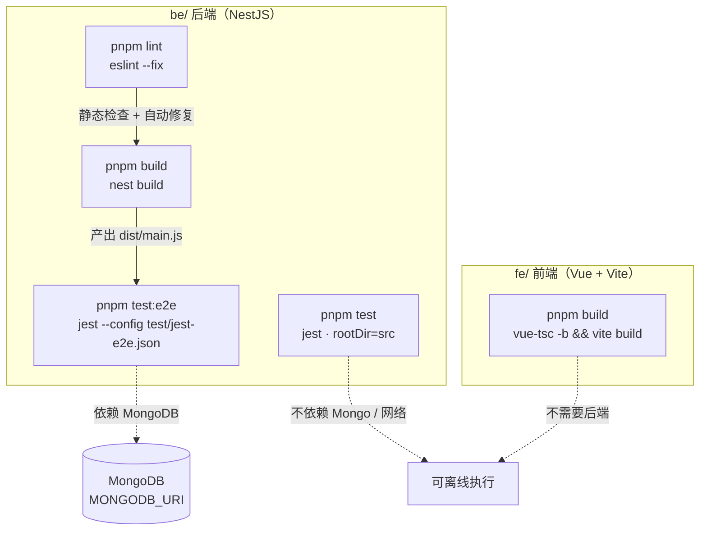
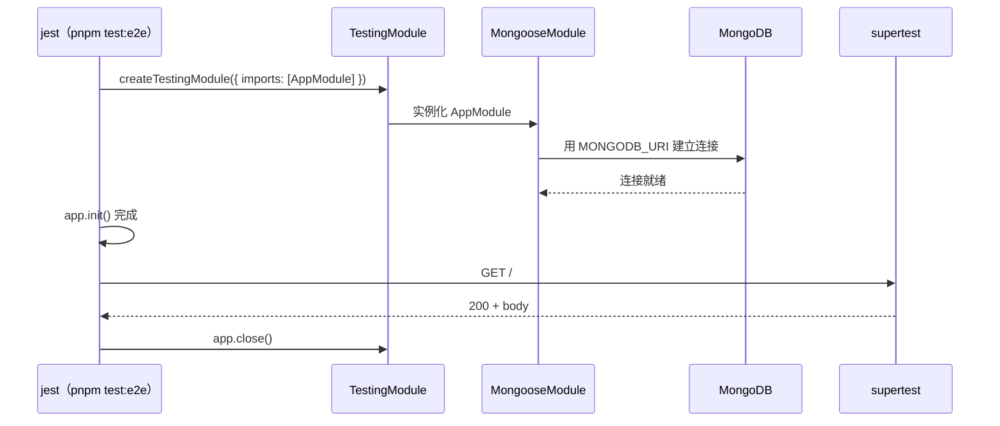
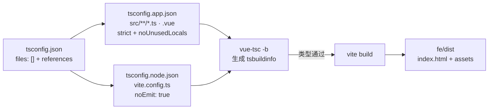

这一页只讲**工程化三件套**：怎么编译、怎么静态检查、怎么跑测试。它是把一个能跑的仓库变成"每次改完都能自证没坏"的仓库的最小闭环。关于图内部逻辑的断言设计、附件边界的用例细节，请分别看 [脚本化假模型驱动图测试：循环、记忆与上限断言](23-jiao-ben-hua-jia-mo-xing-qu-dong-tu-ce-shi-xun-huan-ji-yi-yu-shang-xian-duan-yan) 和 [附件解析的边界条件与错误语义测试](24-fu-jian-jie-xi-de-bian-jie-tiao-jian-yu-cuo-wu-yu-yi-ce-shi)；本页关注的是**配置如何拼起来、在哪一步会失败、失败时怎么排查**。

## 五条命令组成的验证矩阵

先建立整体地图：整个项目只有两类"可验证的产物"——后端 NestJS 应用和前端 Vue 单页应用，但验证入口共有五个，且它们对环境的依赖程度完全不同。这是初学者最容易踩坑的地方：**同样的 `pnpm` 前缀，有的命令可以离线跑，有的命令必须等 MongoDB 活着**。



这张图的读法是：`lint → build` 是串行的（先看风格再看能否编译），`test` 与 `test:e2e` 是两条平行支线，其中只有 e2e 需要外部数据库；前端构建与后端完全解耦。

Sources: [package.json](be/package.json#L8-L21), [package.json](fe/package.json#L6-L10), [README.md](be/README.md#L137-L145)

| 命令 | 所在包 | 底层工具 | 外部依赖 | 是否需要先 build |
|---|---|---|---|---|
| `pnpm lint` | be | ESLint 9（flat config）+ Prettier | 无 | 否 |
| `pnpm format` | be | Prettier | 无 | 否 |
| `pnpm build` | be | `nest build`（tsc 驱动） | 无 | 否 |
| `pnpm test` | be | Jest 30 + ts-jest | 无（单元测试用假模型与 `MemorySaver`） | 否 |
| `pnpm test:cov` | be | 同上 + 覆盖率 | 无 | 否 |
| `pnpm test:e2e` | be | Jest + supertest | **MongoDB**（且需 `.env` 中 `MONGODB_URI`） | 否（jest 直接跑 ts） |
| `pnpm build` | fe | `vue-tsc -b` + `vite build` | 无 | 否 |
| `pnpm start:prod` | be | `node dist/main` | MongoDB + 模型 Key | **是** |

Sources: [package.json](be/package.json#L8-L21), [package.json](fe/package.json#L6-L10)

顺带明确一个容易误解的结构问题：`be/` 与 `fe/` 各自带一个 `pnpm-workspace.yaml`，但里面只有构建脚本审批配置（`allowBuilds`），**没有 `packages:` 字段**，所以这**不是**一个 pnpm monorepo，两侧必须各自安装依赖、各自执行命令。另外 `fe/` 目录里同时存在 `package-lock.json` 与 `pnpm-lock.yaml`，而 README 对前端写的是 `npm install`——两人协同时请先统一包管理器，否则 lockfile 会互相打架。

Sources: [pnpm-workspace.yaml](be/pnpm-workspace.yaml#L1-L5), [pnpm-workspace.yaml](fe/pnpm-workspace.yaml#L1-L5), [README.MD](README.MD#L58-L66)

## 后端构建：两份 tsconfig 的分工

`nest build` 本身不接受太多参数，真正决定"编译什么、跳过什么"的是两份继承关系的 tsconfig。根配置 `tsconfig.json` 定义了语言级别与输出位置：`target: ES2023`、`module: nodenext`、`outDir: ./dist`、开启 `incremental` 增量编译，并且**只开了部分严格检查**——`strictNullChecks: true` 但 `noImplicitAny: false`、`strictBindCallApply: false`。这是 Nest 脚手架的默认偏宽松组合：它允许你在快速原型阶段少写类型标注，代价是类型错误的防线要靠下面的 ESLint 补上。

Sources: [tsconfig.json](be/tsconfig.json#L1-L24)

真正的构建配置是 `tsconfig.build.json`，它只做一件事：在继承之上**排除测试与产物**——`node_modules`、`test`、`dist`，以及所有 `*.spec.ts`。这解释了为什么 `be/dist` 里看不到 `app.controller.spec.js`：单元测试文件永远不进生产产物。

Sources: [tsconfig.build.json](be/tsconfig.build.json#L1-L4)

`nest-cli.json` 保持最小：`sourceRoot: "src"` 指明源码根，`compilerOptions.deleteOutDir: true` 让每次构建前先清空 `dist`。这条设置很实用——它避免了"删掉的源文件在 dist 里留下孤儿 js"这类幽灵问题；但反过来说，**不要在 `dist` 里手工放任何东西**，一次 build 就会全部抹掉。

Sources: [nest-cli.json](be/nest-cli.json#L1-L8)

构建产物被 `.gitignore` 排除（`dist/`、`build/`、`coverage/`），所以仓库里出现的 `be/dist/*.js`、`*.js.map` 与 `tsconfig.build.tsbuildinfo` 只是本地执行过构建的痕迹，不应作为源码依据。同理，`be/.gitignore` 也忽略了 `.env`——这就是为什么配置要通过 `pnpm` 脚本与 `ConfigModule` 在运行时注入，而不是写进代码。

Sources: [.gitignore](be/.gitignore#L1-L31)

## 后端 Lint：类型感知的 ESLint 与 Prettier 的合流

后端的 lint 不是"纯文本规则"，而是**类型感知（type-aware）**检查。`eslint.config.mjs` 使用 flat config 形式，依次叠加 `@eslint/js` 推荐规则、`typescript-eslint` 的 `recommendedTypeChecked`、以及 `eslint-plugin-prettier/recommended`。关键在 `languageOptions.parserOptions`：`projectService: true` 让 ESLint 直接调用 TypeScript 的 project service 解析类型信息——这意味着 lint 与 `tsc` 看到的是同一套类型世界，规则才能真正判断"这个 `any` 会流向哪里"。

Sources: [eslint.config.mjs](be/eslint.config.mjs#L1-L26)

具体到规则口径，项目做了三处放宽/收紧：关掉 `@typescript-eslint/no-explicit-any`（图与 LangChain 的类型边界上确实存在 `any`），把 `no-floating-promises` 与 `no-unsafe-argument` 降级为 **warn**（提醒但不阻塞），并把 `prettier/prettier` 提为 **error** 且带 `endOfLine: "auto"`。最后这一项是跨平台协作的实用补丁：Windows 的 CRLF 与 macOS 的 LF 不再导致 lint 失败。

Sources: [eslint.config.mjs](be/eslint.config.mjs#L27-L34)

格式化口径本身只有两行：单引号 + 尾随逗号 `all`，写在 `.prettierrc`。`format` 脚本覆盖 `src/**/*.ts` 与 `test/**/*.ts`，因此 e2e 测试文件同样被纳入风格约束。

Sources: [.prettierrc](be/.prettierrc#L1-L4), [package.json](be/package.json#L10)

一个必须提醒初学者的行为差异：`pnpm lint` 的真实命令是 `eslint "{src,apps,libs,test}/**/*.ts" --fix`，**它带 `--fix`，会直接改写你的文件**。所以执行前最好保证工作区干净（`git status` 无未提交改动），否则"我明明没改这个文件"会变成一次困惑。同时注意扫描范围包含 `apps`、`libs` 两个目录——本项目并不存在这两个目录，多余的模式不会报错，但也不要以为它们被检查了。

Sources: [package.json](be/package.json#L15)

## 后端单元测试：为什么 `pnpm test` 不需要数据库

单元测试的 Jest 配置直接内联在 `package.json` 的 `jest` 字段里，核心是三个键：`rootDir: "src"`、`testRegex: ".*\.spec\.ts$"`、以及 `transform` 让 `.ts` 走 `ts-jest`。`rootDir` 限定为 `src` 有一个直接后果——**`be/test/app.e2e-spec.ts` 不在这个根下，所以 `pnpm test` 永远不会碰到 e2e 文件**，两条测试通道天然隔离，不靠文件名约定运气。

Sources: [package.json](be/package.json#L68-L84)

另一个细节是覆盖率目录写成了 `"../coverage"`：因为 `rootDir` 是 `src`，`..` 才回到 `be/` 根，所以实际产物在 `be/coverage/`，也正好对应 `.gitignore` 里的 `coverage/`。

Sources: [package.json](be/package.json#L82), [.gitignore](be/.gitignore#L30-L32)

能在没有 MongoDB、没有网络的情况下跑通，靠的是"依赖注入点被设计成可替换"。以 `graph.spec.ts` 为例：它自己造一个 `weather` 工具（不联网）、造一个按脚本返回 `AIMessage` 的假模型（记录每次收到的消息数组）、并把 checkpointer 换成内存版 `MemorySaver`，然后调用 `buildChatGraph({ model, tools, checkpointer, maxSteps })`。整个用例链路里没有任何真实 I/O。

Sources: [graph.spec.ts](be/src/ai/graph/graph.spec.ts#L1-L46), [graph.ts](be/src/ai/graph/graph.ts#L13-L22)

这份"可被替换"的能力来自 `buildChatGraph` 的选项签名与最后一行 `checkpointer ? workflow.compile({ checkpointer }) : workflow.compile()`——测试可以完全不传 checkpointer（例如上限测试），也可以传内存版。当前 `src` 下共有三个 spec 文件、17 个 `it`：图行为 6 个、附件解析 10 个、`AppController` 1 个。

Sources: [graph.ts](be/src/ai/graph/graph.ts#L41-L59), [graph.spec.ts](be/src/ai/graph/graph.spec.ts#L48-L137), [attachments.spec.ts](be/src/ai/operator/attachments.spec.ts#L19-L112), [app.controller.spec.ts](be/src/app.controller.spec.ts#L5-L28)

顺带回答一个常见疑问："spec 文件的类型谁来检查？" 因为 `tsconfig.build.json` 排除了 `*.spec.ts`，`nest build` 并不会校验它们；这些文件只在执行 `pnpm test` 时由 `ts-jest` 编译，也就是说**测试跑通本身即意味着测试文件类型正确**。

Sources: [tsconfig.build.json](be/tsconfig.build.json#L3)

## e2e 测试：一次真实的 Nest 启动

e2e 与单元测试的分界线不是"测多深"，而是"**是否真的启动框架**"。`test/jest-e2e.json` 是一份独立配置：`rootDir: "."`（即 `be/test/`）、`testRegex: ".e2e-spec.ts$"`、同样用 `ts-jest` 转译。它就是 `pnpm test:e2e` 里的 `--config` 目标。

Sources: [jest-e2e.json](be/test/jest-e2e.json#L1-L9), [package.json](be/package.json#L20)

用例结构是最标准的 Nest e2e 三段式：`beforeEach` 里用 `Test.createTestingModule({ imports: [AppModule] })` 编译模块并 `app.init()`；`afterEach` 里 `app.close()` 释放资源；中间用 `supertest` 对 `app.getHttpServer()` 发真实 HTTP 请求。



这张时序图解释了最关键的一条实践约束：`AppModule` 里 `MongooseModule.forRootAsync` 会在模块实例化阶段就连库，所以**没有 MongoDB 时 e2e 不是"断言失败"，而是卡住（默认 server selection 超时）后报连接错误**。测试文件顶部的中文注释已经把这条前提写明："e2e 需要本地/远程 MongoDB（LangGraph checkpoint 依赖它）。没有数据库时只跑单元测试（pnpm test）。"

Sources: [app.e2e-spec.ts](be/test/app.e2e-spec.ts#L1-L25), [app.module.ts](be/src/app.module.ts#L9-L31)

连接参数从哪来？`ConfigModule.forRoot({ isGlobal: true, envFilePath: '.env' })` 在模块加载时读取 `be/.env`，而 `forRootAsync` + `ConfigService` 的写法正是为了避开"模块文件在 dotenv 加载前就读 `process.env`"的时序问题。所以在 `be/` 目录下执行 `pnpm test:e2e` 时，只要 `.env` 里有 `MONGODB_URI`（模板默认 `mongodb://127.0.0.1:27017/chat_robot`），连接串就会被正确带上。

Sources: [app.module.ts](be/src/app.module.ts#L10-L30), [.env.example](be/.env.example#L16-L24)

第二个必须知道的语义差异是**响应体形状**。`main.ts` 里注册的 `ResponseInterceptor` 与 `HttpExceptionFilter` 只在 `bootstrap()` 中生效，而 e2e 从不执行 `main.ts`，因此拿到的始终是 Controller 的原始返回值——没有 `{ code, message, data }` 外壳。用例因此直接断言 `res.body.mode === 'single-user'`、`res.body.user.role === 'admin'`、`res.body.graph.framework === 'langgraph'`，并且源码里专门留了注释提醒这一点。若你照着线上响应去写 `res.body.data.content`，就会看到 `undefined`。

Sources: [app.e2e-spec.ts](be/test/app.e2e-spec.ts#L27-L38), [main.ts](be/src/main.ts#L9-L19)

还有一个让 e2e 变"轻"的设计：`AiOperator` 用一个 `graphPromise` 惰性构建图，只有真正调用 `/chat` 或 `/search` 时才会去创建模型客户端与 checkpointer。而当前这条 e2e 只请求 `GET /`，因此**即使 `.env` 里没有 `MODEL_API_KEY`，这个用例也能通过**——它验证的是"框架能起来 + 服务信息契约正确"，而不是模型链路。

Sources: [AiOperator.ts](be/src/ai/operator/AiOperator.ts#L27-L52), [app.controller.ts](be/src/app.controller.ts#L4-L12)

## 前端构建：`vue-tsc -b` 兼任类型检查与"lint"

前端没有 ESLint，也没有测试框架（`devDependencies` 里既无 eslint 也无 vitest/jest），它把质量闸门全部压在**构建**这一步上：`build` 脚本是 `vue-tsc -b && vite build`，先用 `&&` 短路——类型检查不过，打包根本不会开始。

Sources: [package.json](fe/package.json#L6-L25)

`vue-tsc -b` 的 `-b` 是 TypeScript 的 **build 模式**，它要求项目是"引用式"结构。根 `tsconfig.json` 本身不含源码（`"files": []`），只做两件事：把 `tsconfig.app.json`（源码）与 `tsconfig.node.json`（`vite.config.ts`）登记为被引用项目。



`tsconfig.app.json` 的检查口径比后端严得多：`strict: true`、`noUnusedLocals: true`、`noUnusedParameters: true`、`noFallthroughCasesInSwitch: true`。这也是历史提交里"修复前端 vue-tsc 报错（未使用变量、索引可能 undefined）"的由来——**在 Vue 侧，一个没删干净的无用变量就等于构建失败**。

Sources: [tsconfig.json](fe/tsconfig.json#L1-L7), [tsconfig.app.json](fe/tsconfig.app.json#L1-L16)

两个增量编译缓存文件值得记住位置：`./node_modules/.tmp/tsconfig.app.tsbuildinfo` 与 `tsconfig.node.tsbuildinfo`。它们放在 `node_modules` 内，因此删 `node_modules` 会连带清掉增量状态——如果你遇到"类型明明改了却还是报旧错误"，清掉这两个文件（或整个 `node_modules/.tmp`）再构建，是最快的手段。

Sources: [tsconfig.app.json](fe/tsconfig.app.json#L4), [tsconfig.node.json](fe/tsconfig.node.json#L3), [tsconfig.node.json](fe/tsconfig.node.json#L1-L26)

产物落在 `fe/dist`，被 `.gitignore` 忽略；目录里会出现带内容哈希的 `assets/*.js`、`*.css`（哈希由 Vite 生成）。`pnpm preview` 用于本地预览这份产物——注意它只服务静态文件，**不会替你转发 `/dev` 代理**，所以 `preview` 模式下要能访问后端，需要把 `VITE_API_BASE_URL` 指到后端真实地址。

Sources: [.gitignore](fe/.gitignore#L13-L15), [package.json](fe/package.json#L6-L10), [README.md](fe/README.md#L23-L40)

## 故障排查速查表

把上面各节的隐含前提汇总成一张"症状 → 根因 → 处置"表，覆盖初学者最常撞的七类问题。

| 症状 | 根因 | 处置 |
|---|---|---|
| `pnpm test:e2e` 长时间无输出，最后报连接超时 / `MongooseServerSelectionError` | `AppModule` 实例化即连 Mongo，`.env` 里的 `MONGODB_URI` 不可达 | 先起 `mongod`，或把 `MONGODB_URI` 指向可用实例；无数据库时只跑 `pnpm test` |
| e2e 断言 `res.body.code` / `res.body.data` 为 `undefined` | e2e 未执行 `main.ts`，全局拦截器不存在 | 断言原始响应体字段（`mode` / `user.role` / `graph.framework`） |
| `pnpm test` 明明有 e2e 文件却一个用例都不跑 | `rootDir: "src"`，`test/` 不在其下 | 用 `pnpm test:e2e`（`--config ./test/jest-e2e.json`） |
| `pnpm lint` 后文件被莫名改动 | `lint` 脚本硬编码 `--fix` | 执行前 `git status` 确认工作区干净，改完看 diff |
| ESLint 报"文件不在任何 tsconfig 项目中"类错误 | 类型感知检查依赖 `projectService`，新文件未被 tsconfig 覆盖 | 确认文件落在 `src`/`test` 内并被 tsconfig 的 include 覆盖 |
| `vue-tsc` 报 `TS6133: ... is declared but its value is never read` | `noUnusedLocals` / `noUnusedParameters` 为 `true` | 删掉未使用变量/参数，而不是加注释绕过 |
| `pnpm start:prod` 报找不到 `dist/main` | 未先构建；且 `deleteOutDir: true` 会清空旧产物 | 先 `pnpm build`，再 `node dist/main` |

Sources: [app.e2e-spec.ts](be/test/app.e2e-spec.ts#L7-L38), [package.json](be/package.json#L15-L20), [eslint.config.mjs](be/eslint.config.mjs#L21-L24), [tsconfig.app.json](fe/tsconfig.app.json#L8-L13), [nest-cli.json](be/nest-cli.json#L6), [package.json](be/package.json#L9-L14)

## 推荐执行顺序与下一步阅读

把五条命令压成一条可复制的"提交前自检"序列（在 `be/` 下执行前三条，在 `fe/` 下执行最后一条）：

```bash
cd be && pnpm lint && pnpm build && pnpm test
# 有 MongoDB 时追加：pnpm test:e2e
cd ../fe && pnpm build
```

顺序依据是失败成本由低到高：lint 只需秒级且能自动修复，build 暴露跨文件类型问题，单元测试覆盖图行为与附件边界，e2e 最慢且依赖外部数据库。仓库根 README 给出的官方口径也是"单元测试 + 前端构建"这两条必须项，并额外注明 `test:e2e` 需要可用 MongoDB。

Sources: [README.MD](README.MD#L147-L154), [README.md](be/README.md#L137-L145)

想继续深入测试的**内容层**（而不只是执行流程），建议按这个顺序读：先看 [脚本化假模型驱动图测试：循环、记忆与上限断言](23-jiao-ben-hua-jia-mo-xing-qu-dong-tu-ce-shi-xun-huan-ji-yi-yu-shang-xian-duan-yan) 理解"假模型 + 脚本"如何驱动整张图，再看 [附件解析的边界条件与错误语义测试](24-fu-jian-jie-xi-de-bian-jie-tiao-jian-yu-cuo-wu-yu-yi-ce-shi) 看输入侧的防御性用例；至于"每一轮迭代该跑哪几条命令"的节奏问题，属于 [里程碑路线图与自检机制：M0 → M7 的推进方法](26-li-cheng-bei-lu-xian-tu-yu-zi-jian-ji-zhi-m0-m7-de-tui-jin-fang-fa) 的话题。