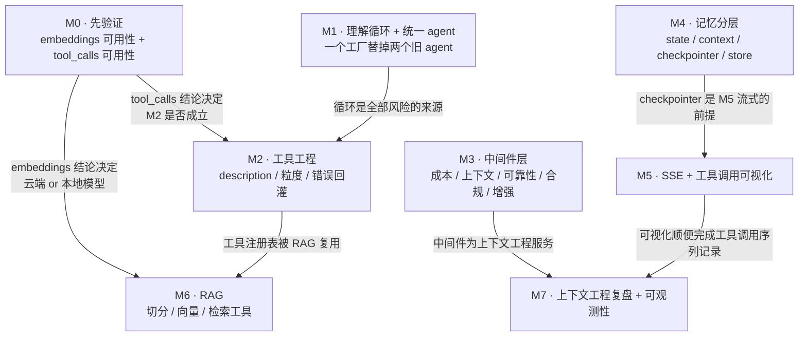
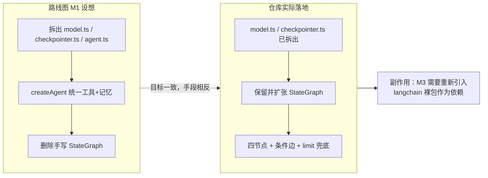

这份文档解读仓库里那份 326 行的 `docs/agent-roadmap.md`，但重点不在复述它的七条里程碑内容，而在**它作为一份工程方法论文档是如何运作的**：为什么每个里程碑都配一条「自检」、为什么自检被设计成硬门禁、以及这套推进顺序背后的依赖关系。同时，我们把这套计划与当前代码库做一次对账——哪些门已经通过、哪些门连前置依赖都还没装，哪些当年的起点问题已经被重构消灭。读完后你应当能判断：下一个该动的是哪一条，以及动完之后用什么证据证明它真的通了。

Sources: [agent-roadmap.md](docs/agent-roadmap.md#L1-L5)

## 三条方法论原则：这份文档的运作方式

路线图的头部用两行字就交代了它的使用方法，这两行是整个文档的元规则。第一行是**「M0 → M7 逐条推进，每条都有『自检』。自检过不了就不要往下走」**——它把里程碑从「功能清单」改造成了「门禁序列」，进度不是按「写了多少代码」计量，而是按「有几条自检被验证通过」计量。第二行是**「主线是 agent 能力，三个功能（tool calling / RAG / SSE）只是它的产物」**——它明确拒绝了以功能为导向的排期方式，把 RAG 和 SSE 定位成 agent 能力长出来之后的自然结果，而不是需要单独攻克的目标。

Sources: [agent-roadmap.md](docs/agent-roadmap.md#L3-L4)

由此衍生出第三条原则，体现在 M0 的措辞里：**「先验证，别急着写」**，并附带一句更狠的话——「不过这两条，后面全是白写」。M0 不含任何代码产出，只有两条 curl 级别的验证（Moonshot 是否支持 embeddings、`kimi-k2.5` 在 `thinking:disabled` 下能否返回 tool_calls），却排在所有开发工作之前。理由是这两条都属于**不可逆决策**：embedding 模型一旦入库就换不动，因为不同模型的向量空间完全不兼容，换模型等于重建整个库；而 tool_calls 是 M2 整章的地基，代码里虽然传了 tools，却「没有证据表明真的调用成功过」。

Sources: [agent-roadmap.md](docs/agent-roadmap.md#L22-L40)

## 里程碑依赖图：谁卡住谁

把七条里程碑之间的阻塞关系画出来，这套排序的合理性就一目了然——它不是按难度排的，而是按**信息依赖**排的。



这张图里最值得注意的是两条「跨级」连线：M0 直接卡住 M6，M0 直接卡住 M2。这正是把 M0 放在最前面的全部意义——它不产出任何可演示的东西，却同时决定了后面两章的技术选型。另一条值得注意的连线是 M2 → M6：RAG 被设计成**一个工具**（agentic RAG），让模型自己决定要不要查知识库，因此它天然复用 M2 建立的工具注册表，而不是另起一套检索管线。

Sources: [agent-roadmap.md](docs/agent-roadmap.md#L239-L241)

## 七条里程碑一览：目标、自检口径与当前状态

下表把路线图的骨架与本仓库的实际代码状态并排放置。「状态」列的判断依据是代码检索结果，而非文档自述。

| 里程碑 | 一句话目标 | 自检口径 | 当前仓库状态 | 证据 |
|---|---|---|---|---|
| M0 | 钉死两个不确定因素 | 两条 curl 有预期输出 | 无代码痕迹，仍是待验门 | 全文检索无 `Embedding` 相关实现 |
| M1 | 理解循环 + 统一 agent | 同 `sessionId` 两轮记得住；日志见真实 tool_call | **循环已通**，但走的是显式 StateGraph 而非 `createAgent` | 四节点图 + 条件边 |
| M2 | 工具工程 | 四句话各触发一次对应工具 | **部分**：仅搜索工具，时间/天气/数学缺位 | 工具注册表只有 `TavilySearch` |
| M3 | 中间件层 | 能说出用了哪几个、各解决什么问题 | **未开始**，且 `langchain` 依赖已不在清单里 | `src/` 无 `middleware` |
| M4 | 记忆分层 | 讲清短期/长期记忆区别 | **半层**：只有 checkpointer，无 store | 仅有 `getMongoCheckpointer` |
| M5 | SSE + 工具调用可视化 | `curl -N` 见连续 token 帧 | **未开始**；拦截器污染风险仍在 | 控制器只有两个非流式端点 |
| M6 | RAG | 模型调用检索工具且答案引用文档 | **未开始**；切分/加载器依赖未装 | 无 `kb` 模块 |
| M7 | 上下文工程 + 可观测性 | 画出一次调用的 context 构成 | **雏形**：有步数/工具数统计，无序列日志 | 返回值含 `steps`/`toolCalls` |

Sources: [agent-roadmap.md](docs/agent-roadmap.md#L102-L102), [agent-roadmap.md](docs/agent-roadmap.md#L156-L157), [agent-roadmap.md](docs/agent-roadmap.md#L177-L177), [agent-roadmap.md](docs/agent-roadmap.md#L214-L214), [agent-roadmap.md](docs/agent-roadmap.md#L261-L261), [agent-roadmap.md](docs/agent-roadmap.md#L273-L273), [tools/index.ts](be/src/ai/tools/index.ts#L14-L27), [graph.ts](be/src/ai/graph/graph.ts#L41-L59)

## 起点清单的考古结论：五条结构问题的去向

路线图第 0 节列了五条「必须先解决的结构问题」，它们是这份文档的考古层——记录了写下这份计划那一刻仓库的真实病灶。逐条对账后可以看出，其中四条已经被一次大规模重构消灭，剩下一条的形态发生了变化。

| 编号 | 当年的问题 | 现状 | 判定依据 |
|---|---|---|---|
| 1 | 两个 agent 割裂：一个有工具没记忆，一个有记忆没工具 | 已消灭：两个旧 agent 被删除，单一图同时具备工具与记忆 | 仓库已无 `agents/` 目录 |
| 2 | AI 层绕过 Nest DI，`new AiOperator()` 类型退化成 `any` | 已修复：`AiOperator` 成为 provider，由构造函数注入 | `providers: [AiService, AiOperator]` |
| 3 | 前端用 `request.get` 调后端 `@Post('chat')` | 已修复：改为 `fetch` + `FormData` POST | `chatKimi` 的 `method: 'POST'` |
| 4 | 模型配置重复两份 | 已消灭：收敛为唯一构造点 | `createChatModel` 单一入口 |
| 5 | `ThrottlerModule` 装了但未生效（缺 `APP_GUARD`） | 已降级：依赖与模块配置一起被移除，问题转成「完全无限流」 | `src/` 无 `Throttler`，`package.json` 无 `@nestjs/throttler` |

第 5 条的变化方式值得单独留意：它并没有被「修好」，而是随着重构被**删除**了——`ThrottlerModule` 的配置和依赖一起消失，所以既不存在「装了不生效」的假象，也不存在任何限流保护。路线图附录 C 把它归为「属现存 bug，与路线图无关，可随时单独修」，这个归类的判断依然成立，但描述的前提已经过期。

Sources: [agent-roadmap.md](docs/agent-roadmap.md#L12-L19), [agent-roadmap.md](docs/agent-roadmap.md#L322-L326), [ai.module.ts](be/src/ai/ai.module.ts#L6-L12), [ai.service.ts](be/src/ai/ai.service.ts#L8-L19), [ai.ts](fe/src/api/ai.ts#L45-L73), [model.ts](be/src/ai/model.ts#L31-L49)

## 计划与实现的偏离：M1 的 createAgent 路线没有被采用

M1 的技术路线在路线图里写得非常具体：把 `agents/kimi.ts` 拆成 `model.ts` / `checkpointer.ts` / `agent.ts` 三个单一职责文件，并用 `createAgent({ model, tools, checkpointer, systemPrompt })` 作为统一工厂，理由是「`createAgent` 本身就同时支持 tools 和 checkpointer」，因此**那段手写 `StateGraph` 可以整个删掉**。

Sources: [agent-roadmap.md](docs/agent-roadmap.md#L64-L73)

实际落地走向了相反的取舍：`model.ts` 与 `checkpointer.ts` 按计划拆了出来，但**手写 StateGraph 被保留并扩张**，从单节点变成了完整的四节点循环图——`prepare` 复位运行时状态、`agent` 调模型、`tools` 执行工具调用、`limit` 作为步数上限兜底，配合 `routeAfterAgent` 条件边形成 `agent → tools → agent` 的回边。也就是说，M1 目标里的「统一 agent」达成了，但达成手段是路线图原本想删掉的那个方案。

Sources: [graph.ts](be/src/ai/graph/graph.ts#L41-L59), [nodes.ts](be/src/ai/graph/nodes.ts#L18-L78), [edges.ts](be/src/ai/graph/edges.ts#L16-L26)

这个偏离有一个直接的、需要提前处理的后遗症：路线图附录 B 断言「已安装 `langchain@1.2.33`」并据此把 M3 的中间件全部视为「顶层导出即可用」，但当前 `package.json` 的依赖清单里**只有 `@langchain/*` 系列，没有裸包 `langchain`**，`pnpm-lock.yaml` 中同样查不到该条目。于是 M3 的真实前置条件变成了两步：先重新引入 `langchain` 依赖，才能按路线图列出的十五个中间件名去组装数组。这是一个「文档事实」与「仓库事实」之间已经分叉的点，也是把路线图当作施工图使用时的第一个坑。

Sources: [agent-roadmap.md](docs/agent-roadmap.md#L292-L314), [package.json](be/package.json#L22-L40)



Sources: [graph.ts](be/src/ai/graph/graph.ts#L24-L59), [state.ts](be/src/ai/graph/state.ts#L31-L52)

## 自检的三种口径：从口头解释到可执行测试

路线图里七条「自检」并不是同一种东西，把它们分类之后才能正确使用。第一种是**可执行断言**，最典型的是 M1 的「同一 sessionId 连问两轮，第二轮记得住第一轮」——它在本仓库已经被固化成单元测试：用脚本化的假模型驱动图，断言第二轮模型调用收到的消息数是 6 条（system + 上一轮 4 条 + 新用户消息），并额外断言换一个 `thread_id` 后上下文不共享。

Sources: [graph.spec.ts](be/src/ai/graph/graph.spec.ts#L79-L113)

第二种是**手工观测**，例如 M0 的「两条 curl 都有预期输出」、M2 的「四句话各触发一次对应工具，看日志确认」、M5 的「`curl -N` 看到连续的 token 帧」。这类自检无法写进测试套件，因为它们检验的是外部服务的行为（Moonshot 的接口能力）或传输层的时序（帧是否连续而非最后憋出一个完整 JSON）。第三种是**能力自述**，集中在 M3、M4、M7：「能说出我的 agent 用了哪几个 middleware、各自解决什么问题」「能讲清短期/长期记忆的区别」「能画出一次典型调用的完整 context 构成」——这类自检的验收对象是**你自己的概念模型**，路线图甚至直接标注「这句话本身就是面试加分回答」。

Sources: [agent-roadmap.md](docs/agent-roadmap.md#L39-L39), [agent-roadmap.md](docs/agent-roadmap.md#L102-L102), [agent-roadmap.md](docs/agent-roadmap.md#L156-L157), [agent-roadmap.md](docs/agent-roadmap.md#L177-L177), [agent-roadmap.md](docs/agent-roadmap.md#L214-L214), [agent-roadmap.md](docs/agent-roadmap.md#L273-L273)

| 自检类型 | 特征 | 路线图中的例子 | 落地方式 |
|---|---|---|---|
| 可执行断言 | 纯进程内、可重复、可回归 | M1 两轮记忆、M1 步数上限 | `graph.spec.ts` 中的脚本化假模型测试 |
| 手工观测 | 依赖外部服务或传输时序 | M0 两条 curl、M2 四句触发、M5 `curl -N` | 一次性验证 + 结论写入文档 |
| 能力自述 | 验收概念模型而非代码 | M3 中间件清单、M4 记忆分层、M7 context 构成 | 复盘输出，作为下一章的输入 |

第一类自检最值得效仿的地方是它的实现手法：`graph.spec.ts` 用 `createScriptedModel` 按脚本返回 `AIMessage`，用 `tool()` + `zod` 造一个不联网的假天气工具，再用 `MemorySaver` 顶替 MongoDB checkpointer——于是「循环」「记忆」「上限」三件最抽象的 agent 行为，全部变成了毫秒级的断言。这恰好证明了一个结论：**agent 的不确定性可以被注入点吸收**，被吸收后它就是可测的。

Sources: [graph.spec.ts](be/src/ai/graph/graph.spec.ts#L9-L46), [graph.spec.ts](be/src/ai/graph/graph.spec.ts#L48-L77), [graph.spec.ts](be/src/ai/graph/graph.spec.ts#L115-L136)

## M1 的循环心智模型：为什么它排在所有工程细节之前

M1 花了一半篇幅讲循环本身，而不是讲怎么写代码，这个篇幅分配本身就是方法论。循环的形态是「用户输入 → 模型思考 → 决定调用工具 → 执行工具 → 结果回灌 → 模型再思考 →（再调工具或输出答案）」，而真正的关键句是：**循环圈数由模型自己决定，不确定**。所有后续风险都是这一句的推论——模型可能不调用工具（该查不查）、可能反复调用同一个工具（烧 token）、可能调错工具（`description` 写得不好）、圈数越多上下文被工具结果塞得越满（上下文爆炸）。

Sources: [agent-roadmap.md](docs/agent-roadmap.md#L45-L62)

这段心智模型在代码里留下了直接痕迹：`AgentStateAnnotation` 显式维护 `stepCount` 与 `toolCallCount` 两个计数器，`maxSteps` 默认 8（可由 `AGENT_MAX_STEPS` 覆盖），而 `prepare` 节点每次运行开始时必须把它们清零——注释里写明了原因：「有 checkpointer 时 state 会跨请求保留，因此计数器必须显式清零」。这是一个非常容易被忽略的正确性细节：如果不清零，第二次对话会继承上一轮的步数配额。`limit` 节点则把「防失控」从抽象口号变成了一条可断言的行为：达到上限时不抛异常，而是产出一条告知用户「已停止继续调用工具」的 `AIMessage`。

Sources: [state.ts](be/src/ai/graph/state.ts#L20-L52), [nodes.ts](be/src/ai/graph/nodes.ts#L14-L25), [nodes.ts](be/src/ai/graph/nodes.ts#L64-L78)

## M3 与 M4 的分工：为什么中间件和记忆分层必须分开看

路线图把 M3（中间件）和 M4（记忆分层）拆成两章，是因为它们解决的是同一句话暴露出的两种不同焦虑。M3 罗列的五类中间件——循环与成本控制、上下文管理、可靠性、安全合规、能力增强——本质是**对不确定循环的五种收口方式**，并以一句警告开头：「agent 会循环，一个 bug 就能烧光额度。这三个是安全气囊」，建议起手就上 `modelCallLimitMiddleware`。

Sources: [agent-roadmap.md](docs/agent-roadmap.md#L106-L158)

M4 则只解决一件事：把「记住这次对话」和「记住这个用户是谁」分开。它用一张四行表把 `stateSchema`（单次运行）、`contextSchema`（单次调用）、`checkpointer`（跨请求、绑定 session）、`store`（永久、跨会话）四个参数钉在四个生命周期上，并指出当前仓库「只有 checkpointer，没有 store」，同时给出一句可复用的表述：「问怎么让 agent 记住用户上次问过什么，答 checkpointer 是及格，答 store 才是优秀」。

Sources: [agent-roadmap.md](docs/agent-roadmap.md#L161-L178)

这与代码现状精确吻合：`getMongoCheckpointer` 是记忆能力的全部，它复用 mongoose 已建立的连接（未就绪时用同一份 `MONGODB_URI` 另建连），并在进程内缓存实例。也就是说 M4 的「半层」状态是真实的——短期记忆有落点，长期记忆连参数入口都还没接。

Sources: [checkpointer.ts](be/src/ai/graph/checkpointer.ts#L11-L63), [AiOperator.ts](be/src/ai/operator/AiOperator.ts#L29-L52)

## M5 的预警项至今仍然成立

M5 是整份路线图里唯一一条**在写下计划时就已经点名了具体陷阱**的里程碑：全局 `ResponseInterceptor` 会把所有返回值包成 `{code, message, data}`，因此会污染 SSE 流；解法是拦截器里判断 `res.headersSent` 直接透传，或者加一个 `@RawResponse()` 装饰器配合 `Reflector` 显式跳过（路线图推荐后者，理由是「更清晰」）。这条预警在今天依然是活的风险——`main.ts` 仍然在 `NestFactory.create` 之后立刻注册全局拦截器，而拦截器实现仍然是无条件的 `map(data => ({code, message, data}))`，没有任何透传判断。因此 M5 动工时，第一件事不是写流，而是先拆掉这层包装。

Sources: [agent-roadmap.md](docs/agent-roadmap.md#L194-L195), [main.ts](be/src/main.ts#L9-L19), [response.interceptor.ts](be/src/common/filters/response.interceptor.ts#L16-L28)

M5 还有一条与 M7 直接衔接的设计意图：工具调用可视化不只是 UI 效果，它同时是可观测性的最小实现。路线图给出的判断是「面试官看不到 tool call，就永远不会知道你写了 tool call」，而 M7 则把这句话翻译成工程语言——「把每次运行的工具调用序列记下来（M5 的可视化顺便就干了这件事）」。当前仓库已经具备这条链路的前半段：`runGraph` 从图状态里取出 `stepCount`、`toolCallCount`、`usage_metadata` 一并返回，前端把它们渲染成「N 步推理 · 调用工具 M 次」这样一行元信息。缺的是序列——只记了次数，没记「哪一次调了哪个工具、参数是什么」。

Sources: [agent-roadmap.md](docs/agent-roadmap.md#L203-L215), [agent-roadmap.md](docs/agent-roadmap.md#L265-L273), [AiOperator.ts](be/src/ai/operator/AiOperator.ts#L129-L139), [Chat.vue](fe/src/components/Chat.vue#L152-L157)

## 附录 A / B / C 的三层用法

路线图末尾的三个附录承担三种不同职能，理解它们的区别能避免误用。**附录 A 是能力清单**（A1–A8），八条各配「一句话」，从「agent 循环本质」到「评估」，其中 A8 明确标注「进阶，暂不做」——它是这份计划的边界声明，告诉读者哪些东西被有意排除在外。**附录 B 是已确认的技术事实**，标注了「本机实测」，逐项列出已安装/未安装的包、`createAgent` 的十一个参数及其在 `types.d.ts` 中的行号、`langchain` 顶层导出的十五个中间件名，以及 JS 与 Python 生态差距的结论（「概念与 API 面基本 1:1，真正的差距是集成生态」）。这份附录的作用是**抗投机**：它把「我记得好像有」「文档里大概写过」替换成可回溯的行号引用。

Sources: [agent-roadmap.md](docs/agent-roadmap.md#L277-L289), [agent-roadmap.md](docs/agent-roadmap.md#L292-L319)

**附录 C 是降级区**，明确写着「可选（暂不做）」，包含限流修复和访客回放、邀请码配额、用量看板。降级区在方法论上的价值不亚于主线：它承认了「知道有问题但选择不做」是一种合法决策，只要写清代价（「属现存 bug，与路线图无关，可随时单独修」）。结合前文的对账，这块降级区里的限流条目连前提都已消失——依赖被移除了，问题从「假装修了」变成「确实没有」。

Sources: [agent-roadmap.md](docs/agent-roadmap.md#L322-L326)

| 附录 | 职能 | 使用时机 |
|---|---|---|
| A 能力清单 | 划定范围，声明边界 | 判断某个需求该不该进这份计划 |
| B 已确认事实 | 抗投机，提供可回溯依据 | 动手前核对依赖与 API 是否存在 |
| C 可选（暂不做） | 记录被有意推迟的债务 | 复盘时区分「没想到」和「决定不做」 |

Sources: [agent-roadmap.md](docs/agent-roadmap.md#L277-L326)

## 推进一轮的操作流程

把上述原则合起来，就得到一条可重复的迭代循环。注意它的起点不是「选一个功能做」，而是「先确认这道门的前提是否仍然成立」——因为路线图上的事实会随重构过期，M1 的手段偏离和 M3 的依赖缺失都是这么发生的。

```mermaid
flowchart TD
    S["选定当前里程碑 Mn"] --> N1["核对附录 B：<br/>依赖与 API 是否仍在本仓库"]
    N1 --> N2{"前提成立?"}
    N2 -- "否"| N3["补齐前提，或改写该里程碑的技术路线"]
    N2 -- "是" | N4["读该章的『为什么』段落<br/>而非直接看代码片段"]
    N3 --> N4
    N4 --> N5["实现最小可验证改动"]
    N5 --> N6{"自检属于哪一类?"}
    N6 -- "可执行断言"| N7["写成 spec，用假模型/假工具隔离不确定性"]
    N6 -- "手工观测"| N8["一次性执行，把结论写回文档"]
    N6 -- "能力自述"| N9["输出复盘：用了什么、解决什么"]
    N7 --> N10{"全部通过?"}
    N8 --> N10
    N9 --> N10
    N10 -- "否"| N5
    N10 -- "是"| N11["进入 Mn+1，并回头修订<br/>已过期的附录事实"]
```

Sources: [agent-roadmap.md](docs/agent-roadmap.md#L3-L3), [agent-roadmap.md](docs/agent-roadmap.md#L64-L73), [graph.spec.ts](be/src/ai/graph/graph.spec.ts#L19-L46)

这套流程里最容易被跳过、却回报最高的一步是最后那个「回头修订」。本仓库已经积累了两类必须修订的事实：M1 的实现手段与计划相反（保留 StateGraph 而非改用 `createAgent`），M3 的依赖前提消失（`langchain` 裸包不在依赖清单）。如果不修订，下一次读这份路线图的人会按一份与仓库不符的地图施工。

Sources: [graph.ts](be/src/ai/graph/graph.ts#L41-L59), [package.json](be/package.json#L22-L40)

## 常见的误用方式

| 误用 | 后果 | 对应路线图中的防线 |
|---|---|---|
| 跳过 M0 直接做 RAG | 入库后才发现 embedding 不可替换，整个库要重建 | 「一旦入库就换不动了」 |
| 把 M5/M6 当独立功能排期 | 做出一个没有 agent 循环的 SSE 壳与检索壳 | 「主线是 agent 能力，三个功能只是产物」 |
| 只做功能不写自检 | 无法证明工具真的被调用过（现状：代码传了 tools 但无调用证据） | 每条里程碑的「自检」段落 |
| 把 `description` 当注释写 | 工具形同虚设，模型该调不调、调错工具 | 「`description` 是 prompt 的一部分」 |
| 工具抛异常直接中断 | 整个 agent 挂掉，而非让模型修正参数重试 | 「把错误作为结果返回给模型」 |
| 用口头记忆代替计数 | 循环失控烧额度；跨请求继承上一轮步数 | `stepCount` / `limit` 节点 |

Sources: [agent-roadmap.md](docs/agent-roadmap.md#L26-L40), [agent-roadmap.md](docs/agent-roadmap.md#L90-L95), [agent-roadmap.md](docs/agent-roadmap.md#L1-L4), [nodes.ts](be/src/ai/graph/nodes.ts#L46-L62)

## 建议的后续阅读顺序

如果你准备开始推进下一条里程碑，按依赖关系选择入口：理解循环与四节点职责的细节见 [四类节点的职责：prepare / agent / tools / limit](6-si-lei-jie-dian-de-zhi-ze-prepare-agent-tools-limit) 与 [条件边路由与步数上限：防止工具调用死循环](7-tiao-jian-bian-lu-you-yu-bu-shu-shang-xian-fang-zhi-gong-ju-diao-yong-si-xun-huan)；准备动 M1 遗留的可测试性问题时看 [图组装与可注入模型接口：让编排可测试](8-tu-zu-zhuang-yu-ke-zhu-ru-mo-xing-jie-kou-rang-bian-pai-ke-ce-shi) 与 [脚本化假模型驱动图测试：循环、记忆与上限断言](23-jiao-ben-hua-jia-mo-xing-qu-dong-tu-ce-shi-xun-huan-ji-yi-yu-shang-xian-duan-yan)；进入 M2 前先读 [工具注册表：工具描述即 Prompt，可选工具的条件启用](14-gong-ju-zhu-ce-biao-gong-ju-miao-shu-ji-prompt-ke-xuan-gong-ju-de-tiao-jian-qi-yong)；直接跳到 M3、M4、M5、M6 的目标章节则分别是 [中间件层与记忆分层：成本控制、上下文治理与 store](27-zhong-jian-jian-ceng-yu-ji-yi-fen-ceng-cheng-ben-kong-zhi-shang-xia-wen-zhi-li-yu-store)、[SSE 流式输出与工具调用可视化设计](28-sse-liu-shi-shu-chu-yu-gong-ju-diao-yong-ke-shi-hua-she-ji)、[轻量 RAG 与 Embedding 选型：向量存储与切分策略](29-qing-liang-rag-yu-embedding-xuan-xing-xiang-liang-cun-chu-yu-qie-fen-ce-lue)。若要先把交付流程本身跑顺，[构建、Lint 与 e2e 测试流程](25-gou-jian-lint-yu-e2e-ce-shi-liu-cheng) 提供了自检的可执行基础设施。