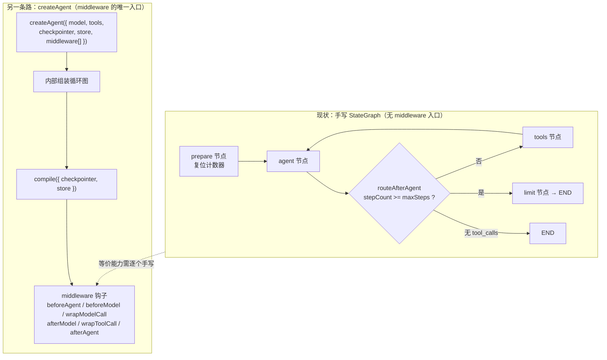
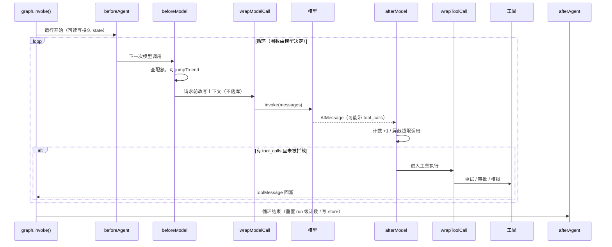
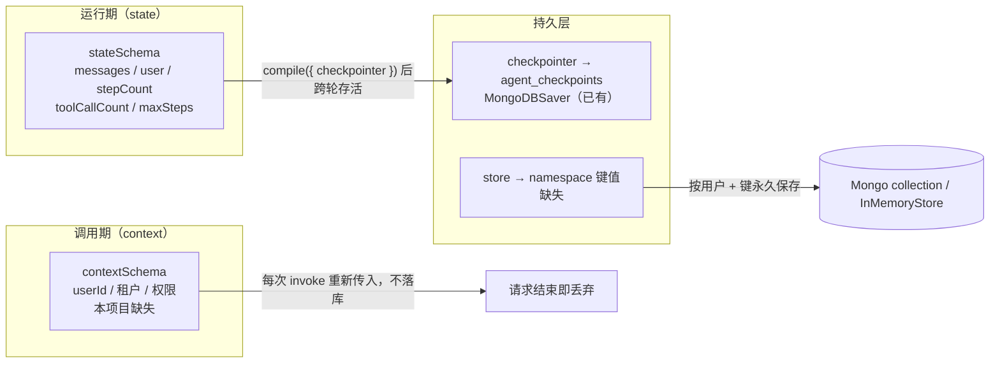
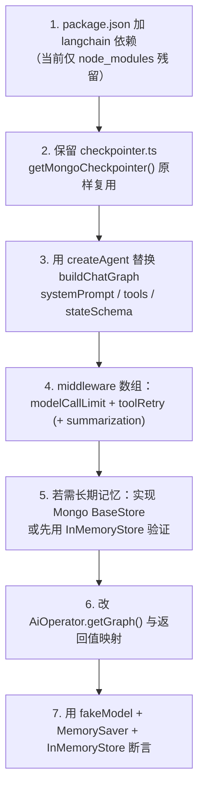

本页处理两个经常被混在一起谈、但在工程上必须拆开的问题：一是 agent 的**横切关注点**（一个 bug 就能烧光额度的循环、会爆掉的上下文、不稳定的外部工具）应该在哪一层治理；二是「记忆」这个词到底指哪一层——运行期状态、单次调用的上下文、会话短期历史，还是跨会话的用户事实。写法是「机制 + 对账」：先把 LangChain v1 的 middleware 与 `store` 机制从源码读清楚，再逐条对到本仓库的实际代码，说清哪些能力已经以手写形式存在、哪些完全缺失。

需要先声明一个事实，否则会误读全页：**本仓库当前的 agent 循环是手写 `StateGraph`，一个 middleware 都没有**。`middleware` 数组只能传给 `createAgent`，而 `createAgent` 来自 `langchain` 包——这个包在上一次重构中被主动移除，图编排被下放为四个显式节点。因此本页前半部分讲的是「已验证可用的能力面」，后半部分讲的是「当前代码里的等价物落在哪几行」，最后给出迁移路径与代价。

Sources: [agent-roadmap.md](docs/agent-roadmap.md#L106-L112), [agent-roadmap.md](docs/agent-roadmap.md#L161-L177)

## 一、前提核对：中间件层的入口在当前代码里不存在

重构提交的说明文字把取舍写得很明确：删除依赖清单里包含 `langchain`，理由是「LangGraph 成为 agent 编排核心，弱化 LangChain」，agent 循环、工具结果回灌、步数上限全部改由显式图完成。这个决定在依赖清单里留下了可验证的痕迹——`be/package.json` 的 `dependencies` 只有 `@langchain/core`、`@langchain/langgraph`、`@langchain/langgraph-checkpoint-mongodb`、`@langchain/openai`、`@langchain/tavily`，没有 `langchain` 本身。

Sources: [package.json](be/package.json#L22-L40)

值得注意的是本地 `node_modules` 里仍然躺着 `langchain@1.2.33` 的软链（pnpm store 里残留），`pnpm-lock.yaml` 的 `importers` 段也确认它已不在直接依赖中。这意味着两件事：**本页引用的所有 middleware/`createAgent` 源码事实都可以在本地直接翻开核对**（路径就是 `be/node_modules/langchain/dist/agents/...`）；但只要执行一次干净的 `pnpm install --frozen-lockfile`，这些能力就会从依赖树里消失。这是「文档看起来能跑、CI 一跑就废」的典型陷阱，引入中间件的第一步必须是把 `langchain` 显式写回 `dependencies`。

Sources: [pnpm-lock.yaml](be/pnpm-lock.yaml#L8-L25)

从架构上看，两条实现路线的分叉点只有一处：`createAgent` 内部会自己组装一张图，并在 `compile` 时把 `checkpointer` 与 `store` 一并注入。手写 `StateGraph` 只接受 `compile({ checkpointer })`，没有接受中间件数组的入口。也就是说，**中间件不是「给现有图加一层」，而是一种只能通过 `createAgent` 获得的组装方式**；在当前代码里想获得同等能力，只能继续往图里加节点与条件边。

Sources: [graph.ts](be/src/ai/graph/graph.ts#L41-L59), [ReactAgent.js](be/node_modules/langchain/dist/agents/ReactAgent.js#L272-L278)



## 二、中间件的机制：六个钩子 + 一份会被持久化的 state

把 middleware 理解成「插件」是不够精确的。它真正的形状是**一组带类型的生命周期钩子 + 一段会合并进 agent state 的 schema**。钩子共六个层级：`beforeAgent`/`afterAgent` 包住整次运行，`beforeModel`/`afterModel` 包住每次模型调用，`wrapModelCall`/`wrapToolCall` 则拿到请求对象与 `handler`，可以选择改写请求或直接短路。前三类钩子还能声明 `canJumpTo`，从而越过正常控制流直接跳到 `end`——这正是限流中间件能在不抛异常的情况下优雅收尾的实现基础。

Sources: [types.d.ts](be/node_modules/langchain/dist/agents/middleware/types.d.ts#L330-L400)



这套机制最容易被忽略的一点是：**中间件可以往 state 里加字段，而这些字段会跟着 checkpoint 落库**。`modelCallLimitMiddleware` 的 state schema 就是 `threadModelCallCount` 与 `runModelCallCount` 两个默认 0 的计数器；它在 `afterModel` 里同时自增，在 `afterAgent` 里只把 `runModelCallCount` 归零。于是「线程级预算」是靠 checkpoint 的持久性自然实现的，「运行级预算」是靠 `afterAgent` 的显式重置实现的——这与本仓库 `prepare` 节点必须手动清零计数器的原因是同一个物理事实，只是官方版本把它封装进了钩子。

Sources: [modelCallLimit.js](be/node_modules/langchain/dist/agents/middleware/modelCallLimit.js#L13-L17), [modelCallLimit.js](be/node_modules/langchain/dist/agents/middleware/modelCallLimit.js#L137-L141), [nodes.ts](be/src/ai/graph/nodes.ts#L14-L25)

## 三、成本护栏：三个限流中间件的精确语义

`modelCallLimitMiddleware` 有两个维度：`runLimit`（单次 `invoke` 内允许的模型调用次数）与 `threadLimit`（整条会话累计的次数），`exitBehavior` 默认 `end`。`end` 的行为不是抛错，而是在 `beforeModel` 里返回 `{ jumpTo: 'end', messages: [new AIMessage(message)] }`——把「配额用尽」变成一条正常返回给用户的助手消息；选 `error` 才抛 `ModelCallLimitMiddlewareError`。这个选择直接决定 HTTP 语义：在本项目里，`AiOperator` 会把非 `HttpException` 的异常统一包成 `BadGatewayException`，所以选 `error` 等于让前端收到 502，选 `end` 才会得到 200 + 一句可读的提示。

Sources: [modelCallLimit.js](be/node_modules/langchain/dist/agents/middleware/modelCallLimit.js#L103-L135), [AiOperator.ts](be/src/ai/operator/AiOperator.ts#L115-L127)

`toolCallLimitMiddleware` 的语义更细。它强制要求至少指定一个 limit，并校验 `runLimit` 不得大于 `threadLimit`；计数不是全局一个数字，而是按工具名维度的两张字典（`threadToolCallCount` / `runToolCallCount`），且 `exitBehavior` 默认为 `continue`。在 `continue` 模式下，超限的工具调用不会被「跳过」，而是被**注入一条 `status: 'error'` 的 ToolMessage** 回灌给模型——这与本项目 `tools` 节点「工具失败不中断图、错误作为结果回灌让模型自行修正」的设计思路完全一致，只是判据从「工具抛异常」换成了「调用次数超预算」。另有一个必须知道的限制：多工具并行时选 `end` 会直接抛错（提示改用 `continue` 或 `error`），因为无法在还有其他待执行工具调用的情况下干净收尾。

Sources: [toolCallLimit.js](be/node_modules/langchain/dist/agents/middleware/toolCallLimit.js#L182-L192), [toolCallLimit.js](be/node_modules/langchain/dist/agents/middleware/toolCallLimit.js#L250-L332), [nodes.ts](be/src/ai/graph/nodes.ts#L46-L62)

| 中间件 | 关键参数与默认值 | 超限时的动作 | 落库后的副作用 |
|---|---|---|---|
| `modelCallLimitMiddleware` | `runLimit` / `threadLimit` / `exitBehavior='end'` | 注入 `AIMessage` 并 `jumpTo:end`（或抛错） | `threadModelCallCount` 持久，`runModelCallCount` 归零 |
| `toolCallLimitMiddleware` | `toolName` / `runLimit` / `threadLimit` / `exitBehavior='continue'` | 注入 `status:'error'` 的 ToolMessage，模型可见 | `threadToolCallCount` 按工具名持久 |
| `toolRetryMiddleware` | `maxRetries` / `retryOn` / `backoffFactor` / `onFailure='continue'` | 包装 `wrapToolCall`，失败后再试或转成消息 | 无状态，不改 state |
| `modelRetryMiddleware` / `modelFallbackMiddleware` | 重试次数、降级模型链 | 主模型失败时重试或换模型 | 无状态 |

对账到当前代码，三个「手写中间件」的位置非常清楚：**防失控**由 `prepare`（复位）+ `routeAfterAgent`（判据 `stepCount >= maxSteps`）+ `limit` 节点（兜底出口）三者合力完成；**工具次数**只统计不限制，`toolCallCount` 在 `tools` 节点按 `toolMessages.length` 累加；**可靠性**目前为零，工具抛异常时由 `ToolNode` 转成 ToolMessage，没有退避重试。

Sources: [nodes.ts](be/src/ai/graph/nodes.ts#L68-L78), [edges.ts](be/src/ai/graph/edges.ts#L16-L26), [nodes.ts](be/src/ai/graph/nodes.ts#L50-L62)

| 能力 | 当前手写实现 | 官方中间件 | 口径差异（迁移时要注意） |
|---|---|---|---|
| 防死循环 | `stepCount` + `maxSteps` + `limit` 节点 | `modelCallLimitMiddleware({ runLimit })` | 计数对象相同（模型调用次数），但手写版只有 run 级、无 thread 级 |
| 工具调用预算 | `toolCallCount` 仅上报，不拦截 | `toolCallLimitMiddleware` | 手写版按 ToolMessage 条数累加；官方按工具名分桶并可拦截 |
| 兜底提示语 | `limit` 节点硬编码中文文案 | `exitBehavior:'end'` 自动生成 | 手写文案可控性更强，官方文案不可定制 |
| 重试 | 无 | `toolRetryMiddleware` / `modelRetryMiddleware` | 迁移后 `onFailure='continue'` 才能保持「不中断图」的现有语义 |

## 四、上下文治理：临时裁剪与持久压缩是两种不同的操作

`contextEditingMiddleware` 与 `summarizationMiddleware` 常被并列称为「上下文管理」，但它们的**作用域完全不同**。前者实现为 `wrapModelCall`：在请求发出的那一刻对 `request.messages` 就地改写，发完即弃，**不会写回 state，也不会改变 checkpoint**。后者实现为 `beforeModel`：返回 `RemoveMessage({ id: REMOVE_ALL_MESSAGES })` + 一条摘要 `HumanMessage` + 保留的近期消息，作为 state 更新提交——也就是说**压缩结果会被持久化**，下一轮读取到的历史已经是压缩后的版本。

Sources: [contextEditing.js](be/node_modules/langchain/dist/agents/middleware/contextEditing.js#L496-L527), [summarization.js](be/node_modules/langchain/dist/agents/middleware/summarization.js#L143-L146), [summarization.js](be/node_modules/langchain/dist/agents/middleware/summarization.js#L200-L212)

`contextEditingMiddleware` 的默认编辑策略是 `new ClearToolUsesEdit()`，即「按需清理旧的工具输出，把内容替换成占位符」。`ClearToolUsesEdit` 的触发与保留都用同一套三元组表达：`trigger` / `keep` 可以是 `{ messages }`、`{ tokens }` 或 `{ fraction }`；一个条件内多个属性是 AND，条件数组之间是 OR。它还有两个隐藏行为值得知道：其一是**无条件清理孤儿 ToolMessage**（找不到对应 `tool_call_id` 的 AIMessage 的那种），这一步先于触发判断执行；其二是 `excludeTools` 能把关键工具的输出永久排除在清理范围外。

Sources: [contextEditing.js](be/node_modules/langchain/dist/agents/middleware/contextEditing.js#L82-L130), [contextEditing.d.ts](be/node_modules/langchain/dist/agents/middleware/contextEditing.d.ts#L77-L143)

| 维度 | `contextEditingMiddleware` | `summarizationMiddleware` |
|---|---|---|
| 钩子 | `wrapModelCall` | `beforeModel` |
| 是否写回 state / checkpoint | 否，仅在请求时刻生效 | 是，摘要成为新的历史起点 |
| 可逆性 | 完全可逆（原始历史仍在库里） | 不可逆（旧消息被 `REMOVE_ALL_MESSAGES` 清空） |
| 典型配置 | `trigger:{tokens:8000}` + `keep:{messages:3}` + `excludeTools` | `model` + `trigger` + `keep`（默认保留 20 条） |
| 额外成本 | 无额外模型调用 | 每次触发要多调一次模型做摘要 |

两个坑必须提前知道。**第一，`fraction` 依赖 model profile**：`getProfileLimits` 只会从 `model.profile.maxInputTokens` 或按模型名查表拿上限，本项目指向 Moonshot 等第三方 OpenAI 兼容端点，拿不到 profile 时会直接抛 `Model profile information is required to use fractional token limits`——因此只能写绝对 token 数。**第二，token 计数是估算**：默认 `countTokensApproximately` 用「字符数 / 4」，对中文偏乐观（中文一个字的 token 密度更接近 1），阈值必须留安全余量，或注入自定义 `tokenCounter`。

Sources: [summarization.js](be/node_modules/langchain/dist/agents/middleware/summarization.js#L80-L89), [summarization.js](be/node_modules/langchain/dist/agents/middleware/summarization.js#L186-L195), [utils.js](be/node_modules/langchain/dist/agents/middleware/utils.js#L16-L27)

还有第三条更轻的路：`trimMessages` / `filterMessages` 这类纯函数，不依赖 `createAgent`，可以被任意节点调用。当前 `agent` 节点已经手工做了一次过滤——把 state 里的 `system` 类型消息剔除，再在调用前临时拼接 SystemMessage，从而避免 system prompt 在每个 checkpoint 里重复堆积。这个手写逻辑本身就是一个「微型上下文治理」，迁移到 `filterMessages` 只是形式升级，语义不变。

Sources: [nodes.ts](be/src/ai/graph/nodes.ts#L32-L44)

## 五、记忆四层：把路线图的表格与代码对账

`createAgent` 的四个参数对应四个层次，这一点路线图已经列过表；但对账时必须修正其中一格的措辞。路线图写 `stateSchema` 的生命周期是「单次运行」，而官方类型注释的原话是「state 在使用 checkpointer 时被持久化……与 context 不同，state 在多次调用之间保留」。真实语义是：**state 的归属是「图」，是否跨轮存活取决于有没有挂 checkpointer**；本仓库挂了 `MongoDBSaver`，所以 `stepCount`、`toolCallCount` 这些纯运行时字段同样会被写进 `agent_checkpoints`，这才是 `prepare` 节点必须复位计数器的根因。

Sources: [types.d.ts](be/node_modules/langchain/dist/agents/types.d.ts#L474-L485), [types.d.ts](be/node_modules/langchain/dist/agents/types.d.ts#L518-L526), [state.ts](be/src/ai/graph/state.ts#L23-L52)



| 层 | 参数 | 生命周期 | 本仓库现状 | 证据 |
|---|---|---|---|---|
| 运行状态 | `stateSchema` | 图实例内，挂 checkpointer 则跨轮持久 | 已有：`AgentStateAnnotation` 五个 channel | [state.ts](be/src/ai/graph/state.ts#L31-L52) |
| 调用上下文 | `contextSchema` | 单次 `invoke`，不落库 | **缺失**：身份被硬编码进 state 的 `user` 字段 | [state.ts](be/src/ai/graph/state.ts#L8-L12) |
| 短期记忆 | `checkpointer` | 跨请求，绑定 `thread_id` | 已有：`MongoDBSaver` + 进程内单例 | [checkpointer.ts](be/src/ai/graph/checkpointer.ts#L44-L63) |
| 长期记忆 | `store` | 跨会话、跨 thread | **缺失** | 依赖树里无任何 `BaseStore` 实现被使用 |

把「单用户 admin」放进 state 而不是 context，是一个可以讨论的取舍：好处是零配置、图内部任何节点和中间件都能读到身份；代价是「身份」和「会话数据」被混在同一份 checkpoint 里，一旦将来要支持多租户，`prepare` 写死的 `ADMIN_USER` 就成了必须改造的耦合点。正确的目标形态是 `contextSchema` 声明 `{ userId }`、由 `AiOperator` 在 `invoke` 时通过 `config.context` 传入，`state` 只留真正的会话数据。

Sources: [nodes.ts](be/src/ai/graph/nodes.ts#L14-L25), [types.d.ts](be/node_modules/langchain/dist/agents/types.d.ts#L552-L564)

## 六、store：长期记忆的正确形状与接入点

checkpointer 替代不了 store，原因不在技术而在**建模维度**：checkpoint 的索引是 `thread_id`，它回答「这条对话说过什么」；store 的索引是 `namespace + key`，它回答「这个用户是谁、偏好什么」。前者是流水，越长越贵、需要压缩；后者是事实，条数有限、需要精确读取。把用户偏好塞进 checkpoint 意味着每开一个新会话就丢失一次偏好，而把聊天流水塞进 store 意味着要为每条消息设计命名空间——两个方向都错。

Sources: [agent-roadmap.md](docs/agent-roadmap.md#L165-L172)

`BaseStore` 的接口很小：`get(namespace[], key)`、`put(namespace[], key, value, index?)`、`search(namespacePrefix[], { filter, limit, offset, query })`、`delete`、`listNamespaces`、`batch`。其中 `search` 同时承担两种职责——按元数据过滤的**结构化查询**，以及传 `query` 时的**向量相似度检索**，后者要求实例在构造时提供 `index: { dims, embeddings, fields }`。这一点把 store 与本项目的另一个未完成项绑在一起：一旦要用语义检索，`store` 就依赖 embedding 选型，而 embedding 选型本身是独立议题（见 [轻量 RAG 与 Embedding 选型：向量存储与切分策略](29-qing-liang-rag-yu-embedding-xuan-xing-xiang-liang-cun-chu-yu-qie-fen-ce-lue)）。

Sources: [base.d.ts](be/node_modules/.pnpm/@langchain+langgraph-checkpoint@1.0.1_@langchain+core@1.1.33_openai@6.31.0_zod@4.3.6__/node_modules/@langchain/langgraph-checkpoint/dist/store/base.d.ts#L277-L360), [base.d.ts](be/node_modules/.pnpm/@langchain+langgraph-checkpoint@1.0.1_@langchain+core@1.1.33_openai@6.31.0_zod@4.3.6__/node_modules/@langchain/langgraph-checkpoint/dist/store/base.d.ts#L223-L245)

实现选择上有个现实约束：`@langchain/langgraph-checkpoint-mongodb` 这个包**只导出一个 `MongoDBSaver`（checkpoint）**，没有任何 MongoDB 版的 `BaseStore`。所以要么用 `InMemoryStore`（进程内、重启即失，只适合开发与单测），要么自己实现一个 `BaseStore` 子类把 `get/put/search` 映射到 Mongo collection——后者的工作量不大，但必须自己处理命名空间层级到文档字段的映射。这一点和短期记忆的处境恰好相反：短期记忆是「有官方实现、只需接线」，长期记忆是「有接口、没有实现」。

Sources: [index.d.ts](be/node_modules/@langchain/langgraph-checkpoint-mongodb/dist/index.d.ts#L1-L50), [memory.d.ts](be/node_modules/.pnpm/@langchain+langgraph-checkpoint@1.0.1_@langchain+core@1.1.33_openai@6.31.0_zod@4.3.6__/node_modules/@langchain/langgraph-checkpoint/dist/store/memory.d.ts#L37-L57)

接线路径本身很短：`createAgent({ store })` → 内部图 `compile({ checkpointer, store })` → 调用模型/工具时把 `store` 挂进 `RunnableConfig`。工具侧因此有两个读法：声明 `runtime: ToolRuntime` 参数后直接取 `runtime.store`（同一对象上还能拿到 `state`、`context`、`toolCallId`、`writer`），或在任意节点里 `getStore(config)`。这正是「agentic memory」的落地点——让模型自己决定何时把一条事实写进长期记忆，而不是每轮无脑摘要。

Sources: [ReactAgent.js](be/node_modules/langchain/dist/agents/ReactAgent.js#L272-L278), [AgentNode.js](be/node_modules/langchain/dist/agents/nodes/AgentNode.js#L190-L200), [types.d.ts](be/node_modules/@langchain/core/dist/tools/types.d.ts#L354-L385)

| 设计项 | 建议 | 理由 |
|---|---|---|
| namespace 形状 | `['users', userId, 'facts']` / `['users', userId, 'preferences']` | 与 `thread_id` 解耦；单用户模式下 userId 恒为 `admin`，但形状保持可扩展 |
| key | 事实的稳定标识（如 `timezone`、`preferred_city`） | `put` 是覆盖语义，同 key 重写即更新，天然幂等 |
| 写入时机 | 工具内（模型主动写）或自定义中间件 `afterAgent`（自动写） | 前者可控、后者零打扰；两者不要同时上，否则会互相覆盖 |
| 读取时机 | `beforeModel` 钩子拼进 system prompt | 与 `dynamicSystemPromptMiddleware` 同一个坑位，避免每个工具各自查一遍 |

## 七、自定义中间件：把成本账真正记下来

本项目当前的成本可见性有一个具体缺口：`AiOperator` 只上报 `messages[最后一条].usage_metadata`。一次多步运行会产生 3~8 次模型调用，中间每一次的 token 消耗都被丢掉了，前端看到的只是最后一跳的用量。补齐这件事不需要改图，只需要一个 `afterModel` 钩子把每次的 `usage_metadata` 累加进 state，再在 `afterAgent` 里落一条日志或写入 store——用 `createMiddleware` 声明一份 `{ totalInputTokens, totalOutputTokens, modelCalls }` 的 state schema 即可。

Sources: [AiOperator.ts](be/src/ai/operator/AiOperator.ts#L129-L140)

```ts
// 语义示意：成本账中间件（本项目尚未落地）
const costLedger = createMiddleware({
  name: 'CostLedger',
  stateSchema: z.object({
    totalInputTokens: z.number().default(0),
    totalOutputTokens: z.number().default(0),
    modelCalls: z.number().default(0),
  }),
  afterModel: (state) => {
    const usage = state.messages.at(-1)?.usage_metadata;
    return {
      modelCalls: state.modelCalls + 1,
      totalInputTokens: state.totalInputTokens + (usage?.input_tokens ?? 0),
      totalOutputTokens: state.totalOutputTokens + (usage?.output_tokens ?? 0),
    };
  },
});
```

Sources: [modelCallLimit.js](be/node_modules/langchain/dist/agents/middleware/modelCallLimit.js#L137-L141), [types.d.ts](be/node_modules/langchain/dist/agents/middleware/types.d.ts#L182-L216)

| 钩子 | 适合做什么 | 不适合做什么 |
|---|---|---|
| `beforeAgent` | 从 store 加载用户偏好到 state | 做耗时 IO（会拖慢每次运行的首字节） |
| `beforeModel` | 查配额、动态拼 prompt、触发摘要压缩 | 改写工具结果 |
| `wrapModelCall` | 请求级临时裁剪、注入请求头/超参 | 期望改动被记住（不落库） |
| `afterModel` | 计数、成本累加、检测空回答 | 修改已生成的消息内容（语义上应视为只读） |
| `wrapToolCall` | 重试、审批、模拟、结果脱敏 | 改变工具名（会破坏 `tool_call_id` 配对） |
| `afterAgent` | 重置 run 级计数、写 store、上报指标 | 依赖还有下一次模型调用 |

## 八、迁移路径：从手写图到 middleware

**选项 A 是完整迁移**：把 `buildChatGraph` 换成 `createAgent`，用 `middleware` 数组表达限流与上下文治理，用 `stateSchema` 承接现有的 `AgentStateAnnotation`，`checkpointer` 直接复用 `getMongoCheckpointer()`，`store` 视是否实现 Mongo 版本决定。**选项 B 是局部增强**：保留现有图，只引入 `trimMessages`/`filterMessages` 这类纯函数，并把成本累加写成 `agent` 节点内的一行 state 更新。选项 B 零风险但没有真正的限流与重试；选项 A 拿到了全套能力，代价是失去对图结构的显式控制（这正是上一次重构刻意换来的东西，放弃它需要理由）。

Sources: [graph.ts](be/src/ai/graph/graph.ts#L13-L22), [AiOperator.ts](be/src/ai/operator/AiOperator.ts#L29-L52)



迁移真正的风险不在 API，而在**契约**。`AiOperator` 现在向外承诺 `steps`（来自 state 的 `stepCount`）与 `toolCalls`（来自 `toolCallCount`），前端 `Chat.vue` 直接把这两个数渲染成「N 步推理 / 调用工具 M 次」。换成 `createAgent` 后这些字段不再由自定义 state 提供，必须改成从中间件计数（`runModelCallCount` / `runToolCallCount`）或自定义成本中间件里取——否则前端会静默显示 0，而不是报错。

Sources: [AiOperator.ts](be/src/ai/operator/AiOperator.ts#L132-L139), [Chat.vue](fe/src/components/Chat.vue#L152-L156)

| 迁移项 | 现状 | 迁移后 | 破坏风险 |
|---|---|---|---|
| 防死循环 | `stepCount >= maxSteps` → `limit` 节点 | `modelCallLimitMiddleware({ runLimit })` | 提示文案变化；若误用 `exitBehavior:'error'` → 前端收到 502 |
| 步数上报 | `result.stepCount` | `runModelCallCount` 或自定义 state | 字段消失，前端显示 0 |
| 工具次数 | `toolCallCount`（ToolMessage 条数） | `runToolCallCount`（按工具名分桶） | 语义从「条数」变成「每工具次数」，聚合方式要改 |
| system prompt | 节点内临时拼接、不入库 | `systemPrompt` 参数或 `prompt` 函数 | 若改成写入历史，需重新处理「重复 system message」问题 |
| 短期记忆 | `MongoDBSaver` | 原样复用 | 无（同一个 saver 接口） |
| 长期记忆 | 无 | `store` | 需自建 Mongo 实现，否则重启丢数据 |

测试上有个很实用的组合：`fakeModel()` 提供链式脚本（`.respondWithTools()` 排一次工具调用、`.respond()` 排最终答案），并暴露 `.callCount` 与 `.calls`，配合 `MemorySaver` + `InMemoryStore` 就能在无网络条件下断言「第 N 次模型调用被拦下」「thread 级计数跨轮累加」「store 里的偏好被下一次运行读到」。这与现有 `graph.spec.ts` 里「脚本化假模型 + 断言模型调用次数」的思路完全同构，迁移测试几乎是平移改写。

Sources: [fake_model_builder.d.ts](be/node_modules/@langchain/core/dist/testing/fake_model_builder.d.ts#L1-L135), [graph.spec.ts](be/src/ai/graph/graph.spec.ts#L19-L43)

## 九、三条自检问题与后续阅读

读完本页应当能回答三个问题。**第一，为什么 `middleware` 加不到现有图上？** 因为它是 `createAgent` 的组装参数，手写 `StateGraph` 只有 `compile({ checkpointer })` 这一个注入点，等价能力必须自己写成节点与条件边。**第二，为什么 `stateSchema` 被归为「运行期」却不能当临时变量用？** 因为它会随 checkpoint 落库，跨轮存活，所以任何计数器都必须在每次运行开始时复位——本仓库用 `prepare` 节点，官方用 `afterAgent` 钩子。**第三，checkpointer 与 store 的分界线在哪？** 在索引维度：`thread_id` 索引的是「这条对话说过什么」，`namespace + key` 索引的是「这个用户是谁」，前者需要压缩与淘汰，后者需要精确与永久。

Sources: [types.d.ts](be/node_modules/langchain/dist/agents/types.d.ts#L556-L565), [nodes.ts](be/src/ai/graph/nodes.ts#L14-L25)

如果你想沿着这条线继续深入，短期记忆的落库细节与 `thread_id` 的设计在 [MongoDB Checkpointer：短期记忆的落库与读取](10-mongodb-checkpointer-duan-qi-ji-yi-de-luo-ku-yu-du-qu) 与 [thread_id 生命周期：sessionId 与「清空对话」的语义](11-thread_id-sheng-ming-zhou-qi-sessionid-yu-qing-kong-dui-hua-de-yu-yi)；手写图的节点与路由语义在 [四类节点的职责：prepare / agent / tools / limit](6-si-lei-jie-dian-de-zhi-ze-prepare-agent-tools-limit) 与 [条件边路由与步数上限：防止工具调用死循环](7-tiao-jian-bian-lu-you-yu-bu-shu-shang-xian-fang-zhi-gong-ju-diao-yong-si-xun-huan)；而把 store 的语义检索真正用起来，需要先解决 embedding 与切分策略，见 [轻量 RAG 与 Embedding 选型：向量存储与切分策略](29-qing-liang-rag-yu-embedding-xuan-xing-xiang-liang-cun-chu-yu-qie-fen-ce-lue)。