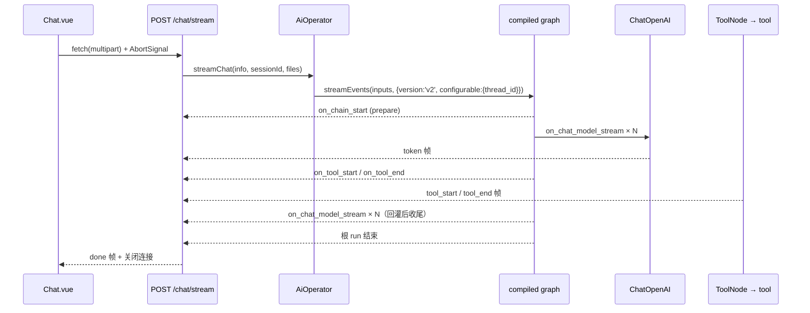
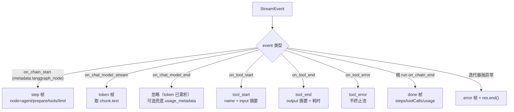
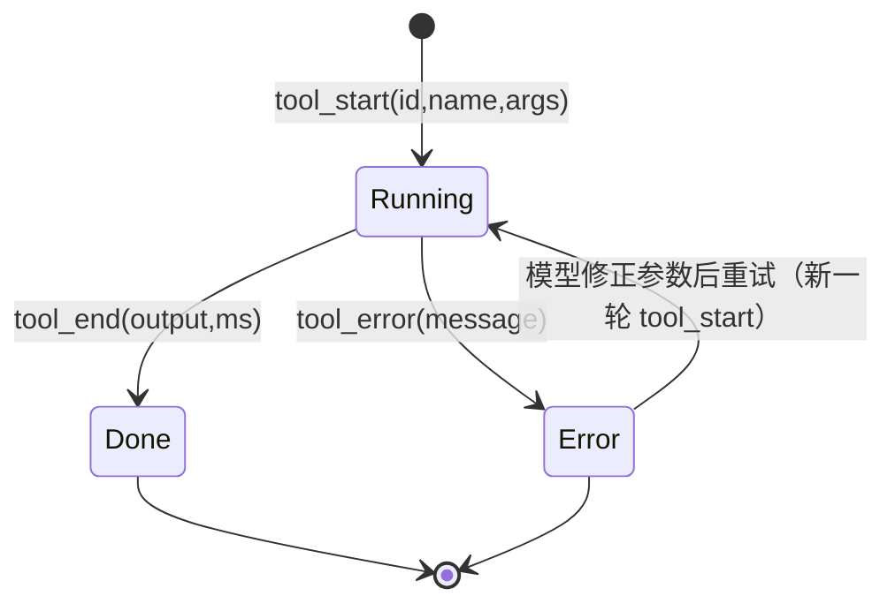

这一页解决一个具体问题：**怎样让 agent 的推理过程在浏览器里「看得见」**——逐字出字，以及工具调用的开始/结束状态。之所以要单独成页，是因为它不是「把 `invoke` 换成 `stream`」这么简单：现有链路上有三个刻意设计成一次性语义的部件（图的聚合返回、统一响应包装、前端 `response.json()`），每一个都会在流式改造中变成阻塞点。

需要先声明一个事实，否则会误读全页：**SSE 在本仓库里尚未落地**。`be/src` 与 `fe/src` 中没有任何 `text/event-stream`、`streamEvents` 或 `EventSource` 代码，`POST /chat` 仍是唯一入口。本页因此是设计文档：每个设计判断都对到一处可验证的代码接缝（或 `node_modules` 里已安装版本的真实实现），而不是对已存在功能的描述。设计依据来自路线图 M5 一节。

Sources: [agent-roadmap.md](docs/agent-roadmap.md#L181-L215), [ai.controller.ts](be/src/ai/ai.controller.ts#L34-L47), [ai.ts](fe/src/api/ai.ts#L45-L73)

## 一、基线核对：当前链路为什么天生「憋一个大 JSON」

流的缺失在三个层各有一道闸门，缺一不可地叠加成了「等到最后一次性渲染」。第一道在图执行层：`AiOperator.runGraph` 用的是 `graph.invoke`，它把整轮 agent 循环跑完才返回，然后从 `result.messages` 里取最后一条消息的文本、从 `usage_metadata` 取 token 用量、从 `stepCount` / `toolCallCount` 取计数——这是一个**聚合视图**，中间过程在这一层就已被丢弃。

Sources: [AiOperator.ts](be/src/ai/operator/AiOperator.ts#L115-L140)

第二道在响应包装层：`main.ts` 里全局注册的 `ResponseInterceptor` 对每个 handler 的返回值做 `map(data => ({ code: 200, message: 'success', data }))`。这个契约假设「一次请求 = 一个对象」，它同时被前端 `ChatApiResponse` 类型（`code` / `message` / `data`）和 `HttpExceptionFilter` 的 `response.status(status).json({ code, message, data: null })` 共同锁定。

Sources: [main.ts](be/src/main.ts#L15-L19), [response.interceptor.ts](be/src/common/filters/response.interceptor.ts#L16-L30), [http-exception.filter.ts](be/src/common/filters/http-exception.filter.ts#L59-L63), [ai.ts](fe/src/api/ai.ts#L21-L26)

第三道在前端：`chatKimi` 用的是 `fetch`，但紧接着 `await response.json()`——这行会把 body 完整读进内存后才 resolve。一个常被误传的细节是「必须绕开 axios」，而 `fe/package.json` 的 `dependencies` 里**根本没有 axios**（只有 element-plus、vue、vue-router），前端从一开始就是原生 `fetch`。所以真正的阻塞点是 `.json()` 的全量读取与 `{code,message,data}` 的解包校验，而不是 HTTP 客户端选型。

Sources: [ai.ts](fe/src/api/ai.ts#L56-L72), [package.json](fe/package.json#L11-L16)

下表把这六个月的改造面积压成一张对照，后面每一节都只是其中一行的展开：

| 层 | 现状（一次性语义） | 流式改造的落点 | 是否需要改契约 |
|---|---|---|---|
| 图执行 | `graph.invoke` 返回聚合 state | `graph.streamEvents(...)` 逐事件消费 | 否（同一个 compile 后的图） |
| Controller | `@Post('chat')` 直接 return Service 结果 | 新端点，需拿原生响应或返回 Observable | 是（新增一条路径） |
| 响应包装 | 全局 `map` 包 `{code,message,data}` | 该路由必须显式豁免 | 是 |
| 异常处理 | 全局 filter 写 JSON | 已 flush 后不能再写 JSON，改写成 error 帧 | 是 |
| 前端传输 | `fetch` + `response.json()` | `fetch` + `body.getReader()` + 帧解析 | 是 |
| 前端状态 | `content: string` + `meta: string` | 累积文本 + 工具卡片列表 | 是 |

## 二、协议设计：一次运行 = 一条带类型的事件流

SSE 的本质是「一个长连接上的多条 HTTP body 片段」，每条片段以空行终止，字段行由 `event:` / `data:` / `id:` / `retry:` 组成。Nest 11 自带的 `SseStream` 实现里可以逐字读到这套编码规则：`_transform` 依次拼 `event:`、`id:`、`retry:`、`data:`，最后补一个 `\n` 作为帧结束；`data` 若为对象先 `JSON.stringify`，若为多行字符串则按行拆成多个 `data:` 行。

Sources: [sse-stream.js](be/node_modules/@nestjs/core/router/sse-stream.js#L57-L67)

据此可以定下事件词表。设计原则有两条：**事件名承担路由语义，`data` 永远是单行 JSON**；以及**事件只描述「发生了什么」，不做渲染决策**（文案与展示留给前端，便于后续替换 UI）。

| SSE 事件名 | 触发时机 | `data` 载荷 | 前端表现 |
|---|---|---|---|
| `start` | 请求被受理、图开始跑 | `{ threadId, model }` | 立刻出现「正在思考…」气泡，拿到可用于中断的句柄 |
| `step` | 每次进入 `agent` 节点 | `{ index }` | 轮次计数 +1，可选显示「第 N 轮推理」 |
| `token` | 模型吐出一个 chunk | `{ text }` | 追加到当前气泡文本 |
| `tool_start` | 工具开始执行 | `{ id, name, args }` | 插入工具卡片（running），`args` 摘要成一行 |
| `tool_end` | 工具成功返回 | `{ id, name, output, ms }` | 卡片转 done，折叠展示结果摘要 |
| `tool_error` | 工具 run 抛错 | `{ id, name, message }` | 卡片转 error，红字提示但**不中断流** |
| `done` | 图跑完 | `{ steps, toolCalls, tokenUsage }` | 收敛 meta 行，恢复输入框 |
| `error` | 图/模型级失败 | `{ message }` | 气泡转错误态，保留已生成内容 |

下面这张时序图是整个设计的主干。注意 `graph.streamEvents` 是**唯一**的数据源：token 与工具状态都从同一条事件流里分流出来，不存在「正文走一条通道、工具走另一条」的旁路设计。

## 三、后端三条实现路径与选型

`be/package.json` 里 `@langchain/langgraph@^1.2.6` 与 `@nestjs/core@^11` 的组合，实际上给出了三种都能跑通的方案，差别在于「谁负责帧编码」。

**路径 A：`@Res()` 拿原生响应，手写 `data:` 帧。** Controller 注入 `@Res() res: Response`，自行 `writeHead` 设置 `Content-Type: text/event-stream`、`Cache-Control: no-cache`、`Connection: keep-alive`、`X-Accel-Buffering: no`（最后一个是 Nginx 反代不缓冲的关键），然后 `for await` 消费事件流、逐帧 `res.write()`。优点是帧格式、事件命名、错误帧完全自主；代价是流控、背压、断开清理都要自己写。这条路与现有 `POST /chat` 的 multipart 契约（`FilesInterceptor('files')`）天然兼容——请求体已被 multer 读完，响应可以继续长连接。

Sources: [ai.controller.ts](be/src/ai/ai.controller.ts#L35-L47)

**路径 B：`@Sse()` + 返回 Observable。** Nest 的 `@Sse` 装饰器写入 `SSE_METADATA`，执行上下文检测到它就走 `responseController.sse()`：设置 `Content-Type: text/event-stream`、`Connection: keep-alive`、`Cache-Control: private, no-cache, no-store, must-revalidate...`、`X-Accel-Buffering: no`，调用 `flushHeaders()`，并**先写一个 `\n`** 让客户端尽早拿到响应；消息对象按 `{ data, type, id, retry }` 编码，`id` 还会自动递增；客户端断开时自动 `unsubscribe()` 并 `end()` 流。代价是：它要求返回 **Observable**（返回 Promise 会直接抛 `ReferenceError`），且 `type` 是事件名的唯一来源——这一点在下一节会变成核心冲突。

Sources: [router-execution-context.js](be/node_modules/@nestjs/core/router/router-execution-context.js#L167-L178), [router-response-controller.js](be/node_modules/@nestjs/core/router/router-response-controller.js#L51-L100), [sse-stream.js](be/node_modules/@nestjs/core/router/sse-stream.js#L38-L56)

**路径 C：让图自己吐 SSE 字节。** 这是最容易被忽略的一条：`streamEvents` 有两个重载，第二个带 `encoding: 'text/event-stream'` 时直接返回 `Uint8Array` 流；`@langchain/core` 侧的 `convertToHttpEventStream` 把每个事件编成 `event: data\ndata: {json}\n\n` 并在末尾补 `event: end`；LangGraph 侧的 `toEventStream` 则把流式模式编成 `event: {mode}|{ns}\ndata: {...}`，异常编成 `event: error`。好处是零手写帧编码，坏处是**事件词表由框架决定**：所有 `streamEvents` 事件名都被压成统一的 `event: data`，真正的 `on_chat_model_stream` 名字被埋在 JSON 里，前端要多层解包。

Sources: [index.d.ts](be/node_modules/@langchain/langgraph/dist/pregel/index.d.ts#L455-L465), [wrappers.js](be/node_modules/@langchain/core/dist/runnables/wrappers.js#L3-L12), [stream.js](be/node_modules/@langchain/langgraph/dist/pregel/stream.js#L239-L265)

| 维度 | A · `@Res()` 手写帧 | B · `@Sse()` + Observable | C · 图层 `encoding` 直出 |
|---|---|---|---|
| 帧/事件名控制 | 完全自主 | 依赖 `type` 字段 | 框架固定（`data` / `mode\|ns`） |
| 与全局 `ResponseInterceptor` | **不冲突**（见第四节） | **冲突**，需显式豁免 | 冲突，需显式豁免 |
| 错误帧语义 | 手写 | 框架自动 `event: error` | 框架自动 `event: error` |
| 与 multipart 上传 | 天然兼容 | 需要 GET 或覆盖方法元数据 | 同 B |
| 客户端断开清理 | 需监听 `req.on('close')` | 框架自动退订 | 需自行 `return()` |
| 背压 | 自己处理 | 框架用 `drain` 处理 | `ReadableStream` 默认策略 |
| 改动量 | 最大 | 中 | 最小 |

选型结论：**主线走 A，把 B 作为「少写代码」的备选方案论证清楚**。原因是本页的核心诉求不是「能流」，而是「工具调用的状态要能被精确表达、错误要能被区分成帧」——A 是唯一一条帧格式与业务语义 1:1 对应的路径；C 最适合做快速验证（先确认流真的通了），不适合作为产品形态。

## 四、两个「污染」机制，必须逐字理解

路线图里写的是「全局 `ResponseInterceptor` 会污染 SSE 流」。这句话方向对，但机理值得精确到行，否则很容易改错地方。

`InterceptorsConsumer.transformDeferred` 的实现是 `from(next()).pipe(switchMap(res => res instanceof Observable ? res : Promise.resolve(res)))`——也就是说，**handler 返回 Observable 时，拦截器的 `map` 会作用在每一个发射值上，而不是整个流上**。所以在 `@Sse()` 路径下，每个本应是 `{ data, type: 'token' }` 的消息对象会被包成 `{ code: 200, message: 'success', data: { data, type } }`；随后 `responseController.sse` 的 `isObject(message)` 分支原样接受它，`_transform` 发现顶层没有 `type`，于是**不写 `event:` 行**，只在 `data:` 里塞进带包装的 JSON。结果是：流是通的，但事件名全部丢失、类型字段下沉一层、每个 token 多背约 40 字节包装。

Sources: [interceptors-consumer.js](be/node_modules/@nestjs/core/interceptors/interceptors-consumer.js#L30-L36), [response.interceptor.ts](be/src/common/filters/response.interceptor.ts#L22-L28), [router-response-controller.js](be/node_modules/@nestjs/core/router/router-response-controller.js#L57-L70)

而路径 A 反而**不需要**豁免拦截器。`createHandleResponseFn` 里有一处关键分支：`result = await transformToResult(result); !isResponseHandled && await apply(result, res, httpStatusCode)`，其中 `isResponseHandled` 是「注入了 `@Res()` 或 `@Next()` 且未开启 `passthrough`」。也就是说手写帧路径下，拦截器产出的包装值会被**计算后丢弃**，不会被写进响应。真正的风险落在 `@Res({ passthrough: true })`——那时 `apply` 会执行，向已 flush 的响应再写一个 JSON，触发 `Cannot set headers after they are sent`。

Sources: [router-execution-context.js](be/node_modules/@nestjs/core/router/router-execution-context.js#L174-L185)

如果仍决定走 `@Sse()`（或任何返回 Observable 的路径），豁免方式推荐「元数据 + Reflector」而非「判断 `res.headersSent`」：后者在 `@Sse()` 下恒为真（框架先 `flushHeaders()`），判不出「要不要跳过」，只能判「已经太晚」。而 Reflector 方案有一个真实的接线陷阱——`main.ts` 现在是 `new ResponseInterceptor()` **手工实例化**，拿不到容器里的 `Reflector`，必须改成注册为 `APP_INTERCEPTOR` provider 或 `app.useGlobalInterceptors(new ResponseInterceptor(app.get(Reflector)))`，否则 `getAllAndOverride` 会拿到 `undefined`。

Sources: [main.ts](be/src/main.ts#L16), [sse-stream.js](be/node_modules/@nestjs/core/router/sse-stream.js#L38-L55)

第二个机制是异常过滤器。`HttpExceptionFilter` 用 `@Catch()` 捕获一切，最后一句是 `response.status(status).json({ code, message, data: null })`——它在 SSE 场景下会在响应头已发送之后尝试设置状态码并写 JSON，轻则把 JSON 片段追加到事件流末尾（前端解析器会把它当成半帧），重则抛二次写头错误掩盖原始异常。因此流式端点的错误处理必须**在 handler 内部闭合**：`try/catch` 包住 `for await`，捕获后写一个 `event: error` 帧，再 `res.end()`。这也正是 Nest 自家实现的做法——`sse()` 里的 `catchError` 不抛，而是 `writeMessage({ type: 'error', data })` 后返回 `EMPTY`。

Sources: [http-exception.filter.ts](be/src/common/filters/http-exception.filter.ts#L10-L63), [router-response-controller.js](be/node_modules/@nestjs/core/router/router-response-controller.js#L70-L85)

## 五、事件映射：把 StreamEvent 翻译成业务事件

`StreamEvent` 的形状很稳定：`event`（`on_[runnable_type]_[start|stream|end]`）、`name`、`run_id`、`tags`、`metadata`，以及 `data`（`input` / `output` / `chunk` / `error`）。注意 JS 实现的 v2 事件**不带 `parent_ids`**——想定位「这个 token 属于哪个节点」，只能看 `metadata`；LangGraph 在每个任务上写入 `langgraph_node`（节点名）、`langgraph_step`（超步序号）、`langgraph_triggers`、`langgraph_checkpoint_ns`。

Sources: [event_stream.d.ts](be/node_modules/@langchain/core/dist/tracers/event_stream.d.ts#L60-L95), [algo.js](be/node_modules/@langchain/langgraph/dist/pregel/algo.js#L215-L221)

几处实现级细节直接决定成败。取文本必须用 `chunk.text` 而不是 `chunk.content`：`BaseMessage.text` 的 getter 会把字符串内容原样返回，把数组内容里的 `type === 'text'` 片段拼接起来——这正是本仓库 `extractTextContent` 在非流式路径上手动做的事，流式路径交给 getter 即可，前端也不必再写多模态解包逻辑。

Sources: [base.js](be/node_modules/@langchain/core/dist/messages/base.js#L128-L136), [AiOperator.ts](be/src/ai/operator/AiOperator.ts#L129-L139)

工具名来自 `event.name`，其解析顺序是 `run.name ?? serialized.name ?? serialized.id` 的末段。本仓库当前唯一注册的工具是 `TavilySearch`，其实例字段固定为 `name = "tavily_search"`，所以 `tool_start` 帧里出现的名字就是它；未来按路线图 M2 补齐时间/天气/数学工具后，这个名字会自动变成各自工具的 `name`，前端无需改代码。`args` 摘要建议做成通用规则：取输入对象里第一个字符串值（`tavily_search` 的 `query`、天气工具的 `city`），超长截断。

Sources: [event_stream.js](be/node_modules/@langchain/core/dist/tracers/event_stream.js#L267-L285), [tavily-search.js](be/node_modules/@langchain/tavily/dist/tavily-search.js#L101-L106), [index.ts](be/src/ai/tools/index.ts#L14-L27)

一个反直觉但关键的结论：**不需要在 `ChatOpenAI` 上加 `streaming: true`**。`BaseChatModel._generateUncached` 里有一个分支：只要 callback manager 中存在「偏好流式」的 handler，且 `disableStreaming` 为假、消息数为 1，就会改走 `_streamResponseChunks` 并逐 chunk 触发 `handleLLMNewToken`。而 `EventStreamCallbackHandler` 恰好声明了 `lc_prefer_streaming = true`。同时 `ChatOpenAI` 构造函数里 `if (fields?.streaming === false) this.disableStreaming = true`——本仓库 `createChatModel` 没有传 `streaming`，因此自动流式生效；如果将来为了规避某家厂商的非流式差异而显式传 `streaming: false`，整条 SSE 会退化成「最后一次性吐完」，且不会有任何报错。

Sources: [chat_models.js](be/node_modules/@langchain/core/dist/language_models/chat_models.js#L167-L172), [event_stream.js](be/node_modules/@langchain/core/dist/tracers/event_stream.js#L34), [base.js](be/node_modules/@langchain/openai/dist/chat_models/base.js#L222-L224), [model.ts](be/src/ai/model.ts#L35-L49)

还有一处容易踩的边界：`onLLMNewToken` 在 `runInfoMap.size === 1` 时直接 `return`，即「chat model 自己是根 run」时不发 token 事件（避免与根 run 的 output 流重复）。走图执行时 `runInfoMap` 里至少有根 chain run，不受影响；但如果有人为了「先做个 demo」直接对裸模型调 `streamEvents`，就会看到流是空的——这本身就是「流式必须建立在图之上」的理由。

Sources: [event_stream.js](be/node_modules/@langchain/core/dist/tracers/event_stream.js#L148-L180)

## 六、与既有图结构的对齐：流式不能绕开四个节点

流式改造最诱人的错误是「为了拿 token 而直接调模型」。这在本仓库会立刻破坏三处语义，因为图的四个节点各自承担了状态职责。

第一，`prepare` 节点每次运行都要**显式清零** `stepCount` / `toolCallCount` / `maxSteps`——原因是 checkpointer 会让 state 跨请求保留，不清零的话第二轮一开始就「已到上限」。绕开图或自己起一条裸调用，计数器语义就废了。

Sources: [nodes.ts](be/src/ai/graph/nodes.ts#L14-L25), [state.ts](be/src/ai/graph/state.ts#L31-L52)

第二，`limit` 节点产出的是**一个普通 `AIMessage`**，不经过模型，因此**不会有任何 token 事件**。前端必须靠 `step` 帧与 `done` 帧的计数判断「这是被步数上限掐断的收尾」而不是「模型说了这句话」，否则会把兜底文案当成正常回答。条件边 `routeAfterAgent` 的三分支（无 `tool_calls` → `END`；有 `tool_calls` 且 `stepCount >= maxSteps` → `limit`；否则 → `tools`）决定了最多只有 `maxSteps` 次 `agent` 节点进入，也就是 `step` 帧的天然上限。

Sources: [nodes.ts](be/src/ai/graph/nodes.ts#L64-L78), [edges.ts](be/src/ai/graph/edges.ts#L16-L26)

第三，工具失败**不会中断流**，这是特性而非缺陷。`ToolNode` 的 `handleToolErrors` 默认为真：`tool.invoke` 抛错时先由 tracer 发出 `on_tool_error`（run 级失败），随后 `ToolNode` 捕获并构造 `status: 'error'` 的 `ToolMessage`（内容形如 `Error: ...\n Please fix your mistakes.`）回灌给模型，于是图上会看到 `tool_error` 帧**紧接着新一轮 token**——模型正在用错误信息自我修正。可视化上必须把这种「失败后重试」画成两段：红色卡片 + 继续出字，而不是杀死整个气泡。

Sources: [tool_node.js](be/node_modules/@langchain/langgraph/dist/prebuilt/tool_node.js#L139-L170), [nodes.ts](be/src/ai/graph/nodes.ts#L46-L62)

第四，记忆语义不变。`streamEvents` 与 `invoke` 跑的是同一个 `compile({ checkpointer })` 出来的实例，`configurable.thread_id` 仍由 `sessionId` 提供，`MongoDBSaver` 每个 superstep 落盘到 `agent_checkpoints` / `agent_checkpoints_writes`。这一点很重要：流式不是「另一套执行」，只是同一套执行的观测方式。

Sources: [AiOperator.ts](be/src/ai/operator/AiOperator.ts#L29-L52), [checkpointer.ts](be/src/ai/graph/checkpointer.ts#L44-L63)

因此后端的最小改动形状是「复用前段、替换尾段」：`AiOperator` 里把 `chat()` 的输入构造（附件 → 文本/图片片段、`threadId` 决定）原样复用，只把 `runGraph` 的 `graph.invoke` 换成 `graph.streamEvents`，并把事件流以 `AsyncGenerator<业务事件>` 的形式向上暴露；Controller 只负责把业务事件编成 SSE 帧。这样流式与非流式两条路径共享同一份「输入 → 图」的准备逻辑，不会出现「流式能传图、非流式不能」的分裂。

Sources: [AiOperator.ts](be/src/ai/operator/AiOperator.ts#L77-L113), [attachments.ts](be/src/ai/operator/attachments.ts)

## 七、前端：ReadableStream 帧解析器与状态机

前端要放弃 `response.json()`，换成 `response.body.getReader()` + `TextDecoder`。三个细节是必需的：解码器必须用 `new TextDecoder('utf-8', { stream: true })`（否则多字节汉字会在 chunk 边界被截断成乱码）；帧必须按 `\n\n` 切分并**保留尾部残余**（一个 token 帧很可能横跨两次 `read()`）；帧内要忽略以 `:` 开头的注释行（有些代理会插心跳），并且要能容忍 `data:` 出现多行时的拼接、以及 Nest `SseStream` 无条件补上的 `id:` 行。

Sources: [sse-stream.js](be/node_modules/@nestjs/core/router/sse-stream.js#L57-L78), [message-event.interface.d.ts](be/node_modules/@nestjs/common/interfaces/http/message-event.interface.d.ts)

| 边界条件 | 现象 | 解析器必须做的事 |
|---|---|---|
| chunk 边界切在汉字中间 | 出现 `�` | `TextDecoder(..., {stream: true})` 持续解码 |
| 帧被切成两半 | 最后一个事件解析失败 | 只处理到最后一个 `\n\n`，残余留到下一轮 |
| CRLF（`\r\n\r\n`） | 按 `\n\n` 切不开 | 先归一化 `\r\n` → `\n` |
| `id:` 行 | 被误当事件内容 | 只收集 `event:` / `data:`，其余忽略 |
| 注释行 `: ping` | 空事件污染 | 以 `:` 开头的行直接跳过 |
| 响应头已到但无 body | 用户看不到「已开始」 | 收到 `start` 帧前显示占位气泡 |
| 代理缓冲 | 事件成批到达 | 服务端 `X-Accel-Buffering: no` + 立即 `flushHeaders()` |
| 非 2xx（如 503 未配 Key） | body 是 JSON 而非事件流 | 先看 `response.ok` 与 `content-type`，走降级解析 |

传输层可以继续沿用 `getBaseUrl()`（`VITE_API_BASE_URL`，默认 `/dev`，由 Vite 代理到 3000）；由于是单用户模式，**没有鉴权头需要补**——路线图里提到的 `localStorage.chatToken` 在去登录后已不存在，直接照抄那段会导致一个空的 `Authorization` 头。中断用 `AbortController`，把 `signal` 传进 `fetch`，`abort()` 后 `reader.read()` 会抛 `AbortError`，前端要把它与真正的错误区分开（静默收敛，不把「已中断」渲染成失败）。

Sources: [ai.ts](fe/src/api/ai.ts#L35-L59), [vite.config.ts](fe/vite.config.ts#L12-L22)

状态模型上，`Message` 需要从「`content: string` + `meta: string`」扩成三部分：`content`（累积文本）、`toolSteps: ToolStep[]`（工具卡片）、`meta`（结束时的步数与耗时）。现有的 `buildGraphMeta` 已经是这件事的雏形，只是它消费的是一次性响应里的 `steps` / `toolCalls`；流式下这两个数字改为在事件流中自增（`on_chain_start` 且 `langgraph_node === 'agent'` 计步，`on_tool_start` 计次），无需额外查询。

Sources: [Chat.vue](fe/src/components/Chat.vue#L104-L109), [Chat.vue](fe/src/components/Chat.vue#L151-L157)

工具卡片的渲染目标就是路线图给出的那两行示例的工程化版本。信息密度原则：**默认一行摘要（工具名 + 主参数），可展开查看完整入参与结果**；结果超长时只显示前 N 字符 + 字符数，避免把 `tavily_search` 的整页搜索结果灌进气泡——这块 UI 的价值在于「证明这不是套壳」，而不在于展示原文。

Sources: [agent-roadmap.md](docs/agent-roadmap.md#L203-L213)

## 八、中断与「清空对话」的语义对齐

这是设计里唯一一处**现有交互会直接冲突**的地方。`clearMessages` 的第一句是 `if (sending.value) return`——生成期间清空按钮是 no-op；随后它把 `sessionId` 换成新的 `crypto.randomUUID()`。也就是说，「清空」当前的语义是「换一条新 thread，旧 thread 的历史留在 Mongo 里」。

Sources: [Chat.vue](fe/src/components/Chat.vue#L245-L254), [Chat.vue](fe/src/components/Chat.vue#L120)

流式引入后这两个行为必须重新配对：中断 = `abortController.abort()` + 换 `sessionId`。原因是硬性的——checkpointer 每个 superstep 落盘，中途断开极可能留下「有 `tool_calls`、没有最终答复」的半截历史；如果沿用同一个 thread 继续提问，下一轮模型会看到这条断掉的对话并试图接续。换 `sessionId` 恰好把半截历史隔离掉，与现有「清空即新线程」的语义完全一致。所以正确的改法是：让清空按钮在 `sending` 时**可用**，其行为变成「中断 + 清空 + 轮换 sessionId」。

Sources: [checkpointer.ts](be/src/ai/graph/checkpointer.ts#L44-L49), [AiOperator.ts](be/src/ai/operator/AiOperator.ts#L101-L103)

服务端侧的断开清理分两种情况。走 `@Sse()` 时框架已处理：`request.on('close', ...)` 里 `subscription.unsubscribe()` 并 `end()` 流。走 `@Res()` 手写帧时，必须在循环里监听 `req.on('close')` 并 `break`/`return`，让 `for await` 提前退出——`streamEvents` 返回的是 `IterableReadableStreamWithAbortSignal`，提前 `return()` 会触发其取消逻辑，向下传导到 `combineAbortSignals` 合成的 signal，图会停在当前 superstep 而不会在后台把 token 烧完。

Sources: [router-response-controller.js](be/node_modules/@nestjs/core/router/router-response-controller.js#L95-L100), [index.js](be/node_modules/@langchain/langgraph/dist/pregel/index.js#L915-L923)

## 九、降级与并发：三条不能破的约束

**降级路径必须保留。** 路线图明确要求保留 `POST /chat`。工程上它的价值不只是「浏览器不支持」——SSE 经代理易被缓冲、`curl` 之外的调试工具对 multipart + 长连接支持不一，保留一次性端点等于保留了一个「去掉所有流式变量也还能复现」的对照组。

Sources: [agent-roadmap.md](docs/agent-roadmap.md#L185)

**两条路径必须共享同一个图实例。** `AiOperator` 用 `graphPromise` 缓存构建结果（含 `bindTools` 后的模型、`getMongoCheckpointer()` 的 checkpointer），并刻意在初始化失败时把缓存置空以便「配好 Key 后无需重启即可重试」。流式方法若自己再 `buildChatGraph` 一次，会多出一份 MongoDB 连接与一份 checkpointer，同时让「改一处配置两处生效」变成排查噩梦。正确做法是把 `getGraph()` 暴露给流式路径复用，只替换执行调用。

Sources: [AiOperator.ts](be/src/ai/operator/AiOperator.ts#L27-L52), [AiOperator.ts](be/src/ai/operator/AiOperator.ts#L101-L104)

**同一 `thread_id` 不允许并发运行。** 两个并发的图执行会同时写同一个 thread 的 checkpoint，历史会互相覆盖。前端现有 `sending` 标志（`handleSend` 首行 `if (sending.value) return`）已经承担了这个职责，流式改造时它要从「一次请求的 loading」升级成「一个会话的互斥闸门」；多标签页同 `sessionId` 的场景则属于接受的风险（单用户模式下概率极低），可在文档里显式声明。

Sources: [Chat.vue](fe/src/components/Chat.vue#L204-L206), [state.ts](be/src/ai/graph/state.ts#L23-L30)

## 十、验收：把「看不见」变成可断言

路线图给的自检标准很硬，可以直接当作验收用例。第一条是协议级：`curl -N` 必须看到**连续**的 token 帧，而不是最后一个完整 JSON——`-N` 关掉 curl 自己的缓冲，是唯一能证明「服务端没憋」的手段。第二条是语义级：前端肉眼看到逐字出字，并且工具调用有状态变化（`正在查询 → 已完成`）。

Sources: [agent-roadmap.md](docs/agent-roadmap.md#L214)

| 验收项 | 手段 | 通过判据 |
|---|---|---|
| 帧是连续的 | `curl -N -X POST .../chat/stream` | token 帧随模型生成滚动出现 |
| 事件名正确 | 同上，看 `event:` 行 | 出现 `token` / `tool_start` / `tool_end` 而非全是 `data` |
| 无包装污染 | 同上，看 `data:` 内容 | 顶层就是业务字段，没有 `code`/`message` 外壳 |
| 工具可视化 | 前端提问触发 `tavily_search` | 卡片从 running → done，参数摘要可读 |
| 工具失败可恢复 | 临时让工具抛错 | `tool_error` 卡片后仍继续出字并给出最终回答 |
| 上限收尾 | 设 `AGENT_MAX_STEPS=2` 问多步问题 | 收到 `limit` 的收尾文案，且 `done` 帧计数正确 |
| 中断干净 | 出字中途点「清空」 | 连接断开、`sessionId` 轮换、无遗留报错 |
| 代理不缓冲 | 经 Nginx / Vite 代理再测一次 | 帧到达时间仍分散，不成批 |

关于 `AGENT_MAX_STEPS`：它由 `state.ts` 的 `DEFAULT_MAX_STEPS` 与 `AiOperator` 的 `Number(process.env.AGENT_MAX_STEPS ?? 8)` 两处读取，两处的 fallback 要一致，否则「用环境变量压小上限做验收」会得到一个与生产不同的数值。

Sources: [state.ts](be/src/ai/graph/state.ts#L20-L21), [AiOperator.ts](be/src/ai/operator/AiOperator.ts#L42)

## 十一、这条线接下去连到哪里

流式落地之后，「工具调用序列」这份数据就自然存在了——这正是路线图 M7 里说「M5 的可视化顺便就干了可观测性」的含义：把每个 `tool_start` / `tool_end` 加时间戳落库，就有了最小可观测性，能在 agent 非确定性输出时回答「这一次它到底调了什么、调了几次、失败几次」。中间件与限流的取舍见 [中间件层与记忆分层：成本控制、上下文治理与 store](27-zhong-jian-jian-ceng-yu-ji-yi-fen-ceng-cheng-ben-kong-zhi-shang-xia-wen-zhi-li-yu-store)；流式接上检索工具后的形态（`retriever` 事件同样走 `streamEvents`）见 [轻量 RAG 与 Embedding 选型：向量存储与切分策略](29-qing-liang-rag-yu-embedding-xuan-xing-xiang-liang-cun-chu-yu-qie-fen-ce-lue)。

Sources: [agent-roadmap.md](docs/agent-roadmap.md#L265-L276)

如果只想先把「为什么能流」这一层吃透，建议回看两页基础：[图组装与可注入模型接口：让编排可测试](8-tu-zu-zhuang-yu-ke-zhu-ru-mo-xing-jie-kou-rang-bian-pai-ke-ce-shi)（理解 `compile` 出来的实例才拥有 `streamEvents`）与 [全局响应包装与异常过滤器：统一 {code, message, data} 契约](18-quan-ju-xiang-ying-bao-zhuang-yu-yi-chang-guo-lu-qi-tong-code-message-data-qi-yue)（理解第四节的两个污染机制为什么会存在）。前端那侧的展示与状态约定，与 [单页聊天界面：Vue 3 + Element Plus 的消息与附件状态](20-dan-ye-liao-tian-jie-mian-vue-3-element-plus-de-xiao-xi-yu-fu-jian-zhuang-tai) 保持同一套 `Message` 结构即可。