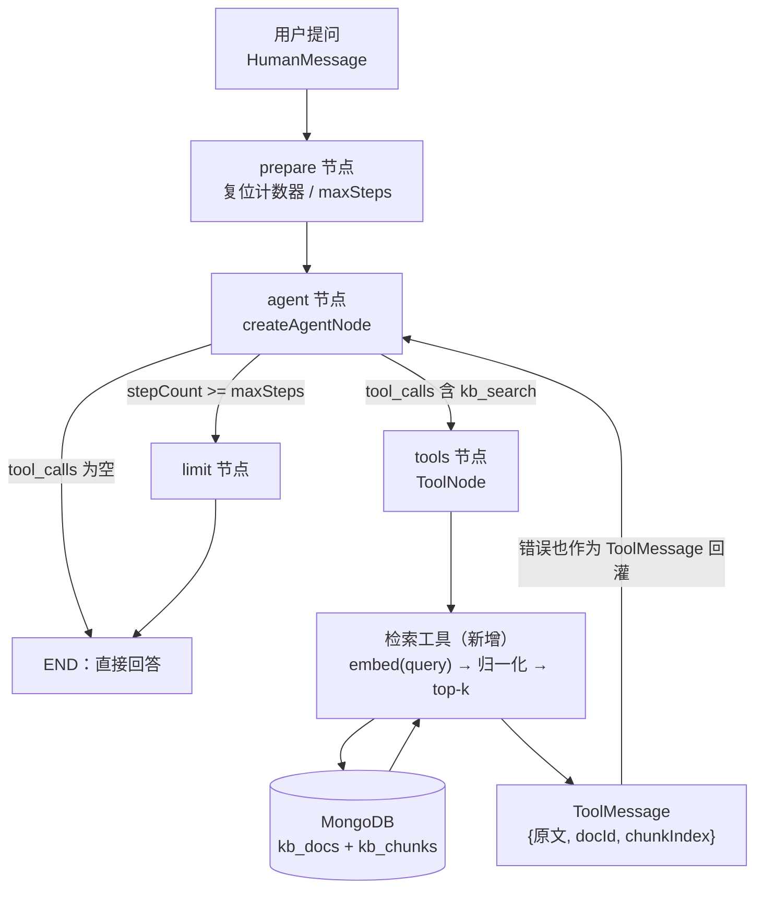
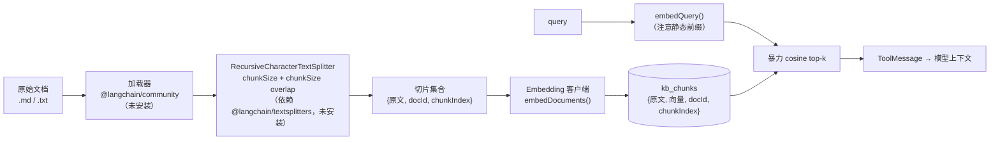

这一页讨论的是本仓库**尚未落地**的部分：知识库检索（RAG）。它在 `docs/agent-roadmap.md` 里被编号为 M6，处于「设计已定、代码为零」的状态。因此本页的证据链由两类材料构成——一类是路线图中已经写死的设计决策（尤其是 embedding 为什么是不可逆选择、为什么自建单机 Mongo 可以直接暴力算），另一类是现有代码里**已经被验证、可以被 RAG 直接复用**的挂载点（工具注册表、ToolNode 的错误回灌、Mongo 连接复用、字符预算治理）。本页只回答三个工程问题：向量存在哪、向量由谁生成、文本怎么切。

Sources: [agent-roadmap.md](docs/agent-roadmap.md#L218-L264)

## 现状基线：RAG 的三个「不存在」证据

在讨论选型前，必须先钉住起点。第一个证据是依赖清单：`be/package.json` 的 `dependencies` 里只有 `@langchain/core`、`@langchain/langgraph`、`@langchain/langgraph-checkpoint-mongodb`、`@langchain/openai`、`@langchain/tavily` 等包，**没有 `@langchain/textsplitters`（切分）与 `@langchain/community`（文档加载器）**。路线图附录 B 也把这两个包明确列为「未安装（RAG 需要）」，并额外提到 `@langchain/classic`。

Sources: [package.json](be/package.json#L22-L41)

Sources: [agent-roadmap.md](docs/agent-roadmap.md#L292-L296)

第二个证据是目录结构：`be/src/ai/` 下只有 `graph/`、`operator/`、`tools/` 与三个文件（`model.ts`、`ai.controller.ts`、`ai.service.ts`、`ai.module.ts`），**不存在路线图要求的 `be/src/kb/` 模块**。第三个证据是工具注册表：`createTools()` 返回的数组里唯一可能被 push 进去的对象是 `TavilySearch`，没有任何检索类工具。

Sources: [README.md](be/README.md#L20-L52)

Sources: [index.ts](be/src/ai/tools/index.ts#L1-L28)

这里有一处极易误读的地方需要澄清：`GET /search` 不是 RAG 检索。它走的是 `AiOperator.searchInfo()`，内部用 `search-${randomUUID()}` 作为 `thread_id` 调用同一张图，语义是「单轮问答、不落会话记忆」，与知识库向量检索毫无关系。判断 RAG 是否落地，看的应是「是否存在 kb 集合 + 检索工具」，而不是这个路由名。

Sources: [ai.controller.ts](be/src/ai/ai.controller.ts#L27-L31)

Sources: [AiOperator.ts](be/src/ai/operator/AiOperator.ts#L54-L71)

| 检查项 | 当前事实 | 对 RAG 的含义 |
|---|---|---|
| 切分/加载器依赖 | 未安装 `@langchain/textsplitters`、`@langchain/community` | 摄取管线无法开工，需先补依赖 |
| 存储模块 | 无 `be/src/kb/` 目录 | 两个 collection 的 schema 尚未定义 |
| 检索工具 | 工具注册表只有 `TavilySearch` | 模型当前不可能发起知识库检索 |
| Embedding 客户端 | `model.ts` 只有 `ChatOpenAI`，无 embeddings | 向量生成入口需要新建，但可照抄现有构造模式 |
| 图与循环 | `prepare/agent/tools/limit` 四节点已就绪 | **接入侧不需要改图**，检索天然是一个 tool |

## 目标形态：agentic RAG 与被复用的挂载点

路线图对「怎么接入」给出的答案不是「每次请求都先检索一遍」，而是**把检索做成一个工具**，让模型自己决定要不要查知识库。理由有两条：闲聊时不会被无关文档污染上下文；并且天然复用 M2 建立的工具注册表，不需要另起一条并行管线。下面的图描述的是这条链路在现有四节点图上的位置——阅读前请注意，`agent`、`tools`、`limit` 三个节点与 `routeAfterAgent` 条件边都是**已经存在的代码**，RAG 唯一新增的是那个检索工具本身和它背后的 `kb_*` 集合。

Sources: [agent-roadmap.md](docs/agent-roadmap.md#L239-L241)

这张图能成立，依赖四个现成的挂载点，它们各自解决 RAG 的一个具体问题，且都不需要重写：

| 挂载点 | 位置 | RAG 复用它做什么 |
|---|---|---|
| 工具注册表 + 条件启用 | `createTools()` 用 `if (process.env.TAVILY_API_KEY)` 决定是否注册 | 检索工具同样按「kb 集合是否已建/是否配置 embedding」条件注册，没建库时图照常能跑 |
| ToolNode 的执行语义 | `createToolsNode` 内部 `new ToolNode(tools)`，注释明确「工具执行失败不会中断图，错误会作为 ToolMessage 回灌给模型自行修正」 | 检索工具抛异常（连接失败、维度不符）不会炸掉整轮对话，模型可换 query 重试 |
| Mongo 连接复用 + 单例缓存 | `createMongoCheckpointer` 优先取 `mongoose.connection.getClient()`，否则用 `MONGODB_URI` 自建；`getMongoCheckpointer` 缓存 Promise | `kb` 模块应照此模式复用同一个 client，避免为 RAG 再开一条连接池 |
| 字符预算治理 | `MAX_TEXT_CHARS_PER_FILE = 20000`、`MAX_TOTAL_TEXT_CHARS = 50000`、`truncate()` | 给了「一次进 prompt 的文本量上限」的既有口径，检索结果的 top-k × chunk 长度应落在同一量级 |

Sources: [index.ts](be/src/ai/tools/index.ts#L12-L24)

Sources: [nodes.ts](be/src/ai/graph/nodes.ts#L44-L62)

Sources: [checkpointer.ts](be/src/ai/graph/checkpointer.ts#L11-L64)

Sources: [attachments.ts](be/src/ai/operator/attachments.ts#L24-L27)

还有一处软性前提：现有 system prompt 的行为准则第 1 条写的是「当问题需要实时信息（新闻、天气、最新数据等）时，先调用可用的搜索工具」，第 2 条是「不要为了调用工具而调用工具」。RAG 工具一旦注册，这段 prompt 需要把「需要查资料/查内部文档」也纳入第 1 条，否则模型是否触发检索就完全靠工具 `description` 硬扛——而在本项目的设计里，`description` 本身就是 prompt 的一部分。

Sources: [prompts.ts](be/src/ai/graph/prompts.ts#L12-L17)

## 向量存储：Mongo 存 + 进程内暴力 cosine

选型的约束来自基础设施而非偏好：技术栈明确标注 MongoDB 是**自建单机、非 Atlas，因此没有 `$vectorSearch`**。Atlas 的向量检索能力不可用，而引入独立向量数据库（Qdrant/Milvus 等）意味着新增一个常驻服务、一套备份策略和一套部署脚本——对一个单用户聊天机器人来说，运维面的增长远大于收益。

Sources: [agent-roadmap.md](docs/agent-roadmap.md#L8-L10)

路线图给出的方案是：新建 `be/src/kb/` 模块，落两个 collection——文档元数据一个，切片一个，切片文档形如 `{原文, 向量, docId, chunkIndex}`。检索时不依赖数据库能力，而是把向量全量读进进程，逐条算 cosine 取 top-k。这个决策附带了显式的规模算术：5000 个 chunk × 512 维 × 4 字节 ≈ 10MB 内存占用，每次查询约 250 万次乘加，在 Node 里 < 10ms。

Sources: [agent-roadmap.md](docs/agent-roadmap.md#L224-L237)

把这段算术展开成复杂度语言，它说明的是一个边界而非结论：暴力检索是 **O(N·d)** 每查询、**O(N·d)** 内存。当 N=5000、d=512 时，两个量级都落在「单次请求的内存与 CPU 抖动可忽略」的区间；当 N 增长到几十万片，同样是线性增长，但每次查询都要遍历的量级变成了亿次乘加，同时冷启动需要把整个库读进内存。所以路线图的结论是分阶段的：**「暴力算」在当前规模下不丢人，等库到几十万片再谈向量数据库。**

Sources: [agent-roadmap.md](docs/agent-roadmap.md#L237)

| 方案 | 检索能力 | 运维面 | 规模拐点 | 切换成本 |
|---|---|---|---|---|
| Atlas `$vectorSearch` | 数据库原生 ANN 索引 | 需迁移到托管 Atlas | 很高 | 高（基础设施迁移） |
| 独立向量库（Qdrant/Milvus） | 最完整（ANN、过滤、混合） | 新增服务、备份、部署 | 很高 | 高（新增组件 + 双写同步） |
| **Mongo 存 + 进程内暴力 cosine** | 全量精确 top-k | **零新增组件**，复用已有 Mongo | 约几十万 chip | 低（替换检索函数即可） |

需要提前想清楚的一个实现细节是**向量的磁盘编码**。`10MB` 这个估算是按每个维度 4 字节算的，而 BSON 对 `number[]` 的默认编码是 8 字节 double——同样 5000×512 的数组，直接以普通数字数组写入，占用约 20MB，是估算值的两倍。这个差异不影响正确性，但影响「读全库进内存」这一步的冷启动成本，所以在定义切片 schema 时就该决定是存 `Float32Array` 编码后的 Binary，还是接受 double。（此处为算术推演，路线图只给出了 4 字节的假设前提。）

Sources: [agent-roadmap.md](docs/agent-roadmap.md#L232-L235)

## Embedding 选型：一个不可逆决策

路线图 M0 把 Moonshot 是否支持 embeddings 放在所有开发工作之前验证，并用一句话说明原因：**「一旦入库就换不动了——不同模型的向量空间完全不兼容，换模型 = 重建整个库。」**这是整份路线图里唯一被明确标注为不可逆的决策，也是它排在最前面的全部意义。

Sources: [agent-roadmap.md](docs/agent-roadmap.md#L26-L28)

不可逆性有两层。第一层是空间不兼容：模型 A 生成的向量与模型 B 生成的向量没有可比性，混用会让相似度排序变成噪声。第二层是维度绑定：路线图的估算按 512 维展开，而 bge-small-zh-v1.5 恰好是 512 维，云端 embedding 服务的维度往往不同——换模型同时改变维度与空间，schema、存储编码、检索代码三处全要动。所以 M0 的验证测试非常具体：`POST https://api.moonshot.cn/v1/embeddings`，`model: moonshot-v3-embedding`，OpenAI 兼容协议，复用现有 key。

Sources: [agent-roadmap.md](docs/agent-roadmap.md#L30-L33)

两条路径的落差集中在「依赖与凭证」上，而不是效果上：

| 维度 | 云端路径 | 本地路径 |
|---|---|---|
| 客户端 | `OpenAIEmbeddings` 改 `baseURL` | `@huggingface/transformers` + ONNX |
| 具体模型 | `moonshot-v3-embedding`（复用现有 key） | `Xenova/bge-small-zh-v1.5` |
| 新依赖 | **零** | 新包（注意新包名 `@huggingface/transformers`，**不是**旧的 `@xenova/transformers`） |
| 新凭证 | **零** | 无 |
| 体积/运行 | 走网络 | 量化约 100MB，首次下载后可离线 |
| 维度 | 由服务商决定 | 512 |
| 失败模式 | 网络/配额，报错明确 | 首次下载失败，报错明确 |

Sources: [agent-roadmap.md](docs/agent-roadmap.md#L245-L250)

在实现层面，`model.ts` 已经提供了一个可以照抄的模板。`readModelSettings()` 从 `MODEL_API_KEY`/`MODEL_BASE_URL`/`MODEL_NAME` 三个环境变量读出配置并在缺 key 时抛 `ServiceUnavailableException`；`createChatModel()` 是**全项目唯一的 ChatOpenAI 构造点**，通过 `configuration: { baseURL }` 指向任意 OpenAI 兼容服务。Embedding 层应当保持同构：一个「唯一的 Embedding 构造点」+ 一组 `EMBEDDING_*` 环境变量，而不是在 `kb` 模块里散落 `new`。

Sources: [model.ts](be/src/ai/model.ts#L13-L49)

比环境变量更关键的是**接口抽象**。图节点之所以能用脚本化假模型做单元测试，是因为 `createAgentNode` 只依赖 `ChatModelLike`（一个 `invoke(messages)` 的最小接口），而不是具体的 `ChatOpenAI`。检索工具同理：只要它依赖 `EmbeddingsLike`（比如 `embedQuery(text): Promise<number[]>`），就能在没有网络、没有 key 的情况下测「切分 → 入库 → 检索」整条链路。这也是路线图说「Embedding 层做成可替换」的工程化含义——可替换不是「换一行配置」，而是「换一个实现而不改调用方」。

Sources: [nodes.ts](be/src/ai/graph/nodes.ts#L7-L12)

Sources: [graph.spec.ts](be/src/ai/graph/graph.spec.ts#L10-L33)

有一类错误必须靠读模型卡而不是靠调试解决：**query 与 document 不对称**。部分模型（bge 系列尤甚）要求给 query 加固定前缀，漏加后不会报错，只会让检索质量莫名下降——「极难 debug」正是它的特征。因此接入任何 embedding 模型的第一步是核对模型卡的 query/document 处理约定，把它固化在客户端实现里，而不是散在调用处。

Sources: [agent-roadmap.md](docs/agent-roadmap.md#L256-L257)

## 切分策略：效果差的第一大元凶

路线图对切分的判断毫不含糊：**「切分是 RAG 效果差的第一大元凶」**，并且给出了排查优先级——**效果不好时先怀疑切分**，再去怀疑 embedding 或 top-k。它的失败模式是双向的：切太大，一片里混了多个主题，向量被平均成模糊的语义点，检索命中后回灌给模型的原文也带着一半无关内容；切太碎，语义被切断，单片的向量几乎没有区分度。

Sources: [agent-roadmap.md](docs/agent-roadmap.md#L254-L255)

处方是 `RecursiveCharacterTextSplitter` + 适量 `overlap`。这个选择的价值在于「递归」：它按优先级依次尝试较粗的分隔符（段落 → 换行 → 句号 → 空格），只有在某一段仍然超长时才退化到更细的分隔符，因此切点天然倾向于落在结构边界上，而不是字符数边界上。`overlap` 则用冗余换连续性——让相邻切片共享一段尾巴，避免一个完整句子被切在边界两侧导致两边都读不懂。

Sources: [agent-roadmap.md](docs/agent-roadmap.md#L255)

下面的流程图把切分放回完整摄取/检索链路里，说明为什么它是唯一同时影响「存储量」和「检索质量」的环节（阅读前提示：`kb_docs` / `kb_chunks` 两个集合来自路线图的存储设计，其余箭头是标准 RAG 流程）：

切分参数不是拍脑袋定的，它有一个现成的锚：`attachments.ts` 里已经定义了「整份文本进 prompt」的上限 —— 单文件 `MAX_TEXT_CHARS_PER_FILE = 20000`、合计 `MAX_TOTAL_TEXT_CHARS = 50000`，超限由 `truncate()` 截断。这说明项目对「一次上下文能承载多少字符」已有明确口径。检索结果的总量 `top-k × chunkSize` 必须显著小于这个口径，否则一次检索就会吃掉原本留给历史消息与工具定义的预算。

Sources: [attachments.ts](be/src/ai/operator/attachments.ts#L63-L116)

参数之间的算术关系也值得在切分前算清：有效信息增量 = `chunkSize − overlap`，总片数 ≈ `ceil(总长度 / (chunkSize − overlap))`。以 `chunkSize=800`、`overlap=120`（15%）为例，一篇 10 万字符的文档会产出约 147 片，同时比无缝切分多存 15% 的向量。也就是说：**overlap 是用存储与检索成本换语义连续性**，它不是一个「越大越保险」的旋钮，而是一个需要和 top-k 一起标定的成本项。

Sources: [agent-roadmap.md](docs/agent-roadmap.md#L232-L237)

| 失败模式 | 可观测症状 | 优先调整 |
|---|---|---|
| 切片过大 | 命中片里混着多个主题；模型引用内容但答偏 | 降 `chunkSize`，优先在结构边界切 |
| 切片过碎 | 命中片语义残缺、指代无着落；top-k 里多条讲同一句 | 升 `chunkSize`，加 `overlap` |
| overlap 过大 | 存储与检索成本上涨，top-k 结果高度重复 | 把 overlap 压回 10%–15% 量级 |
| 完全不切 | 一次检索把整篇文档塞进 prompt，挤掉历史与工具定义 | 强制分片 + 卡死 top-k |

## Query 侧治理：top-k 与 agent 循环的成本乘法

检索工具的返回值会作为 `ToolMessage` 进入 state，而 state 是**跨轮持久化**的（`messages` 由 checkpointer 按 `thread_id` 保存）。这带来一个 RAG 特有的成本结构：一旦某次检索把大批原文写进消息历史，这些 token 会在**后续每一轮**的模型调用里重复付费，直到被摘要或裁剪。路线图因此把「top-k 卡死」列为必须做对的点——不要试图把整个库塞进 prompt。

Sources: [state.ts](be/src/ai/graph/state.ts#L32-L58)

比持久化更隐蔽的是循环内的乘法。一次对话最多允许 `AGENT_MAX_STEPS` 次模型推理（默认 8），模型完全可能在一轮里多次调用检索工具（换个 query 再查一次是合理行为）。于是总检索成本 ≈「检索次数 × top-k × chunkSize」，而这条路径的唯一护栏是已有的步数上限：`routeAfterAgent` 在 `stepCount >= maxSteps` 时把流量导向 `limit` 节点，`createLimitNode` 写入一条明确的终止消息而不是继续调用模型。

Sources: [edges.ts](be/src/ai/graph/edges.ts#L16-L25)

Sources: [nodes.ts](be/src/ai/graph/nodes.ts#L65-L79)

另一条工程要点是**纯向量检索的固有盲区**：专有名词、型号、错误码（路线图举的例子是 `XR-2000`、`E5021`）在向量空间里缺乏可泛化的邻居，语义相似度反而拉不开差距。这类查询需要 hybrid —— 向量召回与 BM25 关键词召回合并后重排。它不是第一阶段必做项，但当用户开始搜型号和错误码时，这是最先暴露的问题。

Sources: [agent-roadmap.md](docs/agent-roadmap.md#L258-L259)

## 自检与验证：复用现有的脚本化假模型基建

RAG 的验收标准在路线图里已经写成一条可执行的自检：传一个内容独特的 md，问只有它能回答的问题，确认**模型调用了检索工具**且**答案引用了文档内容**。这条自检的两个断言恰好对应现有测试基建的两个能力。

Sources: [agent-roadmap.md](docs/agent-roadmap.md#L261)

`graph.spec.ts` 已经提供了「脚本化假模型 + 假工具」的完整范式：`createScriptedModel` 按脚本逐步返回 `AIMessage`（可以中途返回 `tool_calls`），并把每次 `invoke` 收到的消息记进 `calls` 数组；测试通过断言 `model.calls` 的长度、以及 `model.calls[1][3].getType() === 'tool'` 来证明「工具确实被执行且结果回灌」。把假天气工具换成假检索工具、把 `createScriptedModel` 的脚本写成「先调 `kb_search`，再基于 ToolMessage 作答」，就得到 RAG 的单元级验收。

Sources: [graph.spec.ts](be/src/ai/graph/graph.spec.ts#L10-L79)

`attachments.spec.ts` 则示范了另一半：边界条件下的字符预算断言（单文件超长截断、合计超长忽略）。切片入库同样需要这类断言——比如「一份 N 字符文档切出的片数不超过 `ceil(N/(chunkSize−overlap))`」「单片长度不超过 `chunkSize`」「`chunkIndex` 连续无空洞」。这两套测试合起来，正好覆盖 RAG 的输入侧（切分）与输出侧（检索被调用）。

Sources: [attachments.spec.ts](be/src/ai/operator/attachments.spec.ts#L65-L85)

| 验收项 | 做法 | 判据 |
|---|---|---|
| 切片正确性 | 对合成文本跑切分函数 | 片数符合 `ceil(L/(C−O))`；每片长度 ≤ C；`chunkIndex` 连续 |
| 检索被触发 | 脚本化假模型第一步返回 `kb_search` tool_call | `model.calls` 长度 ≥ 2，且第一条 tool 消息内容含命中原文 |
| 答案引用文档 | 真实模型 + 内容独特的 md | 回答中出现只有该文档才有的信息 |
| 成本受控 | 固定 top-k 与 `AGENT_MAX_STEPS` 跑多轮 | 消息历史不随轮次失控增长；超步数时走 `limit` 节点 |
| 失败可恢复 | 让检索工具抛异常 | 图不中断，异常以 `ToolMessage` 回灌，模型可换 query 重试 |

## 边界说明

本页只覆盖「向量存哪、由谁生成、文本怎么切」这三个决策及其代码挂载点。三处相邻议题属于其他页面：检索工具如何被注册与条件启用的通用范式见 [工具注册表：工具描述即 Prompt，可选工具的条件启用](14-gong-ju-zhu-ce-biao-gong-ju-miao-shu-ji-prompt-ke-xuan-gong-ju-de-tiao-jian-qi-yong)；`store` 的语义检索如何依赖 embedding 维度见 [中间件层与记忆分层：成本控制、上下文治理与 store](27-zhong-jian-jian-ceng-yu-ji-yi-fen-ceng-cheng-ben-kong-zhi-shang-xia-wen-zhi-li-yu-store)；附件如何以字符预算方式进入 prompt（本页切分参数的锚点）见 [附件多模态转换：图片 Data URI、文本内联与长度治理](15-fu-jian-duo-mo-tai-zhuan-huan-tu-pian-data-uri-wen-ben-nei-lian-yu-chang-du-zhi-li)；M6 在整体里程碑中的位置与门禁关系见 [里程碑路线图与自检机制：M0 → M7 的推进方法](26-li-cheng-bei-lu-xian-tu-yu-zi-jian-ji-zhi-m0-m7-de-tui-jin-fang-fa)。