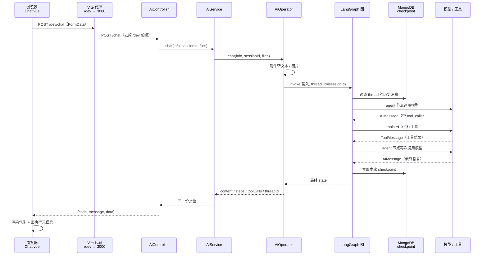
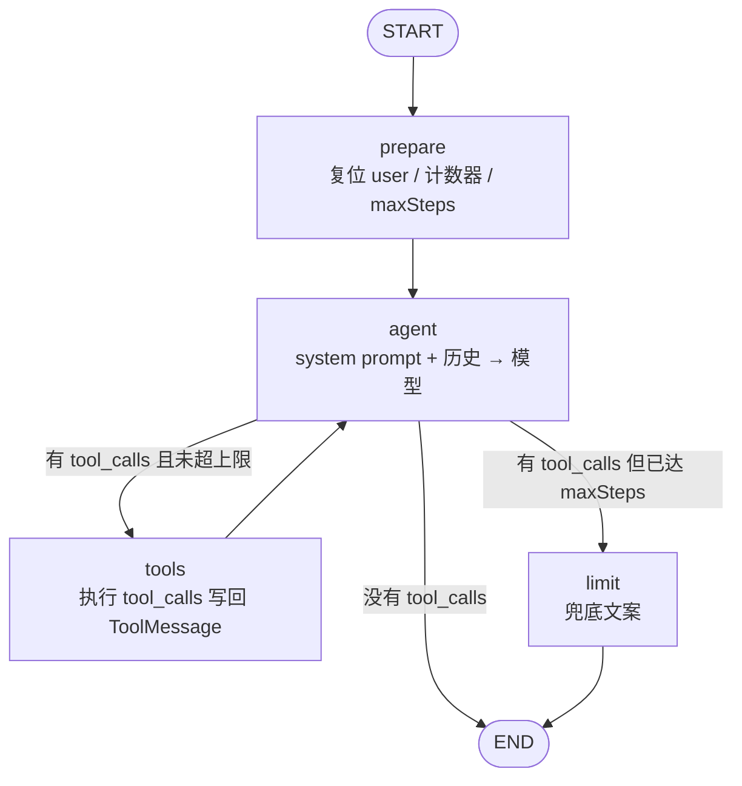

这一页要回答一个很具体的问题：**你在输入框里敲下一句话并按下回车，到屏幕出现 AI 的答复（以及「2 步推理 · 调用工具 1 次」这行小字），中间究竟发生了什么？** 我们把这条链路拆成八个阶段，逐段对应到仓库里真实的文件和代码行，让你能顺着链路自己打断点、自己验证。单轮问答 `/search` 的差异、附件如何转成模型输入、图内部的节点细节会在这条主链路上点明位置，但深入讲解留给专门的页面。

Sources: [ai.ts](fe/src/api/ai.ts#L45-L73)

## 全景：一条请求要穿过七层

先建立整体印象。整条链路是**前端单向发出、后端逐层下沉、再原路返回**的结构：浏览器只认识 HTTP，后端的 Controller 只认识 Service，Service 只认识 Operator，而真正干活（调模型、执行工具、存历史）的只有 LangGraph 图。每一层都很薄，职责只有一个，这是本项目最容易读的架构特征。

Sources: [ai.module.ts](be/src/ai/ai.module.ts#L6-L12)

Sources: [Chat.vue](fe/src/components/Chat.vue#L204-L243), [ai.controller.ts](be/src/ai/ai.controller.ts#L34-L47), [AiOperator.ts](be/src/ai/operator/AiOperator.ts#L115-L140)

把这张图压缩成一张「谁负责什么」的对照表，后面每节都可以回来查：

| 阶段 | 承载文件 | 唯一职责 | 不负责什么 |
|---|---|---|---|
| 1 提交 | `fe/src/components/Chat.vue` | 收集文本/附件、维护 `sessionId`、渲染气泡 | 不知道 LangGraph 存在 |
| 2 传输 | `fe/src/api/ai.ts` + `fe/vite.config.ts` | `fetch` + `FormData` 发 `POST /chat` | 不解析业务字段 |
| 3 入口 | `be/src/ai/ai.controller.ts` | 接收 multipart 三个字段 | 不做业务判断 |
| 4 门面 | `be/src/ai/ai.service.ts` | 原样转发给 Operator | 无任何逻辑 |
| 5 编排 | `be/src/ai/operator/AiOperator.ts` | 输入 → 图状态；图结果 → HTTP 友好结构 | 不做循环与分支决策 |
| 6 图执行 | `be/src/ai/graph/*` | prepare/agent/tools/limit 与条件边 | 不关心 HTTP |
| 7 统一响应 | `be/src/common/filters/*` | 包装 `{code,message,data}`、兜住异常 | 不感知业务 |
| 8 渲染 | `Chat.vue` | 文本 + `steps`/`toolCalls` 展示 | 不重试业务 |

Sources: [ai.service.ts](be/src/ai/ai.service.ts#L4-L19), [response.interceptor.ts](be/src/common/filters/response.interceptor.ts#L16-L30)

## 阶段一：输入框按下回车，前端先做三件事

输入框绑定 `userInput`，回车与发送按钮都指向同一个 `handleSend`；按钮在「正在发送」或「既无文本也无附件」时被禁用，所以 `handleSend` 内部的空值判断只是二次保险。这一步前端做了三件事：先把用户消息**立刻**推进 `messages`（图片/附件以 `📎 文件名` 形式进气泡），再清空输入框与附件列表，最后插入一条内容为「正在思考…」的占位助手消息。

Sources: [Chat.vue](fe/src/components/Chat.vue#L72-L90), [Chat.vue](fe/src/components/Chat.vue#L204-L226)

第三个动作有个值得注意的写法：占位消息通过 `messages.value.push(...) - 1` 拿到下标，再从数组里取出这个元素赋给 `assistantMessage`。因为 Vue 3 的 `ref([])` 返回的是响应式代理，后续直接修改 `assistantMessage.content` 就能触发视图更新——**不需要把整个数组替换掉**。这也是为什么后面的成功与失败分支都只是给这个对象赋 `content`/`meta`。

Sources: [Chat.vue](fe/src/components/Chat.vue#L222-L242)

`sessionId` 是这条链路的隐形主角：组件初始化时由 `crypto.randomUUID()` 生成一次，之后每次请求都带同一个值，直到用户点「清空对话」才重新生成——那时意味着**开启一个全新会话**。

Sources: [Chat.vue](fe/src/components/Chat.vue#L120-L122), [Chat.vue](fe/src/components/Chat.vue#L245-L254)

## 阶段二：请求出网（fetch + FormData + Vite 前缀）

真正的 HTTP 调用在 `chatKimi` 里。它把 `info`、`sessionId` 和每个附件按字段名 `files` 追加进 `FormData`，然后用原生 `fetch` 发出 `POST`。基线地址由 `import.meta.env.VITE_API_BASE_URL || '/dev'` 决定，空环境下就是 `/dev`。

Sources: [ai.ts](fe/src/api/ai.ts#L28-L59)

用 `fetch` 而不是 `axios` 是一个刻意的选择：`axios` 1.x 会给 `post` 补上 `Content-Type: application/x-www-form-urlencoded`，导致浏览器在提交 `FormData` 时不自动写入 `boundary`，后端 multer 会直接报 boundary 缺失。这一段细节在[fetch + FormData 上传：绕开 axios 的 boundary 陷阱](21-fetch-formdata-shang-chuan-rao-kai-axios-de-boundary-xian-jing)里展开，本页只需记住结论：**multipart 请求不要手动设 `Content-Type`**。

Sources: [ai.ts](fe/src/api/ai.ts#L37-L44)

`/dev` 前缀由 Vite 开发服务器接管：匹配 `/dev` 的请求被转发到 `http://localhost:3000`，同时把路径里的 `/dev` 重写掉。所以浏览器眼里是 `POST /dev/chat`，后端收到的是 `POST /chat`。

Sources: [vite.config.ts](fe/vite.config.ts#L12-L25)

## 阶段三：后端入口接收 multipart 三个字段

请求到达 `AiController.chat`。这个方法上挂了 `FilesInterceptor('files', 50, { limits: { fileSize: 10MB, files: 50 } })`，意味着上传在进入业务代码之前就被解析并限量：单文件不超过 10MB、一次最多 50 个。参数侧分别用 `@Body('info')`、`@Body('sessionId')`、`@UploadedFiles()` 取出三段数据，然后**一行转发**给 Service——Controller 里没有任何业务校验。

Sources: [ai.controller.ts](be/src/ai/ai.controller.ts#L14-L47)

有意思的是，那些「必填校验」并不在 Controller：空输入检查、附件类型检查都下沉到了 Operator。Controller 保持极薄，是为了让 `/search` 与 `/chat` 两个入口共享同一套下游逻辑。

Sources: [ai.controller.ts](be/src/ai/ai.controller.ts#L27-L47)

## 阶段四：AiService 是一条零逻辑的走廊

`AiService` 只有两个方法，方法体都是单行 `return this.aiOperator.xxx(...)`。它是一个**门面（facade）**，存在的意义不是加逻辑，而是让 Controller 依赖一个稳定的、与 HTTP 无关的接口：将来要换编排实现（比如换掉 LangGraph），只改 Operator，Controller 和 Service 签名不动。

Sources: [ai.service.ts](be/src/ai/ai.service.ts#L4-L19)

## 阶段五：Operator 把你的输入翻译成「图状态」

真正开始有业务判断的是 `AiOperator.chat`，它是整条链路里唯一同时理解「HTTP 输入」和「图输入」的地方。它依次做四件事。

**第一，做最小校验**：把输入 `trim()` 后，如果既没有文本也没有附件，抛 `BadRequestException`（消息为「请输入您的问题内容或上传文件」）。

**第二，把附件转成模型可消费的内容**：`buildAttachmentContent` 返回两样东西——文本附件拼接出的 `textContent`，以及图片附件转成的 `imageParts`（OpenAI 兼容的 `image_url` + data URI 数组）。遇到 pdf/docx 这类当前无法解析的类型会直接抛 400，避免带着无意义文件去烧 token。

**第三，组装 `content`**：没有图片时它是一个纯字符串（问题 + 附件文本用空行拼接）；有图片时它变成多模态数组——`[{type:'text', ...}, ...imageParts]`，且文本为空时会补一句「请描述这些图片的内容」。

**第四，确定 `threadId`**：直接取 `sessionId`（为空则 `'default'`）。这就是「同一 `sessionId` 复用同一段记忆」在全链路上唯一的实现点。

Sources: [AiOperator.ts](be/src/ai/operator/AiOperator.ts#L77-L103), [attachments.ts](be/src/ai/operator/attachments.ts#L75-L117)

在真正调用图之前，`getGraph()` 会懒加载一个**进程内单例图**：首次调用时创建工具（有 `TAVILY_API_KEY` 才有搜索工具）、创建模型并把工具 `bindTools` 上去、取 MongoDB checkpointer，然后 `buildChatGraph` 编译；结果缓存在 `graphPromise` 里。初始化失败（比如没配 API Key）会把这个缓存清空并抛出，这样你修好 `.env` 后**无需重启**即可重试。

Sources: [AiOperator.ts](be/src/ai/operator/AiOperator.ts#L26-L52), [tools/index.ts](be/src/ai/tools/index.ts#L14-L27), [model.ts](be/src/ai/model.ts#L15-L49)

## 阶段六：图执行——四个节点、一条条件边

图本身只有四行结构性代码：注册 `prepare`、`agent`、`tools`、`limit` 四个节点，接上 `START → prepare → agent`，给 `agent` 挂条件边，最后 `tools → agent` 形成回环、`limit → END`。有 checkpointer 时编译成带持久化的图。

Sources: [graph.ts](be/src/ai/graph/graph.ts#L41-L59)

Sources: [graph.ts](be/src/ai/graph/graph.ts#L24-L40), [edges.ts](be/src/ai/graph/edges.ts#L16-L33)

**prepare 为什么必须存在**：因为有 checkpointer，图的 state 会跨请求保留，计数器会「记得」上一轮的数字。`prepare` 每次运行都显式把 `stepCount`、`toolCallCount` 归零、把 `maxSteps` 重新写入、把 `user` 复位成内置的 `admin`。这也是「单用户模式」在图内的具体体现。

Sources: [nodes.ts](be/src/ai/graph/nodes.ts#L14-L25), [state.ts](be/src/ai/graph/state.ts#L31-L52)

**agent 每次都临时拼 system prompt**：它先把历史里所有 `system` 类型消息过滤掉，再把 `SYSTEM_PROMPT` 和剩余历史一起传给模型，最后只把模型响应写回 `messages` 并把 `stepCount` 加一。这么做的好处是 checkpoint 里不会堆积重复的 system message，而每一轮模型看到的都是最新的提示词。

Sources: [nodes.ts](be/src/ai/graph/nodes.ts#L27-L44), [prompts.ts](be/src/ai/graph/prompts.ts#L7-L20)

**tools 节点把工具错误回灌而不是中断**：`ToolNode` 执行上一条 `AIMessage` 里的 `tool_calls`，返回的 `ToolMessage[]` 被写入 state，`toolCallCount` 按消息条数累加。工具抛错不会炸掉整张图，错误文本会作为 `ToolMessage` 回到模型手里自行修正。

Sources: [nodes.ts](be/src/ai/graph/nodes.ts#L46-L62)

**条件边只问两个问题**：最后一条消息是不是 AI 消息、它有没有 `tool_calls`？没有就 `END`；有但 `stepCount >= maxSteps` 就去 `limit`；否则回 `tools`。所以「防止死循环」不是靠超时，而是靠这条显式分支加 `limit` 节点的兜底文案。

Sources: [edges.ts](be/src/ai/graph/edges.ts#L10-L26), [nodes.ts](be/src/ai/graph/nodes.ts#L64-L78)

一次真实的循环（用户在没配搜索工具时问一句需要实时信息的问题）在状态层面是这样推进的：

| 时刻 | 节点 | `messages` 变化 | `stepCount` | `toolCallCount` |
|---|---|---|---|---|
| 起始 | — | `checkpoint 历史 + 本轮 HumanMessage` | 0（`prepare` 复位） | 0 |
| ① | `agent` | 追加 `AIMessage(tool_calls=[...])` | 1 | 0 |
| ② | `tools` | 追加 1 条 `ToolMessage` | 1 | 1 |
| ③ | `agent` | 追加 `AIMessage(纯文本答复)` | 2 | 1 |
| 结束 | 条件边 | 无 `tool_calls` → `END` | 2 | 1 |

上表中「③ 之后直接结束」正是 `routeAfterAgent` 的 `toolCalls.length === 0` 分支；对应的测试断言 `stepCount = 2`、`toolCallCount = 1`，是这个语义最可靠的证据。

Sources: [graph.spec.ts](be/src/ai/graph/graph.spec.ts#L49-L77), [edges.ts](be/src/ai/graph/edges.ts#L16-L26)

图每轮的读写都落在 MongoDB 上：`MongoDBSaver` 复用 Nest 已建立的 mongoose 连接（未就绪时用同一份 `MONGODB_URI` 单独建连），写入 `agent_checkpoints` 与 `agent_checkpoints_writes` 两个集合，按 `thread_id` 隔离。

Sources: [checkpointer.ts](be/src/ai/graph/checkpointer.ts#L11-L63)

## 阶段七：把图结果整形为 HTTP 友好结构

`graph.invoke` 的两参形式就是整条链路的「接缝」：第一个参数是**增量状态**（只有一条新 `HumanMessage`），第二个参数是**运行时配置**（`configurable.thread_id = threadId`）。历史不在这里传，由 checkpointer 按 thread 自动注入。

Sources: [AiOperator.ts](be/src/ai/operator/AiOperator.ts#L115-L122)

返回后 `runGraph` 从最终 state 里取四类信息：`content` 取**最后一条消息**经 `extractTextContent` 归一化后的文本（部分 OpenAI 兼容实现会把 `content` 返回成数组，这里统一拍平成字符串）；`tokenUsage` 取该消息的 `usage_metadata`；`steps` 与 `toolCalls` 分别读 `stepCount`、`toolCallCount`；`user` 读 state 里的 `admin`。之所以可以直接取「最后一条」，是因为图只有三种出口：agent 产出纯文本、或 `limit` 产出兜底文案，两者都是 `AIMessage`。

Sources: [AiOperator.ts](be/src/ai/operator/AiOperator.ts#L123-L140), [attachments.ts](be/src/ai/operator/attachments.ts#L123-L137)

错误也在这里被翻译成 HTTP 语义：图内部抛出的 `HttpException`（例如 `model.ts` 没读到 Key 时抛的 `ServiceUnavailableException`、附件类型不支持抛的 `BadRequestException`）**保持原语义**向上抛；其他任何异常都包成 `BadGatewayException`，消息前缀为「AI 服务调用失败：」。所以「没配 Key」在浏览器里表现为 503，而「模型服务挂了」是 502。

Sources: [AiOperator.ts](be/src/ai/operator/AiOperator.ts#L123-L127), [model.ts](be/src/ai/model.ts#L15-L29)

`chat` 最终返回的对象是前端契约的 `data` 部分，包含 `content`、`tokenUsage`、`steps`、`toolCalls`、`threadId`、`user` 六个字段——与 `fe/src/api/ai.ts` 里的 `ChatResponseData` 接口一一对应。

Sources: [AiOperator.ts](be/src/ai/operator/AiOperator.ts#L105-L112), [ai.ts](fe/src/api/ai.ts#L8-L19)

## 阶段八：统一响应包装与异常兜底

Controller 返回的对象并不是最终响应体。`main.ts` 里注册了全局 `ResponseInterceptor`，它用 RxJS 的 `map` 把任何成功返回值包成 `{ code: 200, message: 'success', data }`；同一个 `main.ts` 还注册了全局 `HttpExceptionFilter`。

Sources: [main.ts](be/src/main.ts#L9-L19), [response.interceptor.ts](be/src/common/filters/response.interceptor.ts#L16-L30)

失败路径同理被统一：`HttpExceptionFilter` 用 `@Catch()` 捕获一切，`HttpException` 取其状态码与消息，其他异常一律 500 +「服务器内部错误」并打印堆栈，最后以 `{ code, message, data: null }` 输出。所以无论成功还是失败，**响应体外层形状永远一致**，前端只需判断 `code`。

Sources: [http-exception.filter.ts](be/src/common/filters/http-exception.filter.ts#L10-L64)

| 场景 | HTTP 状态 | 响应体 `code` | `message` 来源 | `data` |
|---|---|---|---|---|
| 正常答复 | 200 | 200 | `'success'` | `{content, steps, toolCalls, ...}` |
| 空输入 | 400 | 400 | Operator 的 `BadRequestException` | `null` |
| 不支持的附件类型 | 400 | 400 | `buildAttachmentContent` 抛错 | `null` |
| 未配置模型 Key | 503 | 503 | `readModelSettings` 抛错 | `null` |
| 模型/网络异常 | 502 | 502 | 「AI 服务调用失败：…」 | `null` |
| 其他未知异常 | 500 | 500 | 「服务器内部错误」 | `null` |

Sources: [http-exception.filter.ts](be/src/common/filters/http-exception.filter.ts#L21-L63), [AiOperator.ts](be/src/ai/operator/AiOperator.ts#L84-L99)

## 阶段九：前端把结果写回气泡

`chatKimi` 先尝试 `response.json()`，然后同时检查三件事：HTTP 是否 ok、响应体是否解析成功、`payload.code` 是否为 200。任一不满足就 `throw new Error(payload?.message || '请求失败（HTTP xxx）')`——注意它抛的是**统一后的 `message`**，所以后端那句中文提示能一路穿透到用户眼前。

Sources: [ai.ts](fe/src/api/ai.ts#L61-L73)

`handleSend` 用 `try/catch/finally` 接住两种结果：成功时 `formatContent` 把可能是数组的 `content` 拍平成字符串（数组为空则显示「（空回复）」），`buildGraphMeta` 把 `steps`/`toolCalls` 拼成「2 步推理 · 调用工具 1 次」写进 `meta`；失败时不论业务错误还是网络错误，都把可读提示写进**同一个助手气泡**，而不是只弹一个 toast 留下空白回复。`finally` 里统一复位 `sending` 并滚到底部。

Sources: [Chat.vue](fe/src/components/Chat.vue#L228-L243), [Chat.vue](fe/src/components/Chat.vue#L136-L157)

`meta` 最终渲染在气泡下方的 `.message-meta` 里，这就是「图的执行情况」在 UI 上唯一的可见痕迹——它直接来自图 state 的 `stepCount`/`toolCallCount`，是排查「到底调了几次模型、几次工具」最方便的现场证据。

Sources: [Chat.vue](fe/src/components/Chat.vue#L24-L27)

## 一次请求在各层的数据形态

把同一次带工具调用的对话逐层摊开，能直观看到「数据在哪里变形」：

| 层 | 数据形态 | 关键变形 |
|---|---|---|
| `handleSend` | `userInput: string` + `attachedFiles: File[]` + `sessionId: string` | 追加用户气泡与占位气泡 |
| `chatKimi` | `FormData`（`info` / `sessionId` / `files[]`） | JS 对象 → multipart |
| Vite 代理 | `POST /dev/chat` → `POST /chat` | 路径前缀被重写 |
| `AiController` | `info`、`sessionId`、`Express.Multer.File[]` | multipart → 内存对象（含 `buffer`） |
| `AiOperator.chat` | `content: string ｜ 多模态数组` + `threadId` | 附件转为文本/`image_url` |
| `graph.invoke` | `{ messages: [HumanMessage] }` + `{ configurable: { thread_id } }` | 外部输入 → 图增量状态 |
| 图 state | `messages` / `user` / `stepCount` / `toolCallCount` / `maxSteps` | 循环中持续累积 |
| `runGraph` | `{ content, tokenUsage, steps, toolCalls, user, threadId }` | 取最后一条消息 + 计数器 |
| `ResponseInterceptor` | `{ code: 200, message: 'success', data }` | 成功包壳 |
| `Chat.vue` | 气泡 `content` + `meta` | 文本拍平 + 元信息拼接 |

Sources: [Chat.vue](fe/src/components/Chat.vue#L204-L243), [AiOperator.ts](be/src/ai/operator/AiOperator.ts#L77-L140), [response.interceptor.ts](be/src/common/filters/response.interceptor.ts#L22-L28)

## 断链自查：现象与最可能的断点

排查时按链路顺序往前推，比乱看日志快得多：

| 现象 | 最可能断点 | 验证方式 |
|---|---|---|
| 气泡一直停在「正在思考…」 | 请求未返回（`fetch` 挂起） | 看浏览器 Network 是否有 `/dev/chat` 请求 |
| 提示 `Multipart: Boundary not found` | 有人给 `fetch` 手设了 `Content-Type` | 检查 `api/ai.ts` 未设 header |
| 404 / 请求打到 5173 而非 3000 | Vite 代理未命中 `/dev` | 检查 `vite.config.ts` 的 `rewrite` |
| 503「未配置模型 API Key」 | `readModelSettings` 抛错，图初始化失败 | 检查 `be/.env` 的 `MODEL_API_KEY` |
| 400「暂不支持解析文件」 | 附件类型不在图片/纯文本白名单 | 检查扩展名与 mimetype |
| 回答很短且带「已达到单轮最大推理步数」 | 走了 `limit` 分支 | 调大 `AGENT_MAX_STEPS` 或改写问法 |
| 每轮都像新对话、没有记忆 | `sessionId` 每轮变化或 checkpointer 未连上 | 检查前端 `sessionId` 与 MongoDB 连接 |
| 气泡显示「（空回复）」 | 模型返回的 `content` 为空或结构异常 | 看后端 `runGraph` 里的 `extractTextContent` 结果 |

Sources: [ai.ts](fe/src/api/ai.ts#L56-L73), [AiOperator.ts](be/src/ai/operator/AiOperator.ts#L29-L52), [nodes.ts](be/src/ai/graph/nodes.ts#L64-L78), [Chat.vue](fe/src/components/Chat.vue#L246-L254)

## 顺带一提：`/search` 与 `GET /`

链路里还有两个更短的出口，共享同一张图。`GET /search?info=...` 走 `searchInfo`，逻辑与 `chat` 几乎相同，唯一差别是它用 `search-${randomUUID()}` 作为 `thread_id`——**每次都是新 thread，因此不进会话记忆**，返回值里也不含 `threadId` 与 `user`。而 `GET /` 完全不进图，只返回服务自述信息：单用户模式、内置 `admin`、图节点列表 `['prepare','agent','tools','limit']`、checkpointer 为 `mongodb`。

Sources: [AiOperator.ts](be/src/ai/operator/AiOperator.ts#L54-L71), [ai.controller.ts](be/src/ai/ai.controller.ts#L27-L32), [app.service.ts](be/src/app.service.ts#L6-L18)

## 建议的下一步阅读

这条主链路涉及的概念，分别有专门页面深入：想理解图里 `Annotation` 怎么定义、为什么用户固定是 `admin`，读[图状态设计：Annotation 与单用户 admin 身份](5-tu-zhuang-tai-she-ji-annotation-yu-dan-yong-hu-admin-shen-fen)；想知道 `prepare`/`agent`/`tools`/`limit` 各自还能怎么改，读[四类节点的职责：prepare / agent / tools / limit](6-si-lei-jie-dian-de-zhi-ze-prepare-agent-tools-limit)；想弄清 `maxSteps` 与条件边如何配合防死循环，读[条件边路由与步数上限：防止工具调用死循环](7-tiao-jian-bian-lu-you-yu-bu-shu-shang-xian-fang-zhi-gong-ju-diao-yong-si-xun-huan)；对「同一 `sessionId` 复用 `thread_id`」还想深挖，读[thread_id 生命周期：sessionId 与「清空对话」的语义](11-thread_id-sheng-ming-zhou-qi-sessionid-yu-qing-kong-dui-hua-de-yu-yi)；想改响应体格式，读[全局响应包装与异常过滤器：统一 {code, message, data} 契约](18-quan-ju-xiang-ying-bao-zhuang-yu-yi-chang-guo-lu-qi-tong-code-message-data-qi-yue)。如果模型 Key 还没配好，先回到[配置与环境变量：唯一的凭证是模型 API Key](4-pei-zhi-yu-huan-jing-bian-liang-wei-de-ping-zheng-shi-mo-xing-api-key)完成配置，整条链路才真正跑得起来。