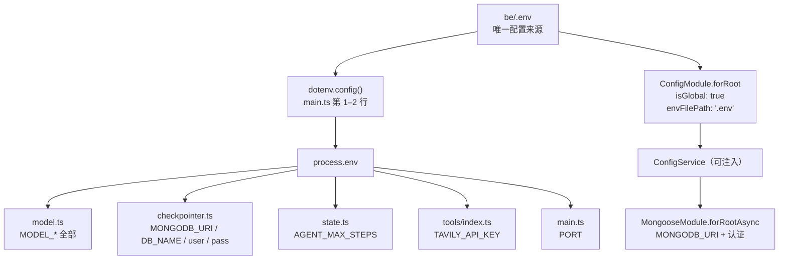
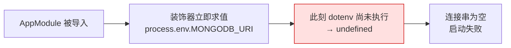
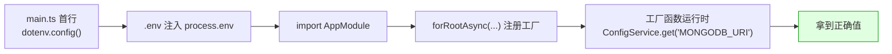

这一页只回答一个问题：**这个项目的配置是怎么被读进代码里的，以及为什么"模型 API Key"是唯一需要你亲手填的凭证**。它聚焦于环境变量的语义、默认值、读取机制与启动时序陷阱——不展开 LangGraph 图如何循环（见 [图状态设计](5-tu-zhuang-tai-she-ji-annotation-yu-dan-yong-hu-admin-shen-fen)），也不深入模型客户端的厂商适配细节（见 [统一模型客户端](13-tong-mo-xing-ke-hu-duan-openai-jian-rong-xie-yi-yu-han-shang-chai-yi-gua-pei)）。读完你应当能回答：我要填哪些变量、它们分别被哪段代码消费、填错了会在哪里报错。

Sources: [README.MD](README.MD#L1-L5), [be/README.md](be/README.md#L1-L7)

## 唯一凭证原则：为什么只需要一把 Key

理解这套配置体系，先要理解一次架构决策：**整个系统把认证层彻底删掉了**。没有登录、没有注册、没有邀请码、没有 JWT，所有请求都以一个内置用户 `admin` 的身份进入图。这意味着原本会让用户填写的一大堆凭证（用户名密码、token、密钥对）全部消失，配置面上只剩下两类"生存必需品"：一把打通模型服务的 **API Key**，一个打通 MongoDB 的**连接串**。

Sources: [README.MD](README.MD#L1-L3), [state.ts](be/src/ai/graph/state.ts#L4-L12)

代码把这个原则写得非常直白。模型配置的读取函数开头有一句注释："单用户模式下去掉了登录，用户唯一需要提供的就是模型 API Key。" 更关键的是它的失败路径——如果连 API Key 都没有，它抛出的不是笼统的 500，而是一个语义明确的错误："未配置模型 API Key：请在 be/.env 中设置 MODEL_API_KEY（或 OPENAI_API_KEY）"。换句话说，**系统把"缺少凭证"当成一件值得单独告知用户的事**，这正印证了它是唯一的用户侧凭证。

Sources: [model.ts](be/src/ai/model.ts#L11-L21)

因此在动手之前请先建立这个心智模型：`.env` 里变量虽多，但真正"阻断启动或阻断对话"的只有两个——`MODEL_API_KEY`（缺了首次对话返回 503）与 `MONGODB_URI`（缺了图无法执行）。其余变量都有合理默认值，或属于"按需开启"的可选项。

Sources: [.env.example](be/.env.example#L1-L27), [be/README.md](be/README.md#L123-L135)

## 配置来源全景：一个 `.env`，两条读取路径

后端的配置来源只有一个物理文件：`be/.env`。仓库里用 `.env.example` 作为模板，`.env` 本身被 git 忽略。但"读取"这件事在代码里却分成**两条路径**——这是本项目配置体系最值得先看清的结构。

Sources: [.gitignore](.gitignore#L1-L4), [be/.gitignore](be/.gitignore#L4-L5)

第一条路径是**直接读 `process.env`**。`main.ts` 开头先调用 `dotenv.config()`，把 `.env` 注入 `process.env`；随后 `model.ts`、`checkpointer.ts`、`state.ts`、`tools/index.ts`、`main.ts` 都直接从这里取值。第二条路径是 **NestJS 的 `ConfigModule` / `ConfigService`**：`app.module.ts` 里 `ConfigModule.forRoot({ isGlobal: true, envFilePath: '.env' })` 把配置变成可注入服务，`MongooseModule` 通过 `forRootAsync + ConfigService` 取出 `MONGODB_URI` 等值来建立连接。

Sources: [main.ts](be/src/main.ts#L1-L2), [app.module.ts](be/src/app.module.ts#L10-L31)

下图把这两条路径及其消费者一次画清：

两条路径最终都指向同一份 `.env`，区别在于**求值时机**：`ConfigService` 的值是异步工厂函数运行时才取的，而 `process.env` 的直读依赖 `dotenv.config()` 已经先执行。这个时机差异，正是下一节"启动时序陷阱"的全部根源。

Sources: [main.ts](be/src/main.ts#L1-L2), [app.module.ts](be/src/app.module.ts#L10-L31), [model.ts](be/src/ai/model.ts#L15-L29)

## 完整变量清单与默认值

下表是 `be/.env` 的全部变量。带"✅"的是真正需要你负责的项，其余基本可以保持模板原样。注意 `MODEL_API_KEY` 有一个隐蔽的备选：若它为空，代码会回退去读 `OPENAI_API_KEY`，方便习惯 OpenAI 命名的使用者。

| 变量 | 必填 | 默认值 | 被谁读取 | 作用 |
|---|---|---|---|---|
| `MODEL_API_KEY` | ✅（与 `OPENAI_API_KEY` 二选一） | 无 | model.ts | 模型凭证，缺失→503 |
| `OPENAI_API_KEY` | 备选 | 无 | model.ts | `MODEL_API_KEY` 的回退别名 |
| `MODEL_BASE_URL` | ❌ | `undefined` | model.ts | OpenAI 兼容端点，不设则用 SDK 默认 |
| `MODEL_NAME` | ❌ | `gpt-4o-mini` | model.ts | 模型名 |
| `MODEL_TEMPERATURE` | ❌ | `0.6` | model.ts | 采样温度 |
| `MODEL_DISABLE_THINKING` | ❌ | 不发送 | model.ts | 严格等于 `'true'` 时才发 `thinking.disabled` |
| `AGENT_MAX_STEPS` | ❌ | `8` | state.ts / AiOperator.ts | 单轮最大推理步数，防死循环 |
| `TAVILY_API_KEY` | ❌ | 无 | tools/index.ts | 设了就注册搜索工具 |
| `MONGODB_URI` | ✅ | 模板给 `mongodb://127.0.0.1:27017/chat_robot` | app.module.ts / checkpointer.ts | checkpoint 存储连接串 |
| `DB_NAME` | ❌ | URI 里的库名，否则 `chat_robot` | checkpointer.ts | checkpoint 库名 |
| `authSource` / `user` / `pass` | ❌ | 无 | app.module.ts / checkpointer.ts | MongoDB 认证（本地无认证留空） |
| `PORT` | ❌ | `3000` | main.ts | 后端监听端口 |

Sources: [.env.example](be/.env.example#L1-L27), [model.ts](be/src/ai/model.ts#L15-L49), [state.ts](be/src/ai/graph/state.ts#L21), [AiOperator.ts](be/src/ai/operator/AiOperator.ts#L42), [checkpointer.ts](be/src/ai/graph/checkpointer.ts#L18-L42), [main.ts](be/src/main.ts#L33), [be/README.md](be/README.md#L123-L135)

一个容易误读的细节：模板里给 `MODEL_BASE_URL` 填了 `https://api.deepseek.com`、`MODEL_NAME` 填了 `deepseek-chat`，但**代码里的真正默认值并非 DeepSeek**。`readModelSettings()` 里 `baseUrl` 的兜底是 `undefined`（交给 SDK 默认），`modelName` 的兜底是 `gpt-4o-mini`。也就是说模板值来自 `.env` 的实际内容，而不是代码兜底——若你删掉这两行又不去改代码，就会回落到 OpenAI 语义。这是一处"模板默认"与"代码默认"不一致的坑，值得留意。

Sources: [model.ts](be/src/ai/model.ts#L23-L28), [.env.example](be/.env.example#L3-L5)

## 模型配置的读取细节：唯一的构造点

所有与模型相关的变量都收敛在 `model.ts` 的一个函数里，这是刻意的设计——它保证"模型客户端只有一个构造点"，排查模型问题时只需看这一处。`readModelSettings()` 依次做三件事：先取 key（`MODEL_API_KEY` 优先，回退 `OPENAI_API_KEY`）、缺失即抛 `ServiceUnavailableException`；再组装 `modelName`、`baseUrl`、`temperature` 三个字段；最后交给 `createChatModel()` 构造 `ChatOpenAI`。

Sources: [model.ts](be/src/ai/model.ts#L15-L49)

`MODEL_DISABLE_THINKING` 的处理是最能体现"配置即行为"的一点。思考模式是 Kimi、Qwen 等厂商的私有参数，并非所有 OpenAI 兼容服务都认。因此代码采用**默认不发送**的策略——只有该变量严格等于字符串 `'true'` 时，才向请求里注入 `modelKwargs: { thinking: { type: 'disabled' } }`。这样同一份代码既能对接 DeepSeek/OpenAI（不发送该参数），也能对接需要显式关闭思考的厂商，而不至于让某个厂商因为不认识这个字段而报错。

Sources: [model.ts](be/src/ai/model.ts#L42-L49)

值得强调的第二个设计是**失败可恢复**。当 key 缺失时，`AiOperator` 初始化图的过程会失败，但它捕获错误后会把缓存的 `graphPromise` 置空，并附上注释："初始化失败（比如没配 API Key）时清空缓存，修好配置后无需重启即可重试"。这意味着你补好 `.env` 后可能不必重启服务——但前提是该进程能重新读到环境变量，具体边界涉及图组装，见 [图组装与可注入模型接口](8-tu-zu-zhuang-yu-ke-zhu-ru-mo-xing-jie-kou-rang-bian-pai-ke-ce-shi)。

Sources: [AiOperator.ts](be/src/ai/operator/AiOperator.ts#L29-L52)

## 优雅降级：可选变量如何改变系统行为

这套配置的第二个特征是**可选就是真的可选**——不填不会报错，只是功能按预期收窄。理解三种降级行为，能帮你在"最小可跑"和"完整功能"之间自由切换。

第一种是**搜索工具的条件启用**。`createTools()` 只在 `process.env.TAVILY_API_KEY` 存在时才注册 `TavilySearch`；否则返回空数组，图照样能跑，只是模型直接作答、不再具备联网搜索能力。工具描述本身会作为 prompt 进入上下文，所以"注册与否"直接改变了模型可用的能力面——这一机制详见 [工具注册表](14-gong-ju-zhu-ce-biao-gong-ju-miao-shu-ji-prompt-ke-xuan-gong-ju-de-tiao-jian-qi-yong)。

Sources: [tools/index.ts](be/src/ai/tools/index.ts#L6-L27)

第二种是**步数上限的默认兜底**。`AGENT_MAX_STEPS` 在两处被读取，且都用了 `Number(...) || 8` 的写法。这个双保险很关键：一是 `?? 8` 覆盖 `undefined`，二是 `|| 8` 兜住"非法数字→`NaN`"的情况，最终一定落到一个可用的整数上。它决定条件边何时走向 `limit` 出口，防止工具调用死循环烧 token——路由逻辑见 [条件边路由与步数上限](7-tiao-jian-bian-lu-you-yu-bu-shu-shang-xian-fang-zhi-gong-ju-diao-yong-si-xun-huan)。

Sources: [state.ts](be/src/ai/graph/state.ts#L20-L21), [AiOperator.ts](be/src/ai/operator/AiOperator.ts#L42)

第三种是**MongoDB 认证的惰性拼接**。`user` / `pass` / `authSource` 三个变量在 `app.module.ts` 里用展开运算符"有才加"：只有当 `user`、`pass` 存在时，连接参数里才会多出认证字段；`authSource` 也只有在存在时才追加。这使得"本地无认证 Mongo"与"云端带认证 Mongo"能用同一套代码平滑切换，本地开发者无需构造假的认证值。

Sources: [app.module.ts](be/src/app.module.ts#L17-L31), [.env.example](be/.env.example#L21-L24)

一个实现上的小差异值得初学者知道：同一个 `MONGODB_URI` 在**模块装配阶段**由 `ConfigService` 读取，而在 **checkpointer 惰性建连阶段**由 `process.env` 直读（且 `authSource` 兜底为 `'admin'`）。两处读的是同一个值、只是时机与默认值略有不同。这属于两套机制并存的自然结果，不必视为 bug，但也解释了你为何在代码里会看到"同一变量两种读法"。

Sources: [app.module.ts](be/src/app.module.ts#L20-L30), [checkpointer.ts](be/src/ai/graph/checkpointer.ts#L18-L42)

## 启动时序陷阱：装饰器求值早于 dotenv

这是本页最"考古"的一段——它记录了一个真实踩过的坑及其修复，理解它能解释"为什么 Mongoose 非要用 `forRootAsync`"。仓库里保存了一份修复记录，问题描述得很清楚：**装饰器内的表达式（如 `process.env.MONGODB_URI`）会在模块加载时立即求值，而 `dotenv.config()` 的执行时机可能晚于 `AppModule` 的加载**，于是此时 `process.env.MONGODB_URI` 还是 `undefined`，Mongo 连接串为空。

Sources: [修复环境变量加载问题.md](be/.trae/documents/修复环境变量加载问题.md#L1-L22)

用流程图对比"错误"与"正确"两种时序会更直观。错误版本里，模块一被导入，装饰器就急着求值，而 `.env` 还没被读进来：

修复后的正确版本把取值推迟到工厂函数运行时，并让 `dotenv.config()` 在所有 import 之前先跑：

最终代码用了两道保险叠加：其一是 `main.ts` 把 `import * as dotenv from 'dotenv'; dotenv.config();` 放在**所有其它 import 之前**，确保 `process.env` 在装饰器求值前已被填充；其二是 `MongooseModule.forRootAsync` + `ConfigService`，把取值推迟到异步工厂里。`app.module.ts` 里那段"用 forRootAsync + ConfigService 读取配置，避免模块文件在 dotenv 加载之前就读取 process.env"的注释，正是这个修复留下的现场记录。

Sources: [main.ts](be/src/main.ts#L1-L7), [app.module.ts](be/src/app.module.ts#L10-L31), [修复环境变量加载问题.md](be/.trae/documents/修复环境变量加载问题.md#L44-L62)

由此推出一条对初学者极重要的操作纪律：**必须在 `be/` 目录内启动后端**。`dotenv.config()` 默认读当前工作目录下的 `./.env`，`ConfigModule.forRoot` 的 `envFilePath` 也写的是相对路径 `'.env'`。若在仓库根目录用 `pnpm --prefix be start:dev` 之类方式启动，工作目录不是 `be/`，两个机制都会找不到 `.env`，于是又回到"变量全是 undefined"的老问题。

Sources: [main.ts](be/src/main.ts#L1-L2), [app.module.ts](be/src/app.module.ts#L10-L13)

## 配置安全：`.env` 永不入库

配置里藏着一把能花钱的 API Key，因此安全边界必须写死：`.env` 被 git 明确忽略，而 `.env.example` 作为模板被白名单放行。根 `.gitignore` 用的是"先忽略 `.env` 与 `.env.*`、再对 `.env.example` 取反放行"的组合拳，后端 `.gitignore` 也再次声明忽略 `.env`。这带来一个必然结果：**克隆下来的仓库里一定没有 `.env`**，你必须先 `cp .env.example .env` 再填值，否则启动即失败。

Sources: [.gitignore](.gitignore#L1-L4), [be/.gitignore](be/.gitignore#L4-L5), [be/README.md](be/README.md#L117-L121)

对应的操作建议也来自这份模板约定：复制模板后，**只需改动 `MODEL_API_KEY` 一行**通常就能跑起来（本地 Mongo 无需认证、DeepSeek 端点已预填）。这也再次回到本页主题——真正需要你亲手负责的机密，只有模型 API Key 这一个。

Sources: [README.MD](README.MD#L50-L56), [.env.example](be/.env.example#L1-L8)

## 前端配置：没有凭证，只有一个前缀

与后端形成鲜明对照的是前端——它**不持有任何凭证**。`fe/.env` 里唯一变量是 `VITE_API_BASE_URL`，默认值 `/dev`；前端代码只在拼接请求地址时读它一次：`import.meta.env.VITE_API_BASE_URL || '/dev'`。没有 key、没有 token，因为所有模型调用都由后端代劳。

Sources: [fe/.env.example](fe/.env.example#L1), [ai.ts](fe/src/api/ai.ts#L35)

需要提醒的是"配置"的二义性：`VITE_API_BASE_URL` 决定前端**写进请求 URL 的前缀**，而 Vite 开发服务器把 `/dev` 代理到后端 `localhost:3000` 的规则目前是**硬编码在 `vite.config.ts`** 里的，并未读取这个环境变量。两者都碰巧是 `/dev`，起步时不会出问题；但如果你改了 `VITE_API_BASE_URL` 想切换目标后端，还需同步修改 `vite.config.ts` 的代理 target，否则会出现"前缀变了、代理没变"的 404/502。代理与构建的完整说明见 [Vite 代理与 TypeScript 构建](22-vite-dai-li-yu-typescript-gou-jian-dev-qian-zhui-dao-hou-duan-3000)。

Sources: [vite.config.ts](fe/vite.config.ts#L12-L25), [ai.ts](fe/src/api/ai.ts#L35)

## 常见问题排查表

配置问题几乎都能归到下面几类。先按"现象"定位，再回到对应的小节确认机制。

| 现象 | 最可能原因 | 处理 |
|---|---|---|
| 首次对话返回 503，提示"未配置模型 API Key" | `MODEL_API_KEY` 为空且无 `OPENAI_API_KEY` | 在 `be/.env` 填真实 Key |
| 启动即报错、Mongo 连不上 | 缺 `.env`、或不在 `be/` 目录启动、或 `MONGODB_URI` 错 | `cp .env.example .env`；`cd be` 内启动；检查 URI |
| `process.env.xxx` 为 `undefined` | 在错误工作目录启动，`dotenv` 读不到 `.env` | 确保工作目录为 `be/` |
| 模型返回 404 / 找不到模型 | `MODEL_BASE_URL` 与 `MODEL_NAME` 厂商不匹配 | 两者成对修改（端点 + 模型名） |
| Kimi/Qwen 报未知参数 `thinking` | 该厂商不认思考参数却仍被发送 | 保持默认不发送；必要时设 `MODEL_DISABLE_THINKING=true` |
| 想联网搜索却一直不触发 | 未配 `TAVILY_API_KEY`，搜索工具未注册 | 配置该 Key（可选功能） |
| 对话陷入反复工具调用 | `AGENT_MAX_STEPS` 过大 | 调小该值（默认 8） |
| 改了 `VITE_API_BASE_URL` 仍连旧后端 | 代理 target 硬编码在 vite.config.ts | 同步改代理 target，或重启 dev server |

Sources: [model.ts](be/src/ai/model.ts#L15-L49), [app.module.ts](be/src/app.module.ts#L10-L31), [tools/index.ts](be/src/ai/tools/index.ts#L14-L27), [state.ts](be/src/ai/graph/state.ts#L21), [vite.config.ts](fe/vite.config.ts#L12-L25), [be/README.md](be/README.md#L123-L135)

## 接下来读什么

配置是"把钥匙交给系统"的一步，接下来最自然的延伸是看清这把钥匙被用在何处。建议依次阅读：

- 想弄清 `MONGODB_URI` 到底流向哪、checkpoint 怎么落库：[MongoDB Checkpointer：短期记忆的落库与读取](10-mongodb-checkpointer-duan-qi-ji-yi-de-luo-ku-yu-du-qu)
- 想弄清 `MODEL_BASE_URL`/`MODEL_NAME` 如何适配不同厂商：[统一模型客户端：OpenAI 兼容协议与厂商差异适配](13-tong-mo-xing-ke-hu-duan-openai-jian-rong-xie-yi-yu-han-shang-chai-yi-gua-pei)
- 想弄清 `ConfigModule` 与各模块的装配关系：[模块划分与依赖注入：ConfigModule 与 AiModule 的协作](16-mo-kuai-hua-fen-yu-yi-lai-zhu-ru-configmodule-yu-aimodule-de-xie-zuo)
- 想弄清 `TAVILY_API_KEY` 如何影响可用工具：[工具注册表：工具描述即 Prompt，可选工具的条件启用](14-gong-ju-zhu-ce-biao-gong-ju-miao-shu-ji-prompt-ke-xuan-gong-ju-de-tiao-jian-qi-yong)
- 想弄清 `AGENT_MAX_STEPS` 如何驱动路由：[条件边路由与步数上限：防止工具调用死循环](7-tiao-jian-bian-lu-you-yu-bu-shu-shang-xian-fang-zhi-gong-ju-diao-yong-si-xun-huan)