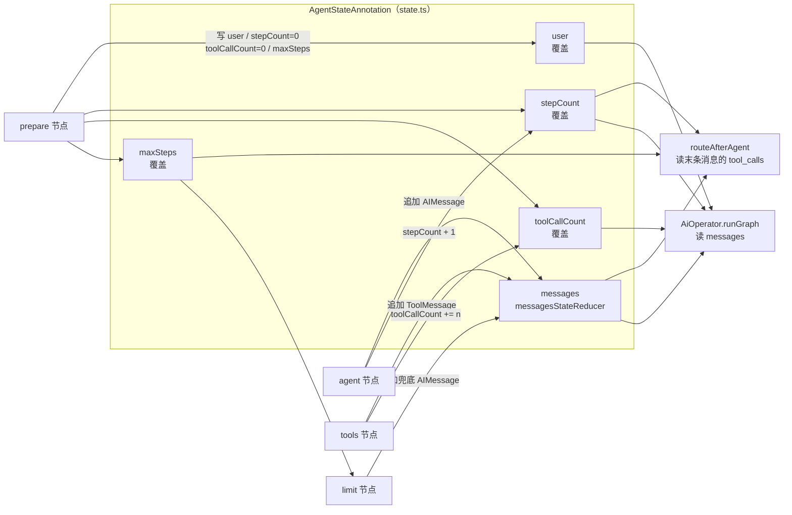
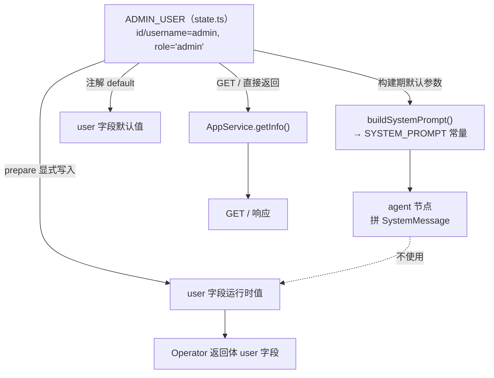
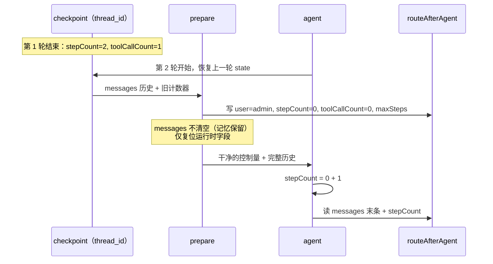
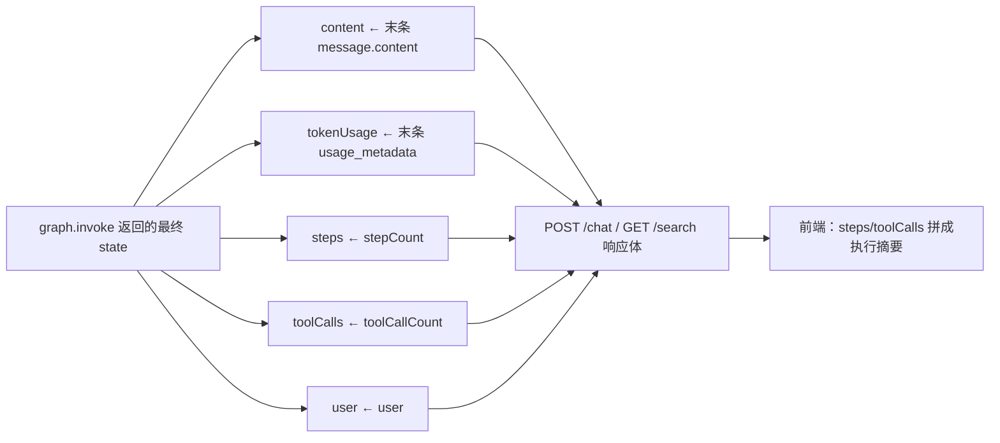

这一页只回答一个问题：**LangGraph 图里"状态"到底是什么、由谁定义、每个字段凭什么规则更新，以及为什么一个"没有登录"的系统仍然需要 `user` 字段**。范围严格限定在 `be/src/ai/graph/state.ts` 及其直接消费方（节点、条件边、Operator 出口契约），不展开四个节点的具体职责（见 [四类节点的职责：prepare / agent / tools / limit](6-si-lei-jie-dian-de-zhi-ze-prepare-agent-tools-limit)），也不讨论路由的完整判定表（见 [条件边路由与步数上限：防止工具调用死循环](7-tiao-jian-bian-lu-you-yu-bu-shu-shang-xian-fang-zhi-gong-ju-diao-yong-si-xun-huan)）与 checkpoint 的落库细节（见 [MongoDB Checkpointer：短期记忆的落库与读取](10-mongodb-checkpointer-duan-qi-ji-yi-de-luo-ku-yu-du-qu)）。

Sources: [state.ts](be/src/ai/graph/state.ts#L23-L56), [graph.ts](be/src/ai/graph/graph.ts#L24-L59)

## 状态即契约：五个字段各司其职

整个图的状态由 `AgentStateAnnotation` 一处集中声明，共五个字段。它们并不是并列的"数据袋子"，而是分属两个不同的语义层：`messages` 是**会被持久化的对话记忆**，其余四个字段是**单次运行的运行时控制量**。这个分层决定了后面所有设计（为什么需要 prepare 复位、为什么节点必须手写累加）的合理性。

Sources: [state.ts](be/src/ai/graph/state.ts#L23-L52)

| 字段 | 类型 | reducer 语义 | 默认值来源 | 谁写入 | 谁读取 |
|---|---|---|---|---|---|
| `messages` | `BaseMessage[]` | `messagesStateReducer`（追加/按 id 合并） | `() => []` | agent、tools、limit 节点 | agent（拼 prompt）、routeAfterAgent、Operator 出口 |
| `user` | `AdminUser` | 覆盖 | `{ ...ADMIN_USER }` | prepare 节点 | Operator 出口（回给前端） |
| `stepCount` | `number` | 覆盖 | `0` | agent 节点（`+1`） | routeAfterAgent（比对上限）、Operator 出口 |
| `toolCallCount` | `number` | 覆盖 | `0` | tools 节点（累加 ToolMessage 数） | Operator 出口 |
| `maxSteps` | `number` | 覆盖 | `DEFAULT_MAX_STEPS` | prepare 节点（由构图参数注入） | routeAfterAgent、limit 节点的提示文案 |

Sources: [state.ts](be/src/ai/graph/state.ts#L31-L52), [nodes.ts](be/src/ai/graph/nodes.ts#L18-L78), [edges.ts](be/src/ai/graph/edges.ts#L16-L26), [AiOperator.ts](be/src/ai/operator/AiOperator.ts#L129-L139)

下图把"字段声明 → 节点写入 → 消费点"的流向一次画清。注意 `maxSteps` 出现的两条独立来源（注解默认值与 prepare 覆盖）在后文有专门讨论：

Sources: [state.ts](be/src/ai/graph/state.ts#L31-L52), [nodes.ts](be/src/ai/graph/nodes.ts#L18-L78), [edges.ts](be/src/ai/graph/edges.ts#L16-L26), [AiOperator.ts](be/src/ai/operator/AiOperator.ts#L115-L140)

## Annotation.Root 提供了什么：schema、reducer、默认值

`Annotation.Root({...})` 接收一个"字段名 → 字段注解"的对象，每个字段用 `Annotation<T>({ reducer, default })` 声明三件事：**字段类型 `T`**、**更新时的合并函数 `reducer`**、**首次运行时的初始值工厂 `default`**。声明完成后，这个对象同时充当两个角色：既是 `new StateGraph(AgentStateAnnotation)` 的 schema 参数，也是 TypeScript 类型的来源。

Sources: [state.ts](be/src/ai/graph/state.ts#L31-L52), [graph.ts](be/src/ai/graph/graph.ts#L47-L47)

`state.ts` 末尾两行把这个对象"拆"成两个类型，这是理解节点函数签名的关键。`typeof AgentStateAnnotation.State` 是**完整状态**（每个字段都存在），用作节点与条件边的入参类型；`typeof AgentStateAnnotation.Update` 是**局部更新**（每个字段都可选），用作节点返回值类型。因此你会看到节点签名长这样：入参是 `AgentState`，返回值是 `AgentStateUpdate`——节点只声明"我要改哪些字段"，剩下的字段由图保留。

Sources: [state.ts](be/src/ai/graph/state.ts#L54-L55), [nodes.ts](be/src/ai/graph/nodes.ts#L20-L25)

| 类型 | 来源 | 语义 | 典型用途 | 代码证据 |
|---|---|---|---|---|
| `AgentState` | `typeof AgentStateAnnotation.State` | 所有字段必填的完整快照 | 节点的**入参**、条件边的**入参** | `async (state: AgentState)` |
| `AgentStateUpdate` | `typeof AgentStateAnnotation.Update` | 所有字段可选的增量 | 节点的**返回值** | `(): AgentStateUpdate => ({ user: ..., stepCount: 0 })` |

Sources: [state.ts](be/src/ai/graph/state.ts#L54-L55), [nodes.ts](be/src/ai/graph/nodes.ts#L32-L44), [edges.ts](be/src/ai/graph/edges.ts#L16-L16)

这个类型设计带来一个可测试性上的副作用：测试里可以直接构造一个"只有部分字段"的对象来喂给条件边。`routeAfterAgent` 的单元测试正是用 `({ messages, stepCount, maxSteps }) as AgentState` 这种断言绕过其余字段，把路由逻辑与整图执行解耦。

Sources: [graph.spec.ts](be/src/ai/graph/graph.spec.ts#L139-L155), [edges.ts](be/src/ai/graph/edges.ts#L16-L26)

## reducer 的两种范式，直接决定了节点的写法

状态设计里最容易踩错的地方不是字段该有几个，而是 **reducer 语义与节点返回值之间的关系**。本项目用到了截然不同的两种范式：

Sources: [state.ts](be/src/ai/graph/state.ts#L32-L51)

| 范式 | 声明方式 | 节点应返回什么 | 本项目实例 | 后果 |
|---|---|---|---|---|
| 追加/归并 | `reducer: messagesStateReducer` | **增量**（新消息数组，通常 1 条） | `messages` | 历史自然累积，与 checkpoint 配合形成短期记忆 |
| 覆盖 | `reducer: (_prev, next) => next` | **绝对终值**（必须自己读旧值再算） | `user`、`stepCount`、`toolCallCount`、`maxSteps` | 节点必须显式写 `state.x + 1`，否则计数器会被"归零" |

Sources: [state.ts](be/src/ai/graph/state.ts#L32-L51), [nodes.ts](be/src/ai/graph/nodes.ts#L40-L43)

代码把这个约定贯彻得很严格。`agent` 节点返回 `stepCount: state.stepCount + 1`，`tools` 节点返回 `toolCallCount: state.toolCallCount + toolMessages.length`——两处都必须先读入参再计算，因为覆盖型 reducer 不会替你做加法。这种写法比"隐式累加"多写几个字符，换来的是**每个节点的更新意图在代码里可见**：读一眼返回值就知道这一步对状态做了什么。测试则从外部锁定了这套语义——一次"模型调工具再回答"的运行，`stepCount` 为 2、`toolCallCount` 为 1。

Sources: [nodes.ts](be/src/ai/graph/nodes.ts#L40-L43), [nodes.ts](be/src/ai/graph/nodes.ts#L57-L60), [graph.spec.ts](be/src/ai/graph/graph.spec.ts#L63-L67)

对于 `messages`，项目的选择是把合并策略交给 LangChain 官方 reducer（`messagesStateReducer`），而不是自己写。这带来一个隐含能力：它支持基于消息 id 的**更新与删除**语义（这是 `messagesStateReducer` 的标准行为），本项目的节点目前只用到"追加"这一半。第一次运行时的 `default: () => []` 用工厂函数而非共享数组常量，避免多次调用之间互相污染。

Sources: [state.ts](be/src/ai/graph/state.ts#L32-L35)

## 单用户身份：admin 是一个模块级常量，不是一个会话对象

`ADMIN_USER` 是整个系统的"内置用户"，用 `as const` 声明为一个字面量常量对象：`id`、`username` 均为 `'admin'`，`role` 被收窄成字面量类型 `'admin'`。紧随其后的 `AdminUser` 类型刻意把 `role: 'admin'` 写成单元素字面量而不是 `string`——这是一个**类型层面的设计断言**：这个系统里不存在其他角色，任何试图构造 `role: 'user'` 的代码都会在编译期失败。

Sources: [state.ts](be/src/ai/graph/state.ts#L4-L18)

这个身份在代码里有四处落点，用途各不相同，值得分开看：

| 落点 | 位置 | 形态 | 实际作用 |
|---|---|---|---|
| 常量定义 | `state.ts` | `ADMIN_USER`（`as const`） | 全系统唯一的身份真相源 |
| 状态默认值与复位 | `state.ts` / `nodes.ts` | `default: () => ({ ...ADMIN_USER })`、prepare 节点显式写入 | 保证任何一次运行（含首次）都有确定身份 |
| 系统提示词 | `prompts.ts` | `buildSystemPrompt(user: AdminUser = ADMIN_USER)` → `SYSTEM_PROMPT` 常量 | 让模型"知道"自己在为谁服务 |
| HTTP 契约 | `app.service.ts` / `AiOperator` / `fe/src/api/ai.ts` | `GET /` 的 `mode: 'single-user'`、`/chat` 返回的 `user` 字段 | 把身份作为可观测数据暴露给调用方 |

Sources: [state.ts](be/src/ai/graph/state.ts#L8-L12), [state.ts](be/src/ai/graph/state.ts#L36-L39), [nodes.ts](be/src/ai/graph/nodes.ts#L18-L25), [prompts.ts](be/src/ai/graph/prompts.ts#L7-L20), [app.service.ts](be/src/app.service.ts#L6-L18), [AiOperator.ts](be/src/ai/operator/AiOperator.ts#L105-L112)

这里有一个容易被误读的细节，值得单独指出：**状态里的 `user` 字段并没有被送进 prompt**。`prompts.ts` 在模块加载时就以默认参数调用 `buildSystemPrompt()` 生成 `SYSTEM_PROMPT` 常量，它取的是 `ADMIN_USER`，而不是 `state.user`；`agent` 节点拼 prompt 时用的也是这个常量。也就是说 `state.user` 扮演的是**身份载体**（供 prepare 复位、供 Operator 回传），而 prompt 里的身份来自**常量**。两条路径目前指向同一个值，但耦合关系是"同源常量"而非"状态传递"。

Sources: [prompts.ts](be/src/ai/graph/prompts.ts#L7-L20), [nodes.ts](be/src/ai/graph/nodes.ts#L32-L44)

Sources: [state.ts](be/src/ai/graph/state.ts#L8-L12), [prompts.ts](be/src/ai/graph/prompts.ts#L20-L20), [nodes.ts](be/src/ai/graph/nodes.ts#L18-L25), [app.service.ts](be/src/app.service.ts#L6-L18)

理解这一点后，"无登录为什么还要有 `user`"的答案就清楚了：这不是鉴权的残留，而是**为未来的多用户留出的状态插槽 + 当下的可观测字段**。前端甚至已经按同一形状声明了 `ChatUser`（`role: 'admin'`）来对接响应；而有意思的是，前端聊天组件实际只渲染了 `steps` 与 `toolCalls` 两个字段拼成的执行摘要，`user` 目前是"契约里有、界面里没用"的状态。

Sources: [ai.ts](fe/src/api/ai.ts#L1-L19), [Chat.vue](fe/src/components/Chat.vue#L151-L157), [Chat.vue](fe/src/components/Chat.vue#L226-L233)

## 为什么必须有 prepare：记忆与运行时状态同居一栏

状态字段的注释写明了两者的生命周期差异：`messages` 由 checkpointer 按 `thread_id` 持久化（短期记忆），而 `stepCount` / `toolCallCount` 是"本次运行"的计量。但在 LangGraph 里，**这两类字段位于同一份被持久化的状态快照中**——只要配了 checkpointer，同一 `thread_id` 的下一轮运行会恢复到上一轮结束时的状态。

Sources: [state.ts](be/src/ai/graph/state.ts#L23-L30), [checkpointer.ts](be/src/ai/graph/checkpointer.ts#L44-L50)

如果不做复位，后果是可推演且严重的：`stepCount` 会跨轮累积，第二轮的第一次 agent 调用就可能直接满足 `stepCount >= maxSteps` 的条件边判定，整轮对话被推去 `limit` 兜底。这正是 `prepare` 节点存在的唯一理由——它的注释把动机写得很直白："有 checkpointer 时 state 会跨请求保留，因此计数器必须显式清零。"

Sources: [nodes.ts](be/src/ai/graph/nodes.ts#L14-L25), [edges.ts](be/src/ai/graph/edges.ts#L23-L25)

下图对比同一个 `thread_id` 下两轮运行的状态流转，可以直观看到 prepare 的作用点：

Sources: [nodes.ts](be/src/ai/graph/nodes.ts#L18-L25), [edges.ts](be/src/ai/graph/edges.ts#L16-L26), [graph.spec.ts](be/src/ai/graph/graph.spec.ts#L79-L104)

一个容易忽略的实现细节：`createPrepareNode` 返回的函数**不接收 `state` 参数**，直接返回常量更新对象。LangGraph 允许节点忽略入参，这恰好与 prepare 的语义一致——它只做覆盖，不读旧值。它同时演示了 `AgentStateUpdate` 的局部性：只写四个字段，`messages` 完全不动，历史因此自然保留。

Sources: [nodes.ts](be/src/ai/graph/nodes.ts#L18-L25), [graph.ts](be/src/ai/graph/graph.ts#L52-L53)

### maxSteps 的三层来源：注解默认值只是兜底

`maxSteps` 有三处独立取值，容易混淆，值得列成表对照：

| 层 | 位置 | 值 | 生效时机 |
|---|---|---|---|
| 注解默认值 | `state.ts` | `DEFAULT_MAX_STEPS = Number(process.env.AGENT_MAX_STEPS ?? 8) \|\| 8` | 状态首次初始化时（prepare 尚未运行） |
| 构图参数默认值 | `graph.ts` | `maxSteps = 8` | 调用 `buildChatGraph` 时未显式传参 |
| 生产注入值 | `AiOperator` | `Number(process.env.AGENT_MAX_STEPS ?? 8) \|\| 8` | 每次运行由 prepare 写入，**最终生效值** |

Sources: [state.ts](be/src/ai/graph/state.ts#L20-L21), [state.ts](be/src/ai/graph/state.ts#L48-L51), [graph.ts](be/src/ai/graph/graph.ts#L41-L48), [AiOperator.ts](be/src/ai/operator/AiOperator.ts#L38-L43)

理清三者的关系：生产路径上 `AiOperator` 读环境变量传给 `buildChatGraph`，再由 `createPrepareNode(maxSteps)` 闭包捕获、在每次运行时写入 state，因此**注解默认值在正常对话里几乎从不显形**，它兜住的是"prepare 尚未执行"的窗口与不经过图的直接状态构造（例如单元测试）。`Number(...) || 8` 这个双重兜底的写法（`??` 挡 `undefined`、`||` 挡 `NaN`）在两层各出现一次，是刻意的冗余。

Sources: [AiOperator.ts](be/src/ai/operator/AiOperator.ts#L42-L42), [state.ts](be/src/ai/graph/state.ts#L21-L21), [graph.spec.ts](be/src/ai/graph/graph.spec.ts#L140-L155)

## messages 的设计：系统提示词刻意不进历史

`messages` 是唯一会被持久化的字段，因此"什么东西允许进入这个数组"本身就是一个状态设计决策。项目给出的答案是：**系统提示词永远不写入历史**。`agent` 节点在调用模型前先 `filter` 掉所有 `getType() === 'system'` 的消息，再把 `SYSTEM_PROMPT` 临时拼在数组最前面。

Sources: [nodes.ts](be/src/ai/graph/nodes.ts#L27-L44)

动机是明确的防膨胀设计：如果每轮都把 system message 追加进 state，checkpoint 里会随轮次堆积重复的系统提示词，既浪费 token 又污染上下文。过滤 + 临时拼接的方案让 checkpoint 中的 `messages` 只包含真实的对话轨迹（`human` / `ai` / `tool` 三类）。

Sources: [nodes.ts](be/src/ai/graph/nodes.ts#L35-L38), [graph.spec.ts](be/src/ai/graph/graph.spec.ts#L69-L77)

| 消息类型 | 是否进入 checkpoint 的 `messages` | 产生者 | 证据 |
|---|---|---|---|
| `system` | ❌ 不进入（每次调用时临时拼接） | `SYSTEM_PROMPT` 常量 | 模型第一次调用收到 2 条：system + 用户消息 |
| `human` | ✅ | `AiOperator.runGraph` 的 `HumanMessage` | 入参构造 |
| `ai` | ✅（含带 `tool_calls` 的 AIMessage） | agent / limit 节点 | 返回值 `messages: [response]` |
| `tool` | ✅ | tools 节点（`ToolNode` 产出） | 第二次调用可见第 4 条为 `tool` 类型 |

Sources: [AiOperator.ts](be/src/ai/operator/AiOperator.ts#L115-L122), [nodes.ts](be/src/ai/graph/nodes.ts#L38-L43), [nodes.ts](be/src/ai/graph/nodes.ts#L53-L61), [graph.spec.ts](be/src/ai/graph/graph.spec.ts#L69-L76)

这套设计在测试里留下了可验证的指纹：第一轮第二轮对话中，模型第二次收到 6 条消息（system + 上一轮 4 条 + 新的用户消息），且换一个 `thread_id` 后立刻掉回 2 条（system + 用户消息）。这同时证明了"历史属于 `messages` 字段 + `thread_id` 分区"这一状态契约。

Sources: [graph.spec.ts](be/src/ai/graph/graph.spec.ts#L97-L112)

## 状态如何跨层：从图输出变成 HTTP 遥测

状态字段的最后一个职责是充当**图与 HTTP 层之间的读数契约**。`AiOperator.runGraph` 在 `graph.invoke` 返回后，从结果状态里取四样东西：末条消息的文本内容、`usage_metadata`、`stepCount`、`toolCallCount`，以及 `user`（缺省为 `null`）。这意味着计数器不只是内部控制量，还是**对外可观测的运行时指标**。

Sources: [AiOperator.ts](be/src/ai/operator/AiOperator.ts#L115-L140)

Sources: [AiOperator.ts](be/src/ai/operator/AiOperator.ts#L129-L139), [Chat.vue](fe/src/components/Chat.vue#L151-L157)

## 设计权衡：这套 schema 的取舍

把上述决策并排看，可以归纳出一组清晰的取舍，它们解释了为什么这份状态定义只有 56 行却足以支撑完整 agent 循环：

| 设计决策 | 收益 | 代价 / 约束 |
|---|---|---|
| 状态集中声明于 `Annotation.Root` | 单一 schema 同时产出类型与图结构，节点只依赖类型 | 新增字段必须回到同一文件改，且要考虑 reducer 语义 |
| `messages` 用官方 reducer | 追加语义开箱可用，兼容按 id 更新/删除 | 需要额外设计"什么不进历史"（system prompt 过滤） |
| 其余字段用覆盖 reducer | 更新意图显式可读，避免隐式累加歧义 | 每个节点必须手写 `state.x + n`，漏写即丢计数 |
| 运行时状态与记忆同居一栏 | 免去第二套 schema，`prepare` 一处复位即可 | 强依赖 `prepare` 作为首节点，图结构不能随意裁剪 |
| 身份用 `as const` 常量 + 字面量类型 | 编译期排除非法角色，无用户表、无鉴权链路 | 多租户改造需把身份从"常量"变为"入参"，涉及 prepare 与 prompt 两处 |

Sources: [state.ts](be/src/ai/graph/state.ts#L8-L56), [nodes.ts](be/src/ai/graph/nodes.ts#L14-L62), [graph.ts](be/src/ai/graph/graph.ts#L47-L58)

从扩展角度看，这套结构预留的接口是清晰的：`user` 字段已经在状态里、已经在响应契约里、前端也已经声明了对应类型，缺的只是"谁来写它"。一旦需要多用户，改动点集中在 `prepare` 节点（改为从运行入参而非常量取值）与 `buildSystemPrompt` 的调用方式（从模块级常量改为运行时按身份构建）。当前"常量同源"的设计在这个改造下会从"隐藏耦合"变成"显式依赖"，这也是为什么前面要特别强调 `state.user` 与 prompt 之间目前并无数据流。

Sources: [state.ts](be/src/ai/graph/state.ts#L36-L39), [nodes.ts](be/src/ai/graph/nodes.ts#L18-L25), [prompts.ts](be/src/ai/graph/prompts.ts#L7-L20), [ai.ts](fe/src/api/ai.ts#L1-L19)

## 小结与阅读线索

`state.ts` 建立的是三层约定：**schema 层**（五个字段、两种 reducer、类型双导出）、**生命周期层**（`messages` 持久化 vs 四个运行时控制量）、**身份层**（`admin` 常量 + 字面量类型，无鉴权链路）。后续三页都在消费这份契约：节点如何读写这些字段见 [四类节点的职责：prepare / agent / tools / limit](6-si-lei-jie-dian-de-zhi-ze-prepare-agent-tools-limit)；`stepCount` / `maxSteps` 如何驱动分支见 [条件边路由与步数上限：防止工具调用死循环](7-tiao-jian-bian-lu-you-yu-bu-shu-shang-xian-fang-zhi-gong-ju-diao-yong-si-xun-huan)；`AgentStateAnnotation` 如何作为 schema 传给 `StateGraph`、以及模型如何被抽象成可注入接口见 [图组装与可注入模型接口：让编排可测试](8-tu-zu-zhuang-yu-ke-zhu-ru-mo-xing-jie-kou-rang-bian-pai-ke-ce-shi)。若想弄清这套状态为何"必须复位"、以及 `thread_id` 到底分区了什么，继续读 [MongoDB Checkpointer：短期记忆的落库与读取](10-mongodb-checkpointer-duan-qi-ji-yi-de-luo-ku-yu-du-qu) 与 [thread_id 生命周期：sessionId 与「清空对话」的语义](11-thread_id-sheng-ming-zhou-qi-sessionid-yu-qing-kong-dui-hua-de-yu-yi)。