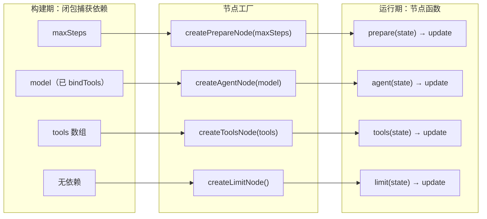
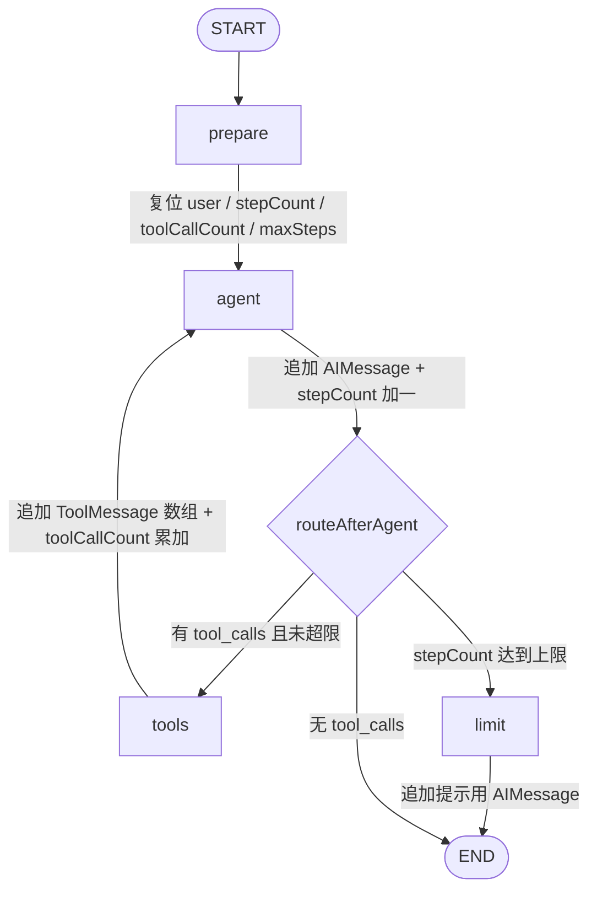

整个 agent 循环能否成立，取决于四个节点各自把「一件事」做干净：`prepare` 负责复位、`agent` 负责思考、`tools` 负责动手、`limit` 负责止损。本页聚焦这四类节点的**实现契约**——每个节点读什么、写什么、为什么只能写这些；至于状态字段本身的语义、条件边的判定规则、图的编译方式，分别属于 [图状态设计：Annotation 与单用户 admin 身份](5-tu-zhuang-tai-she-ji-annotation-yu-dan-yong-hu-admin-shen-fen)、[条件边路由与步数上限：防止工具调用死循环](7-tiao-jian-bian-lu-you-yu-bu-shu-shang-xian-fang-zhi-gong-ju-diao-yong-si-xun-huan) 与 [图组装与可注入模型接口：让编排可测试](8-tu-zu-zhuang-yu-ke-zhu-ru-mo-xing-jie-kou-rang-bian-pai-ke-ce-shi) 的讨论范围。

四个节点在代码里都以**工厂函数**（`createXxxNode`）的形式存在，全部集中在同一个文件里。它们的名称并非随手取的字符串：`prepare` / `agent` 以字面量登记，`tools` / `limit` 复用边模块导出的常量，从而让「节点名」与「路由目标」共享同一个符号来源，避免改名后路由悄悄失效。

Sources: [nodes.ts](be/src/ai/graph/nodes.ts#L1-L79), [graph.ts](be/src/ai/graph/graph.ts#L6-L11)

| 节点 | 一句话职责 | 读取的状态 | 写入的状态 | 是否追加消息 |
|---|---|---|---|---|
| `prepare` | 每轮开始复位运行时字段 | 无（完全忽略入参） | `user`、`stepCount`、`toolCallCount`、`maxSteps` | 否 |
| `agent` | 拼系统提示词并调用模型 | `messages`、`stepCount` | `messages`（追加 AIMessage）、`stepCount` | 是（1 条 AIMessage） |
| `tools` | 执行上一条 AIMessage 的 tool_calls | `messages`、`toolCallCount` | `messages`（追加 ToolMessage[]）、`toolCallCount` | 是（N 条 ToolMessage） |
| `limit` | 产出「已停手」的终局消息 | `maxSteps` | `messages`（追加 AIMessage） | 是（1 条 AIMessage） |

Sources: [nodes.ts](be/src/ai/graph/nodes.ts#L18-L78)

## 统一形态：工厂函数 + 闭包注入

四个节点的签名刻意保持一致的外壳：工厂接收**构建期依赖**（模型、工具数组、步数上限），返回一个「拿 state 换 update」的节点函数。这种分层带来两个直接收益：其一，LangGraph 要求的节点签名 `(state, config) => update` 保持单纯，节点内部不出现任何 `process.env` 读取或单例查找；其二，依赖在图构建那一刻被**冻结**，测试里换成假模型不需要改图之外的任何代码。



Sources: [nodes.ts](be/src/ai/graph/nodes.ts#L18-L78), [graph.ts](be/src/ai/graph/graph.ts#L47-L51)

值得注意的是依赖的**形状**被压到了最小：`agent` 只要求实现一个 `ChatModelLike` 接口——一个能 `invoke(messages, options?)` 并返回 `AIMessage` 的对象——而不是具体的 `ChatOpenAI`；`tools` 则接受 `any[]`。前者是显式的类型契约（为了让假模型合法），后者是务实放宽（LangChain 的工具类型家族太宽，`StructuredTool`、`DynamicTool`、`RunnableToolLike` 都可能是成员）。

Sources: [nodes.ts](be/src/ai/graph/nodes.ts#L6-L12), [nodes.ts](be/src/ai/graph/nodes.ts#L50-L51)

## prepare：唯一忽略入参的节点

`prepare` 是四者中最反直觉的一个——它的签名声明了一个零参数函数，**根本不看传进来的 state**，直接返回一份常量 update。写死的四个字段构成一份「本轮运行基线」：用户身份固定为内置 `admin`、两个计数器归零、`maxSteps` 从闭包取。

```typescript
export const createPrepareNode =
  (maxSteps: number) =>
  (): AgentStateUpdate => ({
    user: { ...ADMIN_USER },
    stepCount: 0,
    toolCallCount: 0,
    maxSteps,
  });
```

Sources: [nodes.ts](be/src/ai/graph/nodes.ts#L14-L25)

`user` 用展开运算符生成**新对象**而非直接引用 `ADMIN_USER`，是为了避开共享可变引用——`ADMIN_USER` 是 `as const` 的模块级常量，一旦被下游就地修改就会污染所有后续请求。计数器必须显式清零的原因不在节点本身，而在于 checkpointer：`stepCount` / `toolCallCount` 与 `messages` 同居一个 state，消息历史按 `thread_id` 跨请求保留时，计数器也会一起被恢复；不复位就意味着第二轮对话一开始就被判定为「已超限」。这一取舍的完整论证见状态设计页，这里只需记住结论：**复位不是防御性编程，而是 checkpointer 语义的必然补丁。**

Sources: [nodes.ts](be/src/ai/graph/nodes.ts#L14-L25), [state.ts](be/src/ai/graph/state.ts#L36-L51)

`maxSteps` 的取值链条值得单独提醒：`state.ts` 里 `DEFAULT_MAX_STEPS`（读 `AGENT_MAX_STEPS`，默认 8）只是注解的兜底默认值，真正生效的是 `prepare` 从闭包写入的值，而闭包的值来自 `buildChatGraph` 的 `maxSteps` 参数（默认 8），最终由 `AiOperator` 用同一份环境变量传入。三处默认值必须一起理解，否则调大 `AGENT_MAX_STEPS` 后奇怪地发现上限没变——如果某处调用 `buildChatGraph` 时没显式传 `maxSteps`，`prepare` 会用 `buildChatGraph` 的硬编码 8 覆盖注解默认值。

Sources: [state.ts](be/src/ai/graph/state.ts#L20-L21), [state.ts](be/src/ai/graph/state.ts#L48-L51), [graph.ts](be/src/ai/graph/graph.ts#L41-L51), [AiOperator.ts](be/src/ai/operator/AiOperator.ts#L38-L43)

## agent：临时拼装系统提示词，并把步数推进一格

`agent` 承担两件事。第一件是**上下文装配**：从 `state.messages` 中过滤掉所有 `system` 类型的消息，再把一份全新的 `SystemMessage` 拼到最前面后交给模型。这个「过滤 + 重拼」组合解决的是长期运行下的历史膨胀问题——如果 system prompt 作为普通消息写进历史，带 checkpointer 的多轮对话会让它在 checkpoint 里不断累积重复副本；而每次调用前临时拼一次，既保证了提示词永远只有一份且总是位于最前，也让提示词可以随部署单独升级而不受历史污染。

Sources: [nodes.ts](be/src/ai/graph/nodes.ts#L27-L38), [prompts.ts](be/src/ai/graph/prompts.ts#L7-L20)

第二件是**计量**：返回值里的 `messages: [response]` 交给 `messagesStateReducer` 追加，`stepCount: state.stepCount + 1` 则通过覆盖型 reducer 直接推进。由于累加发生在模型调用成功之后，`stepCount` 的语义精确地等于「本轮模型被调用的次数」，而不是「图经过的节点数」——这正是步数上限能够对齐 token 成本的原因，也让条件边可以用 `stepCount >= maxSteps` 做单点判断。提示词中「什么时候该调用工具」的规则与之配合：规则写进 prompt 影响模型行为，步数上限则在其失效时兜底。

Sources: [nodes.ts](be/src/ai/graph/nodes.ts#L38-L44), [state.ts](be/src/ai/graph/state.ts#L40-L43)

## tools：ToolNode 的薄包装，加一层计数器

`tools` 节点并不自己解析 tool_calls、也不自己组装 `ToolMessage`——它把执行细节全部委托给 LangGraph 预置的 `ToolNode`，自己只做**调用与计数**：把 `state.messages` 原样递进去，从返回值里取 `messages` 数组，然后按该数组长度累加 `toolCallCount`。包装的全部意义就在于这行计数：没有它，`ToolNode` 本身不会向 state 贡献任何关于「执行了几次工具」的信息。

Sources: [nodes.ts](be/src/ai/graph/nodes.ts#L46-L62)

理解这层包装需要知道 `ToolNode` 的三个行为约定。**其一，定位方式**：它从消息数组末尾向前找到最近一条 `AIMessage`，逐个 `Promise.all` 并行执行其 `tool_calls`，并为每个 call 产出一条 `ToolMessage`——所以 `toolCallCount` 累加的是**消息条数**而非 `tool_calls` 的声明数。**其二，跳过已完成**：它会先收集历史中已有的 `ToolMessage` 的 `tool_call_id`，过滤掉这些 id 对应的 call，因此重复进入 `tools` 节点不会导致同一个工具被重复执行。**其三，错误不中断图**：`handleToolErrors` 默认为 `true`，工具抛错（包括工具名不存在）会被捕获并转成 `status: "error"` 的 `ToolMessage`，内容是 `Error: ... Please fix your mistakes.`，回灌给模型自行修正——这正是 `tools` 节点注释里「工具执行失败不会中断图」的实现依据。

Sources: [tool_node.js](be/node_modules/@langchain/langgraph/dist/prebuilt/tool_node.js#L128-L196), [nodes.ts](be/src/ai/graph/nodes.ts#L46-L49)

这条「错误回灌」路径解释了系统提示词为何要写「工具返回错误时，先判断是参数问题还是工具不可用，必要时换一种方式重试一次」——模型收到的不是异常，而是一条带错误语义的正常对话消息，能否自我修正完全取决于提示词是否教会了它如何解读 `status: "error"`。同时要留意包装层的形状假设：`ToolNode` 在没有任何输出是 `Command` 时才返回 `{ messages: [...] }`，否则会退化成拼接后的数组；一旦引入返回 `Command` 的工具，`result?.messages` 就会取到 `undefined`，`toolMessages` 变成空数组，消息与计数同时丢失。当前工具集（Tavily 搜索）返回纯值，因此这个假设成立。

Sources: [tool_node.js](be/node_modules/@langchain/langgraph/dist/prebuilt/tool_node.js#L198-L215), [nodes.ts](be/src/ai/graph/nodes.ts#L53-L60), [tools/index.ts](be/src/ai/tools/index.ts#L14-L27)

## limit：把「停手」变成一句可读的回答

`limit` 节点的实现短到几乎不需要解释：返回一条 `AIMessage`，内容是告知用户「已达到单轮最大推理步数（${state.maxSteps} 步），已停止继续调用工具」，并建议把问题拆小。它不碰任何计数器——因为此时计数已经说明了问题，再多写一个字段只会让状态更难读。

Sources: [nodes.ts](be/src/ai/graph/nodes.ts#L64-L78)

这个设计有一处容易被忽略的连带效果：`limit` 是 `limit → END` 的终点，它追加的 `AIMessage` 成为整个 state 的**最后一条消息**，而编排层正是取最后一条消息的文本作为 HTTP 响应内容。也就是说，用户看到的不是一个小标题或状态码，而是一句完整的、可直接阅读的解释——止损路径被当作正常回答路径来交付。同时，这条消息通过 `messages` 的追加型 reducer 进入历史并随 checkpoint 落库，下一轮对话中模型能看到自己「上一轮被拦下了」，这也是提示词里要求拆小问题的现实理由。

Sources: [nodes.ts](be/src/ai/graph/nodes.ts#L68-L78), [AiOperator.ts](be/src/ai/operator/AiOperator.ts#L129-L139), [graph.ts](be/src/ai/graph/graph.ts#L56)

## 一轮运行中 state 的四次写入

把四个节点按执行顺序铺开，可以看到一条清晰的写入序列：`prepare` 独占「复位」，`agent` 与 `tools` 在循环中交替推进各自的计数，`limit` 只在异常收敛点追加一条消息。没有任何字段被两个节点共同维护——这个「字段所有权单一」的性质，是四节点分工能够互相独立测试的前提。



Sources: [graph.ts](be/src/ai/graph/graph.ts#L24-L56), [nodes.ts](be/src/ai/graph/nodes.ts#L18-L78)

| 观察点 | 具体表现 | 为什么这样设计 |
|---|---|---|
| 复位只发生一次 | `prepare` 只有 `START → prepare` 一条入边 | 循环在 `agent ↔ tools` 之间，重新进入 `prepare` 会丢掉本轮计数 |
| 计数分两个维度 | `stepCount` 数模型调用，`toolCallCount` 数工具消息 | 前者决定停机，后者只用于对外遥测（`steps` / `toolCalls`） |
| 消息只被追加 | 四个节点写入 `messages` 时都不做替换 | `messagesStateReducer` 负责合并，节点无需了解历史长度 |
| 终局消息可互换 | `limit` 与正常 `agent` 的产出同为 `AIMessage` | 编排层无需分支处理，最后一条消息即答案 |

Sources: [nodes.ts](be/src/ai/graph/nodes.ts#L18-L78), [AiOperator.ts](be/src/ai/operator/AiOperator.ts#L129-L139), [state.ts](be/src/ai/graph/state.ts#L31-L35)

## 可测性契约：节点是纯函数，模型是可替换接口

四节点设计最实际的回报出现在测试里。因为 `agent` 只依赖 `ChatModelLike`、`tools` 只依赖一个工具数组，可以写一个**脚本化假模型**：每次 `invoke` 记录收到的消息数组、按调用序号从脚本里取下一条响应。测试由此能断言三件与节点职责直接相关的事：第一次调用模型看到「system + 用户消息」共 2 条、第二次看到「system + 用户 + AIMessage(tool_calls) + ToolMessage」共 4 条（证明 `agent` 每次重拼提示词、`tools` 确实把工具结果写回了历史）；工具循环一轮后 `stepCount === 2` 而 `toolCallCount === 1`（证明两个计数器互不干扰）。

Sources: [graph.spec.ts](be/src/ai/graph/graph.spec.ts#L9-L77)

`limit` 节点的测试同样直接验证了它的边界语义：在模型永不结束、`maxSteps = 3` 的场景下，最终 `stepCount === 3`、历史中有 2 条 ToolMessage、最后一条消息包含「最大推理步数」、且模型恰好只被调用 3 次——即第 3 次模型调用之后图直接进入 `limit`，不会再有一次「执行工具」的机会。这条断言同时锁定了节点行为与边行为之间的接缝，是理解「为什么上限节点必须独立存在」的最短路径。

Sources: [graph.spec.ts](be/src/ai/graph/graph.spec.ts#L115-L136)

## 易错点速查

| 症状 | 根因 | 定位 |
|---|---|---|
| 第二轮对话立刻返回「已达最大推理步数」 | `prepare` 未在每轮运行开始执行，`stepCount` 从 checkpoint 被恢复 | `START → prepare` 固定边 |
| 调大 `AGENT_MAX_STEPS` 后上限没变 | `buildChatGraph` 的 `maxSteps` 形参默认 8，覆盖了注解默认值 | `prepare` 闭包传入值 |
| 历史里堆满重复的系统提示词 | 把 system message 当普通消息写回 state | `agent` 的过滤 + 临时拼接 |
| 工具报错导致整个请求 502 | 未使用 `ToolNode`（`handleToolErrors` 默认为真），异常直接冒泡 | `tools` 节点委托实现 |
| 计数器与工具调用数对不上 | `toolCallCount` 统计的是 ToolMessage 条数，且已完成的 call 会被跳过 | `ToolNode` 的 id 去重逻辑 |

Sources: [nodes.ts](be/src/ai/graph/nodes.ts#L14-L62), [graph.ts](be/src/ai/graph/graph.ts#L41-L58), [tool_node.js](be/node_modules/@langchain/langgraph/dist/prebuilt/tool_node.js#L128-L196)

## 小结与阅读线索

四个节点可以被压缩成一组对称的承诺：`prepare` 只做复位且不读输入，`agent` 只读历史并追加一条 AI 消息、推进步数，`tools` 只执行并追加工具消息、累加调用数，`limit` 只追加一条可读的终局消息。字段所有权清晰、依赖经由工厂闭包注入、消息一律追加——这三点让每个节点都能被单独替换与单独断言。

接下来若想弄清「`agent` 之后到底走哪条边、为什么不直接结束」的判定细节，请继续阅读 [条件边路由与步数上限：防止工具调用死循环](7-tiao-jian-bian-lu-you-yu-bu-shu-shang-xian-fang-zhi-gong-ju-diao-yong-si-xun-huan)；若想了解这四个节点如何被 `addNode` / `addEdge` 串成可编译的图、以及 `model` 为何要在外部先 `bindTools`，请看 [图组装与可注入模型接口：让编排可测试](8-tu-zu-zhuang-yu-ke-zhu-ru-mo-xing-jie-kou-rang-bian-pai-ke-ce-shi)；系统提示词里那些直接影响 `agent` 是否调用工具的规则，则在 [系统提示词工程：把身份与工具使用规则写进 Prompt](9-xi-tong-ti-shi-ci-gong-cheng-ba-shen-fen-yu-gong-ju-shi-yong-gui-ze-xie-jin-prompt) 中展开；`tools` 节点能拿到什么工具，取决于 [工具注册表：工具描述即 Prompt，可选工具的条件启用](14-gong-ju-zhu-ce-biao-gong-ju-miao-shu-ji-prompt-ke-xuan-gong-ju-de-tiao-jian-qi-yong)。