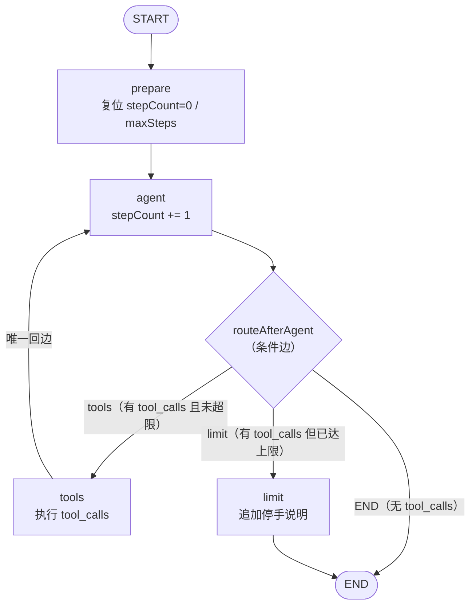
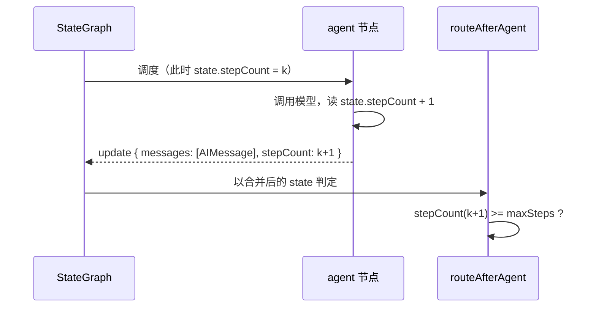

`agent → tools → agent` 这条回边是整个系统唯一可能无限转下去的路径。本页只讨论一件事：**LangGraph 如何在每一次模型返回之后决定「继续调工具 / 收工 / 强制停手」，以及 `stepCount` 与 `maxSteps` 的边界判定为什么必须写成现在这个顺序**。节点内部的读写契约见 [四类节点的职责：prepare / agent / tools / limit](6-si-lei-jie-dian-de-zhi-ze-prepare-agent-tools-limit)，状态字段的 reducer 语义见 [图状态设计：Annotation 与单用户 admin 身份](5-tu-zhuang-tai-she-ji-annotation-yu-dan-yong-hu-admin-shen-fen)；本页聚焦判定逻辑本身。

Sources: [edges.ts](be/src/ai/graph/edges.ts#L10-L34), [graph.ts](be/src/ai/graph/graph.ts#L24-L59)

## 循环的形状：一条回边、三个出口

整张图的拓扑可以用一句话概括：**只有 `tools → agent` 这一条回边**，其余全部是前进边。正因为只有一条回边，防死循环的讨论可以收敛到一个点上——`agent` 之后的那条条件边。图构建代码里三处关键配置分别是：`agent` 挂条件边并配路径映射、`tools` 无条件回到 `agent`、`limit` 无条件指向 `END`。

Sources: [graph.ts](be/src/ai/graph/graph.ts#L47-L58)



这张图暴露了一个容易忽略的事实：**`limit` 不是「循环的中断点」，而是循环的一个终点分支**。它与 `END` 同级挂在条件边上，而不是插在 `agent → tools` 之间。因此「防止死循环」不是靠某个节点抛异常中止，而是靠路由函数**在进入 `tools` 之前改道**——工具一次都不会多执行。

Sources: [graph.ts](be/src/ai/graph/graph.ts#L54-L56), [nodes.ts](be/src/ai/graph/nodes.ts#L64-L78)

## routeAfterAgent：三段判定的顺序就是语义

路由函数本体只有十行，但它把「优先级」写进了代码顺序里：

```typescript
const lastMessage = state.messages[state.messages.length - 1];
const toolCalls =
  lastMessage && lastMessage.getType() === 'ai'
    ? ((lastMessage as AIMessage).tool_calls ?? [])
    : [];

if (toolCalls.length === 0) return END;              // ① 有答案 → 收工
if (state.stepCount >= state.maxSteps) return NODE_LIMIT;  // ② 还要调工具但超限 → 停手
return NODE_TOOLS;                                   // ③ 否则 → 继续调工具
```

Sources: [edges.ts](be/src/ai/graph/edges.ts#L16-L26)

判定顺序决定了三种状态的优先关系，可以整理成一张完备的决策矩阵（`stepCount` 与 `maxSteps` 大小的三种关系 × 有无 `tool_calls`，共六种组合，实际上只有三行返回）：

| 末条消息 | `stepCount` 与 `maxSteps` | 返回值 | 语义 |
|---|---|---|---|
| 无 `tool_calls` | 任意（包含已超限） | `END` | **模型给出了最终回答，答案优先于上限** |
| 有 `tool_calls` | `stepCount < maxSteps` | `tools` | 正常循环，执行工具后回到 `agent` |
| 有 `tool_calls` | `stepCount >= maxSteps` | `limit` | 模型还想调工具，但预算已用完 |

Sources: [edges.ts](be/src/ai/graph/edges.ts#L23-L25), [graph.spec.ts](be/src/ai/graph/graph.spec.ts#L139-L156)

**为什么第 ① 条必须排在第 ② 条前面**，是这段代码最值得展开的设计点。假设反过来先判上限，那么当模型恰好在第 `maxSteps` 步给出了一个完整的最终答案（这是最常见的好情况——模型最后一步往往就是总结），路由仍会把它推向 `limit`，用户的真实回答会被一句「已达到最大推理步数」覆盖掉。把 `toolCalls.length === 0` 放在最前面，等于声明了一条业务不变式：**上限只约束「继续动手」，不约束「已经答完」。**

Sources: [edges.ts](be/src/ai/graph/edges.ts#L23-L24), [nodes.ts](be/src/ai/graph/nodes.ts#L68-L78)

前两行还藏着两个防御性细节。`lastMessage && lastMessage.getType() === 'ai'` 把「末条消息不是 AI 消息」这种情况折算成「没有工具调用」，从而安全地走向 `END`——这条守卫在真实模型上几乎不会命中（`agent` 节点总会追加一条 `AIMessage`），但它是假模型、异常返回值、以及未来若在 `agent` 后插入其他节点时的兜底。`tool_calls ?? []` 则处理相反的情形：某些 OpenAI 兼容实现返回的 `AIMessage` 里 `tool_calls` 字段是 `undefined` 而非空数组，`??` 保证 `length` 判定不会抛错。二者合起来的效果是：**路由函数对「末条消息形状不合预期」的反应是保守收工，而不是盲目进循环。**

Sources: [edges.ts](be/src/ai/graph/edges.ts#L17-L21), [edges.ts](be/src/ai/graph/edges.ts#L1-L8)

## 步数语义：`stepCount` 数的是「模型被调用了几次」

`routeAfterAgent` 能用一个整数做单点判断，前提是 `stepCount` 的语义足够干净。它不是「图走了几个节点」，也不是「工具调了几次」，而是 **`agent` 节点成功调用模型的次数**——因为累加只发生在 `agent` 的返回值里，且累加发生在模型 `invoke` 之后。工具调用次数被单独记在 `toolCallCount` 里，两者互不干扰。

Sources: [nodes.ts](be/src/ai/graph/nodes.ts#L32-L44), [state.ts](be/src/ai/graph/state.ts#L40-L47)

条件边读到的是 `agent` 更新**合并之后**的 state，这一点决定了 `>=` 比较的确切含义。时序上：进入 `agent` 时 `stepCount = k`，节点返回 `stepCount = k + 1`，随后条件边才用 `k + 1` 去比较 `maxSteps`。



Sources: [nodes.ts](be/src/ai/graph/nodes.ts#L38-L43), [edges.ts](be/src/ai/graph/edges.ts#L24)

由此得到一个可以直接验证的推论：`stepCount >= maxSteps` 成立的那一刻，**本次模型调用已经被计入、成本已经发生**，而它产出的 `tool_calls` 会被永远丢弃（路由改道去 `limit`，`tools` 节点不执行）。换句话说，`maxSteps = N` 的准确含义是「模型最多被调用 N 次，工具最多执行 N-1 轮」。测试用 `maxSteps: 3` 恰好锁定了这个数字关系：模型调用 3 次、`ToolMessage` 只有 2 条、`stepCount` 为 3、末条消息含「最大推理步数」。

Sources: [graph.spec.ts](be/src/ai/graph/graph.spec.ts#L115-L136), [nodes.ts](be/src/ai/graph/nodes.ts#L68-L78)

逐 step 推演 `maxSteps = 3` 的完整轨迹，可以把「最后一次调用的浪费」看得更清楚：

| step | `agent` 后 `stepCount` | 模型行为 | 路由判定 | 实际执行 |
|---|---|---|---|---|
| 1 | 1 | 返回 `tool_calls` | 1 < 3 → `tools` | 工具执行 1 次 |
| 2 | 2 | 返回 `tool_calls` | 2 < 3 → `tools` | 工具执行 1 次（累计 2） |
| 3 | 3 | 返回 `tool_calls` | 3 ≥ 3 → `limit` | **工具不执行**，追加停手消息 |
| — | 3 | —（不再调用模型） | — | `limit` 已结束图 |

Sources: [graph.spec.ts](be/src/ai/graph/graph.spec.ts#L115-L136), [edges.ts](be/src/ai/graph/edges.ts#L16-L26)

这个「浪费一次调用」不是实现缺陷，而是**判定位置**的必然结果：条件边只能在节点执行之后运行，要让路由知道「这次没到上限」，就必须先把这一次调用花掉。真正被省下的是「无限次」——从 3 步收敛到 3 步，多花的最后一步可接受。

Sources: [graph.ts](be/src/ai/graph/graph.ts#L54-L56), [nodes.ts](be/src/ai/graph/nodes.ts#L64-L78)

## AGENT_ROUTE_MAP：把出口清单变成可审阅的常量

路由函数的返回类型被显式收窄为一个联合类型，路径映射则把这三个可能值以对象字面量形式再列一遍：

```typescript
export type AgentRoute = typeof NODE_TOOLS | typeof NODE_LIMIT | typeof END;

export const AGENT_ROUTE_MAP = {
  [NODE_TOOLS]: NODE_TOOLS,
  [NODE_LIMIT]: NODE_LIMIT,
  [END]: END,
} as const;
```

Sources: [edges.ts](be/src/ai/graph/edges.ts#L5-L8), [edges.ts](be/src/ai/graph/edges.ts#L28-L33)

从功能上看这份映射是「恒等」的——三个键值完全相同。它的价值不在运行时，而在**结构约束**：`addConditionalEdges` 的第三个参数要求「路由函数返回的字符串 → 目标节点名」的显式对照，映射一旦缺失，返回值就必须与节点名逐字对齐，节点改名会变成静默失效而非编译错误。把三处目标写进 `edges.ts` 而不是散落在 `graph.ts` 里，同时让 `NODE_TOOLS` / `NODE_LIMIT` 这两个字符串常量成为「节点注册」与「路由目标」的唯一符号来源（`graph.ts` 里 `GRAPH_NODE.tools` 直接复用了 `NODE_TOOLS`），从而把「改名破坏路由」这类故障从运行时推回构建期。

Sources: [edges.ts](be/src/ai/graph/edges.ts#L5-L6), [graph.ts](be/src/ai/graph/graph.ts#L6-L11), [graph.ts](be/src/ai/graph/graph.ts#L54)

`AgentRoute` 联合类型与映射表构成一组对偶：类型约束**函数能返回什么**，映射表约束**返回值能去哪**。注意 `END` 被特别列入联合类型——它不是图里的节点，而是框架哨兵，但正因为它可以出现在返回值里，就必须出现在映射表里，否则 `END` 分支会在运行时找不到目标。

Sources: [edges.ts](be/src/ai/graph/edges.ts#L8), [edges.ts](be/src/ai/graph/edges.ts#L29-L33), [graph.ts](be/src/ai/graph/graph.ts#L1)

## limit 是终点：止损路径无法回到循环

`limit` 在装配时只配置了一条边 `limit → END`，没有任何反向边。这条看似平淡的配置承载了关键的收敛性保证：**一旦路由判定为 `limit`，图必然在同一 superstep 链内结束**，不存在「`limit` 之后再回到 `agent` 又超限」的次级循环。若某天需要给 `limit` 添加后续节点（比如自动重试一次），必须显式增加边——收敛性不会被隐式破坏。

Sources: [graph.ts](be/src/ai/graph/graph.ts#L56), [nodes.ts](be/src/ai/graph/nodes.ts#L68-L78)

与之配套的是「止损也要像正常回答」。`limit` 追加的 `AIMessage` 内容是面向用户的自然语言句子（含实际 `maxSteps` 数值），而编排层正是取 state 末条消息的文本作为 HTTP 响应 `content`。这意味着走 `limit` 分支的请求仍然返回 200 + 可读回答，而不是错误码——对前端而言，超限和正常回答走完全相同的渲染路径。

Sources: [nodes.ts](be/src/ai/graph/nodes.ts#L68-L78), [AiOperator.ts](be/src/ai/operator/AiOperator.ts#L129-L139)

## 两层防线：业务级 stepCount 上限 vs 框架级 recursionLimit

`stepCount / maxSteps` 并不是唯一会阻止循环的机制。LangGraph 自身有一个 superstep 级别的硬上限 `recursionLimit`，默认值 25；超出时框架抛出 `GraphRecursionError`（消息形如 `Recursion limit of 25 reached without hitting a stop condition...`）。本项目的 `buildChatGraph` 从不传 `recursionLimit`，因此这个默认值一直在生效——只是平时不会显形，因为业务级上限先触发了。

Sources: [config.js](be/node_modules/@langchain/langgraph/dist/pregel/utils/config.js#L31), [index.js](be/node_modules/@langchain/langgraph/dist/pregel/index.js#L1156-L1160), [graph.ts](be/src/ai/graph/graph.ts#L41-L59)

两道防线在触发时机的量级上完全不同，可以按节点执行次数估算。最坏情况（模型每轮都要求调工具）下，superstep 数约为 `1（prepare）+ N（agent）+ (N-1)（tools）= 2N`：

| 防线 | 计量单位 | 默认阈值 | 触发后果 | 用户体验 |
|---|---|---|---|---|
| `stepCount >= maxSteps` | 模型调用次数 | 8（`AGENT_MAX_STEPS`） | 路由改道 `limit`，追加可读消息 | 200 + 「已达到单轮最大推理步数（8 步）」 |
| `recursionLimit` | superstep 数 | 25（框架默认） | 抛 `GraphRecursionError` | `AiOperator` 包装为 `BadGatewayException` → 502 |

Sources: [edges.ts](be/src/ai/graph/edges.ts#L24), [nodes.ts](be/src/ai/graph/nodes.ts#L68-L78), [config.js](be/node_modules/@langchain/langgraph/dist/pregel/utils/config.js#L31), [AiOperator.ts](be/src/ai/operator/AiOperator.ts#L115-L127)

把 `2N` 代入 25 就能算出一条重要的运维结论：`N = 12` 时 superstep 约 24，仍安全；`N = 13` 时约 26，会在业务上限触发之前先撞上 `GraphRecursionError`。而此时用户的体验会从「一句中文解释」退化成 502 + 「AI 服务调用失败：Recursion limit of 25 reached...」。所以 **`AGENT_MAX_STEPS` 的实际安全上限约为 12**，想调得更高就必须同时把 `recursionLimit` 传进 `graph.invoke` 的 config 或在编译期配置，否则调参是无效的。

Sources: [graph.ts](be/src/ai/graph/graph.ts#L41-L59), [config.js](be/node_modules/@langchain/langgraph/dist/pregel/utils/config.js#L31-L37), [AiOperator.ts](be/src/ai/operator/AiOperator.ts#L119-L127)

## 配置面：`AGENT_MAX_STEPS` 的三处取值与 `|| 8` 的吞值特性

上限值在代码里有三条独立来源，路由时真正生效的是其中第二条（`prepare` 写入 state 的值），另外两条只是兜底：`state.ts` 的注解默认值、`buildChatGraph` 的形参默认值、`AiOperator` 读环境变量后传入的实参。

| 来源 | 位置 | 默认 | 何时生效 |
|---|---|---|---|
| 注解默认 | `state.ts` | `DEFAULT_MAX_STEPS`（读环境变量，兜底 8） | `prepare` 尚未执行时（测试直接构造 state） |
| 构图形参 | `graph.ts` | `maxSteps = 8` | 调用方未显式传参时 |
| 生产实参 | `AiOperator.ts` | `Number(process.env.AGENT_MAX_STEPS ?? 8) \|\| 8` | 每次构建图（并被 `prepare` 闭包捕获） |

Sources: [state.ts](be/src/ai/graph/state.ts#L20-L21), [state.ts](be/src/ai/graph/state.ts#L48-L51), [graph.ts](be/src/ai/graph/graph.ts#L41-L48), [AiOperator.ts](be/src/ai/operator/AiOperator.ts#L38-L43)

`Number(...) || 8` 这个双重兜底在路由语义上有一个具体后果：**把 `AGENT_MAX_STEPS` 设成 `0` 不会让上限变成 0，而是变成 8**。`Number('0')` 得到 `0`，`0` 是 falsy，于是 `|| 8` 接管。同理，任何非数字字符串（`NaN`）也一律回落到 8。从图的角度看这其实是好事——`prepare → agent` 是**无条件边**，第一次模型调用必然发生，所以 `maxSteps = 0` 在语义上不可达（会变成「调用一次模型后立刻判超限」），把它回落到 8 避免了这种反直觉配置。

Sources: [state.ts](be/src/ai/graph/state.ts#L20-L21), [AiOperator.ts](be/src/ai/operator/AiOperator.ts#L42), [graph.ts](be/src/ai/graph/graph.ts#L52-L53)

另一处与路由相关的边界是 `>=` 而非 `==`。由于 `prepare` 每轮把 `stepCount` 清零、`agent` 每次恰好 `+1`，在当前路径上 `==` 与 `>=` 等价；选择 `>=` 意味着路由**不依赖「步数必定精确递增 1」这一不变量**——即便某天 state 被以非零值构造、或计数器被替换成别的累加逻辑，判定依然收敛到 `limit` 而不是穿透。

Sources: [edges.ts](be/src/ai/graph/edges.ts#L24), [nodes.ts](be/src/ai/graph/nodes.ts#L18-L25), [nodes.ts](be/src/ai/graph/nodes.ts#L40-L43)

## 风险与未覆盖项：边界那次的「悬空 tool_calls」

有一条可推演但**尚未被测试覆盖**的边界值得留意。触发 `limit` 的那一刻，`agent` 追加的 `AIMessage` 里带着未被执行的 `tool_calls`，随后 `limit` 又追加一条普通 `AIMessage`。两者都会通过追加型 reducer 进入 `messages`，并在配置了 checkpointer 时随 `thread_id` 落库。下一轮同一 `thread_id` 的请求中，`agent` 会把整段历史（过滤掉 system 后）原样交给模型，于是历史里出现「带 `tool_calls` 的 assistant 消息，后面没有对应的 `ToolMessage`」这种形状——部分 OpenAI 兼容厂商会拒绝这类请求。

Sources: [nodes.ts](be/src/ai/graph/nodes.ts#L32-L43), [nodes.ts](be/src/ai/graph/nodes.ts#L68-L78), [state.ts](be/src/ai/graph/state.ts#L32-L35)

需要明确这是**基于代码路径的推演，而非运行时观测**：`graph.spec.ts` 里验证 `limit` 的那个用例刻意没有传 `checkpointer`，因此这条历史污染路径没有被断言覆盖。若要验证或修复，方向有两个：在 `limit` 节点里同时「抹除」上一条悬空的 `tool_calls`（例如改写该消息），或在 `agent` 组装上下文时过滤掉无配对 `ToolMessage` 的 assistant 工具调用消息。关于 checkpointer 何时恢复 state 的完整机制，见 [MongoDB Checkpointer：短期记忆的落库与读取](10-mongodb-checkpointer-duan-qi-ji-yi-de-luo-ku-yu-du-qu)。

Sources: [graph.spec.ts](be/src/ai/graph/graph.spec.ts#L115-L136), [nodes.ts](be/src/ai/graph/nodes.ts#L35-L38), [AiOperator.ts](be/src/ai/operator/AiOperator.ts#L115-L122)

## 路由逻辑如何被测试锁定

路由被拆成两个可独立验证的层面，这是判定逻辑能保持简洁的直接原因：`routeAfterAgent` 是**纯函数**，可以脱离整图直接喂构造出来的 state；`limit` 分支的收敛性则在整图执行中断言。

| 测试 | 层级 | 断言内容 |
|---|---|---|
| 无 `tool_calls` → `END` | 纯函数 | 末条消息是普通 `AIMessage` 时返回 `END` |
| 有 `tool_calls`、未超限 → `tools` | 纯函数 | `stepCount=1, maxSteps=8` 返回 `tools` |
| 有 `tool_calls`、已超限 → `limit` | 纯函数 | `stepCount=8, maxSteps=8` 返回 `limit`（验证 `>=` 的等号侧） |
| 整图 `maxSteps=3` | 集成 | `stepCount=3`、仅 2 条 `ToolMessage`、末条含「最大推理步数」、模型只被调用 3 次 |

Sources: [graph.spec.ts](be/src/ai/graph/graph.spec.ts#L139-L156), [graph.spec.ts](be/src/ai/graph/graph.spec.ts#L115-L136)

纯函数用例里那句 `({ messages, stepCount, maxSteps }) as AgentState` 值得单独一提：它绕过完整状态的类型检查，只构造路由真正读取的三个字段，把「路由只依赖 `messages` / `stepCount` / `maxSteps`」这个事实写成了测试代码本身。假模型的构造方式（脚本化响应、按调用序号取步骤）见 [脚本化假模型驱动图测试：循环、记忆与上限断言](23-jiao-ben-hua-jia-mo-xing-qu-dong-tu-ce-shi-xun-huan-ji-yi-yu-shang-xian-duan-yan)。

Sources: [graph.spec.ts](be/src/ai/graph/graph.spec.ts#L19-L46), [graph.spec.ts](be/src/ai/graph/graph.spec.ts#L139-L141)

## 小结：三条不变式

这套路由设计的全部约束可以压缩成三条，改动代码时守住它们即可：**其一，答案优先于上限**——`toolCalls.length === 0` 必须先于步数判定，否则合法回答会被止损文案吞掉；**其二，止损必须发生在工具执行之前**——`limit` 只能作为 `agent` 的条件出口，绝不能插在 `tools → agent` 的回边上（那样每轮都会白跑一次工具）；**其三，上限是「模型调用次数」，不是「工具次数」也不是「节点数」**——`stepCount` 只在 `agent` 里 `+1`，这让一个整数比较就能对齐 token 成本。想继续看这套判定所依赖的图装配与模型注入方式，请读 [图组装与可注入模型接口：让编排可测试](8-tu-zu-zhuang-yu-ke-zhu-ru-mo-xing-jie-kou-rang-bian-pai-ke-ce-shi)；想了解提示词层面如何减少模型「无意义调工具」的动机（这是上限之前的软防线），见 [系统提示词工程：把身份与工具使用规则写进 Prompt](9-xi-tong-ti-shi-ci-gong-cheng-ba-shen-fen-yu-gong-ju-shi-yong-gui-ze-xie-jin-prompt)。