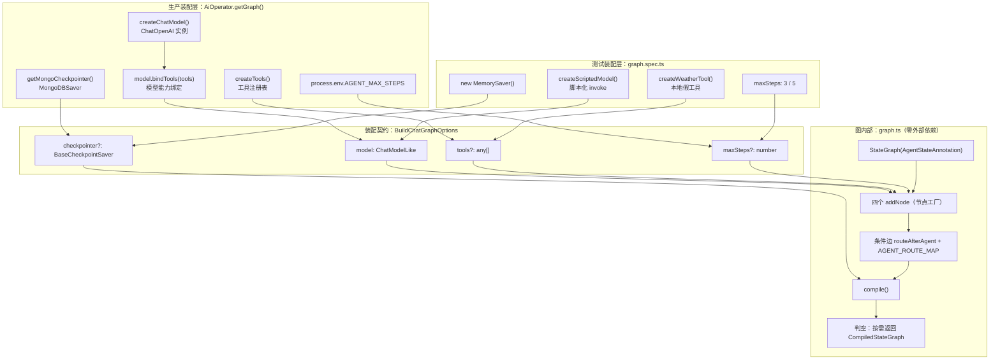
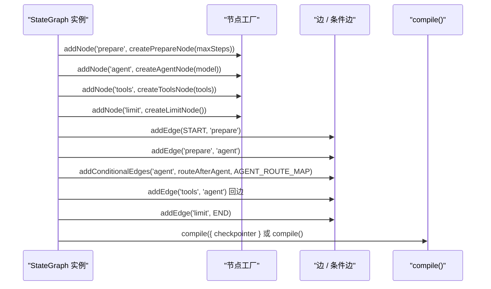

`nodes.ts` 定义了「节点做什么」，`edges.ts` 定义了「之后去哪里」，但这二者本身都还不是一张可运行的图。真正把四类节点、一条条件边、一个可选的持久化后端粘合成可执行对象的，是 `graph.ts` 里唯一的装配函数 `buildChatGraph`。本页聚焦这个装配点：**它接受哪四个依赖、`ChatModelLike` 这个最小接口为什么只需要一个 `invoke`、`tools` 为什么被同时传给模型和工具节点、以及「有/无 checkpointer」如何用一行三元表达式切换成两种运行模式**。节点内部读写契约见 [四类节点的职责：prepare / agent / tools / limit](6-si-lei-jie-dian-de-zhi-ze-prepare-agent-tools-limit)，条件判定顺序见 [条件边路由与步数上限：防止工具调用死循环](7-tiao-jian-bian-lu-you-yu-bu-shu-shang-xian-fang-zhi-gong-ju-diao-yong-si-xun-huan)，脚本化假模型的断言细节见 [脚本化假模型驱动图测试：循环、记忆与上限断言](23-jiao-ben-hua-jia-mo-xing-qu-dong-tu-ce-shi-xun-huan-ji-yi-yu-shang-xian-duan-yan)。

Sources: [graph.ts](be/src/ai/graph/graph.ts#L41-L59)

## 三层结构：图只认接口，不认实现

`graph.ts` 的 import 列表只有三样东西：LangGraph 的 `StateGraph` / `END` / `START` / `BaseCheckpointSaver`、本地的状态注解、以及节点与边的工厂。**它没有 import `ChatOpenAI`、`mongoose`、`dotenv`，也没有任何 `process.env` 读取**。这意味着装配函数是一个纯粹的「形状拼装器」——它决定拓扑，但不决定任何具体实现的来源。

Sources: [graph.ts](be/src/ai/graph/graph.ts#L1-L4)



这张分层图说明了本页的核心论点：**「让编排可测试」不是靠打桩库或模块 mock 实现的，而是靠装配函数的参数表**。测试只要提供四个参数的不同取值，就能在不碰生产代码的前提下得到完全不同行为的图——生产用真实模型与 Mongo 落库，测试用脚本化模型与内存落库，两者走的是同一段 `addNode` / `addEdge` 代码。

Sources: [graph.ts](be/src/ai/graph/graph.ts#L13-L59), [AiOperator.ts](be/src/ai/operator/AiOperator.ts#L29-L43), [graph.spec.ts](be/src/ai/graph/graph.spec.ts#L48-L56)

## 签名即契约：四个可注入依赖

`BuildChatGraphOptions` 一共四个字段，其中三个可选。它们的默认值与「谁来填」构成了完整的装配约定：

| 参数 | 类型 | 默认值 | 生产侧来源 | 测试侧替代 | 替换后改变的行为 |
|---|---|---|---|---|---|
| `model` | `ChatModelLike` | 无默认（必填） | `createChatModel()` 后 `.bindTools(tools)` | `createScriptedModel(script)` 按脚本返回 `AIMessage` | 决定「是否有工具调用 / 何时收工」 |
| `tools` | `any[]` | `[]` | `createTools()`（有 `TAVILY_API_KEY` 才非空） | `tool()` 构造的本地假工具 | 决定 `tools` 节点实际执行什么 |
| `checkpointer` | `BaseCheckpointSaver` | `undefined` | `getMongoCheckpointer()` | `new MemorySaver()` 或不传 | 决定是否编译出带短期记忆的图 |
| `maxSteps` | `number` | `8` | `Number(process.env.AGENT_MAX_STEPS ?? 8) \|\| 8` | 显式小数字（如 `3`） | 决定 `limit` 分支多早触发 |

Sources: [graph.ts](be/src/ai/graph/graph.ts#L13-L46), [AiOperator.ts](be/src/ai/operator/AiOperator.ts#L32-L43), [graph.spec.ts](be/src/ai/graph/graph.spec.ts#L22-L33)

一个容易被忽略的一致性细节：`maxSteps` 的「默认值」实际存在两个来源。装配函数的参数默认值是字面量 `8`，而状态注解里另有 `DEFAULT_MAX_STEPS = Number(process.env.AGENT_MAX_STEPS ?? 8) || 8`。由于 `prepare` 节点每次运行都会把 `maxSteps` 显式写回 state，一旦调用方不传这个参数，环境变量就会被装配层的字面量 `8` 覆盖；生产代码正是为此在 `getGraph()` 里显式传入环境变量值，而不是依赖默认值。

Sources: [graph.ts](be/src/ai/graph/graph.ts#L45-L46), [state.ts](be/src/ai/graph/state.ts#L20-L21), [state.ts](be/src/ai/graph/state.ts#L48-L51), [nodes.ts](be/src/ai/graph/nodes.ts#L18-L25), [AiOperator.ts](be/src/ai/operator/AiOperator.ts#L42)

## ChatModelLike：把模型缩小成一个方法

可测试性的关键一行不在 `graph.ts` 里，而在 `nodes.ts`：

```typescript
export interface ChatModelLike {
  invoke(messages: BaseMessage[], options?: unknown): Promise<AIMessage>;
}
```

这个接口只有 `invoke` 一个成员，第二个参数还刻意写成 `unknown`，从而不承诺任何 LangChain 的调用选项类型。`createAgentNode` 的整个模型交互面就是 `model.invoke([new SystemMessage(SYSTEM_PROMPT), ...history])` 这一句，所以接口只需要覆盖这一句。

Sources: [nodes.ts](be/src/ai/graph/nodes.ts#L6-L12), [nodes.ts](be/src/ai/graph/nodes.ts#L32-L44)

| 能力 | 真实 `ChatOpenAI` | `ChatModelLike` | 差异的含义 |
|---|---|---|---|
| `invoke` | ✅ 返回 `AIMessage` / 流式块 | ✅（唯一要求） | 图唯一用到的能力 |
| `bindTools` | ✅ | ❌ | 工具绑定被推到图外（`AiOperator`）完成 |
| `stream` | ✅ | ❌ | 当前图内不使用流式调用 |
| `bind` / `withStructuredOutput` | ✅ | ❌ | 编排层不需要 |

因为 TypeScript 是结构化类型系统，任何**形状兼容** `invoke` 的对象都自动满足 `ChatModelLike`，无需 `implements`、无需 Nest 的 provider token、也无需在 `AiModule` 里注册。这正是 `AiModule` 的 `providers` 只有 `AiService` 与 `AiOperator`、`imports` 为空的原因——模型不是容器里的一个 bean，而是图构建那一刻传进去的一个普通值。

Sources: [nodes.ts](be/src/ai/graph/nodes.ts#L10-L12), [ai.module.ts](be/src/ai/ai.module.ts#L6-L12), [graph.spec.ts](be/src/ai/graph/graph.spec.ts#L22-L33)

## tools 的双重身份：模型能力与执行能力

`buildChatGraph` 同时接收一个**已绑定工具的模型**和一个**工具数组**，这不是冗余，而是两个不同职责：

- 传给 `model` 的那一份让模型「知道」有哪些工具、因而可能产出 `tool_calls`（属于**模型能力**，在 `AiOperator` 里通过 `bindTools` 完成）；
- 传给 `tools` 参数的那一份交给 `createToolsNode` 内部的 `ToolNode`，负责**真正执行** `tool_calls` 并回灌 `ToolMessage`。

Sources: [AiOperator.ts](be/src/ai/operator/AiOperator.ts#L32-L35), [nodes.ts](be/src/ai/graph/nodes.ts#L50-L62)

两者都来自同一次 `createTools()` 调用，这个「单一注册表、两处消费」的结构消除了「模型能想到调用的工具、执行节点却没有」这类不一致——而这正是装配层而非节点层才能保证的约束。需要注意的是，装配函数对 `tools` 不做条件注册：即使数组为空，`tools` 节点仍然会被 `addNode` 进图；是否真的会走到它，完全由条件边依据最后一条消息是否带 `tool_calls` 决定。

Sources: [graph.ts](be/src/ai/graph/graph.ts#L50), [tools/index.ts](be/src/ai/tools/index.ts#L14-L27), [edges.ts](be/src/ai/graph/edges.ts#L16-L26)

## 装配顺序与节点名符号

装配函数体是一段链式调用，顺序本身就是拓扑定义：先四个 `addNode`，再三条前进边、一条条件边、一条回边、一条出口边。LangGraph 的图对象在 `compile()` 时才校验完整性，因此所有节点必须先登记、所有边再引用。



Sources: [graph.ts](be/src/ai/graph/graph.ts#L47-L58)

条件边是三参数形式：节点名、路由函数、以及**路径映射**。映射的意义在于把 `routeAfterAgent` 的三种可能返回值全部显式声明，让图的静态结构与路由函数的动态判定保持一致；少写一个目标，图就无法为那条分支找到落点。

| 声明位置 | 符号 | 值 | 备注 |
|---|---|---|---|
| `GRAPH_NODE.prepare` | 字面量 | `'prepare'` | 无外部引用 |
| `GRAPH_NODE.agent` | 字面量 | `'agent'` | 无外部引用 |
| `GRAPH_NODE.tools` | 复用常量 | `NODE_TOOLS` | 与路由目标共享同一符号 |
| `GRAPH_NODE.limit` | 复用常量 | `NODE_LIMIT` | 与路由目标共享同一符号 |
| `AGENT_ROUTE_MAP` | 计算键 | `tools` / `limit` / `END` | 必须覆盖路由函数全部返回值 |

这种「一半字面量、一半常量」的不对称是刻意的：`tools` 与 `limit` 同时出现在 `addNode` 与 `routeAfterAgent` 的返回值里，因此共享 `edges.ts` 导出的常量；`prepare` 与 `agent` 只作为边的端点出现，不参与条件判定，直接写字面量反而更短。改名 `NODE_TOOLS` 时路由与注册会一起变化，不会出现「注册成 A、路由到 B」的静默失效。

Sources: [graph.ts](be/src/ai/graph/graph.ts#L6-L11), [edges.ts](be/src/ai/graph/edges.ts#L5-L8), [edges.ts](be/src/ai/graph/edges.ts#L28-L33)

## 条件编译：一行三元决定两种运行模式

装配函数最后一行是全文件最有杠杆效应的一行：

```typescript
return checkpointer ? workflow.compile({ checkpointer }) : workflow.compile();
```

它把「是否需要跨请求持久化」变成了一个纯粹的装配期开关，而不是运行期分支。两种模式在调用侧的差异完全由 `thread_id` 是否有承载物决定：

| 模式 | 装配参数 | 跨请求记忆 | `configurable.thread_id` 的作用 | 使用场景 |
|---|---|---|---|---|
| 持久化 | `checkpointer: new MemorySaver()` 或 `MongoDBSaver` | 有 | 按 `thread_id` 隔离历史 | 测试第 1、2 例；生产 |
| 无持久化 | 不传 `checkpointer` | 无 | 无承载物，读不到上一轮 | 测试第 3 例；单轮场景 |

测试文件正好给出了两种模式的并置证据：前两个用例传入 `MemorySaver` 并在 `invoke` 时带 `{ configurable: { thread_id } }`，第二个用例因此在同一 `thread_id` 上读到上一轮历史、在换 `thread_id` 后上下文归零；第三个用例只传 `maxSteps: 3`，既不传 checkpointer 也不传 configurable，图依然完整跑完并返回最终状态中的 `stepCount`、`limit` 文案。**同一份装配代码，两种验证目标，零条件分支泄漏到节点里。**

Sources: [graph.ts](be/src/ai/graph/graph.ts#L58), [graph.spec.ts](be/src/ai/graph/graph.spec.ts#L48-L61), [graph.spec.ts](be/src/ai/graph/graph.spec.ts#L85-L113), [graph.spec.ts](be/src/ai/graph/graph.spec.ts#L115-L136)

## ChatGraph：类型从实现里推导

```typescript
export type ChatGraph = ReturnType<typeof buildChatGraph>;
```

这个类型没有手写 `CompiledStateGraph<...>` 的泛型参数，而是从实现反推。好处在调用侧显现：`AiOperator.runGraph(graph: ChatGraph, ...)` 的形参类型会自动跟随 `compile()` 的重载变化——若未来改成 `compile({ checkpointer, store })`，或 LangGraph 调整了编译产物类型，调用方无需逐个手改泛型。代价是类型细节（节点名、通道类型）被折叠成一个不透明的编译产物，需要时得回 `buildChatGraph` 看。

Sources: [graph.ts](be/src/ai/graph/graph.ts#L61), [AiOperator.ts](be/src/ai/operator/AiOperator.ts#L115-L122)

## 生产侧装配：composition root 在 AiOperator，不在 DI 容器

`AiOperator.getGraph()` 是这张图唯一的构造点，它按顺序完成四件事：取工具、建模型、绑工具、取 checkpointer，然后交给 `buildChatGraph`。由于 `createChatModel()` 是纯函数而非 Nest provider，模型本身也享受与测试模型完全相同的传参路径——**「可注入」发生在函数参数边界，而不是 DI token**。

Sources: [AiOperator.ts](be/src/ai/operator/AiOperator.ts#L29-L43)

| 注入风格 | 模型来源 | 图何时编译 | 测试成本 | 本项目取舍 |
|---|---|---|---|---|
| Nest provider DI（`@Inject(MODEL_TOKEN)`） | 容器解析 | 每次注入或构造期 | 需启动 `Test.createTestingModule` 或替换 provider | 未采用 |
| 工厂参数注入（`buildChatGraph({ model, ... })`） | 调用方直接传入 | 由调用方决定 | 直接 import 函数即可，无需容器 | 采用 |

装配过程还带有两级「一次性初始化」：`getGraph()` 用 `graphPromise` 缓存编译结果，`checkpointer.ts` 用 `checkpointerPromise` 缓存 saver（后者属于 [MongoDB Checkpointer：短期记忆的落库与读取](10-mongodb-checkpointer-duan-qi-ji-yi-de-luo-ku-yu-du-qu) 的讨论范围）。成功编译后 `graphPromise` 不再重建，因此**编译之后修改 `.env`（例如换 `MODEL_NAME`）不会生效，需要重启进程**；反之若编译失败（典型是缺 API Key），`catch` 会把缓存置空，补齐配置后下一个请求即可重试成功、无需重启。

Sources: [AiOperator.ts](be/src/ai/operator/AiOperator.ts#L27-L52), [checkpointer.ts](be/src/ai/graph/checkpointer.ts#L52-L63)

## 可测性的三个层次

把「可注入」落到测试上，本项目实际形成三个互不依赖的层次，越往下越便宜：

| 层次 | 被测对象 | 需要提供什么 | 能覆盖的问题 | 代码位置 |
|---|---|---|---|---|
| 纯函数 | `routeAfterAgent(state)` | 手搓一个 `AgentState` 字面量 | 三条分支的判定优先级 | `graph.spec.ts` 后半段 |
| 图级 | `buildChatGraph({ model, tools, checkpointer, maxSteps })` | 脚本化模型 + 假工具 + `MemorySaver` | 循环形状、上下文累积、上限触发 | `graph.spec.ts` 前半段 |
| 端到端 | `AppModule` + 真实模型 + Mongo | MongoDB 与环境变量 | 真实 HTTP 契约 | `test/app.e2e-spec.ts` |

路由函数的单测连图都不需要：`stateOf(messages, stepCount, maxSteps)` 构造一个结构相同的对象，断言返回值是 `END` / `NODE_TOOLS` / `NODE_LIMIT` 之一，因为路由函数只依赖 `state.messages`、`stepCount`、`maxSteps` 三个字段。这正是「节点只依赖最小接口」策略在纯函数上的对应收益。

Sources: [graph.spec.ts](be/src/ai/graph/graph.spec.ts#L139-L156), [edges.ts](be/src/ai/graph/edges.ts#L16-L26)

图级测试之所以能断言「循环了几轮」「模型看到了什么」，靠的是脚本化模型把每次 `invoke` 的入参累积到 `calls` 数组里——这是 `ChatModelLike` 只有一个方法带来的副作用式收益：模型可观测面被压缩成「调用次数 + 每次的消息列表」，断言因此可以写成 `expect(model.calls).toHaveLength(2)`、`expect(model.calls[1][3].getType()).toBe('tool')` 这样直接的形式。具体断言清单与脚本编写方式见 [脚本化假模型驱动图测试：循环、记忆与上限断言](23-jiao-ben-hua-jia-mo-xing-qu-dong-tu-ce-shi-xun-huan-ji-yi-yu-shang-xian-duan-yan)，系统提示词为何在每次调用时临时拼接见 [系统提示词工程：把身份与工具使用规则写进 Prompt](9-xi-tong-ti-shi-ci-gong-cheng-ba-shen-fen-yu-gong-ju-shi-yong-gui-ze-xie-jin-prompt)。

Sources: [graph.spec.ts](be/src/ai/graph/graph.spec.ts#L19-L33), [graph.spec.ts](be/src/ai/graph/graph.spec.ts#L63-L77)

## 装配期常见陷阱

| 现象 | 根因 | 处置 |
|---|---|---|
| `compile()` 或首次 `invoke` 报「目标节点不存在 / 无法路由」 | 条件边路径映射漏写了 `routeAfterAgent` 的某个返回值，或节点未 `addNode` | 保证 `AGENT_ROUTE_MAP` 覆盖 `NODE_TOOLS` / `NODE_LIMIT` / `END` 三项 |
| 第二轮对话 `stepCount` 不从 0 开始 | `prepare` 未挂在 `START` 之后的第一位；或 `maxSteps` 的 reducer 只取新值而未由 `prepare` 写回 | 保持 `START → prepare → agent`，并由 `prepare` 同时写入 `stepCount`、`toolCallCount`、`maxSteps` |
| 测试里仍然发出真实网络请求 | 把 `createChatModel()` 的实例直接传进 `buildChatGraph` | 传入满足 `ChatModelLike` 的脚本化对象即可，无需改动图代码 |
| 模型从不产出 `tool_calls`，`tools` 节点形同虚设 | 只把工具数组给了 `tools` 参数，忘了给模型 `bindTools` | 传「已绑定工具的模型」与同一份 `tools` 数组 |
| 改了模型名/温度后行为不变 | `graphPromise` 缓存了已编译的图，模型实例在编译时被闭包冻结 | 重启进程，或在不缓存图的调用方（测试）里重新装配 |
| `checkpointer` 传了但历史仍不连通 | `invoke` 时未在 `configurable.thread_id` 上给同一个值 | 由 `AiOperator` 统一传 `sessionId` 作为 `thread_id`（语义见 thread_id 生命周期一页） |

Sources: [graph.ts](be/src/ai/graph/graph.ts#L47-L58), [edges.ts](be/src/ai/graph/edges.ts#L28-L33), [nodes.ts](be/src/ai/graph/nodes.ts#L18-L25), [AiOperator.ts](be/src/ai/operator/AiOperator.ts#L27-L52), [AiOperator.ts](be/src/ai/operator/AiOperator.ts#L101-L122)

## 小结与阅读路径

`buildChatGraph` 之所以能同时服务生产与测试，靠的不是抽象层数，而是**把三个易变项（模型、工具、持久化）全部提到参数表里，把拓扑留在一个零环境依赖的函数里**。`ChatModelLike` 负责把模型压扁到可替换的宽度，`tools` 的双重消费保证能力与执行不脱节，`checkpointer` 的存在与否用一个三元表达式切换记忆模式，`ReturnType` 则把编译产物类型绑定在实现上。理解了这四条，再看测试文件就只是在读「同一段装配代码的四种参数组合」。

Sources: [graph.ts](be/src/ai/graph/graph.ts#L13-L61), [nodes.ts](be/src/ai/graph/nodes.ts#L6-L12)

接下来按依赖顺序推荐三页：先看 [系统提示词工程：把身份与工具使用规则写进 Prompt](9-xi-tong-ti-shi-ci-gong-cheng-ba-shen-fen-yu-gong-ju-shi-yong-gui-ze-xie-jin-prompt)，因为它是 `agent` 节点里唯一被注入到模型上下文的常量；再看 [MongoDB Checkpointer：短期记忆的落库与读取](10-mongodb-checkpointer-duan-qi-ji-yi-de-luo-ku-yu-du-qu)，理解生产模式下 `checkpointer` 参数实际接的是什么；最后读 [脚本化假模型驱动图测试：循环、记忆与上限断言](23-jiao-ben-hua-jia-mo-xing-qu-dong-tu-ce-shi-xun-huan-ji-yi-yu-shang-xian-duan-yan)，把本页的四个参数组合变成可执行的断言。