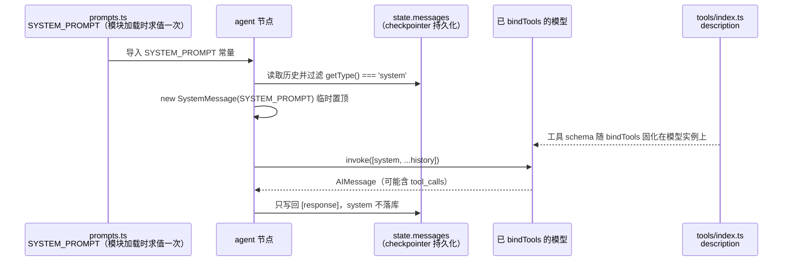

`be/src/ai/graph/prompts.ts` 只有 21 行，却承担着一项极易被低估的工作：它决定了模型在一轮对话里**何时该动手调工具、何时不该**。本页聚焦这三件事——提示词由谁构造、在什么时机被塞进上下文、以及它与工具定义、状态字段之间的真实耦合关系。图中其余节点的编排逻辑请见 [四类节点的职责：prepare / agent / tools / limit](6-si-lei-jie-dian-de-zhi-ze-prepare-agent-tools-limit)；工具注册表本身的设计取舍见 [工具注册表：工具描述即 Prompt，可选工具的条件启用](14-gong-ju-zhu-ce-biao-gong-ju-miao-shu-ji-prompt-ke-xuan-gong-ju-de-tiao-jian-qi-yong)。

Sources: [prompts.ts](be/src/ai/graph/prompts.ts#L1-L21)

## 一、Prompt 的三个来源：别把「提示词」理解成一个字符串

在这套实现里，模型每次看到的「指令性上下文」并非单一常量，而是由三条独立来源拼装而成，它们各自负责不同的决策面向。理解这一点是读懂后续所有设计的前提。

| 来源 | 产物 | 影响的决策 | 代码位置 |
|---|---|---|---|
| 系统提示词 | 身份 + 行为准则字符串 | 该不该调工具、答什么语言、错误怎么办 | `prompts.ts` |
| 工具定义（`description` / `schema`） | 由 `bindTools` 注入的 JSON Schema | 调哪个工具、参数怎么填 | `tools/index.ts` + `AiOperator` |
| 运行时消息 | `HumanMessage`（含附件转换后的内容） | 本轮具体要回答什么问题 | `AiOperator.runGraph` |

Sources: [prompts.ts](be/src/ai/graph/prompts.ts#L7-L20), [index.ts](be/src/ai/tools/index.ts#L1-L27), [AiOperator.ts](be/src/ai/operator/AiOperator.ts#L32-L43)

下图的时序说明了一次「模型推理步」中，这三条来源如何汇聚到同一次 `invoke` 调用：

这个时序里有两个不显眼但关键的事实：系统提示词**不进入**消息历史，而工具描述**不进入**系统提示词。前者解决的是历史膨胀，后者意味着「工具能力」与「工具使用策略」被刻意分居两处。

Sources: [nodes.ts](be/src/ai/graph/nodes.ts#L32-L44), [AiOperator.ts](be/src/ai/operator/AiOperator.ts#L35)

## 二、逐条解读四条行为准则

`buildSystemPrompt` 用模板字符串组装出一段带 `trim()` 的文本，结构上是「身份声明」+「四条编号准则」。身份部分并非写死的字面量，而是从 `AdminUser` 类型对象插值生成——`用户名` 与 `角色` 两个字段分别取自 `user.username` 与 `user.role`，后者在类型层面被约束为字面量 `'admin'`。

Sources: [prompts.ts](be/src/ai/graph/prompts.ts#L7-L12), [state.ts](be/src/ai/graph/state.ts#L8-L18)

四条准则各自对应一类可观测的失败模式，而不是泛泛的「你是一个有帮助的助手」：

| 准则 | 原文要点 | 防御的失败模式 |
|---|---|---|
| 1 | 需要实时信息（新闻、天气、最新数据）时**先调用搜索工具，再基于结果回答** | 该查不查：模型凭训练数据编造时效性答案 |
| 2 | 不需要外部信息时直接回答，**不要为了调用工具而调用工具** | 滥用工具：每次对话都触发一次搜索，拉高延迟与 token |
| 3 | 工具返回错误时先判断是**参数问题还是工具不可用**，必要时换一种方式**重试一次** | 一次失败就放弃，或无限重试 |
| 4 | 简体中文、简洁准确、**引用搜索结果时说明来源** | 语言漂移、以及把工具输出伪装成自身知识 |

准则 3 与 `tools` 节点的错误处理策略是配套的：`ToolNode` 抛出的错误会作为 `ToolMessage` 回灌给模型，图不会中断，这正是准则 3 里「重试一次」得以可行的前提。而「重试一次」这个上限又是 soft constraint——真正的硬约束由 `maxSteps` 与 `limit` 节点承担。

Sources: [prompts.ts](be/src/ai/graph/prompts.ts#L13-L18), [nodes.ts](be/src/ai/graph/nodes.ts#L46-L62)

## 三、关键设计：Prompt 为何被挡在消息历史之外

这是本页最值得抄走的一处工程决策。`createAgentNode` 先对 `state.messages` 做一次 `filter`，剔除所有 `getType() === 'system'` 的消息，再把新构造的 `SystemMessage` 拼在最前面；返回值里只包含 `[response]`，不含那条 system 消息。

Sources: [nodes.ts](be/src/ai/graph/nodes.ts#L27-L44)

对比两种常见写法，差异立刻显现：

| 维度 | 把 system 写进 state（未采用） | 每次调用临时拼装（本仓库采用） |
|---|---|---|
| checkpoint 内容 | 每轮累积一条 system 消息 | 只有 human / ai / tool 三类 |
| 第 N 轮上下文长度 | O(N) 条重复 system，持续放大 token | 恒定 1 条 system |
| 提示词热更新 | 需要清理历史才能生效 | 改代码重启即可，历史无需迁移 |
| 多节点共享 | 需额外去重逻辑 | 天然幂等：每步重建 |

`nodes.ts` 的注释把动机写得很清楚：避免 checkpoint 里堆积重复的 system message。注意 `filter` 这一步并非多余——它保证即使历史里意外残留 system 消息（例如未来某条分支写入），也不会与本次拼装的提示词形成双重指令冲突，是一个防御性的幂等处理。

Sources: [nodes.ts](be/src/ai/graph/nodes.ts#L27-L38)

单元测试从「消息条数」这一侧面固化了该契约：第一轮调用的入参长度断言为 2（system + human），工具回灌后第二轮断言为 4（system + human + ai(tool_calls) + tool），第二轮跨 thread 复用历史时断言为 6。一旦有人把 system 消息写进 state，这些长度断言会成组失败。

Sources: [graph.spec.ts](be/src/ai/graph/graph.spec.ts#L58-L113)

## 四、身份的两处真源：参数化接口与静态常量的分离

`prompts.ts` 同时导出了两个符号：可接收 `AdminUser` 参数的 `buildSystemPrompt(user = ADMIN_USER)`，以及在模块加载时立即求值一次的 `SYSTEM_PROMPT = buildSystemPrompt()`。全仓库只有 `nodes.ts` 引用 `SYSTEM_PROMPT`，没有任何调用点传入自定义用户。

Sources: [prompts.ts](be/src/ai/graph/prompts.ts#L7-L20), [nodes.ts](be/src/ai/graph/nodes.ts#L4)

这里存在一处需要读者明确知道的**解耦事实**：`prepare` 节点每轮会把 `state.user` 复位成 `{ ...ADMIN_USER }`，但 `agent` 节点构造提示词时**并不读取 `state.user`**，用的是模块级默认值。也就是说，当前 `state.user` 只经由 `runGraph` 原样回传给 HTTP 响应，并未参与提示词渲染。若将来要做多用户，改动点不是 `state.ts`，而是 `createAgentNode` 里那一行 `new SystemMessage(SYSTEM_PROMPT)`——把它换成 `new SystemMessage(buildSystemPrompt(state.user))` 即可。`AdminUser` 类型与 `buildSystemPrompt` 的默认参数，正是为这一步预留的接缝。

Sources: [nodes.ts](be/src/ai/graph/nodes.ts#L18-L44), [state.ts](be/src/ai/graph/state.ts#L14-L18), [AiOperator.ts](be/src/ai/operator/AiOperator.ts#L129-L139)

## 五、Prompt 与工具注册表的联动：优雅降级

准则 1 明写「先调用可用的搜索工具」，但搜索工具是**条件注册**的：只有存在 `TAVILY_API_KEY` 时才把 `TavilySearch` 推进工具数组，否则返回空数组。`AiOperator` 拿到空数组时不会调用 `bindTools`，模型实例因此没有可调用的工具。

Sources: [index.ts](be/src/ai/tools/index.ts#L12-L27), [AiOperator.ts](be/src/ai/operator/AiOperator.ts#L32-L35)

这带来一个必须承认的粗糙面：**提示词是静态的，工具集是动态的**。未配置 Key 时，提示词仍在说「先调用可用的搜索工具」，而模型实际无工具可调。工程上它仍能跑通（模型直接回答），因为措辞用了「可用的」这一限定词，但这是靠自然语言的模糊性兜底，而非结构化保证。若要让二者严格一致，需要把工具数量作为参数传进 `buildSystemPrompt`——当前实现未做这一步。

Sources: [prompts.ts](be/src/ai/graph/prompts.ts#L14), [index.ts](be/src/ai/tools/index.ts#L17-L24)

同样的边界也出现在「工具描述即 Prompt」上：`TavilySearch` 的 `description` 由库自带，仓库只配置了 `maxResults: 3` 与 `searchDepth: 'basic'`。这两个参数不改变模型决策，只改变单次检索的成本与召回规模。

Sources: [index.ts](be/src/ai/tools/index.ts#L17-L24)

## 六、提示词之外的两类「面向模型的文案」

除系统提示词外，还有两处文本会直接影响模型行为，容易被误当成普通字符串。第一处是 `limit` 节点兜底时构造的 `AIMessage`，它把「达到最大推理步数（N 步）」与「请把问题拆小一些」写进对话，既告知用户，也让后续轮次的历史里留下一次明确的自我说明。第二处是 `routeAfterAgent` 的判定完全基于结构（`tool_calls.length` 与 `stepCount >= maxSteps`），不依赖模型对提示词的理解——这是本设计的核心安全哲学：**策略写在 Prompt 里，兜底写在代码里**。

Sources: [nodes.ts](be/src/ai/graph/nodes.ts#L64-L78), [edges.ts](be/src/ai/graph/edges.ts#L16-L26)

这一点值得单独强调，因为它是提示词工程的边界意识：凡是「模型可能在压力下不遵守」的规则，都必须在图结构层面有等价实现。准则 2 说「不要为了调用工具而调用工具」（软约束），`maxSteps` 与 `limit` 提供硬截断；准则 3 说「重试一次」（软约束），`stepCount` 累加负责最终止损。

Sources: [prompts.ts](be/src/ai/graph/prompts.ts#L15-L16), [state.ts](be/src/ai/graph/state.ts#L20-L21), [graph.ts](be/src/ai/graph/graph.ts#L41-L59)

## 七、自检清单：调整提示词前后该验证什么

| 检查项 | 验证方式 | 对应代码 |
|---|---|---|
| Prompt 未混入消息历史 | 断言每次 `invoke` 的 `messages[0].getType() === 'system'`，且 state 中 system 数量为 0 | `nodes.ts` L35-L38 |
| 工具确实被触发 | 观察 `toolCallCount > 0` 与日志中的 `tool_calls` | `nodes.ts` L57-L60 |
| 未滥用工具 | 简单问题下 `stepCount === 1` | `edges.ts` L23 |
| 提示词内容本身 | 当前**无任何断言覆盖提示词文本**，改动只能靠端到端观察 | `graph.spec.ts` L69-L76 仅断言条数 |
| 无工具配置时不崩 | 移除 `TAVILY_API_KEY` 后仍能返回答案 | `tools/index.ts` L17-L24 |

最后一行是当前测试覆盖的真实缺口：`graph.spec.ts` 断言了系统消息的**位置与条数**，却从未断言其**内容**，因此提示词措辞的回归无法被自动化捕获。若要补一条测试，最小成本是在 `createScriptedModel` 的 `calls[0][0]` 上断言 `content` 包含关键准则片段。

Sources: [graph.spec.ts](be/src/ai/graph/graph.spec.ts#L19-L33), [graph.spec.ts](be/src/ai/graph/graph.spec.ts#L69-L76)

## 延伸阅读

提示词中「先调工具、再基于结果回答」这一约定，其执行效果依赖条件边的路由判定，详见 [条件边路由与步数上限：防止工具调用死循环](7-tiao-jian-bian-lu-you-yu-bu-shu-shang-xian-fang-zhi-gong-ju-diao-yong-si-xun-huan)；提示词如何被注入一个可替换的模型接口，详见 [图组装与可注入模型接口：让编排可测试](8-tu-zu-zhuang-yu-ke-zhu-ru-mo-xing-jie-kou-rang-bian-pai-ke-ce-shi)；而 `description` 层面的工具工程与条件启用策略，见 [工具注册表：工具描述即 Prompt，可选工具的条件启用](14-gong-ju-zhu-ce-biao-gong-ju-miao-shu-ji-prompt-ke-xuan-gong-ju-de-tiao-jian-qi-yong)。